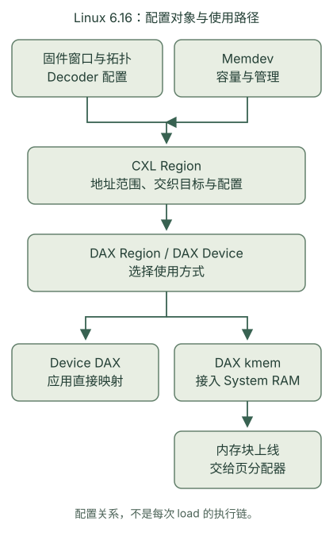

# Linux CXL：从发现设备到应用可用内存

看到 CXL 设备，不等于页分配器已经能使用它。Linux 要把平台窗口、设备容量和地址路由组织成可用区域，再选择交给 DAX 或 System RAM。

本页采用 **Linux 6.16 文档基线**，解释对象关系，不把它当作所有发行版和最新内核的操作手册。未提供需要真实硬件验证的容量修改命令。

## 两条路径不要混淆

设备发现路径回答“有哪些端口和内存设备”；内存接入路径回答“哪些地址由这些设备共同提供”。典型 ACPI 平台通过 CEDT 等固件信息描述主机桥和固定内存窗口，驱动再建立对应对象。

这是配置关系示意，不是每次读写的运行路径。普通访问不需要逐层调用这些软件对象。

## 每个对象回答一个问题

| 对象 | 要核对的内容 | 单独出现时还不能证明什么 |
| --- | --- | --- |
| Memdev | 设备容量、介质模式、管理能力 | 已有主机可访问地址范围 |
| Decoder | 窗口、目标、交织和端点地址转换 | 所有层级配置已经一致 |
| CXL Region | 哪个范围由哪些目标共同提供 | 已经上线为普通 RAM |
| DAX Device | 可直接映射的设备内存范围 | 已进入普通页分配器 |
| System RAM 内存块 | 是否成功接入并上线 | 应用一定按预期 NUMA 策略使用 |

区域可来自固件预配置，也可由软件构建。不能假设每台机器都必须先执行同一条 create-region 命令。对象职责和两条 DAX 路径依据 [Linux 6.16 CXL Driver Operation](https://docs.kernel.org/6.16/driver-api/cxl/linux/cxl-driver.html)。

## 一个“容量没有增加”的诊断顺序

假设设备报告了 256 GiB，但系统可分配内存没有增加。这个数字是构造案例。

先检查设备与端口是否完整枚举；再检查固件是否提供足够窗口，decoder 与 region 是否匹配、提交；随后确定区域是否仍以 Device DAX 提供，还是准备接入 System RAM；最后检查内存块是否上线以及 NUMA 归属。

每一步都能解释同一个表面现象。直接把设备报告容量加到系统 RAM 总量上，会把尚未接入、保留或按其他模式使用的容量也算进去。

## 上线成功后，还要验证用途

Device DAX 面向显式映射；System RAM 面向内核页分配。应用分配到哪里仍受 NUMA 策略、页分配和迁移行为影响。性能测试应记录区域、NUMA 节点、线程绑定和实际页位置，不能只记录设备型号。

缩容与移除不是上线的简单逆序。不可迁移或被长期固定的页可能阻止下线；应用映射和设备访问也需要退出。条件见[错误与生命周期](../05-performance-reliability/memory-errors-and-lifecycle.md)。cxl-cli 属于独立发布的工具，若开展操作实验，还需记录它的版本和实际命令输出。
