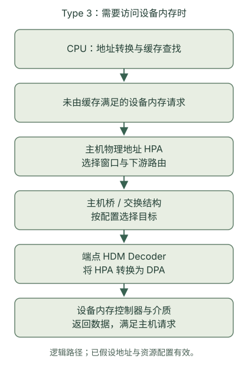

# Type 3 内存访问：从主机地址到设备地址

CXL Type 3 设备可把设备内存暴露给主机。CPU 对已映射区域执行普通内存访问，但数据是否到达 CXL 链路、去哪个设备、访问设备的哪个位置，分别由缓存层次和地址配置决定。

## 从一次缓存未命中的读取开始

前提是设备和链路已就绪，平台已建立有效内存窗口及 decoder 配置，操作系统允许应用访问该区域。CPU 先通过页表得到地址，并查找缓存；缓存命中可以直接返回。只有需要访问下层设备内存时，才沿下面的逻辑路径前进。

HDM 是 Host-Managed Device Memory。Linux 将 decoder 分为 root、switch、endpoint 等角色：中间级主要负责路由，端点完成设备地址转换。root decoder 是平台窗口的软件表示，不能把所有软件对象都画成一块相同的硬件。[Linux 6.16 CXL 驱动文档](https://docs.kernel.org/6.16/driver-api/cxl/linux/cxl-driver.html)给出了这些对象的关系。

## 两路交织的可手算例子

以下是构造映射，不是通用 CXL 编程公式。设一个连续窗口从 HPA 基址 H 开始，两个目标轮流承接 256 B 数据块；两端点 DPA 基址均为 0，没有其他交织层、地址异或或容量空洞。令窗口内字节偏移 o=HPA−H，粒度 G=256 B。

**目标编号 = ⌊o/G⌋ mod 2**

**DPA = ⌊o/(2G)⌋ × G + (o mod G)**

| 窗口内偏移 o | 目标 | 目标内 DPA |
| --- | --- | --- |
| 0x000 | 0 | 0x000 |
| 0x100 | 1 | 0x000 |
| 0x200 | 0 | 0x100 |
| 0x340 | 1 | 0x140 |

两个端点都能使用 DPA=0，它们代表不同设备中的不同位置。每端点承接一半窗口容量，不是每个端点都需要完整窗口大小。真实平台必须按每级 decoder、交织算法、DPA 分配和地址规范化规则求解；多层交织不能直接套这个二路公式。

## 三种地址不能混写

应用虚拟地址由 CPU 页表映射。HPA 用于主机侧访问和路由。DPA 是设备内部的地址空间。某些平台还存在系统地址与组件地址之间的规范化，因此本文只在示例内假设主机侧地址可直接作为 HPA。

CXL 内存也不是“把一大块 BAR 当普通 RAM”。CXL.io 的寄存器与配置访问、设备发起 DMA 的 IOVA 转换、CPU 访问 HDM 的地址路径，分别属于不同机制。把它们画成同一个 IOMMU 方框会隐藏配置责任。

地址能路由到设备，还不表示应用已经获得可用内存。下一步是[Linux region 与内存接入](cxl-linux-regions-and-memory.md)。
