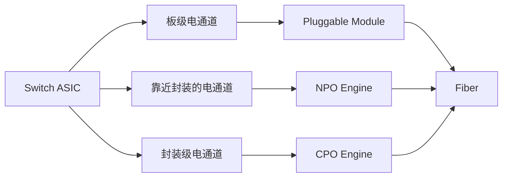

# CPO 分类框架

上级：[01 概览与问题定义](./README.md)

相关：[封装与集成路线](../03-architecture-platform/packaging-routes.md)、[产业链与角色](../02-industry/value-chain.md)

## 为什么要先分类

学习 CPO 最容易混淆的地方，是把下面几种维度混在一起：

- 系统位置
- 光电集成深度
- 激光器放置方式
- 光引擎实现技术
- 厂商平台名称

更稳妥的办法，是按正交维度拆开。

## 维度一：按系统位置分

- `Pluggable optics`：光模块可以插拔；它通常位于前面板或板边，但“可插拔”描述的是替换方式，本身不限定距离。
- `NPO / Near-packaged optics`：光引擎靠近主 ASIC 封装。产品可以使用不同的基板、插座和可替换单元。
- `CPO / Co-packaged optics`：光引擎与主 ASIC 在封装层级紧密集成；应注明双方是否直接装在同一基板，以及各自是否还有独立封装。
- `OBO / On-Board Optics`：板载光学，光模块或引擎位于板上，不一定与 ASIC 共封装。参见 [COBO On-Board Optics Specification 1.1](https://www.advanced-photonics.org/_files/ugd/7bc1dc_b061c0efc5a04d5cb4451ecc450f0817.pdf)。
- `Optical I/O`：光输入/输出的功能描述，可以采用板载、封装内 chiplet 等不同位置；它不等于 OBO。文献中的 `OIO` 缩写可能因作者而异，应核对原文，此处避免把它固定解释为板载光学。

这些名称在不同资料中可能重叠。尤其不能只靠“同一封装”判断：它可能指同一个裸片封装，也可能指包含多个已封装器件的共同组件。[OIF 2022 共封装框架](https://www.oiforum.com/wp-content/uploads/OIF-Co-Packaging-FD-01.0.pdf)以器件和主 ASIC 安装在同一第一级基板为共封装的基本说明，又在示例中将已封装 ASIC 和引擎插在共同基板的布局称为插座式 NPO。阅读时应说明采用的来源、基板层级和连接关系，不能假定 CPO 与 NPO 是所有文献中互斥的类别。

## 维度二：按光源位置分

- `External laser source`：激光器在封装外，光通过光纤或波导送入封装
- `On-package laser`：激光器位于封装内或封装上，具体边界由产品定义
- `Remote laser + local modulation`：远端光源提供连续光，本地调制器把数据调到光上；这是外置光源的一种实现

光源位置会影响热、可靠性、可维护性和安全边界，但不能单独决定这些指标。外置光源可能降低其与 ASIC 的热耦合，也会增加供光、分光、连接和冗余设计。

## 维度三：按光引擎技术分

- `Silicon photonics`：以硅光波导、调制器和耦合结构为核心
- `InP / III-V`：常用于激光器或部分有源器件
- `Hybrid / heterogeneous integration`：把硅光与 III-V、CMOS driver/TIA 组合

不要把“硅光”直接等同于 “CPO”。硅光是器件和工艺路线，CPO 是系统级集成方式。

## 维度四：按封装关系分

- 交换 ASIC 与光引擎分芯片封装后再同板集成
- 多个光引擎围绕交换 ASIC 共封装
- ASIC、driver、TIA、硅光、耦合结构分层或分区集成

这一维度更接近先进封装视角。

## 维度五：按厂商方案名分

- Broadcom、Cisco、Marvell、NVIDIA、Intel 等厂商会给出各自平台表述
- 光引擎、硅光、交换芯片、封装、激光器供应商往往不是同一家公司

厂商名字只适合最后记，不适合作为第一层学习框架。

## 一句话记忆法

先问“光电转换放在哪里”，再问“激光器放哪里”，再问“光引擎怎么做”，最后再看“谁家的商品名”。

## 快速对照表

| 名称 | 常见布局 | 值得检查的收益 | 必须另行确认 |
| --- | --- | --- | --- |
| 前面板可插拔模块 | ASIC 经板级电通道连接模块 | 模块可独立替换 | 实际电损耗、模块功率和面板密度 |
| NPO | 光引擎靠近 ASIC 封装 | 可能缩短电通道 | 基板层级、插座和可替换单元 |
| CPO | 主 ASIC 与光引擎在封装层级集成 | 可能降低电段代价或提高密度 | 热、光损耗、测试覆盖及维修粒度 |

表格描述常见情况，不给出普遍的长度、热或维修性排序。具体产品可能同时符合多个名称的描述。

## 一张图看关系

