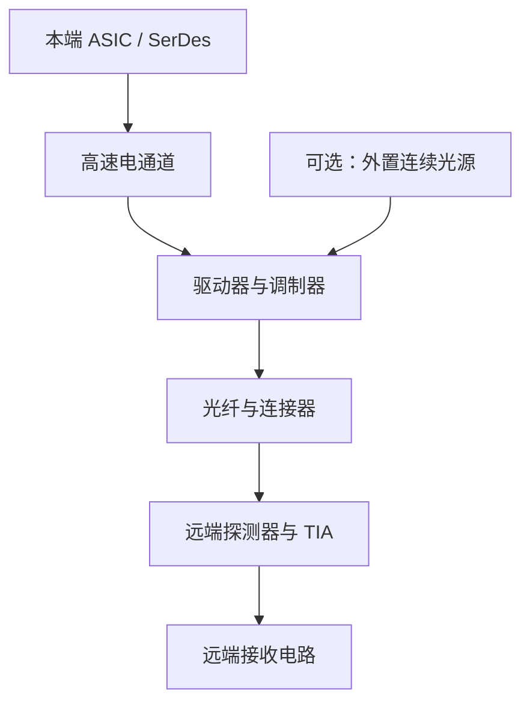

# 系统栈与接口位置

上级：[03 系统架构与集成平台](./README.md)

相关：[CPO 在解决什么问题](../01-overview/problem-statement.md)、[光链路基础](../04-optical-engine/optical-link-basics.md)

## 从交换芯片往外看

可以把一条高速链路抽象成：

本端 ASIC → SerDes → 电通道 → 驱动器 → 调制器 → 光纤 → 远端探测器 → TIA → 远端电接口

SerDes 做串并转换；driver 驱动调制器；远端 detector 把光转为电流，TIA 再将电流转为电压。retimer 可恢复并重发信号，gearbox 可重组通道或速率，是否使用取决于具体链路。采用外置 CW 光源时，另有一条供光支路送未调制光至本端调制器；它不是数据接收支路。

不同方案的差异，主要在于光电转换发生在这条链路的什么位置。

## Pluggable 的位置

在 pluggable optics 里：

- 交换芯片先把高速电信号拉到板边或前面板
- 经过连接器、走线、可能的 retimer/gearbox
- 最后进入模块做 E/O 或 O/E 转换

这种布局通常包含从 ASIC 到板边的电通道。其损耗、均衡需求和功耗取决于实际走线、连接器及接口实现。

## CPO 的位置

在 CPO 里：

- 交换芯片附近就完成电光转换
- 高速电路径更短
- 光纤更早进入系统链路

系统本质变化是：原本“芯片到模块”的电通道，变成更短的“芯片到光引擎”的电通道。

例如，包长和单方向有效速率相同、端口配置不变时，缩短电段可能降低链路能量，但不会仅因此提高每包服务率。模型分别计入路径长度与群速度决定的传播时延、包长除以该方向有效速率的序列化时延，以及实际启用器件的处理时延和能耗。

## CPO 不只是少走一点线

它同时影响：

- 封装引脚分配
- substrate / interposer / bridge 设计
- 电源分配与噪声控制
- 散热器结构
- 光纤引出方式
- 可维护性与更换策略

## 关键判断问题

看一个方案是不是更接近 CPO，先问：

1. 高速电通道缩短到了什么程度
2. driver/TIA 在哪里
3. 光引擎与 ASIC 的热耦合有多强
4. 光纤是如何从封装或板上引出的

## 一张图看系统位置

下图只示意一个发送方向。接收方向从光纤经探测器、TIA 和接收电路回到 ASIC。外置连续光源是可选的供光支路；其他实现可以使用集成光源或直接调制激光器。

前面板模块方案通常把调制器放在板边；共封装方案把光引擎移到封装级。图没有规定器件必须位于同一芯片，也没有给出具体距离或功耗。

## 快速对照表

| 比较问题 | 需要固定的条件 |
| --- | --- |
| 电段是否缩短 | ASIC 和光引擎的位置、走线、连接器与信道损耗 |
| 能耗是否降低 | 双端器件、光源、控制和冷却的功率边界，以及有效吞吐 |
| 故障后换什么 | 光源、引擎、封装和整机的可替换单元 |
| 是否满足温度限制 | 热源位置、散热器、光纤出口及器件工作窗口 |

这些条件比名称更适合用来比较具体方案；[分类框架](../01-overview/taxonomy.md)说明名称可能重叠的情况。
