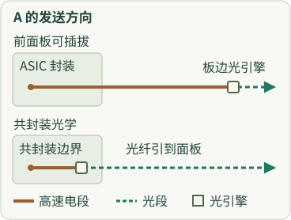
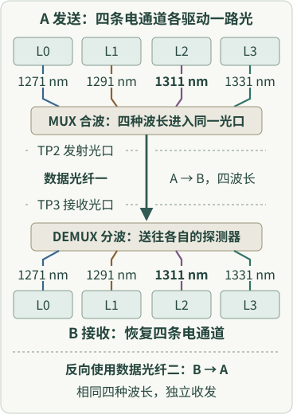

# 一个比特怎样从电路进入光纤，再回到电路？

上级：[光引擎与核心器件](README.md)

交换芯片 A 的一条电通道连续发出 0、1、0。光纤的另一头，交换芯片 B 要在三个相应的时刻读出 0、1、0。电压加在 A 的电路上，B 与 A 之间接的是玻璃光纤。中间那个 1 究竟由什么携带？

先只跟一条通道。本例让激光器持续供光，让电路控制光的强弱。B 把收到的光功率变化变成电流变化，再变成电压变化，最后作出一次判决。沿这条路看一遍，再把四条通道放进同一根光纤，就能回答一个测量问题：在共用的光口上说“每通道收到多少光”，到底量什么？

## 共封装缩短的是哪一段？ {#electrical}

先把手指停在 A 的高速串行电接口，也就是 SerDes 的输出。此时，那个 1 表现在一对导体之间的电压随时间如何变化。使用前面板可插拔模块时，信号通常要从 ASIC（这里的交换芯片）经板级走线和连接器走到模块，模块再做电光转换。高频电信号沿这段路传播会衰减，连接处也会产生反射。电接收端能分辨的电平和可采样的时间随之受限。

**共封装光学（CPO）把光引擎与 ASIC 在封装层级集成。** 在这个例子中，A 到光引擎的高速电连接缩成了封装内的一段；从光引擎到前面板可改用光纤引出。B 的接收方向同理。较短的电段给插入损耗和均衡省出空间。两个机箱之间的距离没变，光源、调制器和探测器也仍要消耗能量或引入损耗。若只换集成位置，保持端口数和符号速率不变，单位时间内能发出的符号数仍相同。[OIF 共封装框架](https://www.oiforum.com/wp-content/uploads/OIF-Co-Packaging-FD-01.0.pdf) · [串行电通道与接收采样](../../SERDES/01-overview/link-end-to-end.md)

## 激光一直亮着，那个 1 怎样上去？ {#modulation}

本例选择外调制。发送端有两条输入：光源送来选定波长的连续光，驱动器根据电通道的数据给出随时间变化的电压。两者在调制器相遇。只接通激光、保持驱动电压不动，输出会保持在同一光功率附近，这时即使光很强，也没有传出那组三个符号。连续光源可以外置，经单独的供光路径进入封装。供光路径与下面承载数据的光纤各有用途。

为什么电压能改变光功率？举一种实现，马赫–曾德尔调制器把同一束光分进两条波导，再让它们汇合。驱动电压改变其中一臂的有效折射率，光通过这段波导时累积的相位随之改变。两路光到达汇合处，电场叠加。相位较为一致时，选定输出口的光功率较高；相位更趋相反时，该口功率较低。把工作点和驱动摆幅调好，就能让两个电输入状态对应两个光功率水平。实际还有其他调制器，也有直接调制激光器的方案。[硅基调制器中的相位调制与干涉](https://www.photonics.intec.ugent.be/download/pub_4874.pdf)

本例用二电平信号。设 0 对应较低光功率，1 对应较高光功率，则 A 的 0、1、0 变成同一波长上连续三个符号时段的低、高、低。低电平时允许仍有光。驱动电压摆幅、调制器偏置或温度漂移如果使两个光功率水平靠得太近，远端判断会更难。光电转换发生在哪里，和两个水平到底相差多少，是要分别回答的问题。

## 四条电通道怎样共用一根光纤？ {#wavelengths}

把 A 的四条发送电通道编号为 L0 至 L3。为给映射一个可查的实例，下面采用 **100G CWDM4 Rev. 1.1** 的四波长光接口，假设共封装光引擎对外提供这样的光口。CWDM4 规定这里用到的线侧接口，本例自行选择共封装布局；它没有规定光引擎必须安放在芯片旁。四条光通道的符号速率各为 25.78125 GBd。按二电平调制，每个符号承载一个线路比特，四路合计 103.125 Gb/s。用户数据还要经过编码和纠错，线路速率与应用吞吐有不同口径。[CWDM4 规范 §1.1、§1.7 和表 2-1 至 2-3](https://www.cwdm4-msa.org/wp-content/uploads/2015/12/CWDM4-MSA-Technical-Spec-1p1-1.pdf#page=6)

沿图中 **L2** 追一次。A 的第 2 号电通道只驱动分配给它的 1311 nm 光通道。另三路也可以同时发送各自的比特。发送端用波分复用器（MUX）把四种波长合到同一根单模光纤。四路可以在同一时刻通过，靠波长区分。一根光纤里现在有四组独立变化的光功率。

到了 B，波分解复用器（DEMUX）先把各波长导向各自的探测器。B 上对应 1311 nm 的探测器才负责 L2。如果直接用一个宽带探测器接整根光纤，它得到的是各路功率共同产生的电流。只看这个电流，无法判断刚才是 L2 变亮还是另一路变亮。B 若要同时回复 A，使用第二根数据光纤，方向从 B 到 A，仍可使用这四种波长。因此每个方向各有四个波长通道，收发共用一对数据光纤。外置光源若另有供光纤，需单独计数。[CWDM4 规范图 1-1 与表 2-1](https://www.cwdm4-msa.org/wp-content/uploads/2015/12/CWDM4-MSA-Technical-Spec-1p1-1.pdf#page=4)

## 光到达 B 后，谁认得那个 1？ {#receiver}

观察 1311 nm 那一路。光子在对这个波长有响应的半导体中被吸收，可以激发出电子和空穴。光电二极管结区的电场把载流子分开，外电路里因此有光电流。单位时间内到达并被有效吸收的光子数增加，在线性范围内，光电流也相应增加。读者如果想跟踪电子如何在结区电场中运动，可以接着读[《从电子到二极管》](../../../semiconductor-foundations/electrons-to-diode/README.md#reverse)。[滨松光子学对光通信探测器的说明](https://www.hamamatsu.com/content/dam/hamamatsu-photonics/sites/documents/21_HPE/featured-products-and-technologies/meeting-optical-communication-demands.pdf)

看一个有单位的例子。假设在 **B 的探测器有源面**，这个符号从低光功率升到高光功率，二者相差 **100 µW**。设该波长的响应度为 0.8 A/W，即每多入射 1 W，在线性模型中多产生 0.8 A。则光电流变化量为 **0.8 A/W × 100 µW = 80 µA**。跨阻放大器（TIA）把电流变化转成电压变化。若跨阻增益的幅值取 1 kΩ，低频线性估计给出输出变化幅值 **1 kΩ × 80 µA = 80 mV**。反相接法可使输出电压下降，接收电路按自己的极性识别两种电平。三个数字说明的是变化量；需要从晶体管级理解电流变化怎样带动节点电压，可参考[放大电路的阶跃响应](../../../semiconductor-foundations/transistor-amplifier/README.md#step)。

接收端还要找对采样时刻。若带宽不足，一段短促的“高”还没有升到稳定值，下一段“低”就来了。暗电流会带来直流偏置及散粒噪声，接收噪声使同一电平的样值分散，时钟抖动使采样时刻前后浮动，放大器饱和则压缩摆幅。这些因素都会影响判决裕量。后续接收电路按需要均衡、恢复时钟，再在合适时刻把样值与门限比较，才能从低、高、低恢复出 0、1、0。刚才算得的 80 mV 本身给不出误码率。[接收前端与判决的位置](../03-architecture-platform/system-stack.md)

## 一根纤上有四种波长，8 dB 预算算给谁？ {#budget}

仍看 A 向 B 发的 L2。图中 TP2 是 A 的发射光接口参考面，TP3 是 B 的接收光接口参考面。接口承载四种波长，却可以在测量中选出 1311 nm 单独评估。发射端合波损耗已影响 TP2 处的测量值。B 的解复用器在 TP3 之后，其损耗已反映在从接收接口规定的灵敏度里。预算只对 **TP2 到 TP3** 之间尚未计入的损耗和规定的损伤作分配。前节的 100 µW 量在探测器有源面，和这里的接收光口之间还隔着解复用及耦合。[CWDM4 规范图 1-1、表 2-3 至 2-5](https://www.cwdm4-msa.org/wp-content/uploads/2015/12/CWDM4-MSA-Technical-Spec-1p1-1.pdf#page=7)

先统一量纲。对于这里的二电平光信号，把代表 1 和 0 的光功率按规定测得后取差，叫**光调制幅度（OMA）**。先用瓦或毫瓦做差，再把这个正的功率差换算成 dBm。平均功率则反映平均收到了多少光。让高、低水平同时增加相同的功率，OMA 可以保持不变，平均功率却会上升。因此即便都写着 dBm，也要先核对栏目名称。dBm 以 1 mW 为基准，表示一个功率数值；两个同口径的 dBm 数相减得到 dB，表示比值。

以规范表 2-3 至 2-5 的最大 TDP 条件为例。TDP 是发射机与色散引入的代价，用 dB 表示。同样的接收 OMA，波形若有更多失真，判决就更困难。规范把这部分单列出来。

1. 在 A 的 TP2，对每路要求“发射 OMA 减去 TDP”至少为 −5 dBm。取最大 TDP **3 dB**，此条件要求发射 OMA 至少为 **−2 dBm**。这个值是按所选条件推得的，表中另有独立的 OMA 下限。
2. B 的 TP3 对每路规定的接收灵敏度最差为 **−10 dBm OMA**，对应纠错前误码率（BER）5 × 10⁻⁵ 的测试条件。比较上一步给出的 OMA 与这个灵敏度，二者相隔 **8 dB**。
3. 规范的示例把 8 dB 分成 **5 dB 通道插入损耗**和 **3 dB 损伤分配**，剩余 **0 dB**。其中 5 dB 已可包括最多 1 dB 的多径干涉代价。若添加一个使 L2 额外损耗 1 dB 的连接，在其他条件保持时，L2 现在缺 **1 dB**。即使另外三条波长还有余量，也不能调给 L2 用。
4. 要判断这条链路实际能否解码，还须做相应的波形、接收和 BER 测试。该规范要求主机开启 RS(528,514) 前向纠错。表里的 stressed receiver sensitivity（受压接收灵敏度）有自己的测试信号与损伤条件；若采用它，必须重建相应的预算，不能再把同一损伤扣一次。[CWDM4 规范 §1.7、表 2-3 至 2-5](https://www.cwdm4-msa.org/wp-content/uploads/2015/12/CWDM4-MSA-Technical-Spec-1p1-1.pdf#page=7)

## 把光引擎移近芯片后，哪些代价也跟着移动？ {#tradeoffs}

缩短 ASIC 到引擎的电段，影响的是电通道的损耗和可能需要的均衡。它本身不会给刚才的 TP2 → TP3 预算凭空加上 1 dB。若故障出在外部光连接，先查相应波长的 TP2 输出、TP3 输入与中间损耗；若光口测试通过而 B 的电字仍错误，还须沿接收电路、采样与电接口继续定位。

现在光引擎与高功耗 ASIC 共处一个封装环境。温漂会改变调制器工作点，光纤与波导的对位影响耦合损耗，激光的用电、温度和寿命也要计入系统。采用外置光源可以改变散热及更换边界，同时多出供光接口和路径损耗。要判断一项设计能否受益，应在相同净速率和距离下比较整端功耗、每比特能量、封装测试与现场维修的条件。[带宽、功耗与热](../05-electrical-thermal-reliability/bandwidth-power-thermal.md) · [测试与故障定位](../05-electrical-thermal-reliability/reliability-test.md) · [制造流程与光纤对位](../06-manufacturing/process-flow.md)
