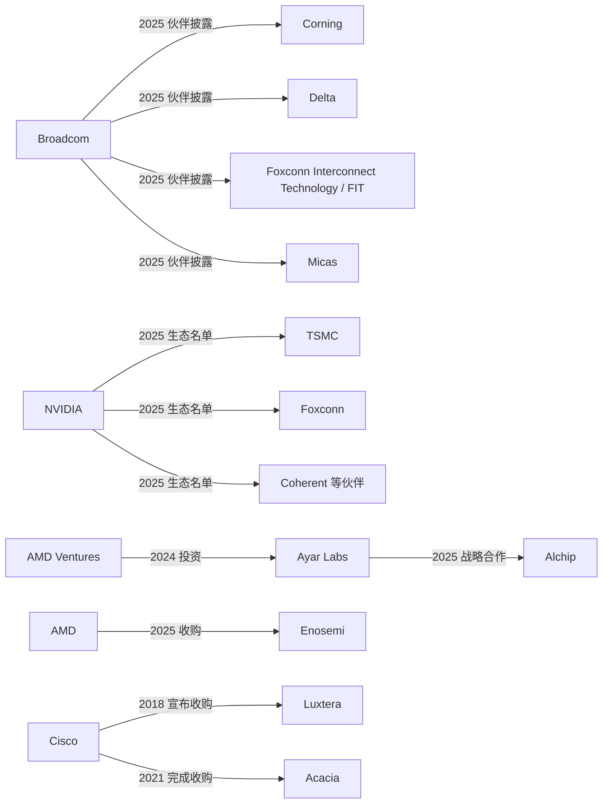

# 合作关系图

上级：[10 重点公司与合作关系图谱](./README.md)

相关：[生态关系图与协作逻辑](../02-industry/ecosystem-relationships.md)

## 公开关系图：关系类型与证据

边的标签区分生态名单、合作、投资和收购。名单不证明每个公司的具体供货、稳定采购或客户部署规模。Foxconn 与 FIT 在图中分开：NVIDIA 公告写 Foxconn；Broadcom 公告写 FIT，不能互换。来源：[Broadcom 2025-05-15](https://investors.broadcom.com/news-releases/news-release-details/broadcom-announces-third-generation-co-packaged-optics-cpo)、[NVIDIA 2025-03-18](https://nvidianews.nvidia.com/news/nvidia-spectrum-x-co-packaged-optics-networking-switches-ai-factories)、[Alchip 2025-09-08](https://www.alchip.com/public/index.php/jp/Newsroom/AyarLabsandAlchiptoScaleAIInfrastructure)、[Ayar Labs 2024-12-11 投资公告](https://ayarlabs.com/news/ayar-labs-155m-series-d-to-address-ai-infrastructure-includes-amd-intel-capital-nvidia/)、[AMD 2025-05-28](https://www.amd.com/en/blogs/2025/amd-acquires-enosemi-to-accelerate-co-packaged-optics-innovation.html)。

## 当前最值得跟踪的几条公开主线

### Broadcom 主线

2025 年伙伴披露涉及连接部件和系统集成。[重点组合案例](./key-combinations.md)按交付环节解释这组关系；[Broadcom 深卡](../11-deep-company-cards/broadcom.md)记录各代产品声明。两者都不能由伙伴名单推算客户现场部署量。

### NVIDIA 主线

2025 年公告列出制造、光器件和连接等生态伙伴，不给出每家的实际交付量。名单和 2026 年生产状态见 [NVIDIA 深卡](../11-deep-company-cards/nvidia.md)。

### Ayar Labs / Alchip / TSMC 主线

这条关系涉及 optical I/O 芯粒、远置光源和封装协作。具体项目是否同时采用 UCIe、COUPE 或 SoIC，需要按项目资料核实；参见 [Ayar Labs 深卡](../11-deep-company-cards/ayar-labs.md)和[组合案例](./key-combinations.md)。

### Cisco 主线

Cisco 的两次收购体现光学能力内化；2026 年网络产品公告与可插拔光学相关，不能直接当作 CPO 供货证据。时间与来源见 [Cisco 深卡](../11-deep-company-cards/cisco.md)。

### AMD 主线

AMD 收购 Enosemi 与 AMD Ventures 投资 Ayar Labs 是不同关系；两者都不能单独证明某个 CPO 产品已稳定供货。参见 [AMD 深卡](../11-deep-company-cards/amd.md)。

## 研究时要注意

- “合作”不等于“已经大规模量产”
- “展示生态”不等于“所有环节都成熟”
- 有些关系是平台验证关系，有些关系才是稳定供应关系

## 主要公开来源

[公司生态与时效性来源表](../18-sources-and-updates/company-ecosystem-sources.md)集中记录原始链接、日期和支持范围。
