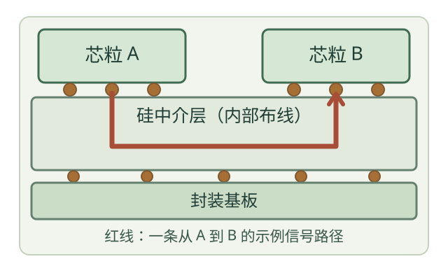
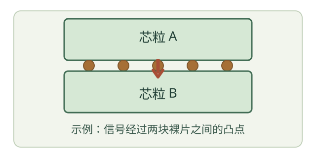

# 芯粒怎样在封装内连接？

上级：[01 芯粒与连接基础](../SUMMARY.md#foundations)

把两块裸片放在同一个封装中，只解决了它们的位置。信号还需要从 A 的接口电路出发，经过可导电的连接结构，再进入 B 的接口电路。本文先看常见的电连接路径。

## 一条连接由哪些部分组成

| 部分 | 作用 |
| --- | --- |
| 两端的物理接口（PHY） | 发送端产生信号；接收端根据电气与时序条件采样信号。 |
| 焊盘和凸点 | 在裸片与相邻连接结构之间提供电接点。具体结构也可以采用其他键合方式。 |
| 封装内布线 | 将一端的接点连到另一端。布线可能位于封装基板、中介层或局部桥等结构中。 |

供电、接地和信号回流路径也需要设计。图中的一条线只帮助理解信号路径，不代表完整接口只有一条连接。

## 并排放置：经过中介层或桥

下图是一个**示意例子**：A 和 B 并排放置，信号经过凸点进入硅中介层，在中介层的布线中到达对端，再进入 B。

这个例子使用整块硅中介层。其他方案可以使用重布线层（RDL）中介层，或只在需要高密度连接的位置使用局部硅桥。TSMC 的 [CoWoS 介绍](https://3dfabric.tsmc.com/english/dedicatedFoundry/technology/cowos.htm)区分硅中介层、RDL 中介层及局部硅互连；Intel 的 [EMIB 介绍](https://www.intel.com/content/www/us/en/corporate/usa-chipmaking/news-and-resources/video-intel-emib-technology-explained.html)展示了局部桥的思路。它们是不同方案的实例，不表示所有封装都采用相同路径。

## 上下堆叠：经过连接界面

裸片也可以上下堆叠。下图用凸点表示一个上下连接的示意；其他实现可以使用直接键合等方式。

堆叠方式会影响可用连接位置、密度、供电和散热。[TSMC SoIC](https://3dfabric.tsmc.com/english/dedicatedFoundry/technology/SoIC.htm)是三维堆叠技术的一个实例。硅通孔（TSV）用于穿过硅体的连接；是否需要 TSV，要看信号或供电路径及堆叠结构，不能仅凭“3D”就假定每条连接都经过 TSV。

## 连接结构和接口规则怎样配合

硅桥或中介层提供布线路径，本身不定义上层交换的是读取还是写入。两端仍要有可配合的 PHY、数据格式和通信规则。例如，芯粒的凸点已经与封装布线接通，如果接收端不能按约定采样，数据仍无法可靠交付。

接口越宽，可能需要越多数据连接和布线资源；提高每线速率也会改变通道和时序要求。不能只根据封装名称判断带宽、功耗或互通性；需要一起检查两端和通道。

## 接下来怎么读

- [跨芯粒寄存器读](../ucie-pcie-read.md#read-path)：看请求和响应怎样使用这些连接。
- [BoW PHY 2.0](../bow-phy.md)：看一种物理接口怎样安排数据线和时钟。
- [UCIe-3D 垂直连接](../02-interfaces/ucie-3d.md)：看上下堆叠时的一种接口与时钟路径。
- [封装局部硅桥](../../../chip-development/FAB/wiki/04-back-end-packaging/2.5d-routes/embedded-bridge-emib-and-cowos-l.md)：进一步理解桥与中介层的结构取舍。
- [HBM 的堆叠与封装内互连](../../../storage/06-system-integration/packaging/hbm-2.5d-3d-tsv.md)：区分 HBM 堆栈内部连接与计算侧连接。
