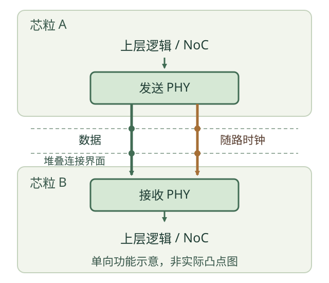

# UCIe-3D：上下堆叠的芯粒怎样交换数据？

上级：[02 接口与案例](../SUMMARY.md#interfaces)

两颗芯粒上下堆叠后，可以在相对的连接界面上布置信号连接。要让数据通过这些连接，两侧还需要相容的物理接口、时钟和上层数据约定。

本文以 UCIe 2.0 引入的 **UCIe-3D** 为例，解释垂直接口的路径和设计边界。它不是对某个产品的内部连接或性能的测量。[UCIe 2.0 白皮书](https://www.uciexpress.org/_files/ugd/0c1418_b6481ec611e24c6e91f1beb743b0c860.pdf)

## 数据怎样跨越堆叠界面

假设芯粒 A 在上方、B 在下方；两端已经按设计建立兼容连接，A 向 B 发送数据。下图仅表示**一个方向的功能路径**，不是实际凸点布局；供电、接地、测试和其他连接没有画出。

1. A 的上层逻辑将约定的数据交给发送 PHY。
2. 发送 PHY 产生数据和随路时钟信号，经对应连接点跨越堆叠界面。
3. B 的接收 PHY 根据数据和时钟的时序关系采样，再交给 B 的上层逻辑。

反方向通信需要相应的发送、接收和连接资源。对端是否能理解数据，还取决于两侧约定的上层接口与语义。UCIe 联盟的技术介绍将该 PHY 描述为单向、使用随路时钟的接口，并展示 NoC 连接 PHY 的例子。[UCIe 联盟 UCIe-3D 技术介绍](https://chipletsummit.com/proceeding_files/a0qVV0000032cp3/20260218_K-4_Das%20Sharma.PDF)

## 从边缘连接到面积连接

并排芯粒的接口常受可用芯片边缘和封装布线位置约束。垂直堆叠则可以在两块芯粒相对的区域安排连接。连接点间距缩小时，同样面积内可能容纳更多位置；但总位置还要分配给数据、时钟、供电、接地和其他需要，不能全部当作有效数据线。

例如，假设一个 **100 μm × 100 μm** 的理想方形区域使用规则方格，忽略边界及其他约束：

| 假设间距 | 按面积粗略估算的位置数 |
| --- | ---: |
| 10 μm | 100 × 100 ÷ 10² = 100 |
| 5 μm | 100 × 100 ÷ 5² = 400 |

这只是几何估算，不表示这两组参数就是某个器件的 UCIe-3D 配置。间距减半使理想位置数变为四倍，也不保证可用数据线或有效带宽变为四倍。比较带宽密度时，还要说清分母是芯片边缘长度还是连接面积，以及是否包含非数据连接和协议开销。

## 接口规则与键合技术

UCIe-3D 规定接口相关要求；混合键合等技术提供可用于实现堆叠连接的工艺。两者需要配合，不能互相代替。两端即使使用相同名称，还需要检查连接点布局、间距、电气条件、时钟和上层接口是否相容。[UCIe 规范介绍](https://www.uciexpress.org/specifications)；[芯粒怎样在封装内连接](../01-foundations/in-package-connections.md)

堆叠不表示每条信号都必须经过 TSV，也不能仅凭连接间距推断功耗、良率或散热结果。实际设计还要考虑供电路径、测试、修复和热约束。

## 它与 UCIe 1.1 读取和重放有什么不同

现有 [UCIe 1.1 读取案例](../ucie-pcie-read.md)从 PCIe 事务出发；[链路错误检测与重放](../03-system-design/link-reliability.md)则假设选定了支持适配器 CRC 与重放的模式。它们不能直接当作 UCIe-3D 的固定数据路径。

UCIe 联盟展示的 UCIe-3D 架构示例中，NoC 直接连接 PHY，没有采用上述 D2D Adapter 及其 CRC/Replay 机制。联盟白皮书将简化电路和相应误码目标联系起来说明这一设计。**这不表示整个系统没有错误检测或纠错**：例如，上层互连及其保护机制仍需要按具体系统判断。[UCIe 联盟技术介绍](https://chipletsummit.com/proceeding_files/a0qVV0000032cp3/20260218_K-4_Das%20Sharma.PDF)；[UCIe 2.0 白皮书](https://www.uciexpress.org/_files/ugd/0c1418_b6481ec611e24c6e91f1beb743b0c860.pdf)

规范版本向后兼容的声明，也不能单独证明任意两颗芯粒的垂直与平面物理接口可直接对接。需要按实际配置检查两端、封装与所需的上层功能。

## 接下来怎么读

- [芯粒怎样在封装内连接](../01-foundations/in-package-connections.md)：比较并排、桥接和堆叠的基本路径。
- [UCIe 1.1 读取案例](../ucie-pcie-read.md)：从一次 PCIe 读取理解另一种承载配置。
- [跨芯粒链路错误检测与重放](../03-system-design/link-reliability.md)：看启用适配器重放时的错误恢复。
- [多芯粒拓扑与数据放置](../03-system-design/multi-chiplet-topology.md)：从一条连接扩展到多个芯粒和数据路径。
- [FAB：微凸点与混合键合](../../../chip-development/FAB/wiki/04-back-end-packaging/3d-routes/micro-bump-vs-hybrid-bonding.md)：进一步了解堆叠工艺。
