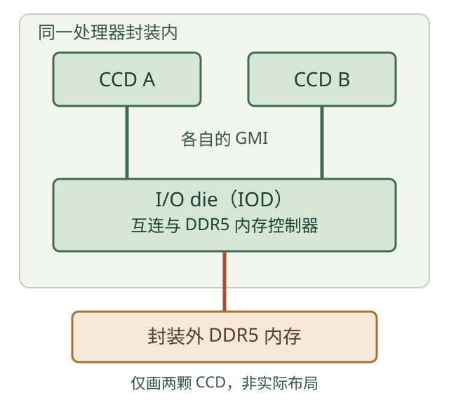

# AMD EPYC 9004：计算芯粒怎样连接 I/O die？

上级：[04 产品与系统案例](../SUMMARY.md#product-cases)

把计算核心和内存接口放在不同裸片上后，核心访问内存时，部分请求需要跨越芯粒边界。AMD EPYC 9004 提供了一个实际产品例子：计算核心位于计算核心 die，内存控制器和其他系统接口位于 I/O die。

本文关注它们的**系统分工和连接边界**。产品结构来自 AMD 公开资料；后面的单次读取是按该结构构造的说明，不是厂商公布的逐拍事务跟踪。[AMD EPYC 9004 调优指南，第 2.9–2.10 节](https://docs.amd.com/api/khub/documents/5P0oVzD6cbWex32rvXJaVw/content)

## 计算和 I/O 分别在哪里

计算核心 die 称为 **CCD**；I/O die 常写作 **IOD**。AMD 说明，CCD 通过 Global Memory Interconnect（**GMI**）连接 IOD。IOD 中的 Infinity Fabric 为计算、内存和 I/O 之间提供数据路径及控制，并帮助维护缓存一致性。

下图只画两颗 CCD，表示连接关系；它不是实际裸片位置图，也不表示所有型号都只有两颗 CCD。

以 **EPYC 9654** 为例，AMD 说明它有 **12 颗 CCD**，每颗 CCD 通过自己的 GMI 连接 IOD。IOD 提供 DDR5 内存控制器，也提供其他系统接口。不同型号的 CCD 数量和配置可能不同。[AMD EPYC 9004 调优指南，第 2.9 节](https://docs.amd.com/api/khub/documents/5P0oVzD6cbWex32rvXJaVw/content)

## 一次需要 DDR5 的读取

假设一个核心请求读取数据，本地缓存没有直接满足这次请求；再假设该请求最终需要访问连接到本处理器的 DDR5。地址映射和系统已经配置完成。简化路径如下：

1. **CCD 发起访问。** 核心的请求经过 CCD 内部路径，交给通往 IOD 的 GMI。
2. **请求跨越封装内边界。** CCD 与 IOD 通过各自的接口和封装连接交换信息。
3. **IOD 访问内存。** IOD 根据系统配置，将需要内存服务的请求交给对应控制器；控制器再与封装外的 DDR5 交换数据。
4. **结果返回。** 数据经 IOD 和相应 GMI 返回请求所在 CCD，最终交给核心所需的路径。

这个例子只说明必须经过的功能边界，不给出 GMI 消息格式、缓存一致性状态机或具体延迟。其他缓存可能已经持有数据；那时结果不一定来自 DDR5。真实路径也会受到地址映射、配置和系统状态影响。

## GMI 与 GMI-Wide 有什么不同

AMD 还描述了部分 **GMI-Wide** 型号。例如，EPYC 9334 的每颗 CCD 连接两个 GMI3 接口。AMD 将此配置描述为增加核心到 I/O die 的带宽。[AMD EPYC 9004 调优指南，第 2.9 节](https://docs.amd.com/api/khub/documents/5P0oVzD6cbWex32rvXJaVw/content)

这不表示每个 9004 型号都使用两个接口，也不能推出应用吞吐或单次读取延迟按同样比例变化。工作负载、在途请求、内存控制器和其他共享资源也可能限制结果。比较时，应把 **CCD 到 IOD 的连接能力**与最终获得的有效性能分开。[跨芯粒读取的有效性能](../03-system-design/effective-bandwidth-and-latency.md)

## 不要把 GMI 和 xGMI 混在一起

| 名称 | 本文中的位置 |
| --- | --- |
| GMI | 连接同一处理器封装中的 CCD 与 IOD。 |
| xGMI | 可用于将数据 fabric 扩展到另一颗处理器；双路系统的具体连接由平台决定。 |

两者处在不同边界。AMD 文档中用于处理器之间 xGMI 的速率，不能直接当作 CCD 到 IOD 的 GMI 速率。本文使用的公开资料也没有给出足以还原 GMI 完整物理接口和事务格式的信息，因此不把它指定为 UCIe、BoW 或 OIF XSR+。

## 接下来怎么读

- [芯粒是什么](../01-foundations/what-is-a-chiplet.md)：回看计算与 I/O 功能为什么可以拆分。
- [一次跨芯粒通信](../01-foundations/cross-die-communication.md)：理解请求和返回需要经过的共同边界。
- [跨芯粒读取的有效性能](../03-system-design/effective-bandwidth-and-latency.md)：区分连接带宽与实际吞吐。
- [Stratix 10 TX 产品案例](./stratix-10-tx.md)：比较 FPGA 核心与收发器 tile 的划分。
- [NoC：跨 die 网关与排队](../../NOC/06-ai-noc-specifics/chiplet-and-die-to-die-interconnect.md)：按需要继续研究网关和排队；本文不假设 EPYC 内部采用该页的构造实现。
