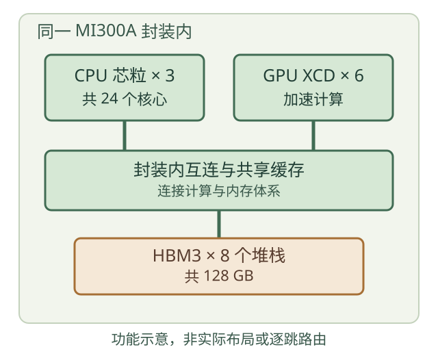

# AMD MI300A：CPU、GPU 和 HBM 怎样在同一封装协作？

上级：[04 产品与系统案例](../SUMMARY.md#product-cases)

CPU 可以准备数据，GPU 可以并行处理数据；两者还需要通过内存和同步机制交换结果。AMD Instinct MI300A 把 CPU、GPU 和 HBM 集成在同一封装内，为理解这些功能怎样跨芯粒协作提供了一个产品案例。

本文依据 AMD 的公开资料说明功能关系。通信过程是构造示例，不是芯片内部事务跟踪或性能测量。

## 封装里有哪些部分

MI300A 包含三个 Zen 4 CPU 芯粒，共 24 个 CPU 核心；GPU 侧包含六个加速计算 die（XCD）。封装还有八个 HBM3 堆栈，共 128 GB。CPU 和 GPU 使用统一的内存地址空间，并通过一致性架构共享内存。[AMD CDNA 3 产品说明](https://www.amd.com/en/technologies/cdna.html)；[MI300A 架构概览](https://instinct.docs.amd.com/projects/amdgpu-docs/en/docs-30.10/gpu-partitioning/mi300a/overview.html)

下图只表示功能关系和数量，不表示芯粒实际位置、内部逐跳路由或每条物理链路。

AMD 说明，该产品使用芯粒和 3D 堆叠技术；封装内 Infinity Fabric 将计算部分连接到共享缓存和 HBM 体系。[AMD 产品介绍](https://www.amd.com/en/blogs/2023/introducing-the-amd-instinct-mi300-series-acceler.html)；[MI300A 架构概览](https://instinct.docs.amd.com/projects/amdgpu-docs/en/docs-30.10/gpu-partitioning/mi300a/overview.html)

## 一次 CPU 与 GPU 协作

假设程序分配了一块 CPU 和 GPU 都可以访问的数据，CPU 先写入输入数据，再启动依赖这些数据的 GPU 工作；GPU 完成处理后，CPU 读取结果。这里假设程序使用了适用于该内存和运行时的同步方式。

1. **CPU 准备输入。** CPU 执行写入。写入经过计算侧缓存和内存体系；此时不能仅凭“共享内存”断定数据已经写回 HBM。
2. **程序建立依赖。** 程序按所用 API 和内存模型安排启动与同步，使 GPU 在满足要求的顺序和可见性条件下读取输入。
3. **GPU 处理数据。** GPU 从共享内存体系取得输入并写入结果。数据可能由缓存或内存体系中的不同位置提供；本文不推断具体逐跳路径。
4. **CPU 读取结果。** 程序等待 GPU 工作并完成相应同步后，CPU 再读取结果。

统一地址空间使双方可以在支持的条件下引用同一内存对象；缓存一致性处理相应的可见性关系；同步则用于建立程序需要的执行顺序。三者相互配合，不能用其中一个概念代替另外两个。AMD 的 [HIP 一致性控制文档](https://rocm.docs.amd.com/projects/HIP/en/docs-6.4.0/how-to/hip_runtime_api/memory_management/coherence_control.html)区分了不同内存一致性模式与同步操作的可见性范围。实际程序要依据其分配方式、API 和运行时版本选择操作。

## 哪些连接在封装内

| 观察边界 | 本例要看的问题 |
| --- | --- |
| CPU、GPU 到共享内存体系 | 计算芯粒如何通过封装内连接参与访问和一致性。 |
| HBM 堆栈内部与计算侧 | DRAM die 的堆叠连接和计算侧到 HBM 的连接是不同边界。 |
| 一个 MI300A 与另一个 APU | 这是处理器封装之间的系统连接，不能当成封装内芯粒链路。 |

AMD 数据手册列出的 **5.3 TB/s** 是 MI300A HBM 的最大理论内存带宽，不是任意一条 CPU–GPU 芯粒链路的实测吞吐。同一手册还描述多 APU 配置中的处理器之间连接；那些数字也不能直接当作封装内连接带宽。[MI300A 数据手册](https://www.amd.com/content/dam/amd/en/documents/instinct-tech-docs/data-sheets/amd-instinct-mi300a-data-sheet.pdf)

公开资料足以说明功能组合，不足以在本文还原每条物理链路的宽度、协议、缓存一致性状态机和请求路由。不能仅因为产品使用芯粒或 3D 堆叠，就断言它采用 UCIe、BoW 或某一种具体连接标准。

## 接下来怎么读

- [AMD EPYC 9004 产品案例](./amd-epyc-9004-gmi.md)：比较 CPU 芯粒经 I/O die 访问封装外 DDR5 的路径。
- [跨芯粒读取的有效性能](../03-system-design/effective-bandwidth-and-latency.md)：区分理论连接能力和应用实际获得的吞吐。
- [多芯粒拓扑与数据放置](../03-system-design/multi-chiplet-topology.md)：用构造案例分析中转与数据位置；它不是 MI300A 的内部拓扑。
- [HBM 的堆叠与封装内互连](../../../storage/06-system-integration/packaging/hbm-2.5d-3d-tsv.md)：区分 HBM 堆栈内部与计算侧连接。
- [NoC：跨 die 网关与排队](../../NOC/06-ai-noc-specifics/chiplet-and-die-to-die-interconnect.md)：从通用模型理解网关与排队；该模型不代表 MI300A 的内部实现。
