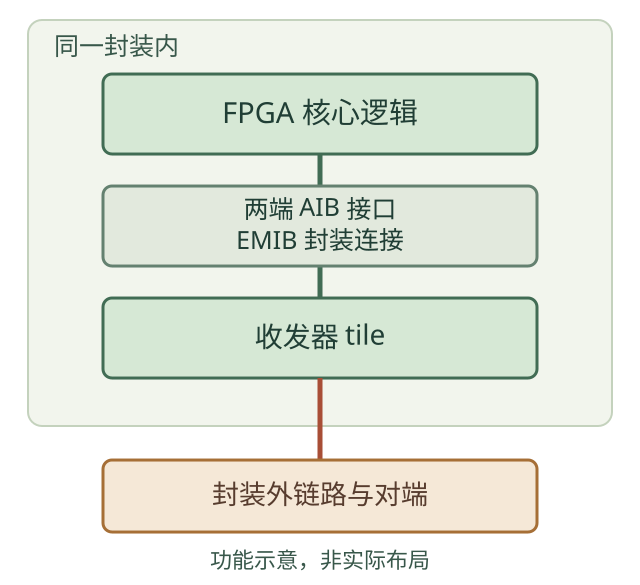

# Stratix 10 TX：FPGA 与收发器芯粒怎样协同？

上级：[04 产品与系统案例](../SUMMARY.md#product-cases)

一颗 FPGA 产品可以把可编程逻辑和高速收发器放在不同的裸片上，再装进同一封装。这样，封装内的裸片间连接和收发器对外使用的高速链路，就是两段需要分别理解的路径。

本文以 **Stratix 10 TX** 为例，看 FPGA 核心与收发器 tile 的职责。产品结构和能力依据厂商公开资料；数据如何通过系统的例子是为了说明路径而构造的。[Altera Stratix 10 TX 产品资料](https://www.altera.com/products/fpga/stratix-10/tx-series)

## 先分清两段连接

下图是**功能示意**，不是裸片的实际位置或布线图。图中只画一个收发器 tile 和一条对外连接。

Intel 展示的 Stratix 10 系列结构使用 AIB 连接 FPGA 核心与收发器；器件手册说明，收发器 tile 通过 EMIB 与 FPGA fabric 相连。**AIB 是两端配合的接口，EMIB 提供封装内的局部连接结构。**[Intel Hot Chips 资料，第 18 页](https://old.hotchips.org/wp-content/uploads/hc_archives/hc29/HC29.22-Tuesday-Pub/HC29.22.50-FPGA-Pub/HC29.22.523-Hetro-Mod-Platform-Shumanrayev-Intel-Final.pdf)；[Altera 收发器手册](https://docs.altera.com/r/docs/683621/current/l-and-h-tile-transceiver-phy-user-guide/overview)

Stratix 10 TX 使用 H-Tile 和 E-Tile 等收发器 tile；具体资源取决于器件型号和配置。本文不假设该产品的每条 AIB 路径都采用 [AIB 2.0 教学案例](../02-interfaces/aib-2.md)中的线数、速率或训练方法。[Altera Stratix 10 产品资料](https://www.altera.com/products/fpga/stratix-10)

## 沿一次发送看职责

假设 FPGA 用户逻辑要向封装外的对端发送数据，并且器件已配置相容的收发器模式。这里只展示一条方向，不指定实际通信协议：

1. **核心逻辑产生数据。** 数据按配置交给通往收发器 tile 的路径。
2. **数据跨越封装内边界。** FPGA 核心和收发器侧的接口配合，信号经过 EMIB 提供的封装连接。
3. **收发器向外发送。** tile 的收发器按所选模式处理数据，产生通过封装外通道发送的高速信号。
4. **外部对端接收。** 对端还要按相容模式恢复和处理信号，才能取得数据。

反方向接收也需要相应的路径。所选协议的帧格式、初始化和完成条件，不能仅由这张示意图确定。某一段传输了信号，也不自动证明对端应用已经收到预期数据。

## 怎样读 57.8 Gb/s

Altera 的 E-Tile 数据手册列出：在所示 **−1 速率等级**下，PAM4 支持的数据率最高为 **57.8 Gb/s**；该表适用于 chip-to-chip 和背板链路。表中注释还说明，达到这一最高速率需要组合两个通道。[Stratix 10 E-Tile 数据手册](https://docs.altera.com/r/docs/683181/current/stratix-10-device-datasheet/transceiver-performance-for-stratix-10-e-tile-devices)

这个数字描述的是收发器对外链路的工作能力，不是图中 AIB 或 EMIB 的单线速率。它也不是应用有效吞吐。不能把产品系列的最大通道数直接乘以 57.8 Gb/s，当作所有型号和配置都能达到的总带宽；应检查具体器件、速率等级、通道组合及所选协议。

## 这个例子能说明什么

把收发器放在独立 tile，使产品可以在同一封装中组合核心与不同接口功能。封装内接口和对外链路分别有自己的电气条件和配置要求；前者接通，也不能证明后者的对端、通道和协议已经配合。

这个产品案例说明一种系统划分，不代表所有芯粒系统都把 SerDes 放在独立裸片上，也不表示所有封装内互连都使用 AIB。要比较不同实现的带宽、延迟或能耗，还需要统一工作条件和测量边界。

## 接下来怎么读

- [AIB 2.0](../02-interfaces/aib-2.md)：通过另一种具体实现理解数据线和随路时钟。
- [OIF 112G XSR+](../02-interfaces/oif-cei-112g-xsr-plus.md)：看一个用于封装内路径的高速串行电接口。
- [AMD EPYC 9004 产品案例](./amd-epyc-9004-gmi.md)：比较计算芯粒与 I/O die 的系统分工。
- [SerDes：Chiplet 与 D2D](../../SERDES/08-system-applications/chiplet-and-d2d.md)：从物理设计角度比较接口取舍。
