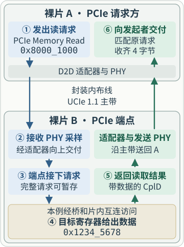

# 一次跨芯粒的寄存器读，什么时候才算完成？

上级：[01 芯粒与连接基础](./SUMMARY.md#foundations)

假设你能在封装里放两个探针。一个看芯粒 B 的接收电路，另一个看芯粒 A 上发起读的模块。第一个探针已经看到请求穿过两颗裸片之间的连线，第二个却显示“仍在等数据”。这段时间，硬件在等谁？

沿用[上一篇的 BAR 寻址方法](../PCIE/03-configuration-enumeration-addressing/config-space-bar-capability.md)。这次把发起方放在芯粒 A，把目标放在同一封装的芯粒 B。假设地址窗口已经配好，基址为 `0x8000_0000`，B 的设备手册把一个 32 位寄存器放在窗口内偏移 `0x1000`。所以 A 要读的地址是 **`0x8000_1000`**。为把前后两次观察对上，设这个寄存器在整个例子中一直保存 **`0x1234_5678`**。地址、数值和后面的时刻都是教学设定。

## 一笔读，两次穿过封装 {#read-path}

先只看图中的六个编号。沿去程找出 B 什么时候**知道有人要读**，再沿回程找出 A 什么时候**知道读到了什么**。图中标出的 PCIe 和 UCIe 名称，是下一节给这些位置选择的一种具体实现。

**① A 发出读请求。** A 已经知道目标地址、要读 4 个字节，却还不知道这 4 个字节的值。发起方留下一项记录，表示“这笔读还欠我一个结果”。去程需要传过去的是读操作、地址和匹配请求所需的信息。此时即使 B 的寄存器里早就存着那个数，A 也拿不到它。

**② B 的物理接口采到信号。** 看一条数据线。A 的物理接口（PHY）驱动焊盘，信号经凸点和本例选用的封装布线到达 B 的接收器。B 在约定的采样时刻判出这条线上承载的位。实际接口可同时使用多条线，连续传送多个节拍。采到其中一组位时，硬件手里可能只有请求的一部分。图上把这个可观察的采样时刻记作②。[封装剖面和实际连线路径](./01-foundations/in-package-connections.md)

**③ B 接下完整的读请求。** 接收侧按约定的传输格式把信息还原出来，交给能理解读操作的协议逻辑。现在 B 知道有人要读哪个地址、需要多少数据，也有地方保存这笔待处理的请求。把它接进队列就可以完成这一步。即使这时去程线路已空闲，请求仍可能排在 B 内部。

**④ B 的目标寄存器给出数据。** 本例中，B 的桥把窗口内的偏移 `0x1000` 译到本地寄存器读口。等片内通路接纳这笔读，寄存器的值经读数据通路回到桥，桥才有可返回的 4 字节。B 可以用片上网络（NoC）连接桥和寄存器，也可以用更简单的本地总线。决定③和④之间要等多久的是这段实际通路。

**⑤ B 发回结果，⑥ A 收齐并交付。** B 把成功状态、与请求对应的标识、数据送上回程。A 的接收侧收回这些信息，发起端把它们与①留下的记录匹配，检查状态，收齐 4 字节，才把 `0x1234_5678` 交给最初要读数的模块。若你在统计这笔读的端到端延迟，起点取①，终点就该取⑥。只测到④，会漏掉返回方向的传输和交付。

## 在同一张图上换成 UCIe 1.1 和 PCIe {#ucie-pcie}

现在给图里的接口选定配置。A 内有 PCIe 根复合体（Root Complex），B 内有 PCIe 端点（Endpoint）。我们选择 **UCIe 1.1 的 68 B flit 格式承载 PCIe non-Flit Mode**，并假设两端已启用适配器重试。这里有两个层次的名字：PCIe 规定“读这 4 字节”以及“怎样回答”，UCIe 规定这段封装内链路怎样把双方约定的信息送过去。可以沿原图做三次核对。[UCIe 联盟 Hot Chips 教程，幻灯片 28、37](https://hc2023.hotchips.org/assets/program/tutorials/ucie/UCIe%20Protocol.pdf)

- **从①到②，4 字节和 68 字节分别量什么？** PCIe 发出的 Memory Read 请求包（MRd）带有目标地址。它的 Length 字段填 1，单位是双字（DW），表示要读 4 字节。寄存器值要等回程的完成包才会出现。PCIe 协议层和本地的 D2D 适配器通过 FDI 接口交换协议信息。在选定的格式中，适配器把 64 字节协议信息与 2 字节头、2 字节校验码（CRC）组织为一个 68 字节传输单元，称为 *flit*，经本地 RDI 接口交给 PHY。PHY 才驱动封装连线，B 用随路时钟在合适的时刻采样。4 字节是所求寄存器的宽度，68 字节是这一层的传输单位。单凭这两个数字算不出每读一次会独占多少个 flit。[UCIe 1.1 规范，第 2.1.3、3.3.2 和 5.5 节](https://tmng-al.uspto.gov/resting2/api/casedoc/cms/case/99231699/tmdocument/20250612064611159321SPE0011.pdf)
- **从②到④，哪块硬件认识寄存器？** B 的 PHY 恢复收到的数据，适配器检查并交付协议信息。B 的 PCIe 端点接下 MRd，这才是③。本例中端点背后的桥接着发起片内 AXI 读，经 NoC 到达寄存器，得到④的数值。换一种片内连接，UCIe 的收发接口仍然可以相同。若适配器检测到可重试的传输错误，可以先在这段链路上重放；链路对某个 flit 的确认，只能说明它在这一跳的接收进度。[UCIe 联盟对适配器校验与重放的说明](https://www.uciexpress.org/post/ucie-1-1-provides-streaming-protocol-solution-for-error-detection-and-replay)
- **从⑤到⑥，A 怎样认出自己的答案？** B 的端点发出 PCIe 带数据的完成包（Completion with Data，CplD）。假设 A 给这笔读分配了 Tag `0x05`，完成包带回原请求者的标识（Requester ID）和这个 Tag。A 据此找到①留下的记录，检查成功状态并接收对应的 4 字节。链路层即使早已确认收到去程的 flit，也无法替 B 的寄存器给出这个数。[PCI-SIG 的 Programmed I/O 读取示例](https://pcisig.com/sites/default/files/files/01_01_PCI_Express_Basics_%26_Background_FROZEN.pdf) · [完成包中的 Requester ID 和 Tag](https://docs.amd.com/r/3.3-English/pg346-cpm-pcie/Completer-Completion-Descriptor-Format)

## 只让 B 的片内入口晚开放，谁会晚三个时隙？ {#return-wait}

设 B 的桥可以暂存一个已接纳的请求。第一次读时，片内入口空闲。第二次做同样的实验，只让另一笔本地访问多占用这个入口三个时隙；B 的桥仍有空位，后面各段的服务时间也保持相同。用同一把外部时间尺记录两次实验，时隙只用来比较先后和差值，两颗芯粒可以有各自的时钟。

| 观察到的事件 | 入口空闲 | 片内多等三个时隙 |
| --- | ---: | ---: |
| ① A 发出读 | 0 | 0 |
| ② B 的 PHY 采到请求的一组位 | 2 | 2 |
| ③ B 接下完整请求 | 3 | 3 |
| ④ 寄存器给出数据 | 5 | 8 |
| ⑤ B 发出带数据的返回 | 6 | 9 |
| ⑥ A 匹配并交付 | 9 | 12 |

在第二次实验的时隙 6，B 的协议端已经接下读请求，寄存器还没给出数值，回程也就没有这笔读的 CplD 可以发送。到时隙 9，两次实验的探针会看到完全不同的事：第一次的 A 已经拿到数据，第二次的 B 才刚发出返回。即使把去程的 PHY 做得更快，也不能直接消掉这三个片内等待时隙。另一种情形是让**返回方向**排队，那样④可以准时发生，A 仍会晚拿到结果。[跨 die 网关的排队与回压](../NOC/06-ai-noc-specifics/chiplet-and-die-to-die-interconnect.md)

如果 B 的目标报告访问失败，B 的端点可以按适用情况形成错误完成，A 检查到错误后结束或上报这笔访问。若 A 只观察到超时，它所知道的是在期限内没有收到预期的完成，仅凭这个现象无法断定 B 是否执行了那次读。[PCIe 事务与 Completion](../PCIE/02-link-transaction-basics/tlp-dllp-completion-basics.md) · [PCI-SIG 对成功 Memory Read 返回数据的说明](https://pcisig.com/section-2311-if-end-point-returns-completion-cpl-no-data-and-successful-completion-status-memory)

## 上电后，什么时候才具备发出①的条件？ {#ready}

先看芯粒和封装是否配套。发送焊盘要能经过实际布线接到对应的接收端，双方的电气条件、时钟和数据线配置也要兼容。再看启动：本例的 UCIe 接口需要完成复位、边带初始化和主带训练，适配器还要确定共同支持的协议及格式。满足这些条件后，两端有了运送协议信息的通路。[UCIe 1.1 启动与训练](./02-interfaces/ucie-1-1-link-bring-up.md) · [芯粒互操作与启动](./03-system-design/interoperability-and-bring-up.md)

最后看业务地址。即使主带已经训练好，如果 B 的设备窗口尚未配置，A 也不能按本例从 `0x8000_1000` 取得这个寄存器的值。反过来，读到正确的设备标识，也不能代替检查请求经过的地址窗口。上一篇的[设备识别成功、寄存器仍然读不到](../PCIE/03-configuration-enumeration-addressing/config-space-bar-capability.md#只改一个桥窗口主机还能看见这张卡吗)就是这个区别。

## 沿哪条问题继续读？ {#next}

- **想看更多读同时在途。** 性能篇把传输对象换成每笔 64 B，分别计算线路速率、A 的在途窗口和 B 的服务能力；链路可靠性篇讲校验、重放与 Raw Mode 的区别。UCIe 1.1 的 streaming flit 和 Raw Mode 各有适用条件，本例采用的是前文选定的 PCIe 承载格式。[跨芯粒读取的有效性能](./03-system-design/effective-bandwidth-and-latency.md) · [链路错误检测与重放](./03-system-design/link-reliability.md)
- **想换一种接口或封装。** 可以把图里的收发接口换成 BoW，沿另一套协议走一遍，或者换成堆叠结构，观察通道怎样变化。不同版本的 UCIe 支持范围也可分开查阅。[BoW PHY](./bow-phy.md) · [BoW.Flexi 的 AHB 读](./bow-flexi.md) · [CHI C2C](./02-interfaces/chi-c2c.md) · [UCIe-3D](./02-interfaces/ucie-3d.md) · [UCIe.mem](./02-interfaces/ucie-memory.md) · [封装内电接口](../SERDES/08-system-applications/chiplet-and-d2d.md) · [HBM 的堆叠和封装](../../storage/06-system-integration/packaging/hbm-2.5d-3d-tsv.md)
- **接着读系列主线。** 这次读的是一个值固定的设备寄存器。如果改读一份可缓存的数据，A 和 B 原先都读到 0，后来 A 把它写成 1，B 下一次从谁手里取得 1？这个问题引出缓存一致性。[《内存里还是 0，为什么 B 能读到 A 写的 1？》](../COHERENCE/01-foundations/coherence-invariants.md)
