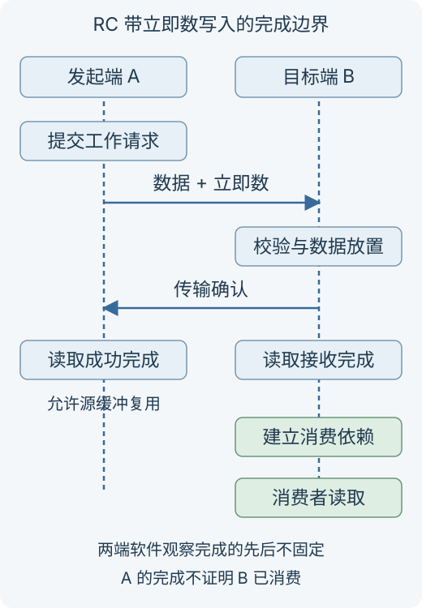

# 同样发 4 KiB，TCP 和 RDMA 什么时候能复用缓冲区？

上级：[基础概念](README.md)

主机 A 要把第 17 轮的 4 KiB 结果交给主机 B。下一轮计算还要用同一块内存。A 调用发送接口，接口成功返回。这时能把第 18 轮的结果写进去吗？

要看接口返回时，**谁还会读 A 的这块内存**。如果系统已经保存了一份副本，网卡晚些时候可以从那份副本取数。如果应用只是把源地址放进工作队列，网卡可能还没来得及读第一个字节。两种方式在屏幕上看起来都像“提交成功”，缓冲区的归属却不同。

## 先给这 4096 字节划一道边界 {#record}

两台主机的应用约定每条记录正好 4096 字节。A 的源缓冲叫 `src`，B 要把一条完整记录放进自己的 `slot`，由一个 CPU 线程消费。第 17 轮和第 18 轮的内容不同，因此即使地址相同，也不能混用。开始时 B 的槽是空的，本轮只允许 A 填一次。

下面先走 Linux 普通拷贝式 TCP socket，再走硬件 RDMA 网卡上的可靠连接（RC），执行一次**带立即数的远端写**。两次实验都只使用普通主机内存，设备与 CPU 遵守平台的 DMA 可见性约定。我们关心三个时刻：A 能改写 `src`，B 能读取完整的第 17 轮，以及 B 用完后 `slot` 能放第 18 轮。它们可以相隔很久。

## TCP：A 的 send 已经返回，B 收到了多少？ {#tcp}

设 A 和 B 已经建立 TCP 连接。A 从 `src` 开头发送 4096 字节，第一次 `send()` 返回 **1536**。这个正数表示本次调用接纳了前 1536 字节。由于这里选用普通拷贝式发送，A 现在可以改写这段前缀，内核会保留自己后续发送、必要时重传所需的内容。但还有 **2560 字节**没有提交。A 要从 `src + 1536` 继续发送。等累计成功接纳了全部 4096 字节，A 才能把整块 `src` 用作下一轮。此时 B 的应用可能还一次 `recv()` 都没调用。Linux 的 `MSG_ZEROCOPY` 有另外的缓冲区归还通知，不能套用这里的返回条件。[Linux 的 send 返回值](https://man7.org/linux/man-pages/man2/send.2.html) · [Linux 的零拷贝发送与归还通知](https://docs.kernel.org/networking/msg_zerocopy.html)

数据接下来怎样到达 B？A 的协议栈维护 TCP 字节序号和重传状态，驱动把可发送的缓冲描述交给网卡（NIC）。A 的 NIC 通过 DMA 从主机内存取载荷，经网络送到 B。B 的 NIC 把收到的数据写入本地主机的接收缓冲，驱动和协议栈再把有序的字节提供给 socket。应用调用 `recv()`，把可用字节取进 `slot`。发送分段、接收合并等卸载会改变某一步看见的块大小；一次应用调用、一个 TCP 段和一个线上帧各有自己的边界。[Linux 的分段与接收合并](https://docs.kernel.org/networking/segmentation-offloads.html)

假设 B 第一次 `recv()` 返回 **1024**，这 1024 字节已经能读，但还拼不成一条记录。B 从 `slot + 1024` 继续接收剩下的 3072 字节。只有累计到 4096，才能按约定把第 17 轮作为完整记录消费。A 的两次发送和 B 的接收次数、长度不要求一一匹配。若请求接收的长度大于零，而 B 在收齐前读到有序关闭的返回值 0，这条记录就被截断了。即使 A 的 TCP 已收到确认（ACK），也只能据此判断对端 TCP 的接收进度；B 的应用是否读完和处理完，还要看应用自己的状态。[TCP 的字节流语义](https://www.rfc-editor.org/rfc/rfc9293.html) · [Linux 的 recv 返回值](https://man7.org/linux/man-pages/man2/recv.2.html)

## RDMA：这一次，网卡为什么可以直接写 B 的槽？ {#rdma}

换一种方式传同样的第 17 轮。B 愿意把已经分配好的 `slot` 开放给 A 写。**A 获得的是这段目标内存的有限访问权**。为使这次访问成立，双方预先做好三件事。

1. **登记内存和权限。** A 为自己的 `src`、B 为自己的 `slot` 准备合适的内存区域（MR）。注册让网卡能依约访问指定范围，并检查相应权限。A 在请求里给出源地址、长度和本地键 `lkey`，让本地网卡从登记过的区域读取这 4096 字节。B 为目标区允许远端写，并经双方的控制通道把目标地址、可用长度、远端键 `rkey` 及本轮槽的使用权告知 A。[内存注册与授权](../03-rdma-endpoints/memory-registration-and-permissions.md)
2. **准备提交和完成的地方。** 已连接的队列对（QP）承载这笔操作。A 会把工作请求（WR）提交到发送队列；网卡完成操作后，软件从完成队列（CQ）取回对应的完成记录（CQE）。可以先把它们理解成两句话：软件先登记“请做这件事”，稍后再取“这件事的结果”。[队列对、工作请求与完成队列](../03-rdma-endpoints/queues-and-connection.md)
3. **让 B 能接到本轮通知。** 因为要做的是带立即数的写，B 要预先提交一项接收工作请求供这次通知使用。A 在写操作上附带 32 位立即数，本例约定数值 **17** 表示第 17 轮。4 KiB 载荷写到 A 请求中由目标地址与 `rkey` 指定的 `slot`。B 预贴的接收项被用来产生通知；它的缓冲地址不决定这 4 KiB 落在哪里。普通 RDMA Write 不会这样自动给对端应用送一条接收完成。[RDMA Write 与 Write with Immediate](https://man7.org/linux/man-pages/man3/ibv_wr_rdma_write_imm.3.html)

现在 A 提交一次非内联（non-inline）、要求本地完成通知（signaled）的写。非内联意味着请求描述里给了 `src` 的位置，4 KiB 本身仍在应用内存里。即使 `ibv_post_send()` 成功返回，A 的 NIC 也可能尚未取完这些字节。发起端网卡随后读取载荷，接收端网卡依据授权直接把数据放到 B 的槽。B 的应用无需再调用 socket 接收这 4 KiB。建连、内存注册、错误处理和消费交接仍需要软件参与。[Linux 的用户态 verbs 路径](https://docs.kernel.org/infiniband/user_verbs.html) · [提交工作请求与源缓冲生命周期](https://man7.org/linux/man-pages/man3/ibv_post_send.3.html)

## 两端都看见了“完成”，各自拿回了什么？ {#completion}

**站在 A。** A 从发送侧 CQ 取到与该工作请求匹配且状态成功的完成，才按本例的契约复用非内联的 `src`。这解决了“我的网卡还会不会取旧数据”。如果 B 的轮询线程此刻被调度器挂起，A 仍可能先拿到自己的完成，把第 18 轮的结果算进 `src`。内联操作把数据放进提交路径，源缓冲按接口规则可更早复用；本例的 4 KiB 没有采用这种方式。

**站在 B。** B 的线程取得本次成功的带立即数写入接收完成，检查完成类型和立即数字段，用轮次 17 与预期槽匹配。这时才按约定消费 `slot` 中的 4096 字节。实际轮询时要先检查状态，再检查完成类型 `IBV_WC_RECV_RDMA_WITH_IMM` 和立即数有效标志 `IBV_WC_WITH_IMM`。立即数使用网络字节序。若轮询线程把槽交给另一个 CPU 线程，要再用线程安全队列等方式发布和接收；若目标改为 GPU 显存，还要满足平台规定的可见性和流同步条件。[完成队列返回的字段](https://man7.org/linux/man-pages/man3/ibv_poll_cq.3.html) · [一致性域与 I/O](../../COHERENCE/01-foundations/coherence-domains-and-io.md)

**再看 B 的目标槽。** B 的 CPU 已经可以读，并不意味着它已经读完。假设 A 见到本地完成就继续往同一个 `slot` 写第 18 轮。即使两笔写在同一条连接上依次到达，第 17 轮也可能在 B 开始处理前就被覆盖。因此本例约定由 B 在消费结束后，通过应用协议向 A 归还这个槽。A 可以提前在自己的内存准备第 18 轮，只有拿回槽的使用权才能再次写入 B 的同一位置。两端软件轮询各自 CQ 的先后没有固定顺序。

| 要做的事 | 普通拷贝式 TCP | 本例的 RDMA 写 |
| --- | --- | --- |
| A 改写整块源缓冲 | 发送调用累计接纳 4096 字节 | 取到本次成功的发送完成 |
| B 开始处理完整记录 | 接收累计得到 4096 字节 | 取到匹配第 17 轮的成功接收完成 |
| B 的原槽装下一轮 | B 消费完，安排下一次接收 | B 消费完并归还槽，A 才再次远端写入 |

## 如果“数据好了”和数据走两条队列呢？ {#queues}

把上例改一处：不用带立即数的同一笔写。A 改用 **QP1** 写 4 KiB 数据，又用 **QP2** 往 B 的另一个位置写“第 17 轮已就绪”。主机线程先提交数据、后提交标志。假设 QP1 暂时排队，QP2 先取得发送机会。B 即使已经观察到标志更新，也没有依据断定 QP1 的数据已全部到达；此时直接读槽，可能看到上一轮或尚未写齐的内容。

原因在于提交的先后发生在 A 的软件里，而 B 需要的是“这一笔数据已按约定交付”到“允许消费”之间的保证。上例把通知和数据放在同一笔 Write with Immediate 上，B 等的是该笔操作对应的成功完成。其他设计要明确建立覆盖两条队列的依赖。同一 QP 内不同类型的操作也有各自的排序条件；如果使用放宽排序的内存注册属性，更要核对哪些顺序和完成语义仍然有效。失败的完成不能拿来消费新数据；连接中断后须阻止新提交并处理在途访问，再回收或撤销区域。[InfiniBand 规范 §9.5 的单 QP 排序规则](https://pllab.cs.nthu.edu.tw/~kyshieh/course/cs5404/page1/page5/files/vol1r1a2.pdf#page=235) · [内存注册的排序属性](https://man7.org/linux/man-pages/man3/ibv_reg_mr.3.html) · [不同 RDMA 操作的接收与授权](../03-rdma-endpoints/send-read-write-and-atomics.md)

## 队列堵住时，先看谁在等谁 {#next}

在这两条路径里，典型的主机内存发送对应 **NIC 从主机读**，接收对应 **NIC 向主机写**。描述符、完成记录也占用主机接口。若 B 的软件迟迟没有轮询，或者两张网卡共用的 PCIe 上行口已饱和，单单提高网络出口速率并不能缩短那段等待。可分别在应用、NIC、PCIe 与交换机观察同一轮数据。[NIC 收发对应哪些 PCIe 事务](../../PCIE/06-workloads-case-studies/nic-dma-case-card.md) · [DMA 网卡的描述符、队列与批处理](../../../microarchitecture/05-dma/07-workloads-case-studies/pcie-nic-dma-case-card.md)

若把第 17 轮这样的写连续发很多次，主机 C 也持续向 B 发送，两股流就可能争用同一个出口。配套算例让两股 100 Gb/s 的流争一个 100 Gb/s 出口：交换机何时给包打 ECN 标记，由 B 的网卡向源端发回拥塞通知 CNP？它又何时用 PFC 要求直接相邻的上游端口暂停？标记、减速、暂停都可能推迟数据到达；它们不能代替本轮的完成通知。[同一出口的两个门槛](../04-roce/pfc-headroom-and-stalls.md#one-egress) · [跟踪 CNP 怎样返回源端](../04-roce/ecn-cnp-and-dcqcn.md#跟踪一次反馈)

上一篇由两张 GPU 交接一块缓冲，也要区分“可以读”和“已经用完”。下一篇把两台服务器、每台两张 GPU 和一块网卡放在同一张图上，计算一次 AllReduce 中哪个出口最忙。[两张 GPU 的缓冲区交接](../../SCALEUP/01-access-semantics/address-mapping-and-permissions.md) · [四张 GPU 做一次 AllReduce，哪个出口最忙？](../../SCALEUP/04-software-and-collectives/four-gpu-allreduce-egress.md)
