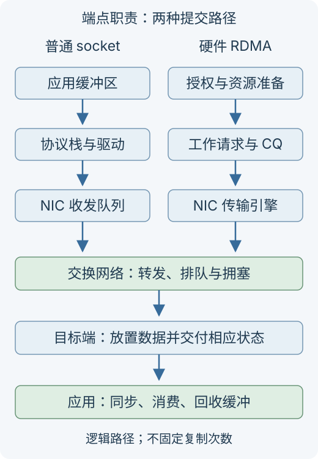

# 从应用缓冲区到网卡端口：主机与 NIC 怎样分工？

上级：[基础概念](README.md)

NIC 不只负责把内存内容送上线缆。它还要取得合法缓冲区、保存队列状态、执行协议，并向软件报告规定的完成。路径中的 CPU、内存与 PCIe 都可能限制网络表现。

图中表示职责，不表示每个实现都有同样的复制次数。驱动、卸载能力和缓冲区类型会改变具体路径。

## 普通 socket 收发

发送端应用向 socket 提供数据，协议栈管理连接、分段和传输状态，驱动把可供 NIC 使用的缓冲区发布到发送队列。NIC 取走数据并执行所配置的卸载，再发送到网络。接收端 NIC 根据配置放置数据，由驱动和协议栈把数据交给 socket，应用读取并处理。

这是一条逻辑路径。TSO 等卸载可以让主机交给 NIC 的数据块大于单个线上包；GRO 等机制也可能让主机观测到合并后的数据。因此，主机抓包中的长度和包数未必等于物理端口上的帧长和包数。

## RDMA 改变了哪些职责

应用先建立设备资源、注册或映射内存，并准备通信参数。快速路径随后提交工作请求，NIC 可以按传输协议直接把数据放到授权目标位置。接收端不必为每个普通 RDMA Write 执行一次 socket 接收，但应用仍需管理数据所有权和通知。

[Linux userspace verbs 文档](https://raw.githubusercontent.com/torvalds/linux/master/Documentation/infiniband/user_verbs.rst)区分快速路径和资源管理慢路径。内核旁路指特定操作的执行路径，不表示没有驱动、CPU 控制或权限检查。软件 RDMA 实现与硬件卸载实现也不能用同一个 CPU 开销假设。

## 把网络方向转换为主机方向

典型主机内存 TX 中，NIC 从主机读取载荷；RX 中，NIC 向主机写入载荷。描述符和完成状态还会产生其他方向的事务。具体 PCIe 流量见 [NIC 数据路径](../../PCIE/06-workloads-case-studies/nic-dma-case-card.md)，ring 与批处理见 [DMA NIC 案例](../../../microarchitecture/05-dma/07-workloads-case-studies/pcie-nic-dma-case-card.md)。

如果网络端口空闲而 CPU 忙于消费完成，增加交换机带宽不能解决问题。如果两个 NIC 共用受限的 PCIe 上行口，两个标称端口速率也不能直接相加作为应用上界。

Linux 的分段卸载机制见[官方说明](https://docs.kernel.org/networking/segmentation-offloads.html)。诊断时应同时记录应用、NIC、PCIe 和网络端口四个观察位置。
