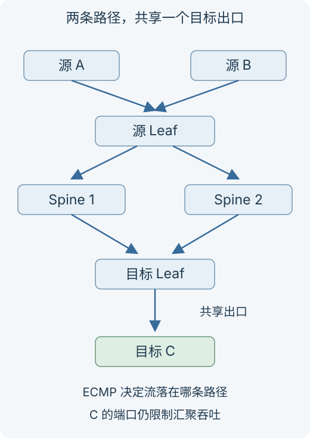

# Clos、ECMP 与多轨：多条链路为什么仍会形成瓶颈？

上级：[Ethernet 与 IP 网络](README.md)

拓扑提供候选路径，路由确定可用路径，流量映射决定实际占用。三者共同决定应用能得到多少带宽。交换机端口总和不是任意端点之间的保证。

图中的两条上行可分担流量，但去往同一接收端口的数据仍汇聚到同一出口。多轨指按 NIC 或端口组织相对独立的通信路径；是否互通、是否共享上级资源，要以实际接线为准。

## Clos 怎样提供路径

Leaf 连接端点，spine 连接多个 leaf。源与目标位于不同 leaf 时，可经多个 spine 到达。为了分析超额订阅，应比较所考察方向上的端点注入需求与可用上行容量，并检查目标侧容量。Clos 是拓扑家族；一张画成两层的图不自动具有无阻塞保证。

构造例子：某 leaf 有 8 个 100 Gb/s 端点口、4 个 100 Gb/s 上行口。如果全部端点同时向外部发送，端点额定注入合计 800 Gb/s，上行只有 400 Gb/s。这个方向的容量比为 2∶1；若流量留在本 leaf，结果会不同。

## ECMP 不等于逐包均匀分配

常见 ECMP 使用报文中的若干字段进行散列，同一流通常落到同一路径，以降低重排。多个大流仍可能散列到同一出口，其他出口同时空闲。改变源端口或增加连接可能改变分配，但也增加端点状态，不构成确定的最优方案。

逐包分散、flowlet 或自适应路由可以使用更多路径，但需要核对重排承受能力、路径切换条件和传输恢复机制。不能把某一厂商扩展写成所有 RoCE 或 Ethernet 的默认行为。拓扑及 ECMP 的工程条件可参考 [RFC 7938](https://www.rfc-editor.org/rfc/rfc7938.html)。

## 放置关系决定共享资源

两张 NIC 连接不同轨道，却共用主机 PCIe 上行，仍可能在主机侧竞争。多个 GPU 都绑定到同一 NIC，则可能根本没有使用另一条轨道。应联合记录 rank→GPU→NIC→leaf→spine 的映射。

通用拓扑指标见[加速器拓扑与带宽](../../SCALEUP/02-fabric-architecture/topology-and-bandwidth.md)。这里新增的是流散列、IP 路由和多轨配置条件，而不是重复拓扑分类。
