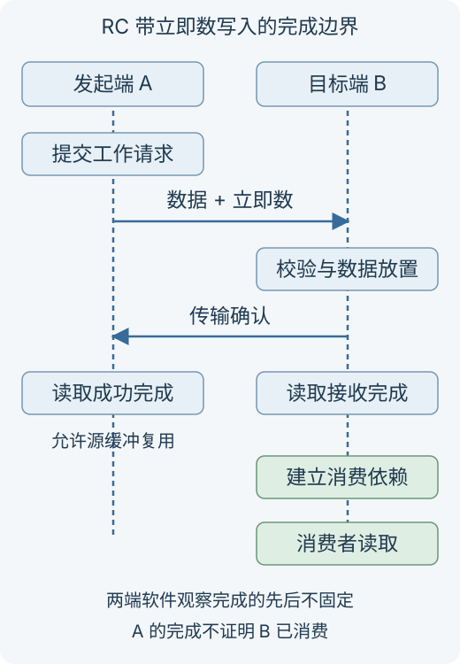

# 排序、完成与缓冲区复用：哪个事件允许程序继续？

上级：[RDMA 端点](README.md)

完成是接口承诺，不是一个通用时间点。解释程序正确性时，要写明观察者、操作类型和完成状态；不能仅写“等待通信完成”。

图中以合法的 RC Write with Immediate 为例。它不规定两端软件轮询 CQ 的先后，也不把远端消费当作发送完成的组成部分。

## 四个阶段分别允许什么

| 阶段 | 可以得到的判断 | 不能自动得到的判断 |
| --- | --- | --- |
| 提交接口返回成功 | 请求已被接口接受 | 数据已发送，或已到达对端 |
| 取得成功的发送工作完成 | 按该操作契约回收本地资源 | 远端应用已消费结果 |
| 远端取得规定的成功通知 | 按接口保证交付数据，并建立后续同步 | 任意 CPU／GPU 消费者都已同步 |
| 应用确认消费结束 | 按应用协议进入下一轮或归还目标缓冲 | 其他未参与协议的访问也已停止 |

非 inline 发送缓冲在设备仍可能读取时不可改写；inline 请求把数据纳入提交路径后，源缓冲可按接口规则更早复用。接收缓冲必须等相应接收完成并经正确同步后读取。[提交接口说明](https://github.com/linux-rdma/rdma-core/blob/master/libibverbs/man/ibv_post_send.3)

## 排队顺序不等于任意可见顺序

同一 QP 的服务具有具体排序规则，但不能推广为所有操作之间、多个 QP 之间的全局顺序。读和原子等操作还可能需要规定的 fence 条件。启用 MR relaxed ordering 后，部分写入顺序保证也会改变，完成保证则应按注册接口说明理解。[MR 排序属性](https://github.com/linux-rdma/rdma-core/blob/master/libibverbs/man/ibv_reg_mr.3)

反例：A 用 QP1 写数据，用 QP2 写“就绪”标志；B 看见标志就读数据。若没有跨 QP 的有效顺序与可见性机制，标志可能先到，这个程序不能靠“两个请求按顺序调用”证明正确。

## 通知之后还有本地消费者

远端轮询线程获得完成后，如果把任务交给另一个 CPU 线程，还需要语言和平台规定的同步。目标是 GPU 内存时，还需要相应 GPU 平台的可见性契约。缓存一致性不能代替这些依赖，见[一致性域与 I/O](../../COHERENCE/01-foundations/coherence-domains-and-io.md)。

失败完成也不能按成功完成使用返回数据。连接中断后，已执行到哪一步可能需要应用确认。资源回收应先阻止新请求，再排空或终止在途操作，最后撤销授权；错误处理不是省略生命周期约束的理由。
