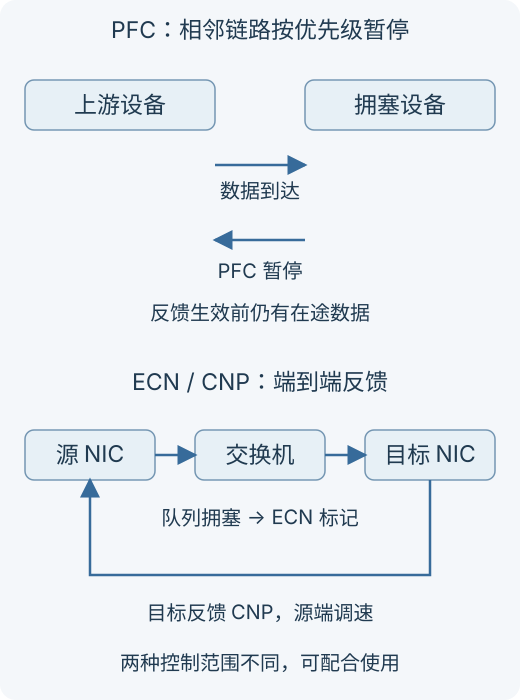

# PFC、Headroom 与暂停传播：怎样避免缓冲溢出？

上级：[RoCE](README.md)

PFC 按优先级暂停相邻链路上的部分流量。它解决接收资源即将不足时的链路发送约束，不负责为所有流公平分配端到端带宽。

## 暂停不会瞬间停止输入

下游检测到相关缓冲压力后发送 PFC 控制信息。信息需要时间到达上游，上游也需要时间响应；已经进入链路的数据仍会到达。因此，触发暂停时要保留足以接收后续在途数据的空间，常称为 headroom。

构造下界：若暂停触发后还会以 100 Gb/s 到达 1 μs 数据，仅这部分就占 **12,500 B**。实际预算还要考虑反馈传播、设备响应、帧粒度、阈值粒度及共享缓冲策略，不能直接把 12.5 kB 写成产品配置值。

[IEEE 802.1Qbb](https://1.ieee802.org/dcb/802-1qbb/)定义按优先级工作的机制。相同优先级中的多个流会受到共同暂停，即使只有其中一个目的地拥塞。

## 为什么暂停会向上游传播

被暂停的出口不能排空，相关上游队列可能继续增长，再触发更上游的暂停。一个局部热点因此可能影响更大范围。若共享队头挡住其他目的地，会形成队头阻塞；若资源等待成环且没有恢复条件，可能出现持续不前进。

把所有业务映射到同一无损优先级会扩大耦合范围。增加优先级也不自动消除依赖环，更不能增加物理容量。一般依赖分析见[NoC 死锁与饥饿](../../NOC/04-routing-and-flow-control/deadlock-livelock-starvation.md)，这里必须再结合真实队列与 PFC 映射检查。

## PFC 与 ECN 的分工

ECN/CNP 可以促使源端减少注入；PFC 在相邻链路约束特定类别。两者的反馈范围和反应时间不同。工程目标通常是让源端控制减少长期积压，而不是依赖持续暂停维持运行。[DCQCN 原论文](https://www.microsoft.com/en-us/research/publication/congestion-control-for-large-scale-rdma-deployments/)

PFC watchdog 等机制可能通过丢弃或恢复动作解除长时间停顿，但行为由产品定义。无损配置主要针对所设计条件内的拥塞丢帧，不保证链路无误码、设备不复位或业务永不失败。是否启用及如何配置，应结合[部署条件](deployment-and-isolation.md)验证。
