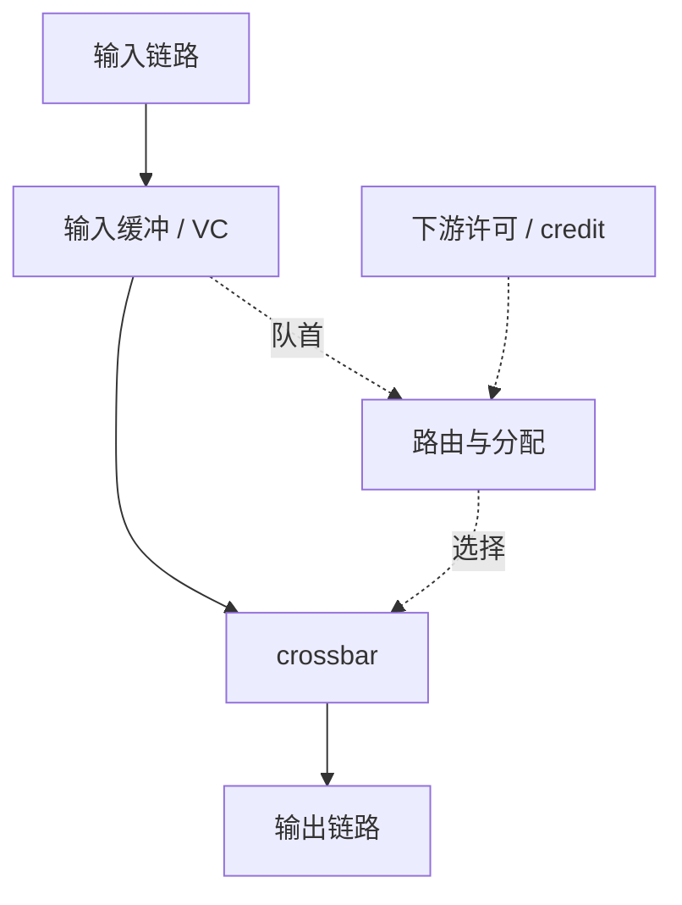

# NoC 路由器怎样逐步转发一个 Flit？

上级：[02 路由器与逐跳流控](../SUMMARY.md#02-router-microarchitecture)；原章节：[02 路由器与逐跳流控](./README.md)

相关：[输入缓冲组织](./input-buffer-organization.md)、[VC 与交换分配](./allocator-design-vc-switch.md)

路由器接收传输单元，为它选择输出，并在共享资源可用时转发。具体实现可以把这些工作合并，也可以拆成多个流水阶段。

## 路由器里有哪些资源

下面以输入缓冲、分包和逐跳流控的路由器为例：

实线表示示意的数据路径，虚线表示所需状态与控制。图中的下游许可和 credit 记录在当前路由器；它们如何更新取决于所选协议。

输入缓冲暂存 flit。路由逻辑选择候选输出；VC 分配记录下游逻辑通道的许可；交换分配决定哪些输入本拍能连接哪些输出。发送前还要检查所选流控条件。不同路由器可以使用其他缓冲位置、分配方式或旁路。

## 把工作划分为阶段

一种教学划分如下。阶段表示**工作**，不保证每一项都各占一个时钟周期。

| 工作 | 职责 | 本例中的对象 |
| --- | --- | --- |
| BW：Buffer Write | 将到达的 flit 写入输入缓冲。 | 每个 flit |
| RC：Route Computation | 根据路由规则选择输出。 | header |
| VA：VC Allocation | 为包申请一个可用的下游 VC。 | header |
| SA：Switch Allocation | 为可前进的队首选择本拍的交换通路。 | 每个候选 flit |
| ST、LT：Switch / Link Traversal | 穿过 crossbar，随后经过输出链路。 | 获胜 flit |

在本例中，VA 申请包可以复用的下游 VC 许可；SA 分配一次交换机会。两种资源的持有期不同，但它们可以由同一硬件逻辑联合或投机分配，不一定对应独立流水级。细节见 [VC 与交换分配](./allocator-design-vc-switch.md)。

接口握手表示一次接口传输是否发生。进入路由器后，还要看路由、缓冲、输出及仲裁是否允许继续前进。其他互连也可能有内部队列和资源竞争；不能仅凭接口名称推断内部流水。

## 一个构造的流水时间线

假设一个包按 H、B0、B1、T 的顺序进入同一个 input VC。H 为 header，T 为 tail。H 计算路由并取得下游 VC；后续 flit 复用该绑定，但仍须排到队首并获得交换机会。

表中各工作占一拍，SA 与 ST 在同一拍完成，LT 在下一拍进行。假设输入 FIFO 可同拍读写、容量足够，输出、credit 和仲裁均不阻塞。这里的数字是教学假设。

| Flit | BW | RC | VA | SA / ST | LT |
| --- | --- | --- | --- | --- | --- |
| H | 0 | 1 | 2 | 3 | 4 |
| B0 | 1 | — | — | 4 | 5 |
| B1 | 2 | — | — | 5 | 6 |
| T | 3 | — | — | 6 | 7 |

B0 可以在 H 做 RC 时进入 FIFO，但必须等 H 先离开队首。即使 VC 已建立绑定，B0 也可能继续等待 credit 或 SA。在本例中，flit 于成功的 SA / ST 拍离开输入 FIFO；其他实现应明确实际出队和返回 credit 的时刻。

不同 flit 的工作可以重叠：拍 4 中，H 在 LT，B0 可以进行 SA / ST。流水化可以提高持续吞吐；单个 flit 的时间还取决于级数、时钟和等待。

## 阶段与实际时钟

更多流水级可能减少每级组合路径，也可能增加经过节点的周期数。墙钟时间要按实际周期数和频率一起计算：例如 3 拍、500 MHz 是 6 ns；4 拍、1 GHz 是 4 ns。这只是算术示例，频率需要通过实现验证。

gem5 Garnet 2.0 的默认**模拟模型**在一个周期内处理 BW、RC、SA、VC 选择和 ST，下一周期进行 LT。它说明阶段可以组合，并不证明真实硬件都能达到这一时序。[gem5 Garnet 2.0](https://www.gem5.org/documentation/general_docs/ruby/garnet-2/)

## 与模拟器的时间边界

模型至少应能区分队列、包的路由与 VC 绑定、交换授权和链路状态。记录“到达、出队、发送、credit 可用”各发生在哪个采样点，再计算等待。

上表是分阶段教学例子。[模拟器时序契约](../08-simulator-construction/router-pipeline-pseudocode.md#时间与快照契约)采用另一套拍初读取、拍末提交规则，且允许 RC / VA / SA / ST 在一个有效拍内完成；两张表不能直接混用。

路由器需要协调路径、缓冲和共享输出；流水线是组织这些工作的实现选择。
