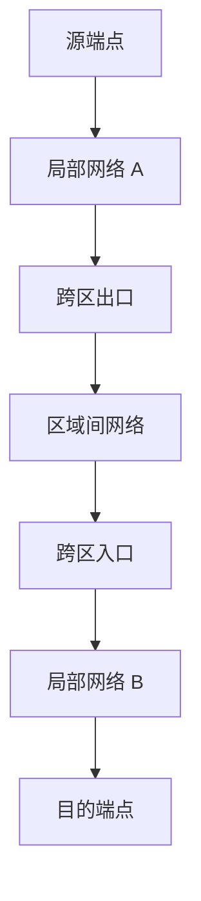

# 层次化与混合互连：局部网络怎样接入全局网络？

上级：[03 拓扑与物理组织](../SUMMARY.md#03-topology)；原章节：[03 拓扑与物理组织](./README.md)

相关：[Ring 与分层 Ring](./ring-and-hierarchical-ring.md)、[Crossbar 与 Concentrated Mesh](./crossbar-and-concentrated-mesh.md)、[拓扑选型](./topology-selection-framework.md)

一张网络可以按区域组织：区域内用局部连接，区域之间用另一组连接。这样做可能减少特定流量对全局资源的占用，也会引入需要共同服务跨区流量的边界资源。局部与全局的划分、连接数量和路径都需要明确给出。

## 先画出一次跨区传输

下面是教学示意。箭头表示一个方向的数据路径，不限定各段由一条还是多条物理链路组成。

如果源和目的都在 A，路径可能只经过局部网络 A；如果目的位于 B，则可能依次使用 A 的出口、区域间网络和 B 的入口。返回流量、仲裁和缓冲需按实现分别描述。不同系统的边界节点可以兼任局部和全局路由器，不一定是单独的设备。

## 局部与全局怎样组合

| 组织方式 | 局部连接 | 跨区连接 | 需要检查 |
| --- | --- | --- | --- |
| 集中接入的 Mesh | 多个端点接入一个路由器 | 路由器组成 Mesh | 端点是独立接入还是共享端口；路由器输出容量。 |
| 分层 Ring | 多个本地环 | 上层环连接区域 | 跨层位置、各方向带宽和选路。 |
| 局部网络加全局网络 | Crossbar、Ring、Mesh 等均可 | 可采用另一种连接图 | 入口、出口数量及其路由和共享关系。 |

这是几种构造方式，不是互斥分类。例如，[Dragonfly](./flattened-butterfly-dragonfly.md#分组连接dragonfly) 的路由器可以同时具有组内和组间端口。局部网络可以有多台路由器，一个区域也可以有多个跨区端口；“分层”不要求所有流量通过同一个 gateway。

## 用容量检查边界

假设一个区域有四个持续发送的端点，每个端点以 λ 向区外发送单播数据；所有这些流必须经过一个单方向容量为 W 的出口。忽略协议开销时，长期稳定服务的必要条件是：

> 4λ ≤ W。

即使局部网络容量足够，该出口也无法长期服务超过 W 的跨区流量。增加第二个出口可能增加可用容量，但需要流量能到达两个出口，且后续链路和目的端也有足够容量。仅增加端口数不能证明性能翻倍。

如果通信更多地留在本地区域，全局网络的负载可能减少。这个结果来自流量映射和实际路径，不能仅由拓扑分组保证。局部网络仍可能在输出端口、共享存储或交换节点发生竞争。

## 分层、混合和不规则有什么区别

**分层**强调区域及其连接的组织；**混合**表示组合不同类型的连接或网络；**不规则**表示节点或连接不满足所选的规则模式。这些维度可以组合，但彼此不等价。例如，不同节点采用不同数量的 express link 可以形成不规则网络，却不一定存在局部与全局层级。

比较候选时，要同时画出端点映射、各层或各区域的连接、每个方向的容量和可能的路径。跨 Die 的事务、网关和协议问题见[芯粒与跨 Die 互连](../06-ai-noc-specifics/chiplet-and-die-to-die-interconnect.md)；本页不假定局部分区必然对应芯粒。

## 设计时先回答什么

先确定端点之间的需求和物理分布，再选择区域边界。随后列出各区域的出入口、共享链路、队列和可用路径。比较不同划分时，既检查局部流量是否受到影响，也检查跨区负载和边界资源；最后再计入线长、时序和实现成本。
