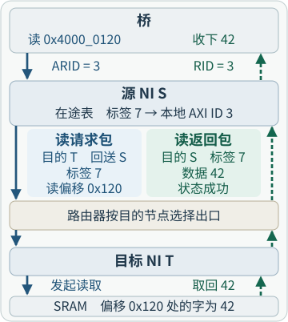

# 一次读取怎样变成 NoC 里的请求包和返回包？

上级：[05 端点与系统集成](../SUMMARY.md#05-system-integration) · 原章节：[05 端点与系统集成](./README.md)

桥要从片内地址 `0x4000_0120` 读出一个 32 位字，那里存着 42。在[上一篇的共享出口](../../BUS/02-fundamentals/arbitration-ordering-backpressure.md)上，我们看见了谁先交出读地址。现在沿桥和 SRAM 之间的连线多看一段：桥旁能看见一个地址，网络中间经过一个请求包，稍后又有一个包反向经过，里面才有 42。路由器凭什么把请求送对地方？回来的 42 又怎么交给桥正在等的那笔读？

## 地址交出去了，谁还记得桥在等什么？

在这颗教学用的芯片里，桥与 SRAM 控制器各自通过一个**网络接口**（Network Interface，NI）接到片上网络（NoC）。把桥旁的 NI 编号为 **S**，SRAM 旁的 NI 编号为 **T**。这两个字母标记网络上的两个端点。桥和控制器各有自己的 AXI4 接口，中间的链路传包。下图只跟踪一次单拍、对齐的 4 字节读。

桥先在读地址通道 AR 上给出地址、大小和读标识 `ARID=3`。S 有空位，在上升沿与桥握手。从下一个周期起，桥就可以把另一笔地址摆上线。假如 S 只把第一个地址往前递，随后清掉关于它的一切记录，等结果回来，S 就缺了重建 AXI 响应所需的信息。

本例给 S 一张**在途表**。它接收地址时分配一个当前空闲的表项，记下“标签 **7** 对应桥的读 ID **3**，应返回 4 字节，尚未交付”。标签 7 只在 S 当前未结束的请求中有这个含义。其他端点可以有自己的标签 7。于是回包需要说明两件事：**送回哪个端点**，以及**在那个端点查哪笔读**。实际硬件也可以靠有序队列或其他编码找回记录。

## 请求包里装什么，路由器又看什么？

S 先查系统地址映射。本例把从 `0x4000_0000` 到 `0x4000_FFFF` 的空间映射给 T。于是，“哪个端点”有了答案；用访问地址减去窗口基址，得出“端点内部哪里”，即字节偏移 `0x120`。本例假设这片普通 SRAM 已允许本次访问。换成受保护的区域，转换逻辑还要按系统约定传递或检查相应访问属性。[地址怎样映射到端点和路径？](./address-map-and-routing-table.md)

现在 S 能组成一份完整的**请求包**：操作是读，目的端是 T，返回端是 S，请求标签是 7，要从偏移 `0x120` 读 4 字节。它里面没有 42，因为此刻还没人去 SRAM 取数。假设这份请求装得进一个 128 bit 的传输单元。网络以这样的单位进行缓冲和流控，称为 **flit**。这里一个请求包恰好占一个 flit；等会儿同一笔读的返回包要占两个。

S 把准备好的 flit 放进注入队列。“注入”指它从 NI 被网络接走。只有下一段有接收空间、需要的出口也轮到它，本次注入才能发生。在本例的路由器里，转发逻辑依据包头中的**目的端 T** 选输出口。换一个目的端，可能换一条路；保持目的端不变，只把偏移从 `0x120` 改成 `0x124`，走的仍是这条路，最后读到的却是 SRAM 中的下一个字。实际设计也可以在包头携带预先算好的路径。[地址映射、选路与源路由](./address-map-and-routing-table.md#ni-decode-和-router-decode)

## T 收到了请求，42 还要经过几次交接？

T 取出偏移和长度，保留返回端 S 与标签 7，通过自己的本地接口向 SRAM 控制器发起一笔读。控制器接下地址，读出 42，再把数据和成功状态交给 T。T 现在才有材料组**返回包**。本例让返回包使用一个独立的头 flit（目的 S、标签 7、成功状态）和一个数据 flit（其中 4 字节有效，值为 42）。头部先到 S 时，S 已能查到应答哪笔读，但连一个字节的数据都还没收到。

下面给这次往返配上一组时刻。为便于读表，假设两端同钟，去程与回程各经过一个路由器，各段都有空间，桥始终愿意接收。每行描述相应**上升沿实际发生的交接**；周期数和包格式都是本例的设计条件。

| 上升沿 | 在哪里看 | 此时交付了什么 |
| ---: | --- | --- |
| 0 | 桥 → S | S 收下 AXI 读地址，给这笔读分配标签 7。 |
| 1 | S → 网络 | 请求 flit 注入，目的 T。 |
| 2 | 去程路由器 | 请求 flit 转入通往 T 的链路。 |
| 3 | 网络 → T | T 收到完整请求，知道要读偏移 `0x120`。 |
| 4 | T → 控制器 | 控制器接下本地读地址。 |
| 5 | 控制器 → T | T 收下 42 和成功状态，准备回包。 |
| 6、7 | T → 网络 | 第 6 沿注入返回头，第 7 沿注入数据。 |
| 8、9 | 网络 → S | 第 8 沿收下标签 7 和状态，第 9 沿收齐 42。 |
| 10 | S → 桥 | 桥握手收下 `RID=3`、数据 42、`RRESP=OKAY` 和末拍标志 `RLAST=1`。 |

第 9 沿，42 已经越过回程最后一段链路。第 10 沿，桥才在自己的读数据通道 R 上收下它。试着只改桥的一根信号：第 10、11 沿令 `RREADY=0`，第 12 沿才给 1。S 有地方暂存这一笔返回，所以表中第 0～9 沿均保持原样。S 将有效的 42、ID 和状态保持两拍，到第 12 沿才与桥握手。本例把表项一直留到这次交付才释放。若桥长期停收，后续返回可能逐渐填满 S 的缓冲，回压才会沿网络向上游传播。先等的是桥，现在卡住的却可能是远处一个路由器的出口。[Credit 与回压](../02-router-microarchitecture/credit-based-flow-control.md)

## 两笔读同时在途，先回来的属于谁？

回到 S 接完第一笔地址、仍在等它返回的时刻。假设 S 还有空位，桥又发出一笔单拍读。这次去另一个 SRAM 端点 U，那里相同偏移处存着 99。两笔可以在网络里同时前进。在途表此时有两行：

| S 的标签 | 桥的读 ID | 访问地址 | 目标 NI |
| :---: | :---: | --- | :---: |
| 7 | 3 | `0x4000_0120` | T |
| 8 | 5 | `0x5000_0120` | U |

先猜一猜：U 的回程更空，带标签 8 的 99 抢先到达 S，它会被当成先发出的那笔读吗？S 查第 8 项，找到桥的 ID 5，于是可以用 `RID=5` 交付 99；等标签 7 到达，再用 `RID=3` 交付 42。这里假设桥有接收空间，两笔读独立，允许不同 ID 的响应调换顺序。哪怕两个地址里恰好都存着 42，匹配过程也完全一样。

再把第二笔的 `ARID` 从 5 改成 3，仍让 U 的返回先到。S 用标签 8 一样能认出这是第二笔，但 AXI4 要求**同一发起接口上、同一读 ID 的响应按发出次序交付**。若 S 已经放行了两笔请求，就要记得谁在前，并留出地方暂存 99：先把标签 7 的 42 交给桥，之后才轮到标签 8。另一种实现可以在发出第二笔之前先等第一笔完成，省去部分重排状态，代价是减少并发。哪怕两笔恰好共用同一个虚通道（VC），也要按端点契约核对这一顺序。[Arm AXI4 规范 A6.6](https://developer.arm.com/-/media/Arm%20Developer%20Community/PDF/IHI0022H_amba_axi_protocol_spec.pdf?hash=6325311012DDADF238C35A6C0FD734E520754F82&la=en&revision=71bd7c57-2ed7-487b-bc3e-68c4ab56fa5f#page=89) · [事务拆分、顺序与完成](./transaction-ordering-and-completion.md)

具体硬件有不同做法。AMD Versal 的 NMU 在封包时查找目的端，并借助读重排缓冲给请求分配内部标签，记录每个 AXI ID 的先后关系。开源 FlooNoC 的设计也把事务 ID 与选路区分开来：AXI 事务 ID 随 flit 的载荷传递，路由器不靠它给 AXI 响应排序。这两个实例都可以拿来和 S 的在途表对照；表中的 7、8 和上面的包格式仅属于教学例子。[AMD Versal NMU](https://docs.amd.com/r/en-US/pg313-network-on-chip/NoC-Master-Unit) · [FlooNoC 的路由与 AXI ID 处理](https://pulp-platform.github.io/FlooNoC/floonoc/chimneys/#axi-transaction-id-handling)

## 128 bit 的链路，为什么没有每拍送来 16 字节读数？

看第 6、7 沿的**同一个回程端口**。它用了两次发送机会，合计送出 32 字节的线上内容，却只替桥带回 4 字节 SRAM 数据。头 flit 占 16 字节；下一个 flit 的 16 字节位置里只有 4 字节对这笔读有效。链路自己的宽度从未改变。

让这个端口以 1 GHz 连续发送，每拍一个 128 bit flit，原始容量就是 16 B/拍 × 10⁹ 拍/s = **16 GB/s**。若有足够多独立请求让回程一直忙，按本例的包格式，每个 4 B 返回占两拍，仅计算有效载荷就得到 4 B ÷ 2 拍 × 1 GHz = **2 GB/s**。把每个返回的有效数据增加到 64 B，仍用一个独立头，不另加尾 flit，也没有空拍。此时要四个数据 flit，总共五拍，64 B ÷ 5 拍 × 1 GHz = **12.8 GB/s**。两次都只量回程单向吞吐；单笔从桥发出到桥收下的往返延迟，要沿前面的时间表计算。

如果物理链路每拍只能搬 64 bit，一个 128 bit flit 就要拆成两次物理传输。每次物理传输的单位叫 **phit**，此时不能再套用“每拍一个 flit”的前提。有的产品还会把头信息与数据编码在一起。比如 AMD PG313 分别列出了它的读请求、读返回、写请求和写响应各占哪些 flit。估算某款芯片前，要先看所选方向的实际包格式。[Packet、Flit 与 Phit](../02-router-microarchitecture/packet-flit-phit-hierarchy.md) · [AMD 的封包开销示例](https://docs.amd.com/r/en-US/pg313-network-on-chip/Packetization-Overhead)

## 建模启示

要在仿真里跟住 42，可以从三处记账。**注入端**记录源、访问地址、目的端、在途标签及队列容量，区分端点请求已收与请求包已发。**网络内**记录包占几个 flit、何处等出口、何时有下游缓冲可用。**接收端**记录头和数据的到达、匹配、返回状态及端点握手。仅有防止缓冲溢出的流控，还要另查数据是否完整、错误是否归到原请求，以及端点是否真能前进。若目标返回错误，源 NI 仍须匹配这笔读，把错误状态交给发起者；超时后要考虑迟到的响应，过早复用标签可能把旧包交给新请求。

即使 NPU 的编译器能预定第 1 沿注入，也还要为 T 的服务和 S 的接收留空间与时隙。若端点使用流式接口，它也可能每到一拍就交一拍，未必需要像本例一样重组成一次内存读。配置寄存器、门铃通知和任务完成信号可以位于相邻的桥或 DMA；研究哪一段延迟，就在对应边界记事件。若两端不同时钟，还要计算跨域队列的传递与反馈时间。[跨时钟域、复位与流控](./clock-domains-and-reset.md)

现在可以暂时拿掉包里的 42，只留下两笔同时发出的读。它们去不同端点时能不能同时走？把目的端改成同一个，先挤满的又会是哪里？下一篇把同一组流量放到[共享总线、交叉开关与多跳 NoC](../01-overview/bus-vs-noc-vs-crossbar.md)上比较。
