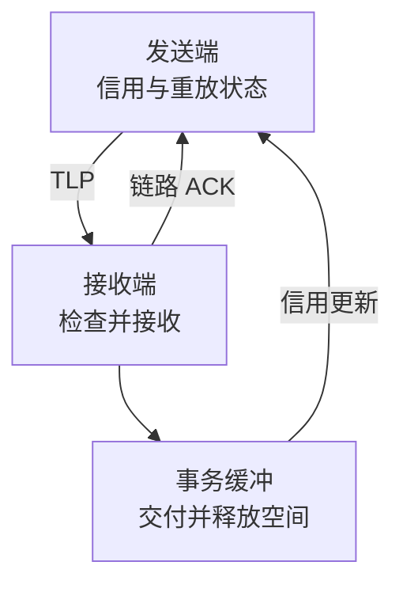

# 信用流控与链路重放：为什么有数据也不能发送？

上级：[链路、分层与事务基础](README.md)

发送队列有数据，并不代表下一个 TLP 可以立刻发送。发送端还要满足接收信用、链路状态、排序及本地资源条件。信用防止接收缓冲被超额占用；重放处理链路传输错误；Tag 跟踪需要 Completion 的事务。三者不能互相替代。

## 本文的观察边界

以下以一跳、一个 Virtual Channel（VC）、传统 Non-Flit 模式为例。信用按 Posted（P）、Non-Posted（NP）、Completion（Cpl）区分，并分别记录 Header 与 Data。它们表示接收端承诺的容量，不能跨类别随意借用。其他 VC、缩放信用和 Flit Mode 的编码及规则应按目标模式核查。

| TLP 示例 | 对应类别 | 传统信用需求 |
| --- | --- | --- |
| 带 256 B 数据的 Memory Write | P | 1 个 PH，16 个 PD |
| 无数据的 Memory Read 请求 | NP | 1 个 NPH，不消耗 NPD |
| 带 128 B 数据的 CplD | Cpl | 1 个 CplH，8 个 CplD data credit |

这里一个 data credit 表示 16 B，一个 header credit 表示一个 TLP 头所需的接收容量。Data credit 数按载荷字节向上取整；表中不表示整包线上字节数。依据：[AMD 信用单位说明](https://docs.amd.com/r/en-US/pg054-7series-pcie/Flow-Control-Credit-Information)。

## 一个有限信用的发送例子

假设发送端已完成信用初始化，看到接收端可用 PH=2、PD=20；没有其他阻塞，两笔待发 Memory Write 都带 256 B 数据。

| 时刻或事件 | 发送端可用信用 | 结果 |
| --- | --- | --- |
| 初始 | PH=2，PD=20 | 第一笔满足条件 |
| 第一笔获得发送资格并记账 | PH=1，PD=4 | 第二笔缺少 12 个 PD，必须等待 |
| 第一笔收到链路 ACK | 仍可能是 PH=1，PD=4 | ACK 本身不返还接收信用 |
| 接收端释放空间，更新传到发送端并生效 | 假设恢复为 PH=2，PD=20 | 第二笔才可能获得发送资格 |

即使接收端已经腾出空间，更新还在途中时发送端也不能提前使用。更新信息可累计表达信用进展；上表是容量记账模型，不是 PCIe 信用计数字段的逐位实现。真实实现还要处理计数回绕、初始化和更新规则。

## 链路 ACK 为什么不等于信用返还

接收端可以已正确接收 TLP，却尚未把内容交给下一模块。此时它能确认传输，但缓冲区仍被占用。反过来，信用更新并不确认某笔端到端事务成功。

图中两条返回路径表达不同事件，不规定它们是两根物理线，也不规定固定周期。

## 重放怎样恢复链路传输

Non-Flit 发送端为尚未确认的 TLP 保留重放副本。接收端依据序号和完整性检查处理数据，并按规则发送 ACK/NAK。NAK 或重放计时条件可触发重传；累计 ACK 推进可回收范围。重放继续使用原传输的序号与记账关系，不能把副本当成新的应用事务重复执行或重复扣一份新 TLP 信用。

重放会再次占用链路时间，也可能阻塞新包。它不重新执行设备软件命令，更不替代 Completion Timeout 的错误恢复。链路无法恢复时，还需设备、平台和软件处理。机制背景见 [Altera PCIe 协议栈](https://docs.altera.com/r/docs/683093/current/pci-express-protocol-stack)。

## 三种等待，三种释放条件

| 等待对象 | 阻塞原因 | 恢复条件 |
| --- | --- | --- |
| 接收信用 | 对应类别的 Header 或 Data 容量不足 | 接收空间释放，信用更新生效 |
| 重放资源 | 尚未确认的链路数据占用资源，或正在重放 | 链路确认推进并满足发送规则 |
| 请求 Tag / 槽 | Requester 已有过多待完成请求 | 所需 Completion 收齐，或进入规定的错误终止流程 |

因此，“Tag 全空但 PD 不足”能阻塞写发送；“请求信用足够但 Tag 全占用”能阻塞新读；“ACK 已到但读未完成”则完全正常。

## 无限通告不等于无限物理内存

Endpoint 的 Completion 信用存在无限通告的特殊规则。Requester 仍须在发读请求前保证可能返回的 Completion 有足够接收空间。否则不能指望通过普通有限 Completion 信用把所有风险留给对端。缓冲预算还要考虑合法的最坏分包及包头数量，见 [AMD Completion 接收缓冲说明](https://docs.amd.com/r/en-US/pg213-pcie4-ultrascale-plus/Managing-Receive-Buffer-Space-for-Inbound-Completions)。

## Flit Mode 与测量边界

Flit Mode 改用 Flit 组织数据和保护信息，控制承载及重放规则也不同。不能给每个 TLP 再加旧模式的独立 LCRC，或按旧 DLLP 字节固定折扣。[PCI-SIG Gen6 说明](https://pcisig.com/blog/evolution-pci-express-specification-its-sixth-generation-third-decade-and-still-going-strong)解释了 Flit、CRC、FEC 与链路重试的组合。

定位等待时，同窗记录信用阻塞、本地缓冲、Tag 占用、重放增量及方向吞吐。AER 负责错误记录与报告；日志条数不是重放次数。性能上的下一步见[瓶颈拆解](../05-performance-debug/host-device-bottleneck-breakdown.md)。
