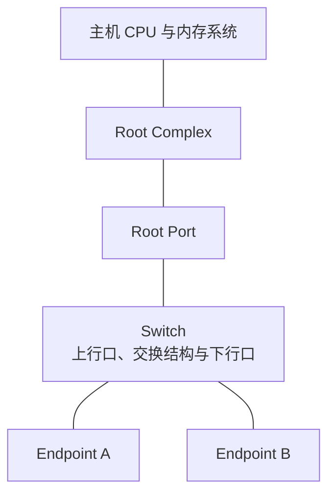

# Root Complex、Switch、Endpoint：请求经过谁？

上级：[链路、分层与事务基础](README.md)

PCIe 拓扑决定请求可达性和共享资源。系统角色描述组件的位置；Requester 与 Completer 描述一笔事务中的职责。Endpoint 可以发起 DMA 读取，也可以接收主机对 BAR 的读取，不能把 Endpoint 固定理解成被动目标。

## 三个基本角色

| 组件 | 输入与职责 | 输出或连接 |
| --- | --- | --- |
| Root Complex（RC） | 连接主机处理器、内存系统与 PCIe 层次 | 通过 Root Port 等主机侧接口连接 PCIe 组件 |
| Root Port | 主机侧的 PCIe 端口，向下连接一条链路 | Endpoint 或 Switch 的上行端口 |
| Switch | 按请求地址、ID 或消息路由规则转发事务 | 上行或下行端口；符合条件时可在下行端口间转发 |
| Endpoint（EP） | 承载设备功能，处理寄存器访问并可发起内存事务 | 主机内存、主机通知路径或可达的对端资源 |

一个 RC 可关联多个 Root Port。一个设备可有多个 Function，软件配置与身份管理通常落到 Function，而不是把整块板卡当成唯一配置对象。

## 一个最常见系统图

主机与 Root Complex、Root Complex 与 Root Port 之间的线表示组织关系；Root Port 以下的线表示 PCIe 链路。Switch 框合并表示端口与内部交换结构。

每条 PCIe 链路均为双向链路，不表示所有方向共享同一份线速容量。xN 表示 N 条 lane；每条 lane 有独立发送与接收差分对。链路实际速率和宽度以协商结果为准。

## 共享上行口怎样限制吞吐

假设 A、B 都向主机执行 DMA 写，且没有其他限制。A→Switch 与 B→Switch 是不同链路，但两股数据都要经过 Switch→Root Port 的同一方向。其有效吞吐之和不能超过这段路径可提供的有效服务带宽。

若 A 向主机写，而 B 从主机读，B 的大部分读数据沿 Root Port→Switch 返回。二者主要载荷处在相反方向，不能简单相加后与一个单向带宽比较。它们仍可能竞争 Switch 内部、主机内存或其他资源。

若 A 向 B 的 BAR 资源做 P2P 写，且平台与 ACS 配置允许本地转发，载荷可不经过上行链路。同一 Switch 只提供拓扑条件，不保证驱动映射和隔离策略已允许该访问。

## 拓扑记录应包含什么

记录每跳端口、实际速率与宽度、上游桥窗口、NUMA 位置及 P2P 路由条件。插槽外形、Endpoint 标称 x16 或某一端的能力寄存器，都不能替代整条路径的记录。

接下来读[三层职责](layered-architecture-transaction-data-link-physical.md)。P2P 的例外与平台限制见 [Linux P2P DMA 文档](https://docs.kernel.org/driver-api/pci/p2pdma.html)及[专题文章](../07-advanced-topics/p2p-switch-topology-constraints.md)。
