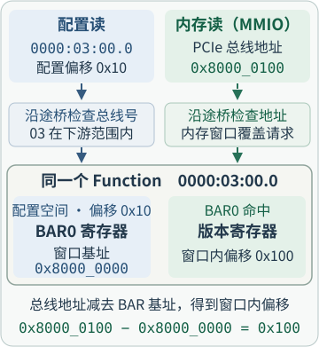

# 主机第一次读卡上的寄存器，地址是怎么来的？

上级：[配置、枚举与地址映射](README.md)

一张加速卡刚插进机器。驱动想读卡上的版本寄存器，设备手册却只写着“BAR0 内偏移 `0x100`，宽 32 位”。这个偏移从哪里起算？如果主机连卡的地址都还不知道，又怎么找到卡，给它分配地址？

[前面那笔跨桥读取](../06-workloads-case-studies/pcie-vs-axi-noc-boundary.md)从一个已经可用的 64 KiB 窗口读回了 42。这次回到同一张卡的上电阶段。我们先读一个版本寄存器，再看为什么系统已经列出了设备，寄存器仍可能读不到。下文的拓扑、基址、卡内布局和寄存器值都是教学假设。

## 还没有 BAR 地址，主机先读哪里？

每个 PCIe **Function** 都给系统软件提供一个标准的配置入口。可以把 Function 理解为系统能够单独识别和配置的一项设备功能；一张物理卡可以提供多项功能。即使业务寄存器还没有分到地址，主机也能尝试读取已可达 Function 的配置空间。这里需要的是三样信息：走哪个 PCI 域、找哪一个 Function、读它配置空间内的哪个偏移。

枚举时，固件或操作系统先从平台获知根桥以及访问配置空间的机制，再沿总线探测可能存在的 Function。读配置偏移 `0x00` 可以取得 Vendor ID 和 Device ID。一个有效应答说明这项功能在配置路径上可达。若识别出桥，系统配置或沿用它的下游总线号范围，再继续向下探测。这就是**枚举**。例如有的平台用 ECAM 把配置访问映射到一段专用的 CPU 地址窗口，主机桥据此生成配置请求；端点自己的 BAR 此时可以尚未分配。[Linux 对主机桥和配置访问机制的说明](https://docs.kernel.org/PCI/acpi-info.html)

本例中，根端口 `00:01.0` 连接交换机上行端口 `01:00.0`，交换机下行端口 `02:01.0` 再连接加速卡。扫描后，卡的一个 Function 记为 **`0000:03:00.0`**：`0000` 是域，`03` 是总线号，`00` 是设备号，最后的 `0` 是功能号。后三项合称 BDF。向它发配置读时，桥根据总线号范围把请求送向正确分支。每座桥的角色和它覆盖的总线号，可以在[桥的总线号与地址窗口](enumeration-bus-number-resource-allocation.md)里逐个核对。

## 读配置偏移 0x10，为什么读不到版本号？

普通端点采用 Type 0 配置头，其中偏移 **`0x10`** 放的是第一个基址寄存器，叫 **BAR0**（Base Address Register）。它让系统为设备的一块资源安排地址。卡的设计者决定这块资源里面有哪些寄存器、每个寄存器在哪个偏移；系统软件决定把整个窗口放到 PCI 总线地址空间的哪里。版本寄存器所在的 **BAR0 内偏移 `0x100`**，和配置头里的 `0x10` 是两个不同空间里的偏移。

先看系统怎么知道窗口要多大。设这项功能实现了一个普通的 **32 位、不可预取的 Memory BAR**。在允许进行资源探测的初始化阶段，系统可以暂时关闭相应地址译码，保存原值，对 BAR 做标准的全 1 探测，读回掩码，再恢复原值或写入分配结果。这里关心的是读回的哪些位能改变。设备需要在一个 64 KiB 窗口里区分 65,536 个字节，所以地址的低 16 位属于窗口内部偏移，不能用来随意放置基址。

本例读回 `0xFFFF_0000`。屏蔽 Memory BAR 低 4 位的类型与属性后，地址掩码仍是 `0xFFFF_0000`。在 **32 位宽度**内取反，得到 `0x0000_FFFF`，再加一就是 `0x0001_0000`，即 **64 KiB**。因此这个 BAR 需要 64 KiB 对齐的基址。这里算出的是设备声明的地址范围；里面可以有寄存器、SRAM，也可以有保留的空洞。Resizable BAR 另有支持尺寸和尺寸选择机制。正常驱动从系统已登记的资源取得范围，无需在工作中的设备上重新探测。[Linux 的 BAR 探测实现](https://codebrowser.dev/linux/linux/drivers/pci/probe.c.html) · [PCI 配置寄存器布局](https://github.com/torvalds/linux/blob/master/include/uapi/linux/pci_regs.h)

Type 0 头为 BAR 留了六个 32 位槽。一个 64 位 Memory BAR 的低、高两部分要占相邻两个槽，有的槽也可能没有实现；设备手册中的有效窗口数因此可能少于六个。BAR 还可以声明 I/O 空间资源。这里选用 Memory BAR，后面的首次访问才是内存映射 I/O（MMIO）读。

## 从 64 KiB 窗口算到卡上的一个寄存器

设系统从可用的 PCI 内存地址范围中，给 BAR0 分配 **`0x8000_0000`**。窗口的最后一个字节是基址加大小减一，得到 `0x8000_FFFF`。系统还要设置沿途各桥允许向下转发的 Memory 窗口。假设这条路径上每一级适用窗口都覆盖 `0x8000_0000–0x800F_FFFF`，并已开启内存转发；端点 Command 寄存器里的 **Memory Space Enable** 也已置位，允许它响应命中自己 Memory BAR 的请求。桥这里开放的是 1 MiB 下游范围，卡只占其中 64 KiB。

驱动取得 BAR0 资源并建立 CPU 可用的 I/O 映射。比如在 Linux 上，可以申请对应区域，使用 `pci_iomap()` 一类接口取得 I/O 映射，再从映射起点加 `0x100` 的位置用 `ioread32()` 读取 4 字节。这里为了便于核对，假设主机侧物理资源与 PCI 总线资源数值相同。其他平台上主机桥可以平移地址，驱动得到的 I/O 映射也有自己的地址，不能把配置空间里读到的 BAR 数字直接当成 CPU 指针。[Linux PCI 驱动的资源访问流程](https://docs.kernel.org/PCI/pci.html) · [Linux 设备 I/O 访问接口](https://docs.kernel.org/driver-api/device-io.html)

| 观察位置 | 这一次读发生了什么 |
| --- | --- |
| 主机侧 PCIe 请求端 | 发出一笔 4 字节 Memory Read，总线地址为 `0x8000_0100`，即 BAR0 基址加 `0x100`。 |
| 沿途的桥 | 逐级检查这个地址是否落在可转发的范围内，送往加速卡所在的下游端口。 |
| 加速卡的 BAR 译码 | 命中 BAR0，减去基址得到偏移 `0x100`。本例把 BAR0 起点接到片内 `0x4000_0000`，于是片内读地址是 `0x4000_0100`。 |
| 卡上的寄存器及回程 | 版本寄存器交出假定值 `0x0001_0002`。端点用带数据的完成包应答，主机侧按请求者标识和 Tag 匹配到原来的读。 |

现在再读 **BAR0 内偏移 `0x120`**。桥窗口和 BAR0 基址都不用动，总线地址变成 `0x8000_0120`，片内地址变成 `0x4000_0120`。那是前面存着 42 的 SRAM 字。两个值分别来自哪一个电路，是卡内地址译码决定的。若设备手册没为某个偏移定义寄存器，仅凭“数字落在 64 KiB 内”无法预测应答内容。[PCIe 到 AXI 的地址转换实例](https://docs.amd.com/r/en-US/pg194-axi-bridge-pcie-gen3/Address-Translation)

## 只改一个桥窗口，主机还能看见这张卡吗？

保持链路、BDF、总线号范围、端点 BAR0 和使能位全都不变。**只把最后一个下行端口 `02:01.0` 的 Memory 窗口改到 `0x8010_0000–0x801F_FFFF`**。试着分别判断下面两笔读。

- **配置读。** 请求仍定位 `0000:03:00.0`，目标总线 03 仍在配置路由范围内。主机可以读到 Vendor ID，也可以从配置偏移 `0x10` 读到已分配的 BAR0 基址 `0x8000_0000`。
- **版本寄存器读。** 请求带的是地址 `0x8000_0100`。最后一级桥允许的范围从 `0x8010_0000` 才开始，这笔请求无法从该端口到达版本寄存器。具体会观察到什么错误取决于平台和处理路径；单凭一个异常读值，定位不到是哪一级出了问题。

这就解释了为什么在 `lspci` 里看见设备、甚至看到一个合理的 BAR 基址，仍不足以证明驱动能读到寄存器。排查时先沿拓扑找到设备和上游端口，再逐级核对地址窗口与 Memory Space Enable。链路带宽是另一个问题：`LnkCap` 描述端口能力，`LnkSta` 给出这条链路当前协商的速率和宽度。完整的只读示例标出了树上应该对照哪两个端口，以及为什么 16 GT/s ×8 的能力可以同时伴随 8 GT/s ×4 的状态。[带注解的 lspci 拓扑和端口输出](../05-performance-debug/aer-counters-link-debug.md#从只读记录开始)

## 看到一种 Capability，驱动已经能用它了吗？

配置空间还告诉驱动可以使用哪些能力。PCIe 每个 Function 的配置空间最多 4 KiB；前 256 字节与传统 PCI 布局兼容。传统 Capability 和从配置偏移 `0x100` 开始的 Extended Capability 是两套分别遍历的链表。例如 MSI-X 和 PCI Express Capability 位于传统链，SR-IOV 使用扩展链。这里又出现了一次 `0x100`：若读的是**配置空间**的这个偏移，查的是扩展能力头；若读的是本卡 **BAR0** 的这个偏移，才会取到版本号。

以 MSI-X 为例。配置空间中的能力项指明它支持 MSI-X，并给出中断表和待处理中断位数组（PBA）各自位于哪个 BAR、从什么偏移开始。表本身在相应的 BAR 窗口里。驱动还要取得中断资源，配置相应表项与屏蔽状态并使能，才能按选定方式接收中断。读一次版本号不要求 MSI-X 已开启，也不要求打开控制设备主动发起普通 DMA 的 **Bus Master Enable**。[Linux MSI/MSI-X 指南](https://docs.kernel.org/PCI/msi-howto.html)

到这里可以把方向调过来想。主机读版本号，卡是被访问的目标，地址落在它的 BAR 内。卡主动搬运主机缓冲区时，它成了请求者，要使用平台为该缓冲区建立的 DMA 地址和权限。NVMe 更能看清这两种方向：主机可以通过 BAR 写门铃，控制器再发起 DMA 去取提交队列里的命令。这是两笔不同的访问。[配置、BAR 与 DMA 的地址视角](mmio-config-dma-address-view.md) · [设备如何发起 DMA](../04-data-path-dma-interrupts/device-dma-read-write-flow.md) · [NVMe 队列与数据路径](../06-workloads-case-studies/nvme-queue-data-path-case-card.md)

如果把发起方和目标寄存器分别放到同一封装里的两颗裸片上，接收端采到了信号，发起方还要等哪几步才能拿到 4 个字节？下一篇跟踪[一次跨芯粒的寄存器读](../../D2D/ucie-pcie-read.md)。
