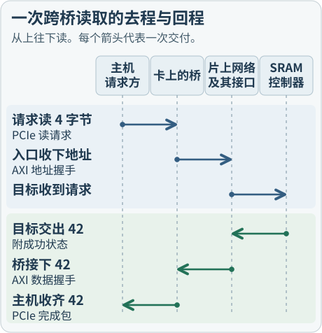

# 一次跨桥读取：设备已经收到请求，主机为什么还在等？

上级：[工作负载与案例](README.md)

主机要从一张加速卡上读 4 个字节。我们事先把设备内存中的这个位置写成了 42。现在盯着卡的 PCIe 接口：读请求到了，地址对，长度也是 4 字节。如果此刻暂停这张卡内部的片上网络，主机还能得到 42 吗？

先做一次不暂停的读取。只追踪这 4 个字节，看看请求到了哪里，42 又是从哪一刻开始往回走的。

## 主机发出去的包里有什么？

加速卡上有一小块 SRAM，也就是能按地址读写的片上存储器。主机的软件已经取得这块设备内存的映射，要读其中偏移 `0x120` 的一个 32 位字。沿着驱动准备好的映射读下去，主机侧的 PCIe 请求方发出一笔 **Memory Read**。这笔请求带着目标地址、读取长度和用来匹配返回的标识。此时，保存着 42 的地方仍在卡内。请求方手里只有“要读哪里”，42 还无从得知。

同一份数据，从卡外和卡内看，可以有两个不同的地址。假设系统为这张卡分配的 PCIe 地址窗口从 `0x8000_0000` 起，大小是 64 KiB。这个窗口通过设备的基址寄存器 **BAR** 配置。设备内部另有一条映射，把窗口起点接到片内地址 `0x4000_0000`。现在这笔请求到了卡边，PCIe 总线地址是 `0x8000_0120`。桥要往片内发什么地址？

先减去窗口起点，得到偏移 `0x120`；再加上片内基址，得到 `0x4000_0120`。硬件可以用地址比较和位拼接实现这组映射。这里写成加减法，是为了让我们能用手算出两边指向的是同一处。本例中的窗口已配置，访问对齐且合法。驱动使用的 CPU 虚拟地址由操作系统另行映射。[AMD PG194 的 PCIe 与 AXI 地址映射示例](https://docs.amd.com/r/en-US/pg194-axi-bridge-pcie-gen3/Address-Translation) · [Linux 的 PCI 设备资源访问](https://docs.kernel.org/PCI/pci.html)

如果这张卡刚上电，主机怎样先找到它、再把这 64 KiB 分给它？窗口建立的过程见[《主机第一次读卡上的寄存器，地址是怎么来的？》](../03-configuration-enumeration-addressing/config-space-bar-capability.md)。

## 桥把地址交出去时，谁接住了它？

桥在卡边接收 PCIe 读请求，接下来要向片内发起另一次读。假设这张教学用的卡选用 **AXI** 来约定模块在接口上怎样交付地址和数据，又选用**片上网络 NoC** 来连接相隔一段距离的模块。先只看紧挨着桥的那个网络入口。

桥把 `0x4000_0120` 放上 AXI 读地址通道，并举起一个信号 `ARVALID`，意思是“这笔读的地址和控制信息已经摆好”。入口有地方接收时，举起 `ARREADY`。在同一个时钟采样沿，两者都为 1，入口就接下这笔地址。假如入口已经满了，它可以让 `ARREADY` 保持为 0。桥会把这笔地址和有效信号保持住，等到真正交付的那个沿。[Arm AMBA AXI 规范，单接口握手规则](https://documentation-service.arm.com/static/63ff0ebd56ea36189d4e7ee7)

现在让入口腾出一个位置，接下地址，再把通往 SRAM 的网络出口暂时占住。此刻可以同时观察到两件事：桥侧的地址握手已经发生，SRAM 控制器却还没有接到这笔读。两者之间有一段会保存请求、也会让请求排队的网络。**“地址已被接受”这个判断，必须连同接受它的接口一起读。**

网络入口根据片内地址找出通往 SRAM 控制器的目的端，把此次读需要的信息装成请求包。等出口可用，片上路由器才把包送向下一跳。到达目标端的网络接口后，接口从包里还原出读操作，把它交给 SRAM 控制器。PCIe、AXI 和 NoC 就是在这里碰到一起的：卡外用 PCIe 提出读操作，桥和片内模块按 AXI 交接，片上网络承担中间那段运输。另一张卡可以用直接连线或交叉开关连接桥和目标。[AMD PG313 中一次 AXI 读取经过 NoC 的实际例子](https://docs.amd.com/r/en-US/pg313-network-on-chip/Read-Transactions)

## SRAM 已经给出 42，主机还要等什么？

看下面的图。上半段从左往右读。最右边的控制器取得那个 32 位字以后，再沿下半段往左读。每个箭头表示一次交付，相邻箭头之间可以隔许多时钟周期。

控制器已经读出 42 时，这 4 个字节可能仍在它的输出寄存器里。目标端的网络接口收下数据，带着成功状态把它送上回程。回程也要争用链路；即使 SRAM 只需很短时间给出值，返回包仍可能等在出口。直到靠近桥的网络接口在 AXI 读数据通道上给出有效数据，桥也表示可以接收，并在采样沿完成握手，42 才真正到了桥。读地址通道叫 **AR**，承载返回数据的通道叫 **R**；上节和本节观察的是两个不同的采样沿。

桥现在有了数据，还得告诉卡外当初等这笔读的请求方。它把 42、成功状态和原请求的身份装进带数据的完成包 **Completion with Data**，简称 **CplD**，经 PCIe 送回。对于本例的一笔对齐 4 字节成功读，一个包就能带回全部结果。主机侧请求方收下它，匹配到原读，确认状态并收齐 4 字节，这笔 PCIe 读才成功完成。这里把终点画在主机侧的 PCIe 请求方；继续追踪软件何时用到 42，还要再看主机内部的交付过程。[PCIe 完成包中携带的请求与状态字段](https://docs.amd.com/r/1.0-English/pg343-pcie-versal/Completer-Completion-Descriptor-Format)

## 如果第二笔数据先回来，桥凭什么知道是谁的？

先前只有一笔读，只要数据回来，桥就知道主机在等它。现在让同一个 PCIe 请求方独立地发出 A、B 两笔读，且允许它们同时在途。A 读刚才的位置，结果是 42；B 读另一个可独立服务的位置，结果是 99。假设这座桥给两笔读分配不同的片内 AXI ID，所选实现允许这两笔读交换返回顺序。

桥可以临时记下两行。数字是为这个例子挑的。

| 请求 | PCIe 侧需记住的身份 | 桥在这个 AXI 口分配的读 ID |
| --- | --- | --- |
| A，读出 42 | 请求方 H，Tag 5 | 2 |
| B，读出 99 | 请求方 H，Tag 6 | 7 |

把 A 的目标端口占住，B 的目标端先空出来。桥先收到片内返回 `RID=7`、数据 99。查第二行，它就知道该构造交给 H、带 **Tag 6** 的完成包。等 `RID=2` 的 42 回来，再按第一行返回 **Tag 5**。如果桥只记得“我先发了 A”，把第一个返回的 99 配给 A，那么两次传输的每个比特都可能是对的，主机拿到的两个答案却都错了。

PCIe 把 Tag 放在请求者的标识空间内使用，所以这里一直把 **请求方和 Tag** 写在一起。在这个只有两笔在途读的桥模型里，每笔读各占一行。真实的桥可以限制并发，或把一笔访问拆成多笔、另行维护进度。AXI 也允许多笔读共用 ID，桥还得遵守相应的同 ID 返回顺序。把这个例子的 2 和 7 换成别的合法编号，查表仍然成立。[Arm AMBA AXI 规范，事务标识与顺序](https://documentation-service.arm.com/static/63ff0ebd56ea36189d4e7ee7) · [PCIe 在途读与返回跟踪](https://docs.amd.com/r/en-US/pg054-7series-pcie/Tracking-Non-Posted-Requests-and-Inbound-Completions)

## 读慢了，能从哪两个位置看出原因？

回到只读 42 的那笔访问。在同一教学时间轴上放四个标记。时间值纯为演算，各模块在真实硬件上可以使用各自的时钟。

| 时间 | 在哪里观察到了什么 |
| --- | --- |
| 0 ns | 主机侧发出读请求。 |
| 20 ns | 桥旁的网络入口接下 AXI 读地址。 |
| 50 ns | 桥在 AXI 返回通道接下 42。 |
| 80 ns | 主机侧请求方收齐成功返回。 |

从主机看，读了 **80 ns**。从桥的两个 AXI 通道看，过去了 **50 − 20 = 30 ns**。这 30 ns 里包括片内去程、目标服务和片内回程。单凭这一个差值，无法判断 SRAM 本身读了多久。

只改一个条件：让片内请求在一个忙碌出口多等 12 ns，其余服务时间都保持原样。第三个标记移到 62 ns，第四个移到 92 ns。主机时间和桥侧的 AXI 读时间都增加了 12 ns。再重新从原来的 80 ns 出发，这次让桥已经拿到 42 之后多等 12 ns 才能发出完成包。主机同样在 92 ns 收齐，桥侧的 AXI 读却仍是 30 ns。

如果手头只有“主机 92 ns、片内 30 ns”这两个差值，只能把多出来的等待缩小到片内测量区间之外。读请求在桥发起 AXI 之前多等 12 ns，同样能得到这两个数。此时把桥接收请求、形成完成包或发出完成包的时刻也记下来，才有机会区分去程与回程。

## 换成错误返回，或者换成写，图上哪个箭头会变？

假设桥已接下读请求，片内译码却报告目标地址不可达。桥现在取得的是一个错误结果。在 AMD 的一款桥实现中，片内 AXI 的译码错误可以被转换成 PCIe 的 Unsupported Request 状态，报告给原请求方。主机由此知道这笔读失败；这条路径没有一个可当作成功读数的 42。其他错误和其他桥实现要看相应的映射约定。更长的成功读也可以分成多个完成包，主机要等这笔请求所需的全部数据到齐。[AMD QDMA 的 AXI 译码错误映射](https://docs.amd.com/r/en-US/pg302-qdma/AXI-DECERR-Response) · [一笔 PCIe 读对应多个完成包](https://docs.amd.com/r/en-US/pg054-7series-pcie/Tracking-Non-Posted-Requests-and-Inbound-Completions)

再把开头的操作改成普通 PCIe **Memory Write**：主机把 42 写进这块 SRAM。这一次，数据从一开始就随写请求向设备前进。桥可以在片内 AXI **B** 通道得到写响应；普通 PCIe 内存写采用 posted 方式，主机不会为每笔这样的写收到一个事务级成功 Completion。若软件要据此继续执行，还须按设备与平台的约定判断写入何时对后续观察者可见。一个桥内接口上的写响应只能说明该接口承诺的事情。[AMD PCIe 桥对 posted 写及完成包的说明](https://docs.amd.com/api/khub/documents/3lREbKrL5IGIzGahJHt7Xw/content)

最后再把卡暂停两次。第一次，停在读地址刚被网络入口接下的瞬间：**谁知道要读哪里？谁刚刚还没看到请求？** 第二次，让 SRAM 顺利读出 42，让返回包停在桥前：**谁已经知道答案？谁仍然没有可以发给主机的数据？** 把这两个位置沿图指出来，就能解释开头那一幕。卡边收到的是一个问题。要让主机得到 42，这个问题还要抵达保存它的地方，答案还要沿回程交到当初提问的一方。

下一篇沿用这个值为 42 的读请求，把镜头停在桥和片上网络入口之间，看清地址和数据分别在哪一拍交付。[地址已经收下，数据为什么还没回来？](../../BUS/02-fundamentals/transaction-address-data-response.md)

如果更想看网络入口怎样封包，可接着读 [NoC 网络接口](../../NOC/05-system-integration/ni-network-interface-design.md)。
