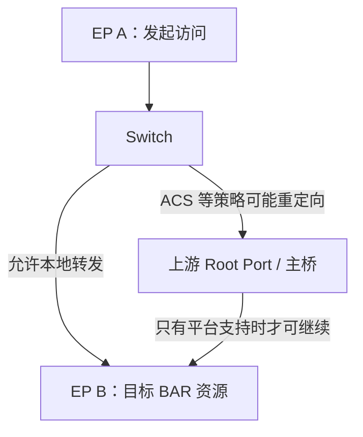

# PCIe P2P：对端资源、路由与隔离必须同时成立

上级：[高级主题](README.md)

P2P DMA 是设备直接访问另一设备可供访问的资源，例如对端 BAR 中的一段内存。普通设备到主机内存的 DMA 也不需要 CPU 逐字节搬运，因此“CPU 不复制”不能作为 P2P 的定义。

## 从目标资源开始检查

目标设备必须公开适合该访问的资源，提供者与请求者的驱动需要协同建立映射与生命周期。不能把有副作用的任意 MMIO 寄存器区直接当成普通共享内存。

| 条件 | 问题 |
| --- | --- |
| 目标 | 哪个 BAR 区域允许对端读写？ |
| 请求者 | 使用什么 DMA 地址、宽度和访问类型？ |
| 路径 | TLP 会本地下行口转发，还是被重定向到上游？ |
| 隔离 | ACS、IOMMU 与平台策略是否允许该路径？ |
| 生命周期 | 对端移除或复位前，谁停止并撤销访问？ |

## 同一 Switch 不等于必然直转

图中是两种候选路径，不是同一请求被同时复制。若 A→B 本地转发成立，载荷可不占 Switch 上行链路；若被重定向，上行路径与主桥支持就会影响可达性和性能。

PCIe 没有给不同 hierarchy domain 之间规定通用转发保证。Linux 对跨主桥路径采用受支持条件和已知平台规则，不能从“同一台主机”推断可达。[Linux P2P DMA 文档](https://docs.kernel.org/driver-api/pci/p2pdma.html)说明了拓扑与驱动协同边界。

## 不支持时不会自动变成两次 DMA

若路径不支持，软件可能明确选择主机缓冲中转：A→主机缓冲，再主机缓冲→B。它需要两段搬运、额外缓冲及同步，并非 Switch 自动提供的透明回退。

比较 P2P 与中转时，应统计实际路径、各方向字节、完成边界和资源占用。少走主机内存可能有收益，但目标 BAR 服务能力、路由和同步仍可能成为瓶颈。

地址区别见[配置、BAR 与 DMA](../03-configuration-enumeration-addressing/mmio-config-dma-address-view.md)，共享链路分析见[拓扑文章](../02-link-transaction-basics/topology-root-complex-switch-endpoint.md)。
