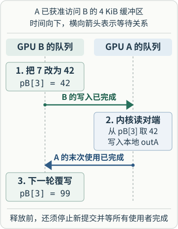

# GPU A 能访问 GPU B 的地址，什么时候才能读？

上级：[访问语义](README.md)

GPU B 上有一个数组，上一轮在第四个元素里留下了 7。这一轮 B 要在同一个位置写入 42，GPU A 随后读取它。假设 A 已经能访问这个数组，主机也先向 B 提交了写内核，再向 A 提交读内核。**A 这次就一定能读到 42 吗？**

关键在“提交”之后。主机先后把两个内核放进了两张卡各自的工作队列，B 的写可能还在排队，A 的读却已经开始。反过来也有一个问题：B 写完 42 后，还要等到什么时候，才能把同一个位置改成下一轮的 99？沿这一个元素走一遍，就能分清这两次等待。

## A 手里的指针，到底指向哪里？ {#buffer}

设一个主机进程控制两张 GPU。程序在 B 上用普通的 `cudaMalloc` 或 `hipMalloc` 分配 4 KiB，把返回的指针记作 `pB`，当作 `uint32_t` 数组来用。4096 字节能放 1024 个元素。下标从 0 开始，`pB[3]` 取的是相对基址偏移 12 至 15 的四个字节。在 A 上另外分配一个 4 字节的结果槽 `outA`。上一轮对 `pB[3]` 写入 7 的操作已经完成。下文数值是教学设定。

现在把 `pB` 作为参数交给 A 上的内核。传过去的是一个地址值。分配仍由 B 拥有，A 上的 `outA` 也没有因此得到数据。等 A 真正执行 `outA[0] = pB[3]` 时，它才会从对端分配中的相应位置取数，再写入自己的显存。程序中的指针、互连选择的目标设备、目标分配内偏移 12，分别用于不同环节。一次 4 字节访问落在分配范围内，也不能据此推算线上恰好只传 4 字节。[远端读取的请求与返回路径](../02-fabric-architecture/remote-read-path.md)

## 哪张卡要打开哪个方向的访问？ {#peer-access}

这笔读由 **A 的内核**发起，目标内存属于 **B**。程序先查询“A 能否直接访问 B”，再为这个方向启用对端访问。以同一进程内支持对端访问的普通设备分配为例，两套运行时的调用可以按同一顺序读。表中的 A、B 是各自的设备编号，`ok` 是能力查询的输出。

| 步骤 | CUDA 和 HIP 的对应调用 |
| --- | --- |
| 查 A→B | `cudaDeviceCanAccessPeer(&ok, A, B)` `hipDeviceCanAccessPeer(&ok, A, B)` |
| 选设备 A | `cudaSetDevice(A)` `hipSetDevice(A)` |
| 启用访问 | `cudaDeviceEnablePeerAccess(B, 0)` `hipDeviceEnablePeerAccess(B, 0)` |

每一步都要检查返回状态，查询成功后还要检查 `ok`。设本例原先没有开启这个方向，查询和启用均成功。此时 A 才具备直接使用这个对端指针的条件。查询若返回不支持，就不能让 A 的这个内核继续解引用 `pB`。B 若还想执行一个内核去访问 A 的显存，需要单独检查反方向。**A 的读请求发向 B，读出的数据从 B 返回 A；这次返回本身不要求再为 B 开一次反向对端访问。** [CUDA 对端访问契约](https://docs.nvidia.com/cuda/cuda-runtime-api/cuda_runtime_api/group__CUDART__PEER.html) · [HIP 对端访问契约](https://rocm.docs.amd.com/projects/HIP/en/latest/doxygen/html/group___peer_to_peer.html)

这个启用接口按设备对建立访问关系，可能涉及 B 的多笔普通分配。它不能给单个元素设置“只准读这个地址”的权限。本例只演示普通读；如果算法需要 A 在 B 的显存上做原子加，还要核对相应操作、类型和平台能力。使用内存池、显式虚拟内存管理或托管内存时，也应遵循该分配方式的访问规则。[CUDA 多 GPU 内存访问](https://docs.nvidia.com/cuda/archive/13.1.0/cuda-programming-guide/03-advanced/multi-gpu-systems.html) · [PCIe 拓扑与对端访问条件](../../PCIE/07-advanced-topics/p2p-switch-topology-constraints.md)

## B 什么时候才算把 42 准备好了？ {#ready}

两张卡各有一条显式创建的流，B 的叫 `sB`，A 的叫 `sA`。流可以理解为程序提交有先后关系的 GPU 工作的队列。我们先采用容易核对的做法：让同一个主机线程在两个交接点等待。每条流都属于创建它的设备，下面的内核都是在对应设备上提交的。只有上一步成功，程序才继续。

1. **在 B 上生产。** 将 B 设为当前设备，在 `sB` 中提交写内核，执行 `pB[3] = 42`。内核启动调用返回时，只能说明工作已经提交。
2. **主机等待 B 写完，再提交 A 的读。** 对 `sB` 调用 `cudaStreamSynchronize(sB)` 或 `hipStreamSynchronize(sB)`。成功返回后，再将 A 设为当前设备，在 `sA` 中提交读内核，执行 `outA[0] = pB[3]`。这条顺序把 B 的本轮写放在 A 的读之前。在所选普通设备分配和已启用的对端路径上，A 应读到 42。HIP 对粗粒度内存的说明也把流同步列为使更新可见的同步点。[CUDA 多设备与流](https://docs.nvidia.com/cuda/archive/13.1.0/cuda-programming-guide/03-advanced/multi-gpu-systems.html) · [HIP 的同步与可见性](https://rocm.docs.amd.com/projects/HIP/en/docs-7.2.3/how-to/hip_runtime_api/memory_management/coherence_control.html)
3. **主机等待 A 用完。** 对 `sA` 调用对应的流同步。成功返回，表明这条流上先前的读内核已结束。现在 `outA[0]` 保存 42。假设没有其他使用者，B 才可以开始覆盖原位置；如果主机想亲自检查答案，可以再把 A 的这个结果槽复制到主机。

如果把第 2 步的等待拿掉，就允许出现这样的执行顺序：A 先读完旧的 7，随后 B 才开始写 42。两次操作都可能访问了正确的地址，A 却拿到了上一轮的内容。这里特意挑了两次访问完全错开的顺序；若未同步的普通读写实际重叠，就存在数据竞争，不能给结果指定一个保证值。

## A 的读已经提交，为什么 B 还不能复用？ {#done}

保留 B 写完到 A 开读的第一道等待，只去掉 A 用完到 B 复用的第二道等待。设 `sA` 前面还有一个耗时的内核。主机已经成功提交了 A 的读，读指令却还没有发出去。这时若 B 抢先写完 99，等到 A 的读真正执行，`outA[0]` 就可能是 **99**。第一道等待只保证 A 不会读得太早，无法限制 B 下一轮写得太早。

图中的两个箭头表示**执行依赖**。CUDA 还可以把等待放到 GPU 流中，让主机提前提交后续工作。在 B 的流写完之后的位置记录事件 `readyB`，先调用 `cudaEventRecord(readyB, sB)`，再让 A 的流用 `cudaStreamWaitEvent(sA, readyB, 0)` 等它，随后排入读内核。再在读内核之后记录 A 的事件 `doneA`，让 B 的流等待它，然后排入下一轮写入。事件在其所属设备的流上记录，等待可以跨设备；主机提交了这组等待时，设备仍可能在工作。HIP 示例采用上一节的主机端流同步，事件方案另须核对平台、内存类型和可见范围。[CUDA 的跨设备流与事件](https://docs.nvidia.com/cuda/archive/13.1.0/cuda-programming-guide/03-advanced/multi-gpu-systems.html#multi-gpu-stream-and-event-behavior) · [HIP 事件的释放范围](https://rocm.docs.amd.com/projects/HIP/en/docs-7.2.3/how-to/hip_runtime_api/memory_management/coherence_control.html)

**复用与释放还有一步区别。** 覆写意味着 B 继续拥有这块分配，旧读者已经退出，下一轮可以接手。释放则意味着这块分配的生命周期结束：先停止新的提交，等所有可能使用它的流和设备完成，若 B 已经开始写 99，也要等那次写结束，再在 B 上释放。关闭设备对的访问会影响该方向的其他分配；只有整个程序不再需要这一关系时才适合关闭。若某次等待超时或设备报错，固定延时不能证明旧请求已排空，恢复流程需先隔离旧使用者。[故障恢复时如何检查在途访问](../06-modeling-and-reference/diagnosis-and-recovery.md)

## 改成先复制到 A，再计算，会改变哪次等待？ {#copy}

仍然只要第四个元素。直接读的做法让 A 的计算内核使用远端指针。另一种做法是在 B 的生产完成后，显式把 `pB + 3` 开始的 4 字节复制到 A 的本地槽 `tmpA`，再让 A 的计算内核读取 `tmpA[0]`。CUDA 和 HIP 对应的异步接口是 `cudaMemcpyPeerAsync` 和 `hipMemcpyPeerAsync`。复制命令入队后，计算内核还要按流顺序或明确的依赖等复制完成。

区别出现在 B 可以复用的那个时刻。直接读时，B 要等最后一个使用 `pB` 的内核用完它。显式复制时，如果这笔复制是 B 缓冲区的最后一个使用者，**复制完成，B 就可以覆写；A 对本地副本的后续计算还可以继续。** 两者的请求粒度、执行资源和实际路由可能不同，不能用一次大块复制的带宽推算内核里这一次远端读的延迟。若需要主机内存中转，则先把 B 的数据复制到主机，等第一段完成，再复制到 A；两段各有自己的完成条件。[CUDA 的对端传输与直接访问](https://docs.nvidia.com/cuda/archive/13.1.0/cuda-programming-guide/03-advanced/multi-gpu-systems.html#peer-to-peer-memory-transfers) · [HIP 的多设备内存访问](https://rocm.docs.amd.com/projects/HIP/en/latest/how-to/hip_runtime_api/multi_device.html)

## 如果 A 和 B 分属两个进程，传指针够吗？ {#ipc}

另一个进程即使收到 `pB` 的数值，也没有因此取得这份分配的映射。对于支持传统 IPC 的分配和平台，拥有者用 `cudaIpcGetMemHandle` 或 `hipIpcGetMemHandle` 导出内存句柄，经进程间通道交给获授权的使用者。使用者通过对应的 `IpcOpenMemHandle` 导入，使用自己进程中返回的设备指针，偏移仍然是 12 字节。

内存句柄解决共享哪一笔分配。谁先写好、谁已经读完，仍要用双方认可的同步方式交接。导入方停止新访问，等待已提交操作完成，调用 `cudaIpcCloseMemHandle` 或 `hipIpcCloseMemHandle` 关闭映射，再通知拥有者。等所有导入方都关闭、拥有者自己的使用也完成，才能释放原始分配。对象若在旧访问结束前被释放，之后使用旧指针就没有合法结果。[CUDA IPC 的打开与关闭](https://docs.nvidia.com/cuda/cuda-runtime-api/cuda_runtime_api/group__CUDART__DEVICE.html) · [HIP IPC 的生命周期](https://rocm.docs.amd.com/projects/HIP/en/latest/doxygen/html/group___device.html)

## 从两张卡走向两台主机 {#next}

回到开头，A 能访问地址，只回答了“读请求可以送去哪里”。这次应当得到 42，还取决于 B 的本轮写已经发布、B 的下一轮写尚未开始。如果继续观察 A 发起请求、互连返回数据的硬件过程，可以接着读[一次远端读取](../02-fabric-architecture/remote-read-path.md)；若关心前一篇里缓存副本如何交换权限，可以回到[同一行数据的 MSI 例子](../../COHERENCE/01-foundations/coherence-invariants.md)。

下一篇把起点和终点放到两台主机，跟踪同一段应用数据经普通网络收发和 RDMA 到达对端。到那时，还要分别判断发送方何时可以复用缓冲区、接收方何时能消费数据。[同样发 4 KiB，TCP 和 RDMA 什么时候能复用缓冲区？](../../NETWORK/01-foundations/host-nic-data-path.md)
