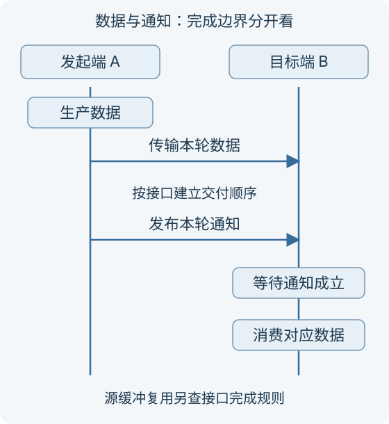

# 读写、原子操作与完成：哪些事件允许继续执行

上级：[访问语义](README.md)

互连接受请求、目标执行操作和应用安全使用结果，是不同事件。若不标清这些边界，就容易过早复用缓冲，或把未完成的数据交给消费者。

## 先定义操作的输入与输出

| 操作 | 输入 | 逻辑结果 | 仍需查明的条件 |
| --- | --- | --- | --- |
| 远端读 | 目标、地址、长度 | 发起端取得数据 | 返回是否完整，读取与并发写如何交互 |
| 远端写 | 目标、地址、数据 | 目标位置得到更新 | 源缓冲何时可复用，目标何时可见 |
| 原子读改写 | 地址、算子、操作数 | 在规定作用范围内不可分割地更新；部分操作返回旧值 | 类型、宽度、对齐、参与者及内存顺序 |

原子性通常针对规定大小的对象和支持的参与者。它不把整个数据结构的更新变成一个原子事务，也不自动为其他地址建立发布顺序。[CUDA 对端原子能力查询](https://docs.nvidia.com/cuda/cuda-driver-api/cuda_driver_api/group__CUDA__PEER__ACCESS.html)说明原子支持需要独立检查。

## 用“数据加通知”检验理解

假设 A 生产一块数据，B 收到通知后消费。正确性要求是：B 观察到本轮有效通知后，必须能按接口保证读到对应数据。

A 需要完成生产，发起数据传输，再使用该接口规定的排序或带通知传输操作发布通知。B 通过规定的等待／测试操作观察通知，建立消费依赖。若通知先到、数据后到，B 就可能读到旧值。

图是教学时序，不规定固定时延。数据传输与通知之间的保证必须来自所选 API；通知到达不是任意普通内存读取都安全的充分条件。

## 顺序与完成不能互换

NVSHMEM 的 `fence` 为指定操作提供向同一 PE 的交付顺序，不保证这些操作已经完成。`quiet` 用于等待其规定范围的未完成操作。CPU 与 GPU 发起操作的排序范围也有区别。[NVSHMEM 内存排序](https://docs.nvidia.com/nvshmem/api/latest/gen/api/ordering.html)

因此，接口表至少要记录四个问题：请求何时被接受、源数据何时可复用、目标更新何时可见、消费者通过什么同步观察更新。“完成”一词若没有观察者和操作范围，就不足以指导程序。

缓存一致性与内存顺序的基础见[一致性专题](../../COHERENCE/README.md)。这里关注跨设备 API 的具体保证，实际软件例子见[GPU 发起通信](../04-software-and-collectives/gpu-initiated-communication.md)。
