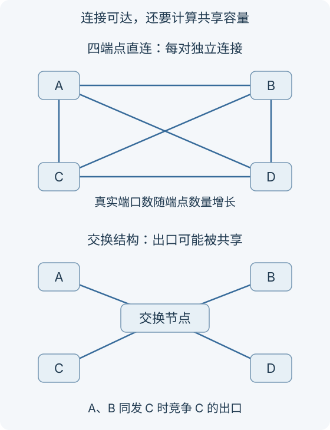

# 直连与交换：怎样计算可供任务使用的带宽

上级：[交换结构](README.md)

拓扑决定可选路径，容量决定路径每单位时间能服务多少数据。标称端口总带宽不能直接表示任意通信模式的可用带宽。

## 直连和交换各付出什么代价

若 N 个端点两两用独立链路连接，且每对恰好一条双向链路，则每端需要 N−1 条链路，总链路数为 N(N−1)/2。八端点需要 28 条链路。这里计算物理连接，不把两个方向算成两条线缆。

交换式结构把端点接入交换组件，减少端点直接面对的邻居数量，但带来交换端口、内部容量、缓冲及可能的多级路径。是否超售要逐级计算，不能从“用了交换机”判断。

图是四端点教学示意。它展示共享资源的位置，不表示真实产品的端口数或吞吐。

| 容量 | 观察边界 | 主要用途 |
| --- | --- | --- |
| 单链路单方向带宽 | 一条有向边 | 计算该边承载的字节与时间 |
| 端点注入带宽 | 一个端点所有可并行出口 | 判断发送端上限 |
| 目标接收／内存带宽 | 一个接收端 | 判断多对一热点 |
| 指定割的容量 | 穿过某组分区的有向边 | 判断跨分区流量的下界 |

## 一个超售例子

假设四个源端各能发送 100 GB/s，却共享一个 200 GB/s 出口。若四者都向出口另一侧发送长消息，注入需求为 400 GB/s，出口容量只有一半。在理想公平分配下，每源平均可得 50 GB/s；没有公平保证时，不能保证每源都得到该值。

若目标都在本侧、路径不经过该出口，则上述出口不构成限制。因此“2:1 超售”必须同时说明端口集合、方向和流量范围。

## 可达、无阻塞与应用吞吐

可达说明存在路径。无阻塞的含义还依赖交换模型、允许的连接集合和路由条件。即使交换结构能承载一个置换流量，所有源同时写入同一目标时，目标端口仍是瓶颈。

[MI350 系统案例](../03-protocols-and-systems/amd-xgmi.md)说明直连链路分布；[NVLink 系统案例](../03-protocols-and-systems/nvlink-nvswitch.md)说明交换式域。通用拓扑和路由算法见[NoC](../../NOC/README.md)，这里的重点是把实际通信矩阵放到资源图上。
