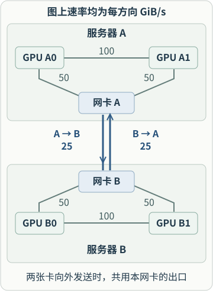

# 四张 GPU 做一次 AllReduce，哪个出口最忙？

上级：[软件与集体通信](README.md)

两台服务器各装两张 GPU 和一块网卡。四张卡算完后，每张卡都有一份 4 MiB 的局部结果。下一步要把四份结果逐元素相加，让每一张卡都拿到同一份和。这样的操作叫作**全归约（AllReduce）**。例如，四张卡在第一个位置上分别存了 1、2、4、8，结束时每张卡的第一个位置都应为 15。[NCCL 对 AllReduce 的定义](https://docs.nvidia.com/deeplearning/nccl/user-guide/docs/usage/collectives.html#allreduce)

现在只改一件事：给每张卡换一个传数据的邻居。每张卡发送的字节数一模一样，为什么一台服务器的网卡可能要多发整整一倍？先让一个元素跟着它所在的分块走完六步，再去网卡出口数一遍。

## 先画机器，在哪儿必须共用网卡？ {#topology}

服务器 A 里是 A0、A1，服务器 B 里是 B0、B1。每张 GPU 是本次通信的一名参与者，通信库通常把参与者编号称为 rank。两张同机 GPU 可以直接通信。发给另一台服务器上的 GPU 时，数据才走本机网卡（NIC）、机间链路、对端网卡。比如 A1 发给 B0，载荷经过 A1 → 网卡 A → 网卡 B → B0。

图上的数字都是**教学假设的单方向有效载荷带宽**：同机 GPU 直连 100 GiB/s，每张 GPU 通往本机网卡的独立通路 50 GiB/s，机间链路 25 GiB/s。所有通路都能全双工，即两个方向可同时达到各自标出的带宽。两张卡同时向外发送时，共用同一条 25 GiB/s 的出口。假设没有其他流量，网卡内部、显存与归约运算均有余量。真实机器上的两条 GPU 到网卡路径还可能共享 PCIe 上行，分析时要把那一段单独画出来。[网卡放置与真实网络路径](../../NETWORK/06-system-integration/libraries-and-nic-placement.md)

## 一块数据怎样走完六步？ {#one-chunk}

每张卡有 4 MiB 输入，等分成 **0、1、2、3 四块，每块 1 MiB**。每张卡的块 0 都包含相同范围的数组下标，只是数值来自不同的卡。选用不会溢出的 32 位整数加法，四张卡可以按不同顺序相加。

先按 **A0 → A1 → B0 → B1 → A0** 排成一个单向环。箭头规定每张卡把块送给谁。第一步，沿环排第 0、1、2、3 位的卡，同时发出自己对应编号的块。于是 A0 先送出块 0，A1 同时送出块 1。接下来只盯住块 0 的第一个元素。每次移动的仍是整整 1 MiB，表里的小数字只是那个元素的值。

| 步 | 块 0 从哪里到哪里 | 接收方做什么 |
| --- | --- | --- |
| 1 | A0 → A1 | 收到 1，加上本地的 2，得到 3 |
| 2 | A1 → B0 | 收到 3，加上本地的 4，得到 7 |
| 3 | B0 → B1 | 收到 7，加上本地的 8，得到 15 |
| 4 | B1 → A0 | 收下完整结果 15 |
| 5 | A0 → A1 | 把完整结果再交给 A1 |
| 6 | A1 → B0 | 最后一张缺块 0 的卡也得到 15 |

前三步，接收方完成一次逐元素相加，再把部分和传给下一个邻居。块 0 的完整和最后落在 B1，另外三个块同时从各自的起点出发，各自的完整和落在另外三张卡上。这一段叫 **Reduce-Scatter（归约后分散）**。这里按出发位置给块编号。如果接口约定编号为 i 的参与者收第 i 块，可以轮换起始块号，发送的字节数相同。后三步只复制已经算好的块，不再做加法。B1 保留块 0，并把它传出去，余下三张卡依次各收一份。这一段叫 **AllGather（全收集）**。结束时，每张卡都持有完整的 4 MiB 结果。[环形全归约的逐块算法](https://andrew.gibiansky.com/blog/machine-learning/baidu-allreduce/) · [环形归约的一般公式](../../NOC/06-ai-noc-specifics/reduction-and-collective-networks.md#带明确前提的-allreduce-模型)

**换回一张卡的视角。** 在每一步，它一边向下家发一块，一边从上家收另一块。每一步发送 1 MiB，六步累计发送 6 MiB，也接收 6 MiB。四张卡合计向环里送出 24 MiB。要知道网卡究竟送出了多少，还得看哪几条箭头经过它。

## 换个环顺序，两张卡什么时候争同一个出口？ {#link-bytes}

**顺序一，同机相邻。** 仍用 A0 → A1 → B0 → B1 → A0。每步 A0 发给 A1，走机内直连，A1 发给 B0，走网卡 A 的发送口。所以 A 每步只向 B 发 1 MiB。反方向上，B1 发给 A0，占用网卡 B 的发送口。全双工允许它和 A1 同时发。

**顺序二，两机交替。** 改成 A0 → B0 → A1 → B1 → A0。此时 A0 发给 B0，A1 发给 B1。两条箭头都从网卡 A 向外，单步就要共用这个出口发送 2 MiB。B0 发给 A1，B1 发给 A0，反方向也有同样的争用。每张卡仍只有一个下家，六步的本地发送量仍是 6 MiB。

下面按图中的物理方向逐项记账。表里若列了两个方向，数字是**每一个方向各自的量**。例如第一行表示 A0 → A1 有 6 MiB，B0 → B1 也有 6 MiB。“本网卡”指该 GPU 所在服务器的那块网卡。

| 六步累计的有效载荷 | 同机相邻 | 两机交替 |
| --- | ---: | ---: |
| A0 → A1、B0 → B1 | 6 MiB | 0 |
| A1 → A0、B1 → B0 | 0 | 0 |
| A0、B0 各自 → 本网卡 | 0 | 6 MiB |
| A1、B1 各自 → 本网卡 | 6 MiB | 6 MiB |
| 网卡 A → A0、网卡 B → B0 | 6 MiB | 6 MiB |
| 网卡 A → A1、网卡 B → B1 | 0 | 6 MiB |
| 网卡 A → 网卡 B | 6 MiB | 12 MiB |
| 网卡 B → 网卡 A | 6 MiB | 12 MiB |

可以反过来验算。交替排列时，四张卡送出的 24 MiB 全部跨机，正好等于机间链路两个方向的 12 + 12 MiB。同机相邻时，只有 12 MiB 跨机，其余 12 MiB 都由两条机内箭头送走。跨机的同一块还会出现在 GPU 到网卡、网卡到网卡、网卡到 GPU 三笔链路账上。做一次跨机流量统计时，只在机间链路这个截面计一次。

## 这多出的 6 MiB，会让哪一步等？ {#time}

先单独问网卡 A：从开始到结束，至少要占用发送口多久？同机相邻时，要向外送 6 MiB。在 25 GiB/s 下，**6 MiB ÷ 25 GiB/s ≈ 234.4 µs**。交替排列时，同样一个发送口要送 12 MiB，至少需要 **468.8 µs**。这里 1 GiB = 1024 MiB。网卡 B 的发送口得出相同下界，两个方向可以同时忙，不能把时间相加。

再看机内。相邻排列中，一条 GPU 直连方向传 6 MiB，按 100 GiB/s 至少占用 58.6 µs。一条承载 6 MiB 的 GPU 到网卡通路按 50 GiB/s 至少占用 117.2 µs。交替排列中，机内直连空闲，GPU 与本网卡各活跃方向仍各占用至少 117.2 µs。**比较所有方向的“字节数 ÷ 单向带宽”，两种排列最吃紧的都是机间链路。换成两机交替，机间每个发送口的最低忙碌时间翻倍。**

这种等待怎样传给计算？在交替排列的第 1 步，A0 的块 0 和 A1 的另一个块都要从网卡 A 出发。假设此时网卡优先服务 A1，A0 的块 0 就会晚到 B0。B0 的第 2 步需要把收到的块 0 加上自己的数，再交给 A1。这一次转发会跟着推迟。即使 B0 可以同时做别的工作，整次 AllReduce 也得等所有参与者拿到所有块。234.4 和 468.8 µs 都是由链路占用推出的**完成时间下界**。分块启动、传播、归约计算与排队怎样重叠，会影响实测时间，不能据此断言应用耗时恰好翻倍。

## 换一个条件，怎样检查自己的答案？ {#check}

假设继续用交替排列，从 A 到 B 的有效带宽因其他业务占用而降到 12.5 GiB/s，反向依然是 25 GiB/s。先看表：环和张量都没改，A 向 B 仍须送 12 MiB，故这个方向单独便需要 **937.5 µs**。B 向 A 至少需要 468.8 µs。此时能点名最紧的出口了：网卡 A 的发送口。慢方向上的块晚到以后，对端下一次依赖这个块的归约或转发也会晚。

如果在真实集群上验证，先确认运行时实际选用的算法、环邻居、GPU 到 NIC 的路径及是否启用了多个通道。只改应用的 rank 编号，库可能仍会排出原来的物理环。可同时观察两端网卡的发送和接收增量，并核对计数器是否包含报头或额外流量。NCCL 测试报告里的 busbw 按数据规模与算法因子归一化，具体某个端口发了多少，要回到物理路径与端口计数器去看。[分块、多通道与网络内归约](collective-mapping-and-offload.md) · [NCCL Tests 的带宽口径](https://github.com/NVIDIA/nccl-tests/blob/master/doc/PERFORMANCE.md)
