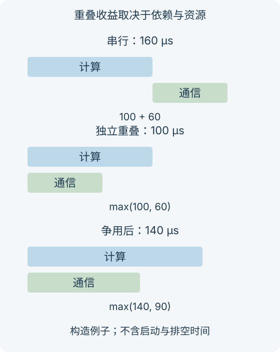

# 通信与计算重叠：怎样计算没有被隐藏的时间

上级：[负载与性能](README.md)

两个操作在时间线上重叠，不代表通信成本已经消失。正确分析需要同时检查依赖和共享资源，并比较整个任务的完成时间。

## 先画依赖，再考虑并行

若计算 B 必须消费通信 A 的结果，B 不能提前执行。可以与 A 重叠的，只能是当前已经具备输入、且不依赖 A 的其他工作。

假设一段独立计算需要 100 μs，一段通信需要 60 μs。串行执行为 160 μs；若两者可以同时启动，且执行时间不因争用而变化，理想完成时间为 100 μs。若计算完全依赖通信，仍需串行。

图中数值是构造例子，忽略启动和收尾。第三种情形假设争用使计算增长到 140 μs、通信增长到 90 μs，即使并发，完成时间也为 140 μs。

## 重叠会消耗哪些相同资源

通信内核可能使用 SM、寄存器和调度槽位；搬运会访问 HBM，也可能经过与计算访存共享的片上路径。复制引擎与通信内核的占用方式不同，不能把二者的结果直接互换。

| 观察量 | 用来回答什么 |
| --- | --- |
| 单独运行的计算与通信时间 | 没有互相争用时的基线 |
| 并发时各自持续时间 | 是否因资源争用变慢 |
| 全任务关键路径时间 | 重叠是否真的缩短完成时间 |
| 数据就绪及消费事件 | 是否以错误同步换取了表面加速 |

NCCL 与 CUDA 流集成，跨流执行仍需明确依赖；部分分组调用还会建立额外流间同步。[NCCL 流语义](https://docs.nvidia.com/deeplearning/nccl/user-guide/docs/usage/streams.html)

## 分块为什么可能有用

把大消息分成多块，可以在第一块完成后开始消费，而不等待整段传输。收益来自缩短生产—传输—消费的等待链。但分块太细会增加启动、同步和调度开销。

评估流水线时，应包含首块启动、稳态和最后一块排空。只取稳态吞吐会低估短任务延迟。用总任务时间判断收益，再用分阶段测量解释原因；不要把所有通信持续时间简单求和作为“未隐藏通信时间”。
