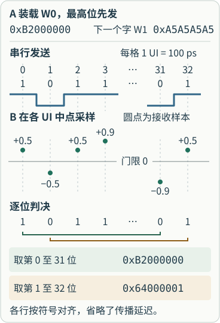
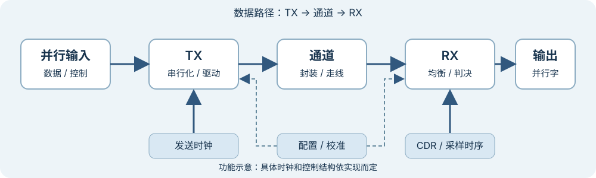

# 一个 32 位字怎样穿过 SerDes，又怎样拼回来？

上级：[全局链路](./README.md)

芯片 A 的寄存器里放着 `0xB2000000`。芯片 B 和它之间只有一条单向串行电链路。A 不会把 32 位一起送到 B 的引脚上。它怎样把这个数送出去？B 即使把经过的每一个位都读对，为什么仍然可能拼出 `0x64000001`？

先把两端的约定写下来。A 每次接纳一个 32 位并行字，**最高位先发**。第一个字记作 W0，紧随其后的 W1 是 `0xA5A5A5A5`。W0 之前的最后一位为 0。链路用两个电平表示 0 和 1，连续的相同位可以保持同一电平，这种信号方式叫 NRZ。本例忽略编码、扰码、空闲和训练的开销，接收器已经获得稳定的采样时序。下面所有时间和电平都来自这组教学假设。

## 把并排的 32 位排进时间里 {#launch}

写成十六进制的 `B2` 占两位数字，每位十六进制数字对应四位二进制。展开 `B` 得到 `1011`，展开 `2` 得到 `0010`。所以 W0 按发送先后依次是 **`10110010 00000000 00000000 00000000`**。这些空格只给人看，导线上不会多出一个分隔符。

A 的并行时钟是 312.5 MHz，一个周期是 3.2 ns。假设每周期都有新字且连续发送，串行器必须在这 3.2 ns 内依次选出 32 个位。平均下来每 100 ps 送一位，线速率是 10 Gb/s。这种 NRZ 链路一个符号携带一位，符号率是 10 GBd；一个符号占用的时间叫**单位间隔（UI）**。从 A 发出第一位开始计时，第 0 个 UI 占 0 至 100 ps，第 1 个占 100 至 200 ps。前八位占 800 ps，到 3.2 ns 时 A 开始发 W1 的最高位。

最简单的想象是 A 先保存并行字，然后在第 0 个 UI 选位 31，第 1 个 UI 选位 30，最后选位 0。电路也可以分级选择或用多相时钟。这里算出的 100 ps 是线上符号间距，芯片里并不需要每层逻辑都由一个 10 GHz 时钟驱动。上游要在装载边沿前后把数据放稳，还要说明哪一拍有效。若串行器持续赶不上输入，有限缓冲终会满，接口需要约定如何背压或处理溢出。若上游没字可送，线上是否允许停顿或需要发空闲码，由真实接口约定。[位宽、速率与时钟](./rates-clocks-and-ui.md) · [发送侧时钟怎样生成](../03-transmitter/clock-pll-and-multiphase.md)

图里同一列对照**同一个符号**的发送和接收。画到省略号时，跳过了第 4 至 30 个 UI。实际从 A 发出到 B 采样有传播延迟，图中把这段延迟扣去，方便对位。

## 一位数据经过通道后，B 的引脚上有什么？ {#channel}

驱动器读到 1，就驱动差分线两根导体之间的电压向一个方向变化；读到 0，就驱动它向另一个方向变化。我们用归一化的 +1 和 −1 表示这两种发送符号。A 连发两个 1 时，换位的时刻已经过去，电平却可以保持原样。所以 B 的接收端面对的是**随时间变化的电压**，它不能指望每发一位，线上就出现一次跳变。

封装、焊点和走线构成的通道带宽有限。看某一位时，前一位造成的电压变化可能还没消退。为看清这点，假设在各 UI 的规定采样时刻，样本等于“当前发送符号的 0.7 倍，加上上一符号的 0.2 倍”，先旁路两端均衡，忽略噪声。这里的数值没有单位，只描述在那些时刻读出的幅度。它们没有给出任意两个采样时刻之间的连续波形。[差分电压和回流](../02-signal-channel/differential-and-return.md) · [前一位怎样影响后一位](../02-signal-channel/isi-noise-and-eye.md)

W0 的第一位是 1，前一个符号代表 0。因此第一个样本是 0.7 × (+1) + 0.2 × (−1) = **+0.5**。第二位是 0，前一位是 1，样本为 −0.7 + 0.2 = **−0.5**。第三位和第四位虽然都是 1，前一位的历史不同，采到的幅度分别是 **+0.5** 和 **+0.9**。这解释了为什么同样发送 1，B 的引脚上可以出现不同的接收电压。

## B 怎样挑出一个时刻，把电压判成一位？ {#sample}

接收端（RX）的时钟与数据恢复电路（CDR）利用接收信号的跳变跟踪符号节奏，安排数据采样。连续几个 UI 没有跳变时，它仍按已经跟踪到的节奏采样。能容许多长的连续相同码，取决于编码、时钟误差和电路设计。本例人为给定合适的采样相位，把每个 UI 的中点作为采样点；实际接收器可调整相位。采样时刻挪动后，上节的两个系数也可能改变。[AMD Versal GTY 的 CDR 实例](https://docs.amd.com/r/en-US/am002-versal-gty-transceivers/RX-CDR) · [触发器为什么需要采样窗口](../../../semiconductor-foundations/latch-and-divider/README.md#timing)

再给采样器一个判决门限。本例门限取 0，样本为正判 1，为负判 0。前四个判决是 `1011`。一次电平判决只负责一个位置。假设只有第 2 个 UI（从 0 数起，恰好是 W0 的位 29）受到干扰，叠加 −0.6 后原先的 +0.5 变成 −0.1。采样器这一位改判为 0，前四位成了 `1001`，按原边界收满 32 位，B 得到 **`0x92000000`**。这个错误改变一位；本例没有开启会把错误反馈给后续判决的电路。[采样器的门限与误判](../04-receiver/sampler-and-decision.md) · [判决反馈均衡怎样传播错误](../04-receiver/dfe-and-error-propagation.md)

## 如果每一位都采对了，却晚一位开始拼字呢？ {#align}

现在去掉干扰。B 得到了正确的连续位流。解串器每次取 32 项，先来的放在位 31，后来的依次往低位放。改变起点，输出就会改变。

| 起点 | B 取走的 32 项判决 | B 输出的字 |
| --- | --- | --- |
| 第 0 个 UI | W0 的位 31 至位 0 | `0xB2000000` |
| 第 1 个 UI | W0 的位 30 至位 0，再接 W1 的位 31 | `0x64000001` |

手算第二行：去掉 W0 最前面的 1，留下 31 位。把它们移到新字的高 31 位，末尾补 0，得到 `0x64000000`。但线上第 32 个 UI 送来的并非 0，而是 W1 的最高位 1，于是末尾填 1。**B 采到的是同一串位，给这些位划的组却不同。** 如果此后始终每 32 位交一次字，这个错位会继续带入后面的字。反过来，如果把 W1 换成最高位为 0 的字，错位结果就会变成 `0x64000000`，原边界上的 W0 仍是 `0xB2000000`。

再想一想旧例里较短的八位分组：若连续发的是两个 `B2` 字节，第二位起的八项是 `01100101`，得到 `0x65`。而本例 W0 的第二个字节是 `00`，从第二位起看到的前八位是 `01100100`。跨过边界时，借来的位取什么值，必须看**线上紧接着发了什么**。

B 怎样找到正确的位置？光看任意一串用户位，32 种切法都能切成字，光靠多看几个字往往也判断不了哪种正确。实际链路会约定可识别的对齐模式、块头或外部帧信息，并规定发现、确认、失锁与重锁的条件。例如有的接收器能够识别规定的 comma 码型；有的硬件向逻辑提供 bit slip，每次调整一个位的位置。哪一层找到的是码组边界，哪一层再把码组组装成用户字，要看所用协议。我们的两个示例字用于演算**已知边界和错开一位**会怎样，并不自带可靠的定界信息。[AMD 的字节与字对齐实例](https://docs.amd.com/r/en-US/am002-versal-gty-transceivers/RX-Byte-and-Word-Alignment) · [Intel Stratix 10 手册的 RX Data Bitslip](https://cdrdv2-public.intel.com/667023/ug_stratix10_l_htile_xcvr_phy-683621-667023.pdf)

## 字已经拼好了，能在哪个时钟边沿取走？ {#clock}

先前算出的 3.2 ns 表示一个字占据这条线多久。从 A 把 W0 装入接口，到 B 的上层逻辑真的拿到 W0，还要经过缓冲、传播、采样、解串，以及可能的时钟域交接。只给出线速率，不能算出这笔端到端延迟。

若 B 的上层逻辑与解串器使用不同时钟，设计要规定输出何时有效、谁可以取走、怎样安全跨域。即使两个时钟标称都是 312.5 MHz，只要写入长期略快于读出，有限深度的缓冲也终会写满，需要速率补偿或协议允许的流量控制。换成多条 lane 时，还要处理同一组里的数据分头到达的时间差。单 lane 的位序颠倒、字边界偏移、跨 lane 偏差和跨时钟域交接，各有自己的观察点。[多条 lane 的到达时间差](../06-link-operation/lane-alignment.md)

在收发器功能图上区分数据和控制

发送时钟控制何时发，CDR 控制何时采。配置与训练也会调整两端的均衡参数。训练序列可能同样占用这条电链路的时间，但它服务于收发器建立或调整工作条件。图里画出的功能可由同一硬件协同实现。[一款 GTY 接收器的模块划分](https://docs.amd.com/r/en-US/am002-versal-gty-transceivers/Receiver)

## 沿这条路径继续深读 {#next}

如果困惑的是“0.5 能不能离门限更远一点”，分别看[发送均衡前后的四个样本](../03-transmitter/tx-path-worked-example.md)和[接收均衡怎样用前一位修正这一位](../04-receiver/rx-cooperation-example.md)。如果关心硬件怎样把采样点保持在合适的位置，接着读[CDR 的跟踪过程](../04-receiver/cdr-and-timing-recovery.md)和[训练如何调参数](../06-link-operation/training-and-adaptation.md)。判断一条真实链路可不可以用，还要看[误码率及置信度](../05-signaling-and-metrics/ber-confidence-and-fec.md)和[实验室验证的条件](../07-design-and-validation/lab-compliance-interop.md)。
