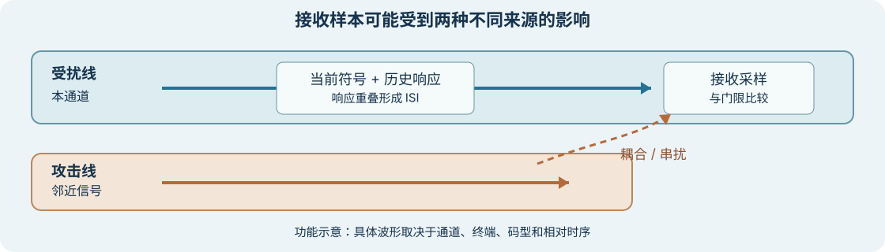

# ISI、串扰与噪声怎样影响判决？

上级：[电信号与通道](./README.md)

接收器在指定时刻看到的值，可能不仅受当前符号影响。前后符号的响应、噪声和采样时刻偏差都会改变它。不同符号之间的这种影响称为码间干扰（ISI）。

## 一个离散采样例子

假设发送符号 a[k] 为 −1 或 +1，并在正确采样时刻使用以下归一化模型：

  r[k] = 0.7a[k] + 0.2a[k−1]

当当前为 +1、前一符号也是 +1 时，r = +0.9；前一符号为 −1 时，r = +0.5。若门限为 0、没有噪声，两次都仍判为 +1。ISI 使值依赖历史，但**不必然已经造成误码**。如果在第二种情况下再叠加 −0.6 的归一化扰动，样本变为 −0.1，判决便出错。

这里没有给出噪声分布，所以不能计算错误概率或 BER。该模型也没有给出连续波形，不能直接画出真实眼图。

同一公式也可看负符号：当前 −1、前一符号 +1 时，采样值为 −0.5；连续两个 −1 时为 −0.9。在这个简化模型里，符号翻转后的样本更接近零门限。接收器越靠近门限，对额外扰动留下的绝对余量越小。

前一项只是一个后游抽头的教学近似。实际采样值还可能受到更早符号、接近符号、非线性或反射影响；不同采样时刻下的有效系数也可能不同。

## 邻近信号怎样造成串扰？

一条正在切换的连接可以通过电场、磁场及共同的参考结构影响另一条连接。发送干扰的通道常称为**攻击线**，受到影响的通道称为**受扰线**。耦合大小和波形取决于几何、回流、频率及两端终端。

*图：两种影响的来源示意，不表示某条实际链路的耦合幅度或波形。窄屏可左右滑动，点击可查看原图。*

在上例中，如果本通道样本为 +0.5，而邻线在同一采样时刻额外贡献 −0.6，接收样本就是 −0.1，零门限判决会翻转。这是人为设定的归一化数值。串扰也可能随邻线码型和相对时序变化；不能一律当作与数据无关的随机噪声。

两者都可能压缩判决余量，但来源不同：ISI 来自本通道各符号响应的重叠；串扰来自其他信号路径的耦合。只测本通道的前向传输，或只消除一个历史符号项，都不能证明串扰已消失。关于耦合和差分连接，可参见 [TI 高速差分连接说明](https://www.ti.com/lit/an/slla104a/slla104a.pdf)。

## 眼图表示什么？

把许多符号间隔的波形按某个时钟参考叠加，可以观察时间与电压方向的开口。NRZ 通常显示一个主要眼口，PAM4 有多个眼口。开口受数据码型、带宽、噪声、时钟恢复和测量方法影响。

眼高和眼宽是具体定义下的观察指标；仅看一张有限样本的图，不能自动证明极低 BER。[Keysight 的眼图说明](https://helpfiles.keysight.com/csg/N1930xB/Analyzing/Analyzing_Data_using_Eye_Diagrams.html)介绍了眼高、眼宽和信号电平。

本页用眼图说明判决余量；眼高、眼宽、抖动与时钟参考的测量口径见[眼图与抖动](../05-signaling-and-metrics/eye-and-jitter.md)。

## 接下来怎么读

进入[发送端](../03-transmitter/README.md)。后面的 [DFE 与错误传播](../04-receiver/dfe-and-error-propagation.md)会继续使用本例的历史符号。
