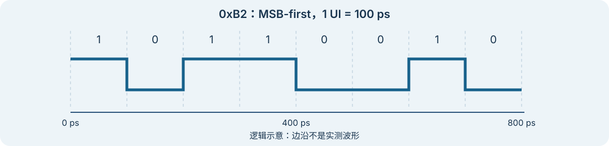

# 走一遍 TX 教学案例

上级：[发送端](./README.md)

本例只说明逻辑顺序和理想数值。它不是实际电路的时序签核，也不代表某个标准的编码或位序。

## 约定输入

并行端每周期给出一个 32 bit 字，时钟为 312.5 MHz。发送 `0xB2000000`，最高位先发。没有空周期或额外位，NRZ 线速率为 10 Gb/s，UI 为 100 ps。从第一个符号开始计时：

| 序号 | 输入位 | 输出区间 |
| ---: | ---: | --- |
| 0 | 1 | 0–100 ps |
| 1 | 0 | 100–200 ps |
| 2 | 1 | 200–300 ps |
| 3 | 1 | 300–400 ps |
| … | … | … |

这只是理想符号区间，不表示输出会在边界瞬间完成电压翻转。32 个符号共占 3.2 ns，等于一个并行输入周期。

## 比较发送均衡开关

把 1 映射为 +1、0 映射为 −1。前四个符号为 +1、−1、+1、+1。假设此前两个符号均为 −1，TX 采用 y[k] = a[k] − 0.25a[k−1]。再假设通道采样模型为 r[k] = 0.7y[k] + 0.2y[k−1]：

下表在窄屏上可以横向滚动。

| 序号 | 输入符号 a[k] | FFE 输出 y[k] | 启用 FFE 的通道样本 | 旁路 FFE 的通道样本 |
| ---: | ---: | ---: | ---: | ---: |
| 0 | +1 | +1.25 | +0.725 | +0.5 |
| 1 | −1 | −1.25 | −0.625 | −0.5 |
| 2 | +1 | +1.25 | +0.625 | +0.5 |
| 3 | +1 | +0.75 | +0.775 | +0.9 |

例如，首个样本使用更早的 y[−1] = −0.75，结果为 0.7 × 1.25 + 0.2 × (−0.75) = 0.725。旁路时用 a 而不是 y 作为通道输入。所有样本都是固定采样时刻的归一化值；没有计算连续波形或误码概率。

FFE 输出的峰值为 1.25，旁路时为 1。若统一限制峰值为 1，需要将本例 FFE 输出及其线性通道样本乘以 0.8，才能按该条件比较。后续的 [RX 协同案例](../04-receiver/rx-cooperation-example.md)为便于单独观察通道 ISI，假设 TX FFE **旁路**；不能把启用 FFE 的 y[k] 直接代入后文将 a[k] 当成通道输入的计算。

如果上层从另一个时钟域提供数据，上表还缺少跨域和装载条件。如果协议要求发送训练或空闲序列，上表的“每个周期都是用户数据”也不成立。完整链路时间除串行化外，还可能包含缓冲、通道传播、接收和对齐；本例没有给这些值。

## 接下来怎么读

进入[04 接收端：怎样从受损波形恢复数据？](../04-receiver/README.md)，观察驱动后的信号经过通道并到达接收器时发生什么。
