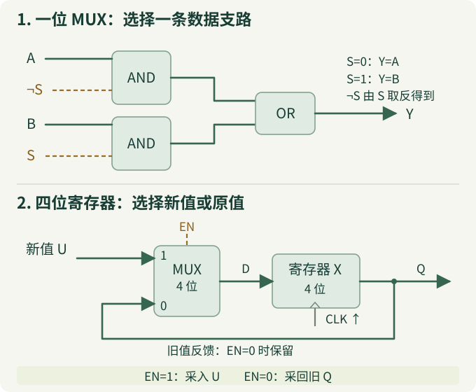

# 怎样让电路按照要求保存、选择和更新数据？

计算芯片不仅需要能算出结果的电路，还需要保存数据和控制运算过程的电路。譬如计算一个四项点积，乘法器应该先收到第一组操作数，再收到第二组，直到四组都处理完。如果没有电路来记录已处理到哪里、选择下一组数据，同一个乘法器就无法有序地完成这项工作。

在[半导体与电路基础](../../semiconductor-foundations/latch-and-divider/README.md#edge)中，我们已经看到 D 触发器怎样在时钟上升沿采样一个比特。现在暂时不关心触发器内部的晶体管，把它当作一个能保存比特的部件。从这里出发，试着造一个小电路：每拍从四组待计算的操作数中取一组，存到计算单元入口的两个寄存器中。我们会把这个例子一直用到后面的乘加和数据通路文章。

| 组号 | 操作数 x | 操作数 w |
| ---: | ---: | ---: |
| 0 | 2 | 3 |
| 1 | 1 | 5 |
| 2 | 3 | 2 |
| 3 | 4 | 1 |

最终我们希望计算 2 × 3 + 1 × 5 + 3 × 2 + 4 × 1 = 21。本篇先不造乘法器或加法器，只追踪这四组数怎样到达寄存器。为了把问题集中在控制上，假设四组输入在整个任务期间都已准备好，每个数占 4 个比特，电路使用同一个时钟且满足采样时序。下一篇再从这些比特的数值含义讲起。

## 为什么让四个触发器共用一个时钟？ {#register}

把数 2 写成四位的二进制 `0010`。如果希望这个数能够保存在电路里，可以并排放四个 D 触发器。每个触发器存一个比特，四个触发器接同一条时钟线。输入端合在一起叫 D[3:0]，输出端合在一起叫 Q[3:0]。这组触发器构成一个 4 位**寄存器（Register）**。[MIT 6.004：同步时序逻辑与寄存器](https://ocw.mit.edu/courses/6-004-computation-structures-spring-2017/pages/c5/c5s1/)。

设寄存器 X 原先保存 0，即 `0000`。先把 `0010` 放到输入 D，等下一个上升沿到来。四个触发器分别采下自己的输入，等输出稳定以后，从 X 的 Q 端就能读到 `0010`。现在把 D 改成 `0001`，X 的 Q 仍是 `0010`。只有到了下一次有效采样沿，X 才可能改为 `0001`。

注意这里出现了两种值：沿前已经保存在 Q 中的旧值，以及 D 上准备写入的新值。两者不必相等。寄存器的输出可以在一拍内被其他逻辑读取，不需要每读一次就触发时钟。真正受边沿约束的是这次**更新**。

按拍观察时，把第 k 个上升沿记作 Ek。在满足建立、保持要求的前提下，沿前的 D 决定沿后稳定的 Q。这里略去了沿后很短的时钟到 Q 延迟；真实的采样窗口和传播时间见[建立与保持](../../semiconductor-foundations/pvt-and-path-delay/README.md)。

## 如果这一拍不该写入，怎样让寄存器保住旧值？ {#enable}

假设 X 已经保存 2，下一组数据 1 已经出现在外部输入上，但现在还不应改变 X。如果直接把输入接到 D，下一条时钟边沿会让 X 变成 1。是否一定要停止寄存器的时钟？

先试一种不改变时钟的办法。既然触发器每次采样 D，就在不想更新时，把 X 的旧输出 Q 重新送回 D。想写入时，再改接外面的新数据。这样即使时钟边沿照常到达，寄存器也只是把自己的旧值再采一次。

需要选哪一条线？可以用两个与门、一个或门和一个反相器来实现。对其中一个比特，令选择信号 S 为 0 时，输入 A 经与门保留，B 路被置为 0；S 为 1 时则反过来。两个分支做或运算，就能得到被选中的输入：

**Y = (¬S ∧ A) ∨ (S ∧ B)**

这就是二选一**多路选择器（Multiplexer，MUX）**。对 4 位数据，只需要把这个选择关系扩展到四个位，并让它们共用 S。选择信号决定数据来自哪里，并不参与数据的数值运算。把 A 接旧 Q，B 接新数据 U，再把 S 改名为 EN（使能），便得到带写入使能的寄存器。

沿这条反馈线走三次。X 起初为 2，外部连续送来 1、3、4。

| 上升沿 | 沿前 X | 新输入 U | EN | 沿后 X |
| --- | ---: | ---: | ---: | ---: |
| E₁ | 2 | 1 | 0 | 2 |
| E₂ | 2 | 3 | 1 | 3 |
| E₃ | 3 | 4 | 0 | 3 |

第一拍 U 虽然变了，但 MUX 选中的仍是 Q，所以 X 不变。第二拍才选择并写入 3。第三拍又转回反馈支路，此时反馈的是**刚写入的 3**，不是最初的 2。这里没有软件命令在每拍执行“保持”；保持行为由门电路的固定连接产生。[MIT 6.004：多路选择器](https://ocw.mit.edu/courses/6-004-computation-structures-spring-2017/pages/c4/c4s1/)与[带写入选择的寄存器](https://ocw.mit.edu/courses/6-004-computation-structures-spring-2017/pages/c13/c13s1/)。

实际器件可能有专门的时钟使能端口，而不必真的在每个触发器外面放置一个这样的 MUX。上图解释的是可实现的逻辑行为。EN = 0 保住了数据，不等于所有内部电路都不再翻转，也不等于停止了这一组触发器的时钟。

## 四份数据都在线上，怎样只选中一份？ {#select-decode}

刚才的 MUX 在两个来源之间选择。现在把它放到 X 的前面，从表中的 4 个 x 值里取一个。一个选择位只能区别两个来源。把四个来源先分成两对，每对用一个二选一 MUX，两个输出再接第三个二选一 MUX。让低位 i₀ 选择每对中的第一个或第二个，让高位 i₁ 选择哪一对，就得到一个四选一 MUX。

选择信号 i = `10` 时，低位为 0，两个第一级 MUX 分别选出 x₀ = 2、x₂ = 3；高位为 1，第二级选后者。沿线便能追到输出 3。给 w 的四个来源也接一棵选择树，让它共用同一组 i，就能同时得到 w₂ = 2。X、W 再在边沿采样这对数。

如果要求反过来：把一份新数据 U 写到四个目的寄存器 R₀、R₁、R₂、R₃ 中的一个，MUX 却不直接解决这个问题。U 可以连到四个输入端，但不能让四个寄存器都更新。需要根据 i 产生各自的写入使能。

例如要写 R₂，i = `10`。用表达式 `i₁ ∧ ¬i₀` 就能识别这个组号。为其他三个组号各造一条判断电路，结果如下：

| i₁i₀ | e₀ | e₁ | e₂ | e₃ |
| --- | ---: | ---: | ---: | ---: |
| `00` | 1 | 0 | 0 | 0 |
| `01` | 0 | 1 | 0 | 0 |
| `10` | 0 | 0 | 1 | 0 |
| `11` | 0 | 0 | 0 | 1 |

这叫二到四**译码器（Decoder）**。这里四条输出的有效电平为 1，在有效并稳定的二位输入下恰有一条为 1，称为 one-hot 信号。把每条 ej 再与总写使能 WE 做与运算，WE 为 0 时谁也不写；WE 为 1 且 i = `10` 时，只有 R₂ 采新值，另外三个沿自己的反馈保持。由此得到一个重要对照：**MUX 负责选择数据的来源，译码器可以选择数据写到哪个目的地**。

反方向也有用到的组合逻辑：如果输入已知只有一条有效，编码器（Encoder）可以把四条 one-hot 信号变回两个编号位。例如仅 e₂ 为 1 时输出 `10`。如果多条同时有效，就不再有唯一编号；怎样从多个请求中选一个，留给 A08 的仲裁来讨论。这里的真值表描述的是输入和输出稳定后的逻辑关系，不保证选择位切换过程中输出永无短暂毛刺。正因如此，写入使能也需要满足接收寄存器的采样约束。

## 让组号自己加一，还需要给电路什么？ {#counter}

目前还需要有人在外面把 i 依次改成 `00`、`01`、`10`、`11`。可不可以让电路自己记住正在处理哪一组？

用两个触发器保存 i。希望每次推进时，i 都变成下一个组号。先把这一行为列出来，看两个比特分别怎样变化。

| 沿前组号 i₁i₀ | 推进后组号 i₁′i₀′ |
| --- | --- |
| `00` | `01` |
| `01` | `10` |
| `10` | `11` |
| `11` | `00` |

低位每次推进都取反；高位只在旧低位为 1 时取反。因此在这只两位计数器中，下一状态可以由两条简单的组合逻辑产生：**i₀′ = ¬i₀，i₁′ = i₁ ⊕ i₀**（⊕ 表示异或）。两个结果接各自触发器的 D，时钟沿到来时一起采样。比如沿前 `01`，高位根据旧低位 1 翻转，低位从 1 变 0，得到 `10`。它们不是先让低位更新，再让高位读取已经改变的低位。

这种包含状态寄存器和递推逻辑的电路叫**计数器（Counter）**。在两个触发器共用时钟的实现里，不必把低位的输出当成高位的时钟。再给 i 的两个比特加上刚才的 EN 反馈，就可以决定某拍推进还是保持。两位只能表示四种状态；想继续计数时，从 3 回到 0，这是本例的模 4 循环。更多位如何完成加一、进位又怎样传播，是 A02 的内容。[TI SN74HC163：同步二进制计数器的计数、装载、清零和保持行为](https://www.ti.com/lit/ds/symlink/sn74hc163.pdf)（手册中的控制极性和端口是具体器件的设计）。

同一个“沿前稳定的 D 决定沿后 Q，而 D 可以来自上一级的沿前 Q”原则还可以用来保存数据历史。如果把 X 的 Q 接到另一个 4 位寄存器 H 的 D，两个寄存器每拍都使能，X 采到新 U 时，H 同时采到**沿前的 X**。假设 X = 2、H = 0，下一拍输入 1 后，X = 1、H = 2；再输入 3 后，X = 3、H = 1。继续串接就形成移位寄存器的一种用法：数据每拍向后移动一级。这样的寄存器间连接稍后会用于流水级，不应理解为一个时钟沿内所有级同时采到了同一个新输入。

## 怎样确定第一组从 0 开始？ {#reset}

上述计数器只知道如何从旧值推出新值，却没有规定它上电时的旧值。不妨再向 i 的 D 输入增加一个选择：当 RST = 1 时，不论原来是什么，把新组号选成 `00`；否则仍由 EN 决定推进还是保持。这样就能在一个上升沿把 i 写成 0。

这就是一种**同步复位（Synchronous Reset）**。本例规定 RST 的优先级高于普通更新使能。RST = 1 时仍需要一个上升沿，随后寄存器才显示复位值。若是带异步复位的触发器，复位有效时不必等待时钟边沿即可把状态置为规定值；复位的极性、优先级和释放时的时序约束由实际实现决定。[AMD FDRE：带时钟使能的同步复位触发器](https://docs.amd.com/r/2023.2-English/ug953-vivado-7series-libraries/FDRE)；[AMD FDCE：异步清零触发器](https://docs.amd.com/r/2023.2-English/ug953-vivado-7series-libraries/FDCE)。

是否要把每一个数据寄存器也复位成 0？未必。如果控制器保证复位后的旧数据不会被误用，且在首次使用前已经写入新值，数据寄存器便可以不依赖复位值。给哪些状态设置初值，本质上取决于电路正确启动需要哪些保证。为了方便下一节逐拍观察，本例规定 X、W、i 和控制状态都同步复位。

## 数完四组以后，电路为什么会停下来？ {#fsm}

把前面的电路接起来：i 同时控制两个四选一 MUX，X 和 W 接住当组选出的数，i 通过反馈产生下一个组号。但还差两个动作：收到 START 才能开始；第四组写入后不该继续回到第一组。

只靠 i 的数值不够。比如 i = 0，可能是任务还未启动，也可能正要处理第 0 组。这两个时刻 X 和 W 是否应该写入的要求不同，所以需要另存一个控制状态 S。

定义三个状态：IDLE（等待任务）、RUN（送入操作数）、DONE（四组均已送入）。两位寄存器足以编码三种状态，例如 `00`、`01`、`10`，剩余 `11` 不用于正常运行。本例让非法编码在下一次上升沿返回 IDLE，且不写数据。START 假定为与本时钟同步的单拍信号，只在 IDLE 中使用；RUN 和 DONE 中收到的 START 不会启动额外任务。这里也假设计算单元可以按规定每拍接收一组数据，不考虑下游停顿。

先决定当前状态应该让各寄存器做什么，再决定当前状态下一拍去哪里。

| 沿前状态 | 条件 | 本沿数据和组号的更新 | 沿后状态 |
| --- | --- | --- | --- |
| IDLE | START = 0 | 保持 X、W、i | IDLE |
| IDLE | START = 1 | i 清零，X、W 保持 | RUN |
| RUN | i ≠ 3 | X、W 写入当前组；i 加一 | RUN |
| RUN | i = 3 | X、W 写入最后一组；i 保持 3 | DONE |
| DONE | 任意 | 保持 X、W、i | IDLE |

复位优先于表中所有情况。RUN 的最后一行并不是要等 i 先增加再比较，而是组合逻辑同时根据沿前的 S、i 产生各寄存器的 D 和 EN。比较 i = 3 只需判断两位是否都为 1。最后一组需要照常写入 X、W，只是 i 不再推进，S 转到 DONE。

状态寄存器、决定下一状态的组合逻辑，以及产生控制输出的逻辑，合起来是常见的**有限状态机（Finite State Machine，FSM）**结构。它不是需要 CPU 来逐条解释的程序。设计时给出的转移条件被实现为逻辑电路，在每个边沿由状态寄存器保存这次决定。[MIT 6.004：有限状态机的数字电路实现](https://ocw.mit.edu/courses/6-004-computation-structures-spring-2017/pages/c6/c6s1/)。

本例的 X、W 普通写使能只取决于 S 是否为 RUN（复位另外覆盖它），DONE 信号也只取决于当前 S 是否为 DONE。这类仅由当前状态决定的输出称为 Moore 型输出；如果某个输出还直接取决于当前的外部输入，则属于 Mealy 型输出。下一状态仍可以由状态和输入共同决定。实现时需要权衡控制路径的长度和信号何时可用，不必为所有输出选用同一种形式。

## 逐拍走完这次任务 {#walkthrough}

从 E₀ 开始观察：先令 RST 有效，在 E₀ 同步复位。之后释放 RST，在 E₁ 之前给 START 一个有效脉冲。每行记录边沿到来之前的选择和沿后稳定的状态。这里所说的“写入”是 X、W 在该边沿保存 MUX 已经选好的操作数，**不是完成该组的乘法**。

| 上升沿 | 沿前 S、i | X/W 写使能 | 采入的 (x, w) | 沿后 S、i | 沿后 (X, W) |
| --- | --- | ---: | --- | --- | --- |
| E₀ | 初值不作假设，RST = 1 | 复位 | — | IDLE, 0 | (0, 0) |
| E₁ | IDLE, 0；START = 1 | 0 | — | RUN, 0 | (0, 0) |
| E₂ | RUN, 0 | 1 | (2, 3) | RUN, 1 | (2, 3) |
| E₃ | RUN, 1 | 1 | (1, 5) | RUN, 2 | (1, 5) |
| E₄ | RUN, 2 | 1 | (3, 2) | RUN, 3 | (3, 2) |
| E₅ | RUN, 3 | 1 | (4, 1) | DONE, 3 | (4, 1) |
| E₆ | DONE, 3 | 0 | — | IDLE, 3 | (4, 1) |

观察 E₂。沿前 i = 0，所以 X 和 W 采到 (2, 3)；沿后的 i = 1 会让 MUX 输出切换到 (1, 5)，但已经写入的 X 和 W 不会立刻跟着变。下一组直到 E₃ 才被采入。再看 E₅，虽然 S 即将进入 DONE，沿前它仍是 RUN，于是最后一组没有丢失。E₅ 沿后，DONE 信号才随状态稳定为 1，到 E₆ 沿后恢复为 0。这个例子的 DONE 只表示**四组数据均已送入入口寄存器**，并不表示点积结果已经算出或可用。

## 这些电路为什么是微架构的共同基础？ {#next}

现在回头看整个过程。保存操作数的 X、W，保存组号的 i，以及保存控制阶段的 S，本质上都由能保存比特的电路构成。差别在于各自的下一值从哪里来：X、W 从输入选择器取数，i 从自己的旧值推导下一组号，S 从当前阶段及完成条件推导下一阶段。连接数据的部分可称为**数据通路**；选择、使能和状态转移等逻辑构成**控制通路**。两者共同工作，才能让输入数据在正确的时刻到达正确的位置。

这个例子也解释了几项设计取舍。提供更多输入来源通常需要更大的选择网络，可能带来额外面积、负载和传播延迟；增加保存数据的级数会增加状态，但也能把某一拍的结果留给下一拍。更复杂的 FSM 可以支持更多工作阶段，却仍需要决定每个阶段哪些状态可以更新，以及怎样避免过早覆盖还要用的数据。它们的代价要结合实际电路、时序和执行需求分析。

我们已经可以有序地把四组操作数送到计算单元，但还不清楚计算单元如何处理这些比特：同样是 `1111`，怎样让它代表 −1 而不是 15？两个 4 位数相加，如果结果需要 5 位，第四位之后的进位该放在哪里？A02 将从这两个问题出发，逐步构造加减运算电路，再到 A03 把它们接成乘加单元，真正计算这个点积。

[返回共同计算基础导读](README.md)。
