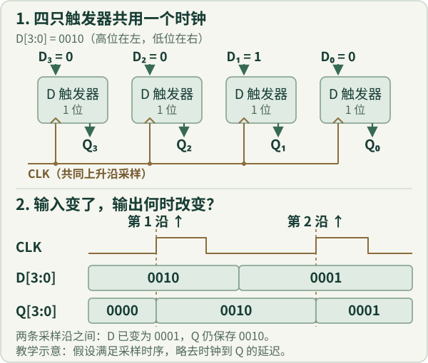
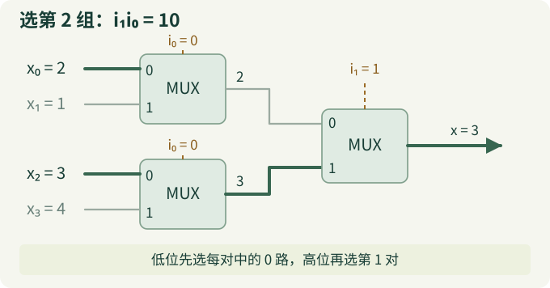
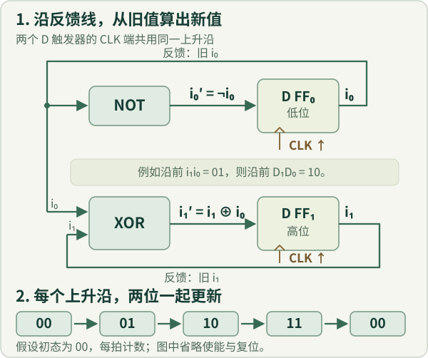
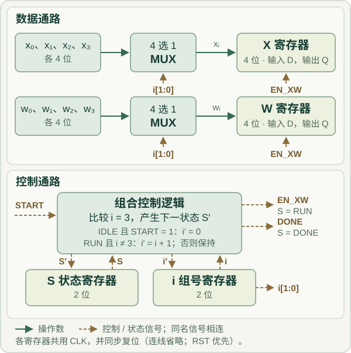
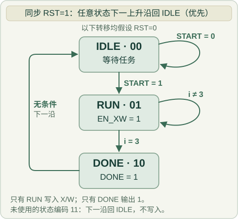
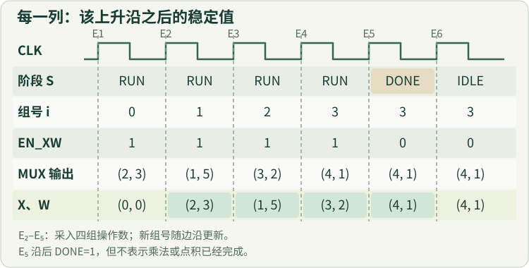

# 怎样让电路按照要求保存、选择和更新数据？

假设芯片只有一套乘法电路，需要先计算 2 × 3，再计算 1 × 5。参与运算的数称为**操作数**。同一套电路可以在不同时刻处理不同的操作数，不必为每项乘法都造一套电路。

那么，谁来选择下一组操作数？如果运算还需要 2 和 3，外部数据已经换成 1 和 5，怎样避免原来的输入被覆盖？

[组合逻辑电路](../../semiconductor-foundations/combinational-logic/README.md)已经解释过：输入有效并稳定、等待充分的传播时间后，组合逻辑的输出由当前输入决定。想在输入改变后仍然取得旧值，就需要另一类能够保存状态的电路。

本篇先不研究乘法器内部怎样计算，只观察它的输入侧。我们先让电路保存一个数，再让它依次选择并保存多组数，最后找出谁来控制整个过程。

## 怎样保存一组数据，而不是一个比特？ {#register}

回忆[半导体系列中的 D 触发器](../../semiconductor-foundations/latch-and-divider/README.md#edge)。D 是数据输入，Q 是数据输出，反映触发器当前保存的值，CLK 是时钟输入。这里采用上升沿触发的 D 触发器，即每当时钟由 0 变为 1，就采样已经准备好的 D，并在短暂的传播延迟后更新 Q。

如果时钟沿还没有到来，D 即使改变，Q 也可以保留原来的值。因此，在满足采样时序的情况下，外部数据可以变化，而已经保存的数据不必跟着变化。

在本文的二值数字逻辑模型中，一根数据信号线表示一个比特，即 0 或 1。假设现在用四根信号线表示一个数。例如，数 2 的四位二进制表示为 `0010`。这是四个比特，不是一个触发器的四种状态。数值怎样编码，留到 A02 详细解释。

为了保存完整的数，给四根输入线各接一个 D 触发器，并让四个触发器共用同一个时钟。这组触发器构成一个**四位寄存器（Register）**，我们把它命名为 X。

<figure markdown="1">

<figcaption>下标从高位 3 到低位 0，对应四根输入线 D[3:0] 和四根输出线 Q[3:0]。时序示意省略实际传播延迟。</figcaption>
</figure>

观察图中的三个时刻：

- 第一个上升沿之前，D 上准备好了 `0010`，而 Q 仍保存旧值 `0000`。
- 第一个上升沿之后，四个触发器分别更新自己的比特，等 Q 稳定，寄存器中便保存了 `0010`。
- 在两个上升沿之间，把 D 改成 `0001`，Q 仍保存 `0010`。新的数据要等下一个上升沿才会写入。

四个触发器共用时钟，是为了让一组数据在同一个逻辑边沿更新。若各位在不同时刻任意改写，读取者可能看到新旧比特混合而成的值。同步设计还要保证各位满足相应的采样时序。

[MIT 6.004：同步时序逻辑与寄存器](https://ocw.mit.edu/courses/6-004-computation-structures-spring-2017/pages/c5/c5s1/) · [建立时间与保持时间](../../semiconductor-foundations/pvt-and-path-delay/README.md)

关联知识：两个寄存器共用时钟时，数据怎样传递？

假设把 X 的 Q 接到另一个四位寄存器 H 的 D。两个寄存器同时采样，X 保存新输入时，H 采到的是这一沿之前的 X。若 X 原来为 2、H 为 0，新输入为 1，则沿后 X 为 1、H 为 2。

继续串接寄存器，就能逐拍将整组数据向后传递。若将相邻的一位触发器按这种方式串接，还可以让数据逐位移动，这就是一种移位寄存器。

## 如果这一拍不该写入，怎样让寄存器保住旧值？ {#enable}

刚才的寄存器每个上升沿都采样输入。假设 X 已经保存 2，外部新输入 U 是 1，但计算电路还需要 X 中的 2。现在怎样让时钟照常运行，却不把 X 改写为 1？

触发器每次采样 D。如果在不想更新时，把 X 的旧输出 Q 送回 D，那么即使时钟沿照常到达，触发器也只是重新采样自己的旧值。

想更新时，则让 D 接收外部新数据 U。这里需要根据控制信号选择两种数据来源。正好可以使用[组合逻辑篇中的多路选择器（Multiplexer，MUX）](../../semiconductor-foundations/combinational-logic/README.md#mux)。

<figure markdown="1">

</figure>

二选一 MUX 有两个数据输入和一个选择信号。在这里，把输入 0 接到旧 Q，把输入 1 接到新 U，并将选择信号命名为 EN（使能）。四位数据的四个比特共用 EN，整组数据会一起被选择。

| EN | MUX 输出 D | 下一个上升沿之后的 Q |
| ---: | --- | --- |
| 0 | 旧 Q | 保持旧值 |
| 1 | 新 U | 保存新值 |

假设 X 起初保存 2。外部依次提供 1、3、4，但只有第二次允许写入。下面的 E₁、E₂、E₃ 分别代表三个连续的时钟上升沿。

| 上升沿 | 沿前 X（旧 Q） | 新输入 U | EN | 当时选中的 D | 沿后 X（新 Q） |
| --- | ---: | ---: | ---: | ---: | ---: |
| E₁ | 2 | 1 | 0 | 2 | 2 |
| E₂ | 2 | 3 | 1 | 3 | 3 |
| E₃ | 3 | 4 | 0 | 3 | 3 |

E₁ 时，MUX 选择反馈支路，X 仍保存 2。E₂ 时，MUX 改选新输入，X 保存 3。E₃ 时，再次选择反馈，但这一次反馈的已经是刚写入的 3。

这就是**寄存器写入使能**的含义：时钟决定何时采样，使能决定这一沿是否改写数据。实际触发器可以有专用使能端口；图中是解释写入行为的一种实现。[MIT 6.004：带写入选择的寄存器](https://ocw.mit.edu/courses/6-004-computation-structures-spring-2017/pages/c13/c13s1/)

EN = 0 只说明数据不会被改写，不等于停止时钟，也不保证所有内部电路都停止翻转。

## 四份数据都已准备好，怎样只取其中一组？ {#select-decode}

现在把例子扩展到四组操作数。我们希望两个输入寄存器 X、W 依照组号 0、1、2、3 的顺序更新，把每一组数提供给同一个计算单元。

| 组号 i | 操作数 x | 操作数 w |
| ---: | ---: | ---: |
| 0 | 2 | 3 |
| 1 | 1 | 5 |
| 2 | 3 | 2 |
| 3 | 4 | 1 |

这是后续将用于计算的四项点积，即对应位置的两个数分别相乘，再把乘积相加。这个例子的数学结果是 2 × 3 + 1 × 5 + 3 × 2 + 4 × 1 = 21，但本篇只组织输入数据，不计算乘积。

假设四组数在本次任务期间都已准备好，每个数用四位信号表示。怎样让 X 和 W 得到同一组号的两个数？

先只看 X。它有四个候选数据来源。使用四选一 MUX，并用两个比特表示组号 i，就能区分四路输入。

<figure markdown="1">

</figure>

从图上观察 i = `10`（组号 2）。四选一 MUX 输出 x₂ = 3。给 W 连接另一个四选一 MUX，让两个 MUX 共用 i，它的输出便是 w₂ = 2。

这样，只需改变一个组号，就能选择一整对操作数。再让两个寄存器共用写入使能 EN_XW：它为 1 时，两者在同一个边沿采下这一对数；它为 0 时，两者都保持原值。

关联知识：如果是从多个目的寄存器中选择一个呢？

MUX 用来从多个来源选择数据。如果希望将同一份数据写入四个目的寄存器中的一个，可以用译码器把两位编号转换为四条独立的选择线，并分别连接各寄存器的写入使能。

例如，组号为 `10` 时，二到四译码器可以令第 2 路选择线有效。再与总写使能组合，就能让选中的寄存器更新，其他寄存器保持。

本例只向 X、W 写入数据，不需要这样的目的端选择。[译码器、编码器及其门级实现](../../semiconductor-foundations/combinational-logic/README.md#decoder)将在构建寄存器文件时再次用到。

## 怎样自动选择下一组数据？ {#counter}

到现在为止，还需要外部每拍把组号 i 改成下一个值。我们希望电路自己记住当前组号，并在允许推进的时候自动选取下一组。

回忆[半导体系列中的二分频电路](../../semiconductor-foundations/latch-and-divider/README.md#divider)。把一个触发器的 Q 取反，再送回 D，那么时钟每到一个上升沿，保存的值就会在 0 和 1 之间翻转一次。

这个电路本身已经能记录两个状态。现在再添一个触发器，让两只触发器分别保存组号的高位 i₁ 和低位 i₀。

| 沿前组号 i₁i₀ | 希望推进后的组号 i₁′i₀′ |
| --- | --- |
| `00` | `01` |
| `01` | `10` |
| `10` | `11` |
| `11` | `00` |

先只看低位 i₀，它依然每次推进就取反。因此可以保留原来的连接，让低位触发器采样 ¬i₀。

再看高位 i₁。沿前低位为 0 时，高位应该保持；沿前低位为 1 时，高位应该翻转。这个关系可以由[异或（XOR）电路](../../semiconductor-foundations/combinational-logic/README.md#logic-function)实现：与 0 异或保持原值，与 1 异或得到反值。

因此，两位在每次推进时的下一值为：

**i₀′ = ¬i₀，i₁′ = i₁ ⊕ i₀**

<figure markdown="1">

<figcaption>图中只展示每拍都推进的基本计数电路，暂不画使能及复位。</figcaption>
</figure>

例如，沿前 i = `01`。低位原来是 1，经过反相后得到 0；高位原来是 0，与旧低位 1 异或后得到 1。两个新值都已准备好，时钟上升沿到来时，两只触发器一起采样，沿后组号成为 `10`。

不是低位先更新、高位再读取新低位。两条用于产生下一值的组合路径始终都存在，两个触发器依据同一采样沿之前的旧状态更新。

这种用状态寄存器和组合逻辑不断推进计数值的电路叫**计数器（Counter）**。本例使用两位，因而在 0、1、2、3 之间循环。给两位加上写入使能，就能控制某一拍是否推进。

[TI SN74HC163：同步二进制计数器的计数、装载、清零和保持行为](https://www.ti.com/lit/ds/symlink/sn74hc163.pdf)（具体端口与信号极性见器件手册）。

## 怎样从指定的组号开始？ {#reset}

我们已经知道怎样从旧组号得到新组号，但还没有规定上电后组号的初值。若上电后恰好保存的是 `10`，第一组就可能选错。

可以增加一个控制信号 RST。RST 为 1 时，不论计数器原来的状态是什么，都让下一值等于 `00`；RST 为 0 时，则按普通使能决定保持或推进。

这就是一种**同步复位（Synchronous Reset）**。本例规定复位优先于普通使能。在 RST 有效时，仍然需要等待一个时钟上升沿，寄存器才会显示规定的初值。

另一种是**异步复位（Asynchronous Reset）**：复位有效时，无须等待时钟边沿即可使寄存器进入规定状态。实际电路的复位极性、优先级以及释放时的时序约束由具体实现决定。

[AMD FDRE：同步复位触发器](https://docs.amd.com/r/2023.2-English/ug953-vivado-7series-libraries/FDRE) · [AMD FDCE：异步清零触发器](https://docs.amd.com/r/2023.2-English/ug953-vivado-7series-libraries/FDCE)

并非所有数据寄存器都需要指定初值。如果控制电路能保证这些寄存器在首次被读取之前已经写入新值，就可以不依赖它们的复位值。为了便于观察，下面的教学电路统一将数据、组号和控制状态同步复位。

## 怎样控制整个过程的开始与结束？ {#fsm}

把计数器的输出 i 接到前面的两个四选一 MUX。只要每拍增加 i，并同时使能 X、W，就能依次写入四组数。

但还有两个问题。任务开始前，电路应该等待，而不是马上开始写数据。写入第 3 组之后，也不应该让 i 回到 0 并继续覆盖数据。

只看组号不够。例如 i = 0，既可能表示正在等待任务，也可能表示任务已启动、准备写入第 0 组。此时 i 虽然相同，两个寄存器应该采取的行为却不同。

所以，这个设计再增加一个寄存器 S，表示电路当前处于哪个工作阶段，而不是数据组号。

| 阶段 | 含义 | 用两个比特表示 |
| --- | --- | --- |
| IDLE | 等待开始 | `00` |
| RUN | 依次写入操作数 | `01` |
| DONE | 四组均已写入 | `10` |

收到开始信号 START 时，从 IDLE 进入 RUN。只有处于 RUN 阶段，才允许 X、W 写入当前组。到达最后一组时，仍应允许这次写入，但随后进入 DONE。

<figure markdown="1">

<figcaption>绿色实线表示操作数路径，棕色虚线表示控制和状态信号；相同信号名表示连接到同一信号。</figcaption>
</figure>

先看图中的两条操作数路径，它们负责选择和保存数据。控制逻辑则观察当前状态 S、组号 i 和开始信号 START，产生写入使能，并决定组号与控制状态的下一值。

沿着控制通路写出完整的更新规则。假设所有寄存器采用相同的时钟并满足采样时序，START 是同步的单拍信号，只在 IDLE 中接受；这里也不考虑下游暂停。

| 沿前状态 | 条件 | 本沿数据和组号的更新 | 沿后状态 |
| --- | --- | --- | --- |
| IDLE | START = 0 | 保持 X、W、i | IDLE |
| IDLE | START = 1 | i 清零，X、W 保持 | RUN |
| RUN | i ≠ 3 | X、W 写入当前组；i 加一 | RUN |
| RUN | i = 3 | X、W 写入最后一组；i 保持 3 | DONE |
| DONE | 任意 | 保持 X、W、i | IDLE |

复位优先于以上规则。两位状态编码剩余的 `11` 不用于正常运行；本例令它在下一上升沿返回 IDLE，且不写入数据。

<figure markdown="1">

</figure>

这个状态转换图不是一段由 CPU 解释执行的程序。每个转移条件都可以用组合逻辑实现，例如比较 i = 3 就是判断两个组号位是否都为 1。

状态寄存器保存当前阶段，组合逻辑根据当前阶段和输入产生下一状态及所需控制信号。到时钟边沿，各寄存器才更新。这种按有限个状态组织行为的电路称为**有限状态机（Finite State Machine，FSM）**。

[MIT 6.004：有限状态机的数字电路实现](https://ocw.mit.edu/courses/6-004-computation-structures-spring-2017/pages/c6/c6s1/)

深化阅读：控制输出是否也可以直接依赖当前输入？

本例的普通 X、W 写入使能只取决于当前 S 是否为 RUN，而完成信号 DONE 也只取决于当前 S 是否为 DONE。仅由当前状态决定的输出称为 Moore 型输出。

如果某个控制输出还直接取决于当前外部输入，则属于 Mealy 型输出。无论哪种形式，下一状态都可以由当前状态和输入共同决定。实际输出的产生时间和控制路径长度取决于具体设计。

## 逐拍走完这次任务 {#walkthrough}

从 E₀ 开始观察。先令 RST 有效，E₀ 上升沿将各寄存器复位。再释放 RST，在 E₁ 之前给 START 一个有效脉冲。此时组号和控制状态会发生什么变化？

| 上升沿 | 沿前 S、i | X/W 写使能 | 采入的 (x, w) | 沿后 S、i | 沿后 (X, W) |
| --- | --- | ---: | --- | --- | --- |
| E₀ | 初值未指定，RST = 1 | 复位 | — | IDLE, 0 | (0, 0) |
| E₁ | IDLE, 0；START = 1 | 0 | — | RUN, 0 | (0, 0) |
| E₂ | RUN, 0 | 1 | (2, 3) | RUN, 1 | (2, 3) |
| E₃ | RUN, 1 | 1 | (1, 5) | RUN, 2 | (1, 5) |
| E₄ | RUN, 2 | 1 | (3, 2) | RUN, 3 | (3, 2) |
| E₅ | RUN, 3 | 1 | (4, 1) | DONE, 3 | (4, 1) |
| E₆ | DONE, 3 | 0 | — | IDLE, 3 | (4, 1) |

E₁ 上升沿之前，S 还是 IDLE，写使能为 0。沿后进入 RUN，组号为 0，MUX 已经从第 0 组选出操作数。直到 E₂ 上升沿，X、W 才采下 (2, 3)。

<figure class="micro-diagram" style="max-width:750px; margin:1.2rem auto" tabindex="0" aria-label="逐拍状态和数据，窄屏可横向滚动" markdown="1">

<figcaption>虚线表示采样边沿；各行中的值表示边沿之后的稳定状态，忽略传播延迟。采样的是该边沿到来之前已经准备好的数据。</figcaption>
</figure>

观察 E₂ 右侧的这一拍：组号已经更新为 1，MUX 的输出会改成 (1, 5)，但 X、W 仍保存刚刚采到的 (2, 3)。它们并没有因为 MUX 输出改变而立刻更新。

再看 E₅。这个上升沿之前 S 还是 RUN，写使能有效，所以最后一组 (4, 1) 不会丢失。沿后 S 进入 DONE，普通写使能无效，下一个上升沿不再改写 X、W。

如果 X、W 的 Q 直接连接组合乘法电路，乘法电路的输入会随 Q 改变。等输入稳定，再经过足够的组合传播时间，乘积才会稳定。

如果后级还有一个寄存器用来保存乘积，同一个上升沿采到的也是沿前已经准备好的结果，而不是这一沿刚写入 X、W 的新操作数产生的结果。

这个例子的 DONE 只表示**四组操作数都已写入入口寄存器**，不代表后级已经使用完它们，更不代表点积结果已经计算出来。怎样协调不同计算阶段，后续再讨论。

## 这些电路为什么是微架构的共同基础？ {#next}

回看整张控制电路图。X、W、i、S 都是保存比特的寄存器，但保存的内容和用途不同：

- X、W 保存当前操作数，下一份数据由 MUX 选择。
- i 保存组号，下一值由计数及控制逻辑产生。
- S 保存工作阶段，下一状态由当前阶段与输入条件决定。

连接和处理操作数的结构是**数据通路（Datapath）**；选择、使能、阶段转换等电路构成**控制通路（Control Path）**。计算微架构研究的一个核心问题，就是如何组织这两类电路，使计算资源正确且高效地工作。

现在试着改变例子的一个条件。如果输入从四组增加到八组，组号至少需要三位，选择网络也需要支持更多数据来源。这不是多写一个编号那么简单，还要增加相应的硬件。

如果下游需要额外一拍才能使用当前操作数，又该怎么办？这时不能简单地让 X、W 每拍继续更新，否则可能覆盖仍然需要的数据。这是后续流水线和握手机制需要解决的问题。

目前我们已经能够选择、保存并依次提供四位操作数，但仍没有解释四个比特怎样表示一个数、怎样进行加减运算。A02 将从数值表示与一个比特的加法开始，构造基本算术电路。

[返回共同计算基础导读](README.md)。
