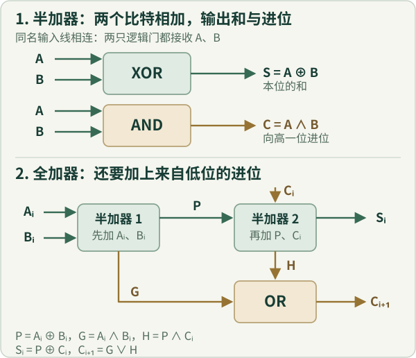
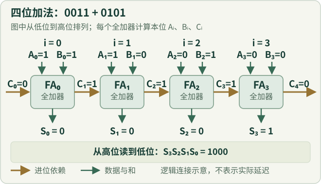
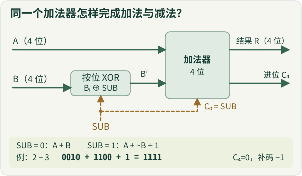
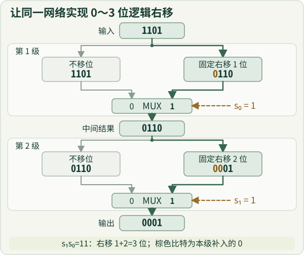
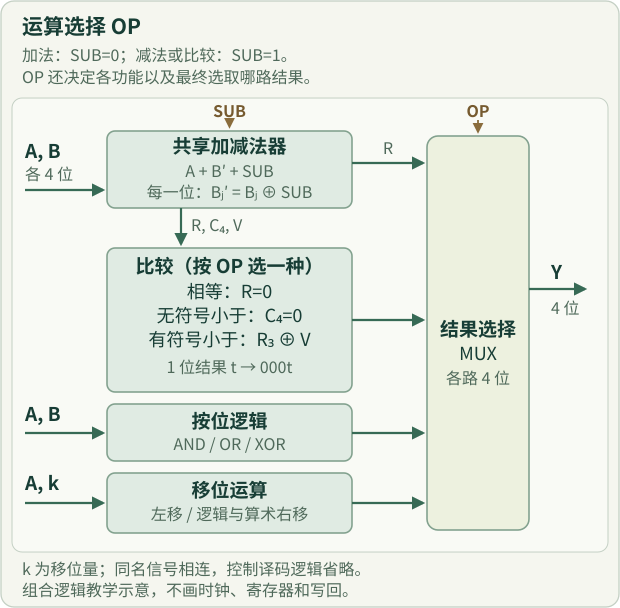
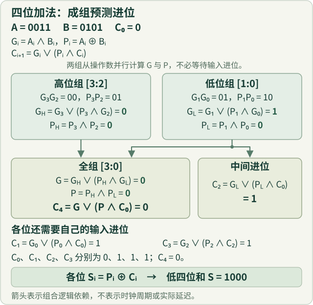

# 有限个比特，怎样表示一个数并完成加减运算？

[上一篇](a01-state-and-control.md)让两个四位寄存器 X、W 依次保存操作数。第一组是 2 和 3，输出信号分别为 `0010` 和 `0011`。

如果把这两组信号送给运算电路，希望它得到 5，应该怎样连接逻辑门？如果改成计算 2 − 3，又怎样用同样的四根输出线表示 −1？

数字运算电路需要解决两个问题：用有限个比特表示数，再按规定的数值含义处理这些比特。本篇从加法出发，逐步构建可以加减、比较、移位的基本运算单元。

## 四根信号线，为什么能表示 16 个整数？ {#binary}

在十进制中，数字 23 的两位并不具有相同的权重。左边的 2 代表两个十，右边的 3 代表三个一。因此 23 = 2 × 10 + 3 × 1。

四根数字信号线每根只能取 0 或 1。我们也可以为它们约定不同的权重，从右到左依次为 1、2、4、8。这些权重每向左移动一位就翻倍，这就是**二进制的位权**。

| 比特下标 | 3 | 2 | 1 | 0 |
| --- | ---: | ---: | ---: | ---: |
| 位权 | 8 | 4 | 2 | 1 |
| X 的输出 | 0 | 0 | 1 | 0 |
| W 的输出 | 0 | 0 | 1 | 1 |

X 的值为 0 × 8 + 0 × 4 + 1 × 2 + 0 × 1 = 2，W 的值则是 3。第 0 位具有最小的权重，称为最低有效位（LSB）；第 3 位是最高有效位（MSB）。

每个比特都可以取两种值，四个独立的比特一共有 2⁴ = 16 种组合。从 `0000` 到 `1111`，在上述位权约定下，恰好表示 0 到 15。这种表示称为**无符号整数（Unsigned Integer）**。

一般地，n 位无符号整数的最大值为 2ⁿ − 1。位宽越大，可表示的整数范围就越大。[MIT 6.004：二进制整数与数值表示](https://ocw.mit.edu/courses/6-004-computation-structures-spring-2017/pages/c1/c1s1/)

这里的 8、4、2、1 是我们对信号组合的解释，不是四根线上存在四种不同的高电压。每根线仍然使用相同的数字逻辑规则。

## 只加两个比特，为什么需要两根输出线？ {#half-adder}

先不急于处理四位数据。把 X、W 的最低位分别连接到输入 A 和 B，希望电路得到这一列的加法结果。

| A | B | 数学和 | 进位 C | 本位和 S |
| ---: | ---: | ---: | ---: | ---: |
| 0 | 0 | 0 | 0 | 0 |
| 0 | 1 | 1 | 0 | 1 |
| 1 | 0 | 1 | 0 | 1 |
| 1 | 1 | 2 | 1 | 0 |

最后一行是关键：一个比特无法单独表示 2。由于左侧一位的权重是本位的两倍，可以将 2 表示为二进制 `10`。右边的 0 是本位和，左边的 1 是送给更高位的进位。

观察表中两列输出。当 A、B 不同时，本位和 S 为 1；当 A、B 同时为 1 时，进位 C 为 1。这正是[组合逻辑篇](../../semiconductor-foundations/combinational-logic/README.md#logic-function)中介绍的异或与与运算。

因此，用一个异或门产生 S，用一个与门产生 C，就能把两个一位输入相加：

**S = A ⊕ B，C = A ∧ B**

这个电路称为**半加器（Half Adder）**。它只需要两个输入，输出本位和及进位。

## 如果低位也产生了进位，怎么办？ {#full-adder}

现在开始计算 X + W，即 `0010 + 0011`。最低位是 0 + 1，得到本位和 1，没有进位。

到了第 1 位，两个输入都是 1，本位和为 0，同时向第 2 位送出一个进位。第 2 位的两个输入都为 0，但不能忽略低位传来的 1，否则结果将错误。

所以，更高位的加法器需要三个输入：Aᵢ、Bᵢ，以及来自低一位的进位 Cᵢ。我们仍要产生本位和 Sᵢ 与向高一位传出的进位 Cᵢ₊₁。

怎么构建这个电路？先用一个半加器计算 Aᵢ + Bᵢ，再用另一个半加器把本位和与 Cᵢ 相加。两次相加只要有一次产生进位，就要向高一位送出 1。如果第一个半加器已产生进位，其本位和就是 0，第二个半加器便不会再产生进位。两路进位用或门合并即可。

<figure markdown="1">

</figure>

这个接受三个一位输入的电路称为**全加器（Full Adder，FA）**。它满足：

**Aᵢ + Bᵢ + Cᵢ = Sᵢ + 2 × Cᵢ₊₁**

右边的 2 表示进位对应的权重比本位高一倍。例如三个输入都是 1 时，数学和为 3，Sᵢ 与 Cᵢ₊₁ 都为 1，对应二进制 `11`。

根据图中的连接可以得到：

- Sᵢ = (Aᵢ ⊕ Bᵢ) ⊕ Cᵢ
- Cᵢ₊₁ = (Aᵢ ∧ Bᵢ) ∨ ((Aᵢ ⊕ Bᵢ) ∧ Cᵢ)

用八种输入组合检查全加器

| Aᵢ | Bᵢ | Cᵢ | Sᵢ | Cᵢ₊₁ |
| ---: | ---: | ---: | ---: | ---: |
| 0 | 0 | 0 | 0 | 0 |
| 0 | 0 | 1 | 1 | 0 |
| 0 | 1 | 0 | 1 | 0 |
| 0 | 1 | 1 | 0 | 1 |
| 1 | 0 | 0 | 1 | 0 |
| 1 | 0 | 1 | 0 | 1 |
| 1 | 1 | 0 | 0 | 1 |
| 1 | 1 | 1 | 1 | 1 |

每一行都满足上述恒等式。三个一位输入相加最多为 3，所以两个输出位足以表示完整的和。

把四个全加器连接起来，让每一位的进位送给高一位，便得到一个四位加法器。最低位没有来自更低位的进位，令 C₀ = 0 即可。

为了更清楚地观察这条进位路径，换用 A01 中出现过的 3 和 5，计算 `0011 + 0101`。

<figure class="micro-diagram" style="max-width:660px; margin:1.2rem auto" tabindex="0" aria-label="四位串行进位加法过程，窄屏可横向滚动" markdown="1">

<figcaption>数据和进位均为组合逻辑信号。箭头表示依赖与传播方向，不代表每个全加器占用一个时钟周期。</figcaption>
</figure>

| 位 i（从最低位开始） | Aᵢ | Bᵢ | 输入进位 Cᵢ | 本位和 Sᵢ | 输出进位 Cᵢ₊₁ |
| ---: | ---: | ---: | ---: | ---: | ---: |
| 0 | 1 | 1 | 0 | 0 | 1 |
| 1 | 1 | 0 | 1 | 0 | 1 |
| 2 | 0 | 1 | 1 | 0 | 1 |
| 3 | 0 | 0 | 1 | 1 | 0 |

将和的四个比特按高位到低位排列，得到 `1000`，也就是 8。

这种让进位依次传到高位的结构称为**串行进位加法器（Ripple-Carry Adder）**。各位全加器的逻辑电路在硬件中同时存在；当某位的进位发生变化时，下游组合逻辑才继续响应。

[MIT 6.111：多位加法器及进位结构](https://web.mit.edu/6.111/www/s2009/LECTURES/l8-l9.pdf)

## 只有四个比特，怎样表示 −1？ {#twos-complement}

加法已经可以完成。现在回到最初的两个操作数，计算 2 − 3。数学结果应当是 −1，可是四位无符号整数没有负数。

换一种思路：不另造一种用于负数的加法电路，而是规定负数使用怎样的比特组合，使原来的加法器就能处理它们。

先观察四位加法器的一个特性。`1111 + 0001` 的完整结果是五位的 `1 0000`。如果结果寄存器只有四位，只保存低四位，就会得到 `0000`。最高处多出来的进位没有被写进这个寄存器。

| 完整数值 | 16 | 17 | 18 | … |
| --- | ---: | ---: | ---: | ---: |
| 保留低四位后的无符号值 | 0 | 1 | 2 | … |

每加上 16，低四位的组合就会重复。这种固定宽度的低位结果可以视为**模 16 运算**，即只保留除以 16 的余数。它不是某个加法器的物理故障，而是只保留有限个输出位的结果。

如果让 `1111` 表示 −1，就出现一个很有用的性质：−1 + 1 = 0，而原来的四位加法器也正好产生 `0000`。同理，`1110` 可以表示 −2，因为它加上 `0010` 后也得到低四位全零。

如果希望四位数据同时表示正数和负数，我们可以将 16 种组合中的一半用于非负数，另一半用于负数。采用下面的约定：

| 比特组合 | 无符号解释 | 四位补码解释 |
| --- | ---: | ---: |
| `0000` | 0 | 0 |
| `0001` | 1 | 1 |
| `0010` | 2 | 2 |
| … | … | … |
| `0111` | 7 | 7 |
| `1000` | 8 | −8 |
| … | … | … |
| `1101` | 13 | −3 |
| `1110` | 14 | −2 |
| `1111` | 15 | −1 |

这就是**二进制补码（Two's Complement）**。最高位为 1 时，将原无符号值减去 16，便得到对应的负数。原先最高位贡献的 8，减去 16 后就变成了 −8。

因此，四位补码的位权为 −8、4、2、1，其他三位的权重不变。例如 `1101` = −8 + 4 + 0 + 1 = −3。

四位补码的范围是 −8 到 7。一般的 n 位补码范围为 −2n−1 到 2n−1 − 1。

同一组比特 `1111` 既可以表示无符号的 15，也可以表示补码的 −1。比特本身没有“这是正数还是负数”的标签；数据的格式或运算接口决定其解释。

### 怎样得到一个数的相反数？

例如，怎样让电路从 `0011`（3）得到表示 −3 的 `1101`？

先将四个比特逐一取反，得到 `1100`。原数与取反后的数相加，四位结果恰好是 `1111`，也就是 15。再加 1，就得到 16，低四位为零。

所以，取反再加 1，可以得到与原数相加后低四位恰为零的比特组合：

**3 + (12 + 1) = 16**

这里的取反只在规定的四位范围内进行。

这样便得到补码的常见求相反数方法：**逐位取反，再加 1**。例如 `0011` → `1100` → `1101`，正好是 −3。

但并非所有相反数都可以用相同位宽表示。四位补码的 −8（`1000`）取反加一仍为 `1000`，因为 +8 已超出四位补码范围。若要精确表示 +8，必须增加位宽。

[MIT 6.004：负位权、补码范围和取反加一](https://ocw.mit.edu/courses/6-004-computation-structures-spring-2017/pages/c1/c1s1/)

## 能否让同一个加法器完成减法？ {#add-sub}

已经有了表示负数的方法。回到 2 − 3，将减法写成 2 + (−3)。只要让原先的加法器接收两个数，再把第二个数按需要变成其补码相反数，就能完成减法。

但如果在第二个操作数前专门造一个“取反后加一”的加法器，似乎又多用了一套资源。前面的四位加法器已经有一个尚未利用的输入进位 C₀，能否用它完成这个加一？

设控制信号 SUB：

- SUB = 0：将 B 原样送入加法器，并令 C₀ = 0，计算 A + B。
- SUB = 1：将 B 的各位取反，并令 C₀ = 1，计算 A + ¬B + 1，低四位就是 A − B。

每个 Bᵢ 只需经过一个异或门，与 SUB 做异或。当 SUB 为 0 时，该比特不变；当 SUB 为 1 时，该比特取反。

<figure markdown="1">

</figure>

代入 2 − 3：A = `0010`，B = `0011`。SUB 为 1，送入加法器的第二个数是 `1100`，C₀ 为 1。

**0010 + 1100 + 1 = 1111**

按补码解释，结果是 −1。整个加减电路只需要一套多位加法器。改变控制信号，便改变了这套计算电路完成的任务。

即使 B 是四位补码的 −8，电路也仍可计算 A + ¬B + 1 的低四位。它不需要先得到能用四位表示的数学相反数 +8。若精确差超出表示范围，仍需检测溢出。

[MIT 6.111：共享加法器实现加减法](https://web.mit.edu/6.111/www/s2009/LECTURES/l8-l9.pdf)

## 结果已经算出来，为什么还可能是错的？ {#overflow}

加减电路的四位结果记为 R，即加法器输出的四位本位和。注意，我们一直使用四位输入和四位输出。即使逻辑电路完全按照设计工作，数学结果也可能需要更多比特。

### 无符号进位与有符号溢出

刚才的 3 + 5 得到了 `1000`，并且 C₄ = 0。按无符号整数解释，结果 8 是正确的。但如果这两个操作数采用四位补码，`1000` 就表示 −8。

两个正数相加为什么会得到负数？不是加法器少算了一位，而是四位补码无法表示 +8。数学结果超出约定的可表示范围，这称为**溢出（Overflow）**。

| 四位加法 | 低四位结果 | C₄ | 无符号解释 | 补码解释 |
| --- | --- | ---: | --- | --- |
| `0011 + 0101` | `1000` | 0 | 3 + 5 = 8，正确 | 3 + 5 超范围 |
| `1111 + 0001` | `0000` | 1 | 15 + 1 超范围 | −1 + 1 = 0，正确 |

无符号加法中，C₄ 为 1 表示完整数学和超过四位可表示范围。补码加法却不能直接用 C₄ 判断溢出。

补码加法的两个操作数如果都是非负数，数学和不可能为负；两个负数相加，数学和也不可能为非负数。所以，两个同号操作数相加后得到异号结果，说明结果溢出。两个不同符号的数相加则不会发生这种溢出。

### 怎样避免丢失超过四位的结果？

一种方法是在运算之前扩展操作数，并用位数更多的加法器计算。无符号数在高位补 0；补码数需要复制原来的最高位（符号位），这叫**符号扩展（Sign Extension）**。

例如，将四位补码 −3 的 `1101` 扩展到五位时，得到 `11101`。原先最高位的贡献是 −8；现在最高两位的贡献是 −16 + 8 = −8，数值没有改变。如果错误地补 0，得到 `01101`，便改变成 13。

例如，计算 3 + 5 时先将两个正数扩展成五位，再进行五位加法：`00011 + 00101 = 01000`，精确结果为 8。若等到四位结果已经变成 `1000`，再做符号扩展，得到的仍是 −8，无法恢复原来的数学结果。

另一种方法是约定只返回低四位，同时提供额外的溢出信息；也可以约定超范围时返回边界值（饱和）。由接口规定需要哪种行为，电路就实现相应规则，而不是所有加法都自动饱和。

真实指令集有不同的约定。例如 RISC-V 的基本整数 ADD、SUB 指令保留规定宽度的低位结果，不因整数算术溢出自动触发异常。[RISC-V RV32I 规范：整数计算指令](https://docs.riscv.org/reference/isa/v20240411/unpriv/rv32.html)

### 电路怎样判断补码是否溢出？

令 V 为溢出信号，发生补码溢出时 V = 1，否则为 0。对于本文的四位加减器，进入最高位的进位为 C₃，离开最高位的进位为 C₄。两者的异或就可以得到 V：

**V = C₃ ⊕ C₄**

为什么？当两个最高位都为 0，最高位不会向外生成进位，只有 C₃ = 1 时结果才变成负数。如果两个最高位都为 1，则 C₄ 恒为 1，只有 C₃ = 0 时结果才成为非负数。

不同符号时，最高位只会传递 C₃，因而 C₄ = C₃，不会溢出。所以，只有进出最高位的两个进位不同时，V 才为 1。

3 + 5 的 C₃ = 1、C₄ = 0，因此 V = 1。−1 + 1 的 C₃ 和 C₄ 都是 1，因此 V = 0。

这一判定也适用于上述条件取反、设置 C₀ 的减法电路。减法发生补码溢出的条件是 A、B 符号不同，并且低位结果的符号与 A 不同。[MIT 6.111：补码溢出检测](https://web.mit.edu/6.111/www/s2009/LECTURES/l8-l9.pdf)

## 比较两个数，还需要另外造比较器吗？ {#compare}

如果只想知道 X 是否小于 W，能不能利用刚才已经构造好的加减电路？

对数学上的整数，有 A 小于 B 当且仅当 A − B 小于 0。但在固定宽度中，减法结果可能被截断，所以必须根据数字的解释方式，选择正确的判断条件。

### 无符号比较：有没有借位？

计算无符号的 2 − 3，需要从更高的一位借值。在四位加减器中，可以观察 C₄ 来判断是否发生这种借位。

之前的减法电路计算的是 A + ¬B + 1。对四位无符号数，¬B = 15 − B，所以完整的内部和等于 A + 16 − B。

若 A 大于或等于 B，完整的和至少为 16，因此 C₄ = 1。若 A 小于 B，和小于 16，则 C₄ = 0。

所以，在这种实现中，减法后的 C₄ = 0 表示发生借位，也表示 A 小于 B。

### 补码比较：结果的符号可靠吗？

补码下，先看 2 − 3。低四位为 `1111`，代表 −1，所以 2 小于 3。似乎只需要检查结果 R 的最高位，记为 N = R₃。

然而，如果要比较 3 与 −5，用四位加减器得到：

**3 − (−5) = 8（数学值），低四位为 `1000`**

低四位的最高位为 1，但 3 显然不小于 −5。问题仍然是溢出。8 已超出四位补码范围，截断后的解释变成了负数。

对于本文的补码减法，发生溢出时，截断结果的符号与真实数学差的符号相反。因此，将符号位 N 与溢出信号 V 异或，就能得到带符号的小于关系。

刚才计算 3 − (−5) 时，N = 1、V = 1，异或结果为 0。这才与真实的比较结果一致：3 不小于 −5。

同一个加减电路的两种小于判断分别是：

| 操作数解释 | A 小于 B 的判断条件 |
| --- | --- |
| 无符号 | 减法的 C₄ = 0（有借位） |
| 补码 | N ⊕ V = 1（校正溢出后的符号） |

若只检查是否相等，可以直接用[组合逻辑篇中的多位相等比较电路](../../semiconductor-foundations/combinational-logic/README.md#logic-function)，或者检查差的低四位是否为零。两者对本文的等宽比特组合都成立。

这里说明的是可以怎样复用加减电路完成比较，不代表所有芯片都必须这样实现。具体指令集也未必将这些内部信号作为可供软件读取的标志位。

[MITx：利用加减与溢出信号实现比较](https://courses.edx.org/asset-v1:MITx%2B6.004.1x_3%2B3T2016%2Btype@asset%2Bblock/labs_lab4_1_instructions.html)

## 为什么移动比特就能改变数值？ {#shift}

在第一节，我们为四个位约定了 8、4、2、1 的权重。如果把比特 `0011`（3）整体向左移动一位，得到 `0110`（6）。原本权重为 1 和 2 的两个 1，分别移动到了权重为 2 和 4 的位置。

因此，逻辑左移一位并在低位补 0，相当于将整数乘以 2，前提是数学结果仍能用规定的位宽及数值格式表示。否则，越过最高位边界的比特会被丢弃，不能保证得到精确数学结果。

向右移动又如何？先取四位比特 `1101`。它可以被解释为无符号的 13，也可以被解释为补码的 −3。

| 移位方式 | 右移一位结果 | 数值含义 |
| --- | --- | --- |
| 逻辑右移：高位补 0 | `0110` | 无符号 13 右移为 6 |
| 算术右移：高位补原符号位 | `1110` | 补码 −3 右移为 −2 |

逻辑右移把无符号整数除以 2 后向下取整。算术右移保留补码的符号扩展效果，对 −3 得到的是 −2，而不是向零取整所得的 −1。

### 怎样让硬件选择移动几位？

如果电路永远只需要逻辑右移一位，甚至不需要加法：将每根输出线接到高一位的输入线，最高位接常量 0 就可以了。

如果要求选择移动 0、1、2 或 3 位，就需要能在不同的接线方式之间切换。这里又能用到 MUX。

第一层根据移位量的低位决定是否右移 1 位；第二层根据高位决定是否再右移 2 位。若两个控制位都是 1，整组数据便连续右移 3 位。

<figure markdown="1">

</figure>

这种逐级选择固定距离的连接，可构成可变位移电路（常称桶形移位器，Barrel Shifter 的一种实现）。它不需要将一个比特在时钟之间逐次移动；图中的选择网络是一条组合逻辑路径。

[RISC-V RV32I：逻辑和算术移位的操作语义](https://docs.riscv.org/reference/isa/v20240411/unpriv/rv32.html) · [MITx：基于多级 MUX 的移位电路](https://courses.edx.org/asset-v1:MITx%2B6.004.1x_3%2B3T2016%2Btype@asset%2Bblock/labs_lab4_1_instructions.html)

## 同样四个比特，能不能表示小数？ {#fixed-point}

假设 X 的四位信号仍然是 `0010`，W 仍然是 `0011`。之前将它们解释为整数 2 和 3。

现在重新约定位权，让每一位的权重都变成原来的一半。对于四位补码，相应位权变成 −4、2、1、0.5。此时 `0010` 表示 1，`0011` 表示 1.5。

只需改变我们对比特的解释，寄存器不需要增加任何新线路。这是**二进制定点数（Fixed-Point Number）**的一种常见表示方法：用整数编码 I 表示实际数值 I × 2−F，其中 F 表示约定的小数位数。例如 F = 1 时，可以把 `0010` 理解为 `001.0`，小数点位置只是约定，不占用信号线。

| 四位补码编码 | 整数解释（F = 0） | 定点解释（F = 1） |
| --- | ---: | ---: |
| `0010` | 2 | 1 |
| `0011` | 3 | 1.5 |
| `0101` | 5 | 2.5 |
| `1000` | −8 | −4 |

如果两个操作数采用相同的缩放关系，只要整数加法没有超出位宽，加完后的整数仍然按同样的缩放关系解释。因此，原来的四位加法器计算 `0010 + 0011 = 0101`，现在得到的是 2.5。

这里仍有范围与精度的取舍。保持四位补码不变：

| 小数位数 F | 相邻可表示值的间隔 | 可表示范围 |
| ---: | ---: | --- |
| 0 | 1 | −8 ～ 7 |
| 1 | 0.5 | −4 ～ 3.5 |
| 2 | 0.25 | −2 ～ 1.75 |

小数位越多，在这个固定总位宽下就能表示越细的数值变化，但整数范围随之缩小。如果两个操作数的缩放关系不同，不能直接用原始编码相加，需先对齐尺度，并处理可能发生的精度损失或溢出。

本篇只解释二进制定点编码及同尺度加法，不讨论模型应如何选择量化尺度。浮点数怎样改变数值范围与精度，将在 A04 继续解释。

[MathWorks：二进制定点数的位权与缩放](https://www.mathworks.com/help/fixedpoint/gs/scaling.html)

## 有了这些电路，怎样让它们成为一个可选的运算单元？ {#alu}

把刚才构造的电路放到一起。两个寄存器提供操作数 A、B，共享的加减电路能产生算术结果与比较所需信号。另外还可以连接移位电路，以及直接处理每一位的与、或、异或电路。

例如 A = `0010`、B = `0011` 时，按位与、或、异或的结果分别为 `0010`、`0011`、`0001`。它们只处理同一位置的比特，不传递进位，因此与加法的 `0101` 不同。

这些组合逻辑可以同时存在，但本次计算只需要其中一种结果。所以，用操作选择信号决定怎样配置加减电路，以及选择哪一路结果送往输出。

<figure class="micro-diagram" style="max-width:620px; margin:1.2rem auto" tabindex="0" aria-label="四位 ALU 结构，窄屏可横向滚动" markdown="1">

<figcaption>教学示意。比较结果只有一位，这里约定将其高位补零后送入四位结果选择器；具体硬件可能有不同的组织方式。</figcaption>
</figure>

这样的运算单元通常称为**算术逻辑单元（Arithmetic Logic Unit，ALU）**。就本例而言，它根据数据与控制信号完成加减、逻辑运算、比较或移位。

ALU 的输出本身仍是组合逻辑的结果。如果要保留这个结果，可以接回 A01 所讨论的寄存器，并在合适的时钟边沿写入。完整的操作数选择和结果写回通路留给 A05。

## 为什么加法器位数越多，进位可能越慢？ {#carry-lookahead}

现在回到四位加法 `0011 + 0101 = 1000`。如果各路输入刚刚改变，最高位的本位和还需要知道低位传来的 C₃。

最低位生成 C₁，第 1 位依据 C₁ 得到 C₂，第 2 位又依据 C₂ 得到 C₃。若每一位都必须等待前一位的进位稳定，最高位的输出就可能经过较长的逻辑传播路径。

扩大到 32 位或 64 位时，这个问题更加明显。能不能利用各位已经准备好的 A、B，提前判断进位，而不必让它逐位传播？

### 把每一位对进位的作用分开

回看全加器的进位公式：

**Cᵢ₊₁ = (Aᵢ ∧ Bᵢ) ∨ ((Aᵢ ⊕ Bᵢ) ∧ Cᵢ)**

它揭示了两种不同的关系：

- **生成进位**：两个输入均为 1，不论有没有低位进位，都会生成新的进位。令 Gᵢ = Aᵢ ∧ Bᵢ。
- **传递进位**：两个输入不同，如果低位送来进位，本位也会向高位送出进位。令 Pᵢ = Aᵢ ⊕ Bᵢ。

两个输入均为 0 时，既不生成也不传递进位。所以可以把原进位关系简写为：

**Cᵢ₊₁ = Gᵢ ∨ (Pᵢ ∧ Cᵢ)**

Gᵢ 与 Pᵢ 只取决于当前的两个操作数，不必等待低位进位就能先产生。

在 3 + 5 的例子中，最低位生成进位，第 1、2 位负责传递进位，第 3 位既不生成也不传递，因此最高位收到进位却没有继续向外进位。

### 能否不等待中间进位？

以 C₂ 为例，在串行结构中，先得到 C₁，再计算 C₂：

- C₁ = G₀ ∨ (P₀ ∧ C₀)
- C₂ = G₁ ∨ (P₁ ∧ C₁)

将 C₁ 的表达式代入第二式：

**C₂ = G₁ ∨ (P₁ ∧ G₀) ∨ (P₁ ∧ P₀ ∧ C₀)**

观察右边，已经不包含中间信号 C₁。所有项都可以由 A、B 产生的 G、P 以及 C₀ 得到。这样就能用组合逻辑直接产生 C₂，不必将 C₁ 的输出逐级送入第二个全加器。

同样的展开方式也可以用于其他进位。这种利用生成和传递关系预先求出进位的办法称为**超前进位（Carry Lookahead）**。

### 位数继续增加时，怎样避免表达式过于复杂？

如果直接展开一个 64 位进位表达式，组合逻辑将需要处理大量输入条件。更实用的一种方法是先计算小组的生成和传递关系，再组合这些小组。

例如，把四个位分成低两位 L 与高两位 H：

- GL = G₁ ∨ (P₁ ∧ G₀)，PL = P₁ ∧ P₀。
- GH = G₃ ∨ (P₃ ∧ G₂)，PH = P₃ ∧ P₂。

把两个小组当作两段进位逻辑。GL 表示低两位即使没有输入进位，是否仍能生成越过小组边界的进位；PL 表示两位是否都能传递输入进位。高位小组的含义相同。

<figure class="micro-diagram" style="max-width:640px; margin:1.2rem auto" tabindex="0" aria-label="分组超前进位计算，窄屏可横向滚动" markdown="1">

<figcaption>图中按组展示进位生成和传递的关系。形成各位本位和还需要相应的 C₁、C₂、C₃ 等进位信号。</figcaption>
</figure>

由高、低两组可以继续形成更大一组：

- G = GH ∨ (PH ∧ GL)
- P = PH ∧ PL
- C₄ = G ∨ (P ∧ C₀)

同样的关系可反复组合，用更少的串行依赖层次得到多个进位信号。现代宽位加法器的分组超前进位和并行前缀结构都利用了这类思想，但具体连线组织不尽相同。

在理想的有限扇入组合逻辑模型中，逐位串行的最坏依赖深度随位宽线性增长；分层的并行前缀可以把生成进位的逻辑深度降为对数级。实际延迟还取决于门、布线和负载，不能仅凭位数公式断定电路会快几倍。

这种速度收益并非免费。更多并行进位计算可能增加面积、布线与扇出负载。需要怎样的加法器，取决于性能、面积、功耗以及实际工艺条件。

[MIT 6.004：串行进位、超前进位及分层组织](https://ocw.mit.edu/courses/6-004-computation-structures-spring-2017/pages/c8/c8s1/)

## 接下来怎样构造乘法器？ {#next}

我们已经能够解释 A01 中保存的四位数据怎样表示一个数，也构造了处理这些数据的基本加减电路。数值格式决定比特的含义，逻辑连接决定怎样产生结果，位宽决定哪些数学结果可以保留下来。

回到最初希望计算的 2 × 3。加法器已经能把两个数加起来，但乘法并不是简单地连接一个新的逻辑门。下一篇 [A03 · 从部分积到 MAC：芯片怎样完成一次乘加？](a03-multiplication-and-accumulation.md) 将从二进制的部分积出发，进一步研究怎样用逻辑门、全加器与累加电路构成乘法器和乘加单元。

[返回共同计算基础导读](README.md)。
