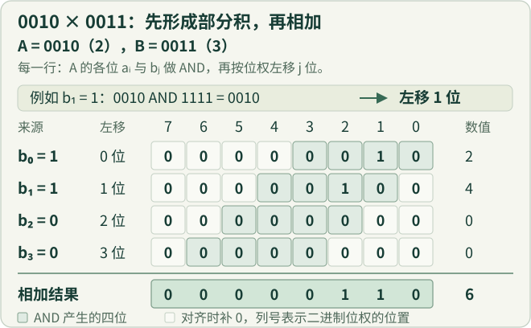
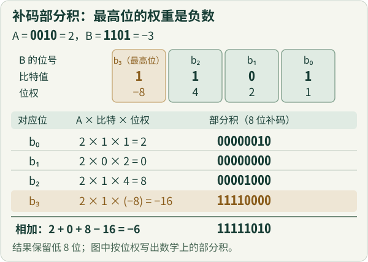
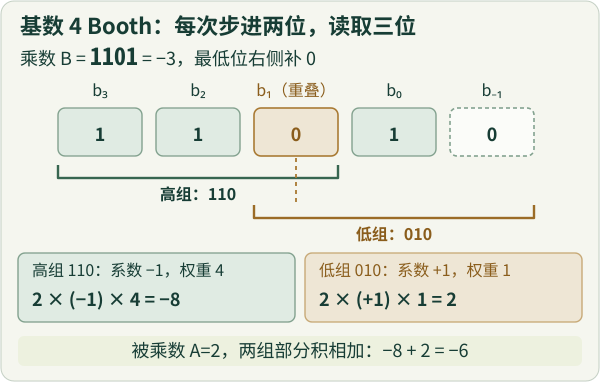
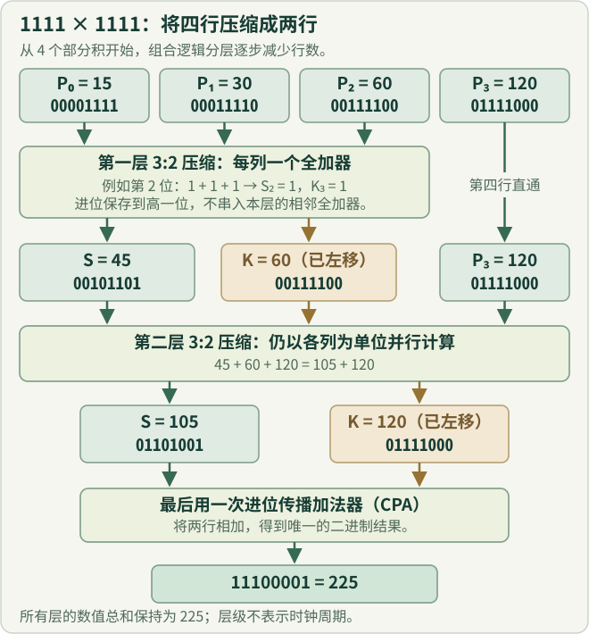
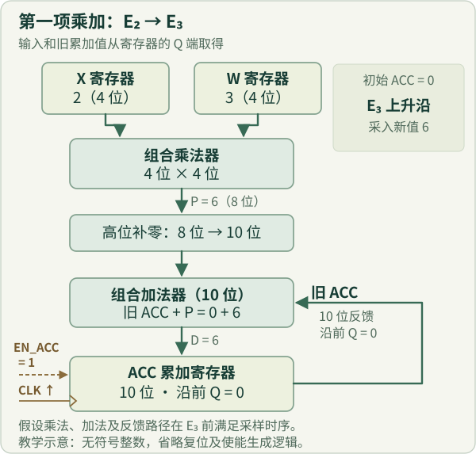
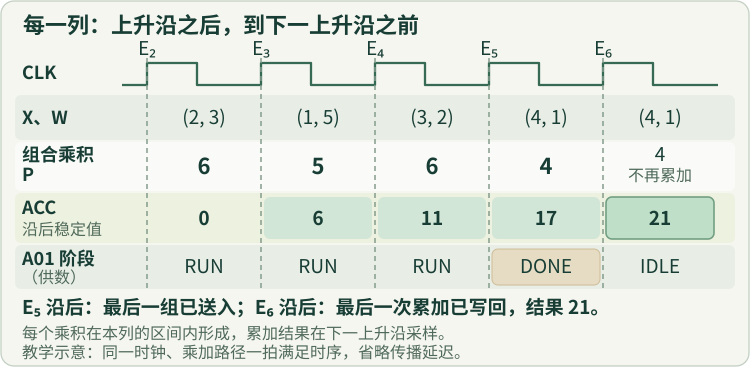
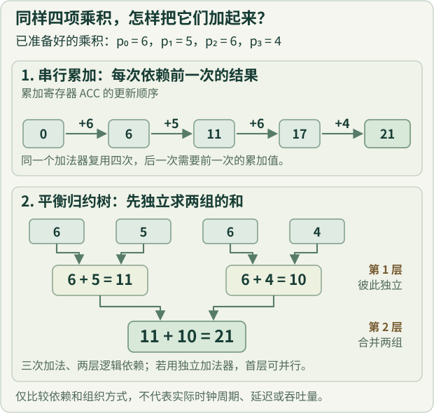

# 从部分积到 MAC：芯片怎样完成一次乘加？

[A01](a01-state-and-control.md)让两个寄存器 X、W 依次保存四组操作数：

| 组号 | X | W | 希望得到的乘积 |
| ---: | ---: | ---: | ---: |
| 0 | 2 | 3 | 6 |
| 1 | 1 | 5 | 5 |
| 2 | 3 | 2 | 6 |
| 3 | 4 | 1 | 4 |

我们最终希望得到这四项乘积的和：6 + 5 + 6 + 4 = 21，也就是四项点积。

[A02](a02-number-representation-and-arithmetic.md)已经解释，逻辑门可以组成全加器，多个全加器又能组成多位加法器。现在需要回答一个新的问题：如果 X、W 输出的是两个四位数，怎样利用这些电路得到它们的乘积？

本篇先观察一次乘法，再研究怎样把每次得到的乘积加到已保存的结果中。除专门讨论带符号表示的部分外，沿用四位无符号操作数。

## 两个数相乘，为什么可以先得到几行加数？ {#partial-products}

取第 0 组操作数。用 A = `0010` 表示 2，用 B = `0011` 表示 3。A、B 分别是被乘数和乘数。

回忆二进制位权：B 的第 0 位权重为 1，第 1 位权重为 2。因为只有这两位为 1，所以 3 = 1 + 2。乘法可以写成：

**2 × 3 = 2 × (1 + 2) = 2 + 4**

这个式子说明，我们不必用某个逻辑门直接计算 2 × 3。对于乘数 B 的每一个比特，可以决定是否保留一份 A，并按这一位的权重移动。

| B 的位 | 位值 | 权重 | 产生的加数 |
| --- | ---: | ---: | ---: |
| b₀ | 1 | 1 | 2 |
| b₁ | 1 | 2 | 4 |
| b₂ | 0 | 4 | 0 |
| b₃ | 0 | 8 | 0 |

例如 b₁ = 1 时，先保留 A，再将它左移一位，便得到乘以 2 后的 4；如果 b₁ = 0，这一项应该是全零。

怎样让电路决定保留还是清零？[组合逻辑篇](../../semiconductor-foundations/combinational-logic/README.md#logic-function)里的与门恰好具备这个功能：一个输入为 0 时，输出一定为 0；一个输入为 1 时，输出等于另一个输入。

将 A 的每一个比特 aᵢ 与 B 的某一位 bⱼ 分别连接到与门，然后将所得的比特放在权重为 2i+j 的位置。由此产生一行与该位乘数对应的**部分积（Partial Product）**。

<figure class="micro-diagram" style="max-width:650px; margin:1.2rem auto" tabindex="0" aria-label="四位无符号乘法的部分积排列，窄屏可横向滚动" markdown="1">

<figcaption>左移由部分积连到不同位权的列实现，不表示每产生一行就要等待一个时钟周期。</figcaption>
</figure>

对于普通的四位乘四位无符号乘法，可以用 16 个与门同时产生所有单比特部分积，将它们按权重排列成四行。

随后还需要把这四行相加。一种直接的做法是使用 A02 中的多位加法器，逐次相加。不过，后面会看到，产生乘积不一定需要经过三次完整的进位传播。

还有一个问题：四位输入需要多少位输出？若 A、B 都为 `1111`，即 15，完整乘积为 225。七位无符号数最大为 127，因此不足以表示它；八位可以表示 255，足以保存所有四位无符号乘积。

一般来说，分别为 m 位和 n 位的两个无符号输入，其完整乘积最多需要 m + n 位。[MIT 6.004：二进制乘法与部分积电路](https://ocw.mit.edu/courses/6-004-computation-structures-spring-2017/pages/c8/c8s1/)

## 如果其中一个数为负，部分积还应该怎样排列？ {#signed-products}

保持 A = 2，只改动 B：令 B = `1101`。按照无符号整数解释，它是 13；按照[A02 的四位补码](a02-number-representation-and-arithmetic.md#twos-complement)解释，它却是 −3。

如果照搬前面的无符号乘法电路，四行部分积会得到 2 + 0 + 8 + 16 = 26，而不是期望的 −6。问题出在哪里？

四位补码的最高位权重不是 +8，而是 −8。因此，B 的数值是 1 + 4 − 8，而不是 1 + 4 + 8。乘法也应该变为：

**2 × (−3) = 2 × (1 + 4 − 8) = 2 + 8 − 16**

把最高位产生的那一项改为带负号的部分积，就能得到正确结果。

<figure class="micro-diagram" style="max-width:650px; margin:1.2rem auto" tabindex="0" aria-label="四位补码乘法的正负部分积，窄屏可横向滚动" markdown="1">

</figure>

图中各行使用八位补码。例如 −16 的编码为 `11110000`，三项的数学和为 −6，按八位输出保留低位便得到 `11111010`。

如果 A 自身也是负数呢？仍然根据 B 各位的实际权重产生加数。但在每行左移之前，需要把 A 按补码扩展到足够的宽度，再按需要取相反数。

例如 A = −2，四位编码为 `1110`，应扩展为八位的 `11111110`。若错误地在高位补 0，就变成了 +14。符号扩展的原理见[A02](a02-number-representation-and-arithmetic.md#overflow)。

仍取 B = −3，各行的数学值现在变为 −2、0、−8、+16，相加得到 +6。最高位的负权作用可以在八位范围内用取反加一实现，不需要再造一种加法器。

两个四位补码数的精确乘积，最小可能是 −8 × 7 = −56，最大可能是 −8 × (−8) = 64。完整结果用八位补码可以表示，范围为 −128 到 127。

这一方法说明了负权和符号扩展怎样改变乘法电路的行为。实际的有符号乘法器可以用不同的部分积生成方式，只要满足相同的数值语义。[MIT 6.004：有符号部分积与八位结果](https://ocw.mit.edu/courses/6-004-computation-structures-spring-2017/pages/c8/c8s1/)

## 如果乘数有一串连续的 1，能不能少生成几行部分积？ {#booth}

接下来思考怎样减少部分积。从刚才的乘数 3 开始，`0011` 不仅可以解释为 2 + 1，还可以解释为 4 − 1。

若使用第二种方式，2 × 3 = 2 × 4 − 2。虽然这个例子仍然需要两个非零加数，但如果乘数是 7，即 `0111`，原来有三项 4 + 2 + 1，现在可以用两项 8 − 1 来表示。

连续的 1 越多，把它们写成两端的权重之差，就越可能减少非零的加数。怎样让硬件自动识别这些边界？

### 通过相邻比特找出连续的 1（Radix-2 Booth）

让乘数的最低位右边再补一个 0，记作 b₋₁。然后从低位往高位观察相邻的两位。

如果沿这个方向看到 0 后出现 1，就表示一段连续的 1 开始，需要减去这个位置的权重。如果看到 1 后出现 0，就表示这段连续的 1 结束，需要加上当前的权重。中间相同的比特不必产生新加数。

用 dᵢ 表示当前位编码后的系数：

**dᵢ = bᵢ₋₁ − bᵢ**

| 当前位 bᵢ | 前一位 bᵢ₋₁ | 系数 dᵢ | 应产生的加数（还需按位权移位） |
| ---: | ---: | ---: | --- |
| 0 | 0 | 0 | 0 |
| 0 | 1 | +1 | +A |
| 1 | 0 | −1 | −A |
| 1 | 1 | 0 | 0 |

以四位补码 `0011` 表示的 3 为例，从低位到高位得到系数 −1、0、+1、0。乘数的值就变为 −1 × 1 + 1 × 4 = 3，恰好得到刚才的 4 − 1。

对四位补码的 −3（`1101`），从低位到高位则是 −1、+1、−1、0。对应 −1 + 2 − 4 = −3。

为什么最高位为 1 的负数也能采用这套规则？把四个相邻位之差按它们的位置加权并相加：

**−b₀ + 2(b₀ − b₁) + 4(b₁ − b₂) + 8(b₂ − b₃) = b₀ + 2b₁ + 4b₂ − 8b₃**

等式右侧恰好是四位补码的位权定义，所以这种编码也适用于负数。

这种通过改写乘数的位组合、生成带正负号部分积的方式称为 **Booth 编码（Booth Recoding）**。它并不是一种新的数值格式，而是乘法器内部生成部分积的一种方法。

如果输入中交替出现 0 和 1，Radix-2 Booth 可能产生更多非零加数，所以不能认为每一个乘数都一定得到更少的非零部分积。[Booth 1951 年原始论文](https://doi.org/10.1093/qjmam/4.2.236) · [MIT 6.175：Radix-2 Booth](https://csg.csail.mit.edu/6.175/labs/lab3-multipliers.html)

### 每次处理两个比特（改进 Radix-4 Booth）

Radix-2 每次根据相邻两个比特产生一个系数。还可以把相邻的两项合并，让每个编码组处理两位乘数。

例如把位置 0 和位置 1 的两项合并。位置 1 的权重是位置 0 的两倍，因此合并后的系数是 d₀ + 2 × d₁。

对于第 j 组，把前面的相邻位关系代入：

- 第一个系数 d2j = b2j−1 − b2j。
- 第二个系数 d2j+1 = b2j − b2j+1。

将第一项与两倍的第二项相加，得到组系数：

**ej = b2j−1 + b2j − 2 × b2j+1**

每组需要观察三个相邻比特，从高到低分别为 b2j+1、b2j、b2j−1。相邻组共享其中的一位，第 j 组的权重为 4j。各组只依赖各自所观察的三位，在组合电路中可以并行生成，并不要求按时钟逐次读取。

| 观察的三位 | 编码系数 | 选择的部分积（移位前） |
| --- | ---: | --- |
| `000` | 0 | 0 |
| `001` 或 `010` | +1 | +A |
| `011` | +2 | +2A |
| `100` | −2 | −2A |
| `101` 或 `110` | −1 | −A |
| `111` | 0 | 0 |

仍用刚才的 B = `1101`（−3）。在最低位右边补 0 后，低组为 `010`，编码成 +1；高组为 `110`，编码成 −1。低组权重为 1，高组权重为 4，所以乘数被改写为 1 − 4 = −3。

<figure markdown="1">

<figcaption>示例中每组产生的部分积在乘积位宽中表示；两组的位权不同。</figcaption>
</figure>

对 A = 2，只需生成 +2 与 −8 这两个加数，就能得到 −6。同样地，对于任意一组，2A 可以通过移位获得，负倍数可以通过补码的取反加一产生，生成以后再放到对应组的位权位置。

这里必须在足够宽的表示中产生负倍数。例如四位 A = −8 时，−2A = +16，显然不能只用原来的四位或五位补码表示。图中采用足够的完整乘积位宽。

这种方法称为**改进 Radix-4 Booth 编码（Modified Booth Recoding）**。对于偶数位宽的有符号乘数，可以每两位形成一个编码组，奇数位宽时按符号扩展后分组。

与普通每位产生一行的方式相比，主要部分积行数大约减半，但编码、倍数选择、取负和修正逻辑也有代价。如果乘数是无符号数，使用补码 Booth 规则前必须在高位补 0，不能把无符号的 `1111` 直接当作 −1。

[MIT 6.175：Radix-4 Booth 乘法](https://csg.csail.mit.edu/6.175/labs/lab3-multipliers.html) · [EPFL 算术电路讲义：改进 Booth 编码表](https://www.ece.ucdavis.edu/~vojin/CLASSES/EPFL/Lectures/VLSI-Arithmetic-Lect-9-Multiplier.pdf#page=18)

## 有了多行部分积，为什么不直接用加法器逐行相加？ {#compression}

回到 4 位无符号乘法。若两个数都是 `1111`，即 15，普通部分积生成方式会产生下面四个非零加数。

| 部分积 | 八位表示 | 十进制 |
| --- | --- | ---: |
| A × 1 | `00001111` | 15 |
| A × 2 | `00011110` | 30 |
| A × 4 | `00111100` | 60 |
| A × 8 | `01111000` | 120 |

如果先算 15 + 30，再把结果与 60 相加，最后与 120 相加，每次都需要一个完整的多位加法。使用三级相连的组合加法器时，后一段还依赖前一段得到的结果。

[A02 的串行进位](a02-number-representation-and-arithmetic.md#carry-lookahead)已经解释过，完整加法的高位可能要等待低位的进位。如果每合并一行部分积就完成一次全宽进位传播，这种依赖会重复出现。

能不能先处理每一列中的数字，暂时不管相邻列已经算完没有？

### 全加器还能把三个比特压缩为两个

回忆[A02 的全加器](a02-number-representation-and-arithmetic.md#full-adder)。它满足：

**a + b + c = s + 2 × k**

在普通多位加法器中，第三个输入 c 来自低一位的进位。但从这个等式看，三个输入只要具有相同的位权，就都可以作为独立输入。

假设取前三行部分积的第 2 列，该列的位权为 4，三个输入都是 1，共代表 12。将这三个比特送进同一个全加器，会得到 s = 1、k = 1。

留下的 s 仍处于权重为 4 的第 2 列；k 移到权重为 8 的第 3 列。原先三个 1 的总值为 12，新的两个 1 的总值仍然是 4 + 8 = 12。

这种用全加器将同位权的三个比特变成两个比特的方式，称为一种 **3:2 压缩器（3:2 Compressor）**。它没有丢弃数值，也不要求先把每一列变成一个最终的和。

### 先压缩到两行，再完成最后一次加法

把前三个部分积 15、30、60 按列送入全加器。每一列都可以同时处理自己位置上的三个比特，输出一行本位和 S 与一行已移到高一位的进位 K。

这一次不用把 K 接到同一层更高位全加器的输入，而是保留到下一层再处理。因此该层不需要等待一条贯穿整个字宽的逐位进位链。

这种处理方式称为**进位保存（Carry Save）**。这里 K 已包含左移一位的位权，所以三行输入的数值和等于 S + K，不需要再将 K 左移一次。

<figure class="micro-diagram" style="max-width:700px; margin:1.2rem auto" tabindex="0" aria-label="四行部分积的两层进位保存和末级加法，窄屏可横向滚动" markdown="1">

<figcaption>教学示意：每层按列独立压缩，K 已经按位权移位；箭头表示组合逻辑依赖，不表示实际时钟周期。</figcaption>
</figure>

逐层检查图中的数字：

| 输入行（十进制） | 本位和行 S | 移位后的进位行 K | 数值关系 |
| --- | ---: | ---: | --- |
| 15、30、60 | 45 | 60 | 105 = 45 + 60 |
| 45、60、120 | 105 | 120 | 225 = 105 + 120 |

现在只剩下两行。它们还不是最终乘积，必须使用[A02 中的多位加法器](a02-number-representation-and-arithmetic.md#carry-lookahead)，让最后的进位正确传播，才能得到 `11100001`，即 225。

这就是乘法器中常见的结构：**生成部分积、逐层压缩、末级进位传播加法**。末级加法器（Carry-Propagate Adder，CPA）可以采用串行进位、超前进位等不同实现。

[Wallace 1964 年原始论文：三行压缩为两行，再执行末级加法](https://www.ece.ucdavis.edu/~vojin/CLASSES/EPFL/Papers/1_Wallace_mult.pdf)

### 为什么有的压缩树不立即压缩所有可以处理的比特？

前面将整行部分积作为观察对象。实际布置压缩网络时，更值得关心的是每个列有多少个待归约的比特。

四位无符号乘法的原始部分积，从低到高各列的最大高度为 1、2、3、4、3、2、1。不同列需要的压缩数量并不相同。

- **Wallace 树**倾向于尽早将可压缩的同列比特进行归约，逐层减少高度。
- **Dadda 树**先确定下一层允许的最大列高，只在需要达到这一高度时进行压缩。例如，最大列高为 4 时，可按目标高度 3、2 逐步归约。

例如，下一阶段的目标高度是 3，如果一列暂有四个输入比特，用一个半加器将两个比特变为一个本位和及一个高位进位，该列就少了一个比特。没有超出目标的列并不一定需要压缩。

不过，在安排下一层的目标列高时，两者都要把相邻低位列的压缩输出计入该列；这不是要求同一压缩层逐位消费新进位。两者都以最终不超过两行作为归约目标。差别在于如何选择并组织压缩器，而不是计算不同的乘法结果。

上面的四行向量压缩是用于理解进位保存的教学例子，不是某一种具体 Wallace 或 Dadda 树的完整门级调度。实际结构需要考虑压缩器数量、连线、末级加法器和时序约束。

[Dadda 1965 年原始论文：分阶段目标高度的并行乘法器](https://ethw-images.s3.us-east-va.perf.cloud.ovh.us/ieee/8/82/Some_schemes_for_parallel_multipliers_%28reprint%29.pdf)

## 一次乘法结束后，怎样把结果加到此前的和中？ {#mac}

现在已经有了一个四位乘四位的整数乘法器。对于 A01 的四组数据，我们可以让它每次得到一个乘积，等全部乘积准备好后，再把它们加在一起。

但如果希望持续处理数据，是否一定要把四个乘积分别保存起来？我们也可以只保存到目前为止的和。

先令这个和为 0。第一份乘积为 6，就计算 0 + 6，得到 6。下一份乘积为 5，再计算 6 + 5，得到 11。继续执行两次，最终便得到 21。

这个反复执行的动作称为**乘加（Multiply-Accumulate，MAC）**：

**ACC 的下一值 = ACC 的当前值 + X × W**

保存部分和的寄存器称为**累加器（Accumulator）**。乘加电路不仅需要乘法器和加法器，还需要让旧的累加值能够作为下一次加法的输入。

### 把结果送回自己的输入

取 A01 中的输入寄存器 X 和 W。将它们的输出接到乘法器，再把乘积送到加法器的一个输入端。加法器的另一个输入端接累加器当前的 Q。

如此一来，只要其中某个输入发生变化，加法器就会重新计算下一份部分和。但是，要把这份新和真正写回 ACC，仍要等待指定的时钟沿，并且写入使能有效。

<figure markdown="1">

<figcaption>假设 X、W 为四位无符号数，ACC 为十位，乘积在加法前补零扩展。图中为第一组操作数 X=2、W=3，ACC 初始为 0 的状态。</figcaption>
</figure>

假设当前 X = 2，W = 3，ACC = 0。组合乘法器产生 6，加法器的结果也为 6。等这一沿真正写入 ACC，反馈端才从 0 变成 6。

到下一组数据到来时，加法器便会取得新的乘积与已经保存的旧和。这个过程不需要把全部历史乘积都保存下来。

MAC 不一定在物理上分成一个完整的乘法器和一个完整的加法器。一种更集成的实现还可以在压缩部分积时，把经过扩展的 ACC 作为额外加数一同归约，最后再产生新的和。

本文使用分开的组合乘法器和加法器，是为了清楚追踪数值和反馈关系。实际 MAC 单元也可能将累加状态放在单元之外。[AMD DSP48E2：部分积与累加路径的实际实现示例](https://docs.amd.com/api/khub/documents/pTysoma4TYgNH95BrY1Sbw/content)

### 沿用 A01 的时钟，四组数据何时真正算完？

A01 在 E₂、E₃、E₄、E₅ 四个时钟上升沿，分别把四组操作数写入 X、W。注意，新数据是在沿后才出现在它们的 Q 上的。

现在假设本例的组合乘法器、加法器和反馈路径都有足够的时间，在一个完整时钟周期内产生并稳定下一份部分和。任务开始时 ACC 已清零，且控制电路只允许在 E₃ 至 E₆ 写入有效的累加结果。

在这个教学设计中，可以把 A01 的输入寄存器写入使能 EN_XW 保存到一个触发器中，复位时清零。输出作为累加写入使能 EN_ACC，就比 EN_XW 晚一拍。这样每组操作数被写入后，下一沿才允许写回对应的累加值。

| 计算区间 | X、W（区间内） | 乘积 P | ACC 旧值 | 下一沿写入的新值 |
| --- | --- | ---: | ---: | ---: |
| E₂ → E₃ | (2, 3) | 6 | 0 | 6 |
| E₃ → E₄ | (1, 5) | 5 | 6 | 11 |
| E₄ → E₅ | (3, 2) | 6 | 11 | 17 |
| E₅ → E₆ | (4, 1) | 4 | 17 | 21 |

<figure class="micro-diagram" style="max-width:750px; margin:1.2rem auto" tabindex="0" aria-label="四组点积输入与累加时钟边沿，窄屏可横向滚动" markdown="1">

<figcaption>教学单周期组合 MAC，忽略沿后传播延迟，只展示稳定值。输入寄存器写入与累加器写入是不同的动作。</figcaption>
</figure>

观察 E₃：ACC 在这个边沿采到了 6，同时 X、W 接收第二组操作数。累加器采的是沿前已稳定的加法结果，而不是沿后刚改变的操作数。

再看 E₅。A01 的 DONE 在该沿后有效，它只说明四组操作数都已经写入入口寄存器。此时 ACC 的值是 17，第四组乘法尚未形成最终部分和。

直到 E₆ 沿后，ACC 才保存完整结果 21。已有数据、已写入输入寄存器、已完成计算是三种不同的状态，不能用一个 DONE 信号不加区分地表示它们。

如果组合 MAC 路径无法在一个周期内稳定，就不能承诺这种逐拍累加行为。特别是，下一次加法依赖刚写入的部分和。这是**反馈依赖**，它与不同输入的乘法能否独立并行是两个问题，A06 将继续研究。

## 累加器为什么往往比乘积更宽？ {#accumulator-width}

在这个例子中，最终得到 21，只用五位无符号数就能准确表示。但这并不表示我们设计一个五位累加器，就能正确处理任意四组四位操作数。

先观察一种最坏的输入组合。如果每个四位无符号操作数都取最大值 15，那么每项乘积最大为 225。四项乘积的和最大为：

**225 × 4 = 900**

八位无符号数最多表示 255，九位最多表示 511，都不足以保存 900。十位无符号数最多表示 1023，因而足够。

| 保存对象 | 需要覆盖的最大值 | 本例的位宽 |
| --- | ---: | ---: |
| 单个操作数 | 15 | 4 位 |
| 单个乘积 | 225 | 8 位 |
| 四项完整累加和 | 900 | 10 位 |

这就是累加器做成十位的原因。一般来说，如果每份乘积使用 m + n 位完整表示，累加 K 份、初始值为零，可以采用 m + n + ceil(log₂ K) 位作为一种安全位宽估计。

其中 ceil 表示向上取整；例如 K = 4，需要增加 2 位。实际需要的最小位宽还取决于输入的实际取值范围、符号、初始和与接口定义，并不总是这个估计值。

如果操作数是四位补码，单项乘积的范围为 −56 到 64。四项精确和的范围是 −224 到 256。九位补码虽然能表示 −256，却只能表示到 +255，因此在这个最坏条件下，仍需要十位补码。

无符号乘积送入较宽的累加加法器时在高位补 0；有符号乘积需要做符号扩展。若累加器宽度不够，必须按照指定规则处理溢出，而不能假定所有 MAC 都会返回精确的长期累加和。

关联知识：如果输入是定点小数呢？

[A02](a02-number-representation-and-arithmetic.md#fixed-point)将二进制定点数解释为整数编码 I 乘以 2−F。对于分别采用 FA 和 FB 个小数位的两个操作数，相乘得到的整数编码所对应的缩放为 2−(Fₐ+Fᵦ)。

所以乘积对应的小数位数为 FA + FB。累加前还应保证乘积与累加状态的数值尺度一致。若要压缩位宽或改变尺度，需按约定处理舍入与溢出，而不是无条件截去比特。

本篇只追踪完整整数乘加，浮点乘加及低精度格式中的舍入问题将在 A04 进一步讨论。

真实硬件可能规定比理论最坏值更小的累加范围。例如 RISC-V 向量加宽整数乘加规定使用更宽的乘积与累加元素，但输出仍有确定的元素位宽；它并不承诺任意数量的乘积都能精确累加。[RISC-V V：加宽整数乘加](https://docs.riscv.org/reference/isa/extensions/vector/_attachments/riscv-v-spec.pdf)

## 如果四项乘积已经齐备，可以不按顺序累加吗？ {#reduction}

刚才只用一个乘法器和一套累加电路，四份操作数先后到达。累加器每次更新都离不开上一次的结果。

如果已经有四个乘积 6、5、6、4，并且有更多的加法资源，就可以换一种组织方式。先让一个加法器计算 6 + 5，另一个同时计算 6 + 4，得到两个部分和 11 与 10。然后只需要把这两个部分和相加。

<figure markdown="1">

<figcaption>假设所有乘积已经准备好。图对比的是逻辑依赖关系；两层加法不是两个实际时钟周期的保证。</figcaption>
</figure>

这称为树形**归约（Reduction）**。它与前面乘法器内部的压缩树有所不同：这里每个输入已经是一个完整的乘积，归约树负责把多个乘积的值加在一起。

采用串行累加时，可以复用一个加法器和一个累加器，适合按顺序供数。如果直接把第一项乘积装入 ACC，也只需做三次加法。因此，树形归约的关键不是一定少算一次，而是改变加法之间的依赖关系。采用树形归约时，前面的两个加法不存在相互依赖；若使用独立加法资源，就有机会并行执行。

树形归约需要相应的计算资源、数据供给、部分和位置及连线。乘积如果需要一项一项地等待，或者归约层受到其他资源限制，实际时间不一定比串行累加更短。

在完整精度的整数运算中，改变加法顺序不会改变数学和。然而，若中间阶段存在饱和、不同位宽的截断或舍入，重新组织归约顺序后还需要核对数值语义。

## 接下来需要理解什么？ {#next}

现在回看 A01 的四组操作数。我们已经从单比特与门产生部分积，用编码和压缩网络减少不必要的加法依赖，再通过末级加法器得到乘积。

将乘积与累加器的旧值相加，就可以在满足时序条件的情况下逐项完成点积；若多个乘积同时可用，还可以通过归约网络组织计算。

这些机制构成许多 AI 计算单元的基础。不过，同一组比特不一定表示整数。如果输入和权重采用浮点格式，怎样让指数、有效数字和舍入规则共同参与一次乘加？[A04 · 浮点与低精度运算：芯片怎样计算不同格式的数？](a04-floating-point-and-low-precision.md) 将继续解答这一问题。

[返回共同计算基础导读](README.md)。
