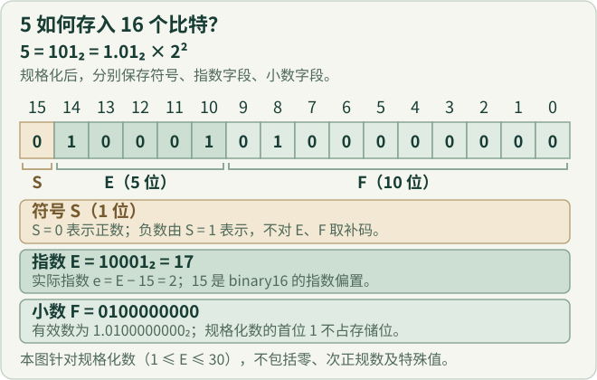
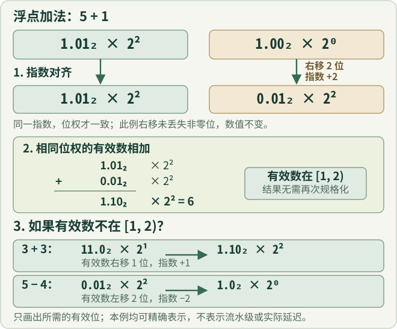
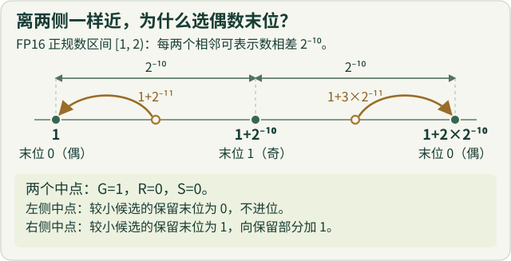
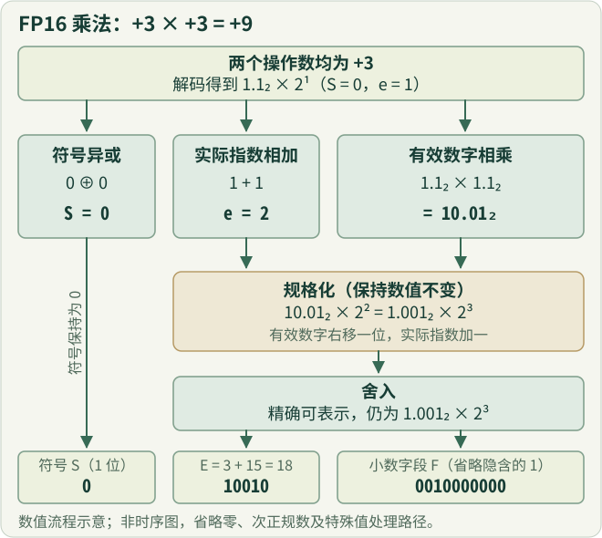
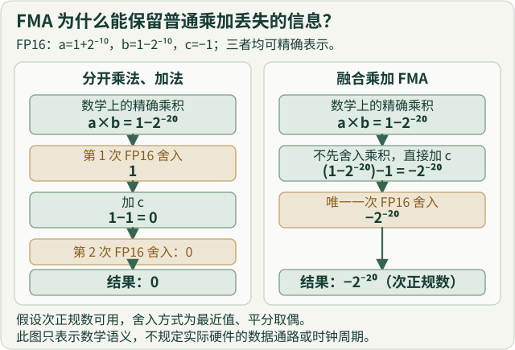
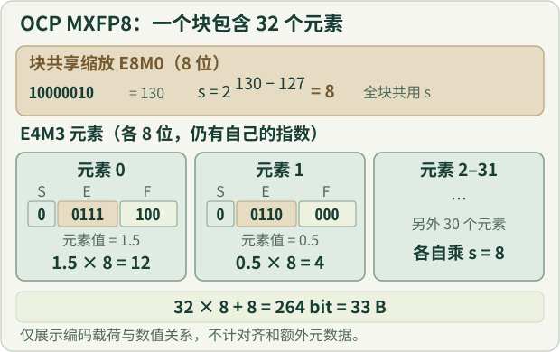
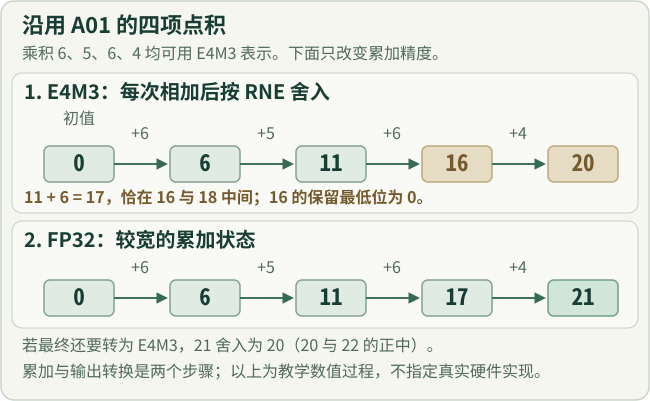

# 浮点与低精度运算：芯片怎样计算不同格式的数？

[A02](a02-number-representation-and-arithmetic.md)已经解释了怎样用一组比特表示整数和定点小数，[A03](a03-multiplication-and-accumulation.md)则用这些整数构建了乘加电路。

现在，如果希望同一个计算单元既能处理很大的数，又能保留很小的数值变化，固定的位权就可能不够用了。我们需要让表示数值的尺度随每个数本身改变。

这一篇先建立浮点数的编码，再观察浮点加法、乘法与融合乘加怎样工作。最后讨论改变指数和有效数的位宽，以及采用共享尺度和宽位累加器，会带来什么变化。

## 为什么不一直使用定点数？ {#why-floating-point}

在[A02 的定点数](a02-number-representation-and-arithmetic.md#fixed-point)中，曾经用四位补码表示整数编码 I，再统一将实际数值解释为 I × 2−F。F 越大，相邻数值越接近，但可表示的范围越小。

例如，四位补码若统一约定 F = 3，就可以准确描述 0.625，因为整数编码 5 乘以 1/8 等于 0.625。但此时最大正数只有 7/8，无法表示 5。

当然，可以增加总位宽来扩大范围。不过，还可以改变数值的组织方式，让每个数具有自己的缩放尺度。

回忆十进制的科学计数法。同一个有效数字 1.25，乘上不同的 10 的幂，可以表示不同大小的数。使用二进制，也可以做类似的事情。

| 数值 | 二进制 | 将有效数字和尺度分开 |
| ---: | --- | --- |
| 5 | 101 | 1.01 × 2² |
| 0.625 | 0.101 | 1.01 × 2⁻¹ |

这里二进制的 `1.01` 表示 1 + 1/4 = 1.25。两个数使用相同的有效数字，却有不同的指数。

这就是**浮点数（Floating-Point Number）**的基本思路。它分别保存数值的符号、有效数字（Significand）和指数（Exponent），由指数决定有效数字处于哪一个尺度。

这种表示不会让所有数值间隔都变得一样细。浮点数将有限的比特分配给不同尺度，以便在较大范围内保留一定数量的有效位。

## 十六个比特，怎样同时保存指数和有效数字？ {#encoding}

先选择一种具体格式：[IEEE 754-2019](https://standards.ieee.org/ieee/754/6210/) 中的 binary16，通常称为 FP16。它总共有十六位：

- 1 位符号 S：区分正负。
- 5 位指数字段 E：用于编码尺度。
- 10 位小数字段 F：用于编码有效数字中小数点右侧的比特。

先看普通的非零正规数（Normal Number）。我们让有效数字的绝对值落在 1 到 2 之间（包含 1，不包含 2），用调整指数的方式维持这个形式。这称为**规格化（Normalization）**。

二进制正规数的有效数字一定以 1 开头。因此，存储时可以省略这一个固定的前导 1，只保存后面的十个比特。实际有效数字的精度就成为 11 个二进制有效位。

### 指数怎样表示正数和负数？

如果直接将指数编码成无符号整数，就无法表示 0.625 所需要的负指数。因此 FP16 将实际指数 e 加上一个固定偏置（Bias），然后再写进 E。

FP16 的偏置为 15。实际指数 e = 2 时，存储 E = 17；e = −1 时，存储 E = 14。解码时再减去 15。

所以，在正规数编码下，数值可写成：

**(−1)S × (1 + F / 210) × 2E−15**

其中公式里的 F 是小数字段按无符号整数解释得到的值。F = 256 代表有效数字的小数部分为 256/1024 = 0.25。

<figure class="micro-diagram" style="max-width:660px; margin:1.2rem auto" tabindex="0" aria-label="FP16 的十六位布局与正规数5的解码，窄屏可横向滚动" markdown="1">

</figure>

用这套规则得到 A01 中的几个数。表中有效数字采用二进制书写。

| 数值 | 规格化表示 | S | E | F |
| ---: | --- | ---: | --- | --- |
| 1 | 1.00 × 2⁰ | 0 | `01111` | `0000000000` |
| 2 | 1.00 × 2¹ | 0 | `10000` | `0000000000` |
| 3 | 1.10 × 2¹ | 0 | `10000` | `1000000000` |
| 5 | 1.01 × 2² | 0 | `10001` | `0100000000` |
| 0.625 | 1.01 × 2⁻¹ | 0 | `01110` | `0100000000` |

若要表示 −5，只需将 5 的符号位置为 1，指数和小数字段保持不变。这与 A02 中的整数补码不同，不是将整个浮点编码逐位取反并加一。

FP16 正规数的 E 取值为 1 到 30，因此实际指数为 −14 到 15。E = 0 和 E = 31 有另外的含义，稍后会讨论。

## 两个数的尺度不一样，怎样把它们加起来？ {#addition}

取 A01 中的两个值 5 和 1，希望计算 5 + 1 = 6。

若直接将它们的有效数字送入 A02 的整数加法器，就会计算 1.01 + 1.00。这两个有效数字的位权实际上并不相同，因为 5 的指数为 2，1 的指数为 0。

所以，在加法前，需要先让它们采用相同的指数，然后再进行有效数字的相加。这个过程称为**对阶（Exponent Alignment）**。

### 先对齐有效数字的位权

选择两个数中较大的实际指数 e = 2 作为共同尺度。为了使 1 的数值保持不变，要在指数增加 2 的同时，将有效数字右移 2 位。

**1.00 × 2⁰ = 0.01 × 2²**

于是，原来的两个数可以写成：

| 操作数 | 对阶前 | 对阶后 |
| --- | --- | --- |
| 5 | 1.01 × 2² | 1.01 × 2² |
| 1 | 1.00 × 2⁰ | 0.01 × 2² |

现在两份有效数字中同一个位置的比特具有相同位权，可以像定点数一样进行加法。计算 1.01 + 0.01 = 1.10，保留共同指数 2，得到 1.10 × 2² = 6。

实现这个过程，需要比较两个指数、计算指数差，并根据这个差控制移位电路。这里就用到了 A02 已经介绍的[比较器、加减器和多级 MUX 移位网络](a02-number-representation-and-arithmetic.md#shift)。

### 有效数字超出 1 到 2 怎么办？

换成 3 + 3。两个数的指数都是 1，无须对阶。有效数字 1.10 + 1.10 = 11.00，已经大于或等于 2。

将它右移一位，同时让指数增加 1，数值保持不变：

**11.00 × 2¹ = 1.10 × 2² = 6**

反过来，计算 5 − 4 时，两个数的指数都是 2。有效数字相减得到 0.01，小于 1，需要左移两位，同时将指数减 2，得到 1.00 × 2⁰ = 1。

<figure class="micro-diagram" style="max-width:660px; margin:1.2rem auto" tabindex="0" aria-label="浮点加法对阶与左右规格化算例，窄屏可横向滚动" markdown="1">

<figcaption>图中追踪正规数的数学值，暂不展示有限精度舍入和特殊值处理。</figcaption>
</figure>

对于不同符号的操作数，计算过程涉及有效数字相减，以及确定结果符号。若结果接近于零，可能需要检测前导零，确定需要左移的距离；若恰好得到零，则应使用零的编码，而不是一直左移。

原来计算 2 + 3 只需要按位加法。浮点加法却要额外处理指数比较、位权对齐、有效数字加减和结果规格化。至于硬件如何将这些组合逻辑分配到实际流水级，留给 A06。

[UCLA《Digital Arithmetic》：浮点加减、对阶和规格化](https://web.cs.ucla.edu/digital_arithmetic/files/ch8.pdf)

## 有效数字的位数有限，丢掉的比特怎样处理？ {#rounding}

前面的算例没有遇到无法表示的结果，但 FP16 只有十个小数位。即使指数范围足够，同一个尺度内仍只能保存有限个不同的有效数字。

在实际指数为 0 的区间（包含 1，不包含 2），两个相邻 FP16 正规数之间的距离是 2⁻¹⁰。假设精确数学结果是 1 + 2⁻¹¹，正好落在 1 与 1 + 2⁻¹⁰ 的中间，无法直接表示。

此时需要规定舍入规则。IEEE 二进制浮点运算的默认舍入方式是**舍入到最近值，平分时取偶（Round to Nearest, Ties to Even，RNE）**。

如果两个可表示值距离不同，选较近的；如果距离恰好相同，选择有效数字最后一个保留位为 0 的结果。这里的“偶”指编码的末位，不是说一定选择整数偶数。

<figure class="micro-diagram" style="max-width:640px; margin:1.2rem auto" tabindex="0" aria-label="FP16舍入到最近值与中点取偶，窄屏可横向滚动" markdown="1">

</figure>

对于第一个中点 1 + 2⁻¹¹，较低候选值 1 的小数字段全为 0，末位为 0，因此选择 1。

对于第二个中点 1 + 3 × 2⁻¹¹，较低候选值的小数字段末位为 1，较高候选值末位为 0，因此选择较高的 1 + 2⁻⁹。

### 电路怎样知道恰好在中间？

浮点加法的对阶、乘法的有效数字乘积可能产生比输出格式更多的比特。如果立即将它们全部丢弃，就可能无法正确判断应向哪一侧舍入。

一种常见办法是在最终保留位之后，跟踪三个与被舍弃部分有关的信息：

| 信号 | 含义 |
| --- | --- |
| G（Guard） | 第一个被舍弃的比特 |
| R（Round） | 第二个被舍弃的比特 |
| S（Sticky） | 剩余全部低位是否至少有一个 1 |

这里的 S 是粘滞位，不是浮点编码中的符号位。再记最后一个保留位为 L。

当被舍弃部分都为零或者不足半个单位时，不应增加保留值；超过半个单位时，应加一。恰好半个单位（G = 1、R = 0、S = 0）时，要看 L 是否为 1。

对于 RNE，用于控制保留有效数字是否加一的条件可以写成：

**G ∧ (R ∨ S ∨ L)**

这一规则又可以由 A02 中的组合逻辑与加法电路实现。如果给保留位加一后产生新的最高位进位，还要再次调整规格化和指数。

GRS 是一种实现舍入判断的常用技术，而不是 IEEE 要求所有硬件必须采用的内部结构。实际电路需要正确保存对阶、加减以及规格化过程中的必要信息。

IEEE 也定义向零和向正、负无穷方向舍入等规则。采用哪种规则属于运算语义；下文以 RNE 为例。

[IEEE 754-2019：舍入规则及结果语义](https://standards.ieee.org/ieee/754/6210/) · [UCLA《Digital Arithmetic》：浮点舍入电路](https://web.cs.ucla.edu/digital_arithmetic/files/ch8.pdf)

## 指数到了边界，还能表示零和更小的数吗？ {#special-values}

在前面的正规数公式中，隐含的前导位一直是 1。如果不区分其他编码，那么有效数字永远不是零，也无法表示比最小正规数更小的非零数。

IEEE FP16 为此赋予指数字段全零和全一两种额外的含义。

| 指数字段 E | 小数字段 F | 数值解释 |
| --- | --- | --- |
| 1～30 | 任意 | 正规数：隐含前导 1 |
| 0 | 0 | +0 或 −0 |
| 0 | 非零 | 次正规数：隐含前导 0 |
| 31（全 1） | 0 | +∞ 或 −∞ |
| 31（全 1） | 非零 | NaN（非数值） |

### 为什么需要次正规数？

最小的正 FP16 正规数是 1.00 × 2⁻¹⁴，即 2⁻¹⁴。如果这个数再除以 2，实际结果是 2⁻¹⁵；普通正规数的指数已经无法继续减小。

IEEE FP16 在 E = 0 且 F 非零时，不再使用隐含前导 1，而是使用 0，实际有效指数仍为 −14。也就是说，它可以表示：

**(−1)S × (F / 210) × 2−14**

这样，F = 512 时就能表示 2⁻¹⁵，F = 1 时能表示 2⁻²⁴。数值可以逐步接近零，而不是一下子失去所有比最小正规数还小的结果。这称为次正规数（Subnormal Number）。

### 数值太大或者运算没有定义怎么办？

FP16 的最大有限正数是 (2 − 2⁻¹⁰) × 2¹⁵ = 65504。若运算的舍入结果超出有限数范围，可能需要返回无穷大或最大有限值，具体依赖舍入规则。非常小的结果也可能舍入成次正规数或零。

像 0 × ∞、同符号的两个无穷大相减这样的无效运算，在 IEEE 默认异常处理下产生 NaN。实际浮点运算电路需要识别输入的特殊编码，决定特殊情况的输出，而不能一律套用正规数对阶或乘法的公式。

这里介绍的是 IEEE binary16 的编码和基本运算语义。有些计算单元还具有将次正规数转换为零等执行模式；是否支持这些语义，需要查看具体接口。

[IEEE 754-2019：二进制正规数、次正规数及特殊值](https://standards.ieee.org/ieee/754/6210/)

## 浮点乘法为什么不需要先对阶？ {#multiplication}

回到 A01 的第 0 组操作数，计算 2 × 3。对于两个正规浮点数，它们分别写成：

**(1.00 × 2¹) × (1.10 × 2¹)**

与加法不同，乘法的两个尺度不需要相同。乘法可以将两部分分别处理：有效数字相乘，指数相加。此例的结果就是 (1.00 × 1.10) × 2² = 1.10 × 2² = 6。

带符号的浮点乘法还要决定结果符号：同号得正，异号得负，这可以用一个异或门产生。

这样，构建浮点乘法器时，指数和符号的逻辑可以分开处理。有效数字的乘法依然可以利用[A03](a03-multiplication-and-accumulation.md#partial-products)介绍的整数部分积与压缩树。

### 有效数字乘积为什么还要规格化？

两个正规数的有效数字都至少为 1 且小于 2，因此相乘后一定至少为 1 且小于 4。如果乘积达到 2，就需要右移一位，并增加指数。

例如 3 × 3 = 9。有效数字 1.10 × 1.10 = 10.01（二进制），原来的指数之和为 2。右移一位后结果变为 1.001 × 2³ = 9。

<figure class="micro-diagram" style="max-width:660px; margin:1.2rem auto" tabindex="0" aria-label="FP16 乘法的符号、指数、有效数字与规格化流程，窄屏可横向滚动" markdown="1">

<figcaption>教学数值流程。实际电路还需要处理特殊值、次正规数和指数边界。</figcaption>
</figure>

注意，图中相加的是解码后的实际指数，而不是直接把两个带偏置的 E 当作无符号数相加。若使用编码字段，则需减去一次偏置，再考虑规格化引起的指数变化。

FP16 正规数的有效数字有 11 个有效位，相乘会产生更多位的中间结果。即使格式仍为 FP16，也不能先任意截掉这些位，而应在确定最终指数和保留位置后按规定舍入。

这说明浮点乘法器不仅有有效数字的乘法电路，还有指数处理、规格化、舍入和特殊值处理逻辑。

[UCLA《Digital Arithmetic》：浮点乘法](https://web.cs.ucla.edu/digital_arithmetic/files/ch8.pdf)

## 浮点乘加为什么可能与先乘后加不同？ {#fma}

[A03](a03-multiplication-and-accumulation.md#mac)将一次乘加描述为 A × B + ACC。在整数宽度足够时，先得到完整乘积再加到累加值中，可以得到精确结果。

如果改用 FP16，首先保存一个 FP16 乘积，就可能需要舍入。然后再进行加法，又会产生一次可能的舍入。这两次舍入与只在最终结果舍入的行为并不一样。

假设所有操作数均使用 FP16，而且使用 RNE，支持次正规数。取 a = 1 + 2⁻¹⁰，b = 1 − 2⁻¹⁰，c = −1。这三个操作数都能准确编码。

它们的精确乘积为：

**(1 + 2⁻¹⁰)(1 − 2⁻¹⁰) = 1 − 2⁻²⁰**

这个乘积非常接近 1。如果先将乘积舍入成 FP16，它会变成 1，再加上 −1，结果为 0。

如果保留足够的信息，在加上 −1 之后才进行唯一的一次舍入，则精确结果为 −2⁻²⁰。它可以用 FP16 的次正规数准确表示，因此最终结果不为零。

<figure class="micro-diagram" style="max-width:640px; margin:1.2rem auto" tabindex="0" aria-label="分离浮点乘加与融合乘加的舍入差异，窄屏可横向滚动" markdown="1">

</figure>

IEEE 将这种计算 a × b + c 并只对最终结果舍入一次的运算称为**融合乘加（Fused Multiply-Add，FMA）**。严格的 FMA 语义也不能因为单独乘积超出目标范围就先将其舍入成无穷大或零。

实现时，可以将有效数字乘积和指数相关信息保留在内部，再将累加操作数对齐并相加，最后统一规格化和舍入。具体实现不一定具有图中同样的电路结构。

FMA 的一次舍入针对一次乘加操作。如果连续进行四次 FMA，并且每次都写回有限精度的累加器，四次更新仍然分别按照自己的结果格式舍入，而不是整段点积一定只舍入一次。

[IEEE 754-2019：fusedMultiplyAdd 语义](https://standards.ieee.org/ieee/754/6210/)

## 同样的十六位或八位，为什么要分配不同的字段？ {#formats}

理解 FP16 以后，就可以看出指数位与小数位承担不同职责。如果总位宽不变，增加指数位通常有利于覆盖更多数量级，但会减少同一尺度内可以区分的数值。

下面将 FP16 与机器学习中常见的几种格式比较。S、E、F 分别表示符号、指数及显式小数字段位数。表中均为正数，“1 上方间隔”指 1 与比它大的下一个正规数之间的差。

| 格式 | S/E/F 位数 | 指数偏置 | 1 上方间隔 | 最小正规正数 | 最大有限正数 |
| --- | --- | ---: | --- | --- | --- |
| IEEE FP32 | 1/8/23 | 127 | 2⁻²³ | 2⁻¹²⁶ | 约 3.40 × 10³⁸ |
| IEEE FP16 | 1/5/10 | 15 | 2⁻¹⁰ | 2⁻¹⁴ | 65504 |
| BF16 | 1/8/7 | 127 | 2⁻⁷ | 2⁻¹²⁶ | 约 3.39 × 10³⁸ |
| OCP FP8 E4M3 | 1/4/3 | 7 | 2⁻³ | 2⁻⁶ | 448 |
| OCP FP8 E5M2 | 1/5/2 | 15 | 2⁻² | 2⁻¹⁴ | 57344 |

### BF16 与 FP16 都只有十六位

BF16（Bfloat16）保留与 FP32 相同的指数位数及偏置，所以正规数的实际指数范围与 FP32 相同。但它只保存 7 位小数字段，在 1 附近的数值间隔是 FP16 的 8 倍。

这意味着 BF16 与 FP16 不是简单的优劣关系：BF16 覆盖的数量级更大，FP16 在许多相同数量级的正规数上能区分更细的数值。BF16 与 FP32 的最大有限值和可表示次正规数也并不完全相同。

例如，如果保留次正规数，BF16 的最小非零正数为 2⁻¹³³，FP32 则为 2⁻¹⁴⁹。BF16 是一种常用的二进制浮点编码，并非 IEEE binary16。

具体计算单元是否保留次正规数，还需看执行规范。例如 RISC-V 定义的 BF16 相关指令支持次正规数，而 Google Cloud TPU 的 BF16 转换会将次正规数转换为零。

[RISC-V BF16 扩展 v1.0：格式定义](https://docs.riscv.org/reference/isa/extensions/bf16min/_attachments/riscv-bfloat16.pdf) · [Google Cloud TPU：BF16 转换行为](https://docs.cloud.google.com/tpu/docs/bfloat16)

### 两种常见 FP8 编码怎样增加范围或精度？

在 [OCP OFP8 Revision 1.0](https://www.opencompute.org/documents/ocp-8-bit-floating-point-specification-ofp8-revision-1-0-2023-12-01-pdf-1) 中，E4M3 与 E5M2 也是同样的取舍。

E4M3 比 E5M2 多一个小数位，因此在 1 附近更细；E5M2 多一个指数位，范围更大。不过，还要查看这些格式对特殊值的具体定义，而不能直接套用 FP16 的规则。

- OCP E4M3 没有无穷大编码。指数字段全 1 时，除了小数字段也为全 1 的 NaN，其余仍可表示有限值。
- OCP E5M2 有无穷大和 NaN 编码，指数字段全 1 的规则与 IEEE 二进制格式类似。

所以，E4M3 最大有限正数是 1.110 × 2⁸ = 448；E5M2 最大有限正数则是 1.11 × 2¹⁵ = 57344。两个有效数字均为二进制。

这里限定为 OCP OFP8 定义的两种编码。其他 FP8 变体可能采用不同的偏置、特殊值及转换方式。

OFP8 还规定了相关转换规则。例如从更宽格式转换到 FP8 时，需要支持 RNE，并区分饱和和非饱和转换。对于有限输入，若按转换规则判为溢出，饱和模式将幅值钳位到最大有限值；非饱和模式下 E4M3 返回 NaN，E5M2 返回带符号无穷大。

这些是转换语义，并不为所有以 FP8 为输入的计算单元规定同一种内部算术与累加方式。

## 如果很多元素共享一个尺度，会发生什么？ {#microscaling}

浮点数可以让每个元素用自己的指数表示不同的尺度。但当每个元素只有很少的指数位时，单个编码能覆盖的数值范围仍然有限。

如果一组元素允许共同使用额外的缩放因子（Scale），那么最终可以表示的实际数值不必仅限于单个元素编码的范围。

这是微缩放（Microscaling，MX）格式的思路之一。在 [OCP MX v1.0](https://www.opencompute.org/documents/ocp-microscaling-formats-mx-v1.0-spec-final-pdf/) 定义的具体格式中，一个块包含 32 个元素以及一个共享的八位尺度 E8M0。

### 把元素值与公共尺度分开

例如 MXFP8 的每个元素仍然是一个符合规定的 E4M3 或 E5M2 编码。每个元素自己的指数仍然存在；额外的 E8M0 尺度属于整个块，并不是用块的指数替代这些元素的指数。

E8M0 不保存符号或小数位。数值码 0 到 254 分别表示尺度 2E−127，255 表示 NaN。它没有零或无穷大尺度编码。NaN 尺度意味着整个块为 NaN。在尺度有效、元素有限且实际值的绝对值未超过 FP32 最大有限数时，数值可写成：

**元素实际值 = 共享尺度 × 元素编码所表示的数值**

如果这个乘积超出 FP32 最大有限范围，OCP MX v1.0 将实际行为交由具体实现定义。

<figure class="micro-diagram" style="max-width:660px; margin:1.2rem auto" tabindex="0" aria-label="OCP MXFP8 的32个元素与共享尺度，窄屏可横向滚动" markdown="1">

</figure>

对采用相同共享尺度的完整块，可以按下列教学算式看数据组织的成本。32 个八位元素加一个八位尺度，共 264 位，即 33 字节，平均 8.25 位/元素。这不包括布局填充、对齐或其他元数据。

如果采用 MXFP4 等更小的元素格式，每个元素的指数和小数字段进一步减少，但仍需承担块共享尺度的开销与约束。这里的平均位宽并不代表存在一种独立的 8.25 位浮点元素。

### 共享尺度怎样参与乘加？

假设两个向量中对应的 32 个元素各自组成一个对齐的块，两个块的尺度有效、元素及实际值有限。其中第 i 项实际值分别为 sX × xᵢ 和 sW × wᵢ。

在不考虑中间舍入的数学运算中，这两个块的点积可以等价地写成：

**sX × sW × Σ(xᵢ × wᵢ)**

因此，共享尺度提供了在块内处理缩放关系的机会。硬件是否先算无尺度的部分和再应用尺度，怎样将多个块的部分和按不同尺度归并，仍取决于具体算术路径和精度约定。

同一块内的元素共享尺度，也意味着这些元素的可表示范围受到同一个尺度的影响。本篇只解释编码与执行关系，不讨论如何为模型选择块尺度。

[OCP MX v1.0：具体格式、E8M0 与块点积定义](https://www.opencompute.org/documents/ocp-microscaling-formats-mx-v1.0-spec-final-pdf/)

## 为什么低精度输入常常配合高精度累加？ {#mixed-precision}

[A03](a03-multiplication-and-accumulation.md#accumulator-width)已经说明，即使整数输入和乘积能准确表示，累加器的位宽太小，仍可能在逐项求和时溢出。

浮点累加又多了一个问题：部分和的大小不断变化，它所在区间的可表示值间隔也会变化。即使结果没有超出格式的指数范围，小的增量也可能在舍入过程中消失。

用 A01 的四项点积做一次对照，乘积依次为 6、5、6、4。这四个乘积都能用无共享尺度的 OCP E4M3 准确表示。

假设采用一种教学用的算术语义：每次更新累加状态都按 E4M3 的编码规则舍入到最近值、平分取偶。与使用 FP32 保存累加状态的结果对比如下。

| 更新 | 数学增量 | E4M3 累加（每次舍入） | FP32 累加 |
| --- | ---: | ---: | ---: |
| 初始 | — | 0 | 0 |
| 第 1 项 | +6 | 6 | 6 |
| 第 2 项 | +5 | 11 | 11 |
| 第 3 项 | +6 | 16 | 17 |
| 第 4 项 | +4 | 20 | 21 |

为什么第三项的结果不是 17？E4M3 有 4 个有效位，在 16 到 32 这个区间，相邻正规数间隔为 2。17 正好位于 16 和 18 中间，其中 16 的有效数字末位为 0，18 的末位为 1，所以平分取偶选择 16。因此，下一次加法取得的旧累加值已经是 16。

<figure class="micro-diagram" style="max-width:700px; margin:1.2rem auto" tabindex="0" aria-label="同一组乘积使用E4M3累加与FP32累加的区别，窄屏可横向滚动" markdown="1">

<figcaption>这是指定编码和舍入方式下的教学算术对照，并非某个 FP8 硬件的实测执行过程。</figcaption>
</figure>

同样的输入与乘积，如果使用 FP32 作为累加格式，本例可以准确保留全部整数结果 21。如果最后还要把 21 转换为 E4M3，转换本身仍须再次按照指定的舍入规则进行。

这种使用低精度操作数、较宽累加值或中间结果的方式，属于**混合精度计算（Mixed Precision）**。例如一些向量或张量指令支持 BF16 或 FP8 输入及 FP32 类型的累加结果。

实际指令会规定支持的输入和输出类型，并可能规定内部精度、舍入和累加顺序；不能仅由累加器标称格式就推断它等同于逐项 IEEE FP32 FMA。

[RISC-V BF16 扩展：加宽浮点乘加](https://docs.riscv.org/reference/isa/extensions/bf16min/_attachments/riscv-bfloat16.pdf) · [NVIDIA PTX ISA 9.1：矩阵乘加类型与精度规则](https://docs.nvidia.com/cuda/archive/13.1.1/pdf/ptx_isa_9.1.pdf)

较窄的输入格式可以减少存储和搬运比特数，也可能减少有效数字乘法需要处理的位数。但实际电路还要考虑指数、尺度、转换、累加器和控制逻辑。如果数据进入硬件之前已经舍入，较宽的累加器也无法恢复那些丢失的信息。

## 接下来怎样把这些运算单元组织起来？ {#next}

我们已经从固定的整数位权走到浮点的可变尺度，理解了浮点加减、乘法和 FMA 所需的额外逻辑。BF16、FP8、MX 以及混合精度，都建立在数值编码、运算语义和硬件实现的区别上。

这些浮点加法、乘法与 FMA 电路构成了浮点运算单元（FPU）的常见功能。接下来需要将它们与 A01 的寄存器、选择器及控制逻辑组织到数据通路中。[A05 · 一组运算单元怎样连续完成不同的计算？](a05-datapath-and-control.md) 将进一步研究不同计算单元怎样取得操作数、执行运算并写回结果。

[返回共同计算基础导读](README.md)。
