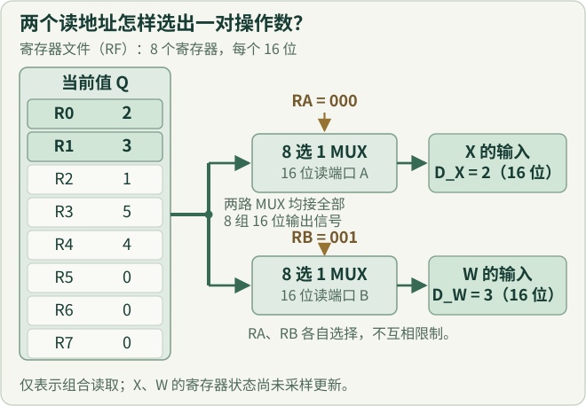
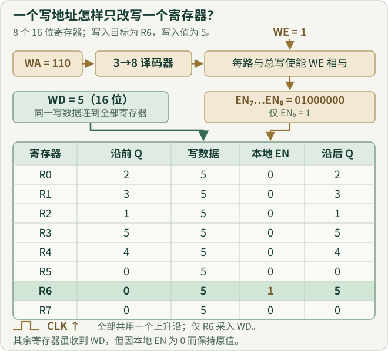
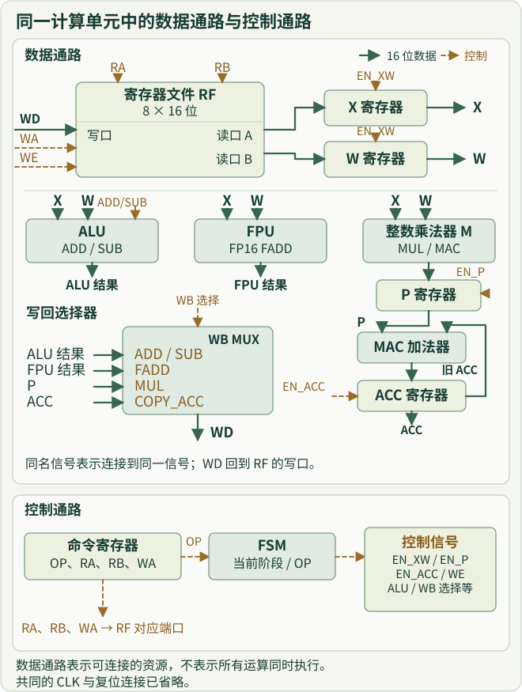
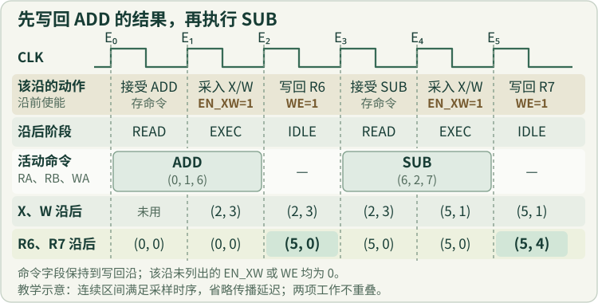
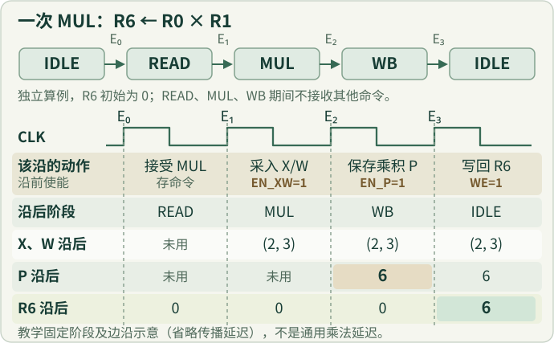
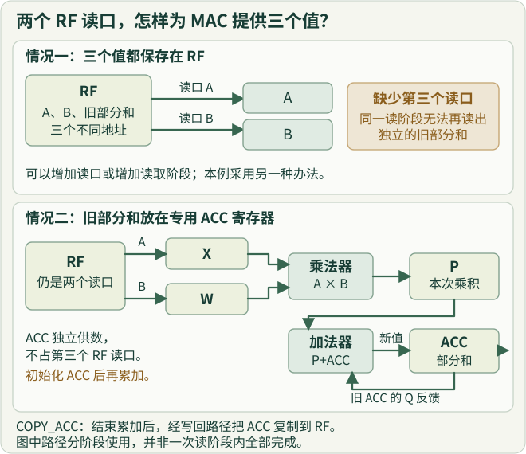
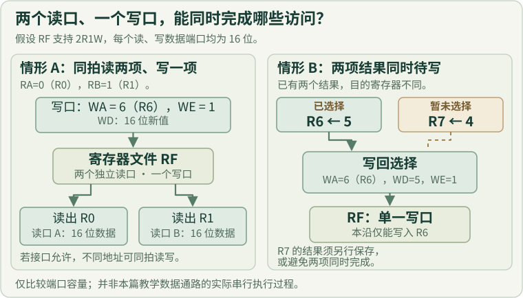

# 一组运算单元怎样连续完成不同的计算？

[A01](a01-state-and-control.md)构造了能够顺序选择操作数的电路。[A02](a02-number-representation-and-arithmetic.md)、[A03](a03-multiplication-and-accumulation.md)和[A04](a04-floating-point-and-low-precision.md)分别解释了整数运算、乘加和浮点运算的实现。

现在希望这几个电路能共同完成一系列计算。例如，先计算 2 + 3 = 5，再将这个 5 与 1 相减，得到 4。如果仍然采用 A01 中固定连接的操作数来源，第二次运算可能就找不到刚产生的 5。

怎样让计算单元从不同位置获取数据，把结果保存到指定位置，并在下一项运算时重新使用它？这正是**数据通路（Datapath）**需要解决的问题。

下面从一个可以执行加减的简单电路开始，逐步加入不同运算单元和控制逻辑。

## 为什么不直接将输入接到运算单元？ {#register-file}

A01 将四对操作数预先准备好，通过共用的组号依次选出每一对，再采入寄存器 X、W。由于计算顺序固定，只要逐拍改变组号就可以了。

但如果希望先使用 2 和 3，再使用计算得到的 5 和另一个数 1，那么每次需要的数据来源就可能不同。可以提供一组带编号的寄存器，保存输入和中间结果，让运算电路根据编号选取操作数。

做一个很小的教学设计：使用八个十六位寄存器 R0～R7。我们预先将上一组算例中的数值存进去，暂时不研究它们怎样从外部加载。

| 编号 | 初始值（十进制整数） | 用途 |
| --- | ---: | --- |
| R0 | 2 | 操作数 |
| R1 | 3 | 操作数 |
| R2 | 1 | 操作数 |
| R3 | 5 | 操作数 |
| R4 | 4 | 操作数 |
| R5 | 0 | 备用 |
| R6 | 0 | 中间结果 |
| R7 | 0 | 另一个结果 |

选择十六位宽，既方便保存 A03 中四位整数的完整乘积与四项点积，也可以在后面保存 A04 所介绍的 FP16 编码。

每个寄存器都具有 A01 中的保持和写入功能。只不过，我们现在希望能够按编号读取任意一个寄存器，也可以按编号更新其中一个。

这样组织的存储结构称为**寄存器文件（Register File，RF）**，也常称为寄存器堆。这里先用触发器构造一个小型 RF，不假设所有实际的寄存器文件都采用相同的物理实现。

## 怎样同时取得两个操作数？ {#read-ports}

先只考虑计算 2 + 3。我们希望第一个操作数来自 R0，第二个来自 R1。下一次可能改为计算 R3 + R4，所以不能将两根数据路径永远固定连接到 R0 与 R1。

回忆[A01 的数据选择电路](a01-state-and-control.md#select-decode)。可以把八个寄存器的 Q 都接到一个八选一 MUX，再用三位选择信号 RA 指定应读取哪个寄存器。

但一个 MUX 一次只能在这八个来源中选出一路。要在同一时刻获得两份可以独立选择的数据，就可以增加第二个 MUX，使用另一组三位选择信号 RB。

<figure class="micro-diagram" style="max-width:680px; margin:1.2rem auto" tabindex="0" aria-label="八个寄存器和两个独立读端口的操作数选择，窄屏可横向滚动" markdown="1">

<figcaption>图中每条数据通路宽十六位。一个读口包含独立的编号输入和对应的数据输出；两个读口可以选择同一条目或不同条目。</figcaption>
</figure>

RA 和 RB 都是二进制编号，不是要参加加法的数。RA = `000`，第一个 MUX 输出 R0 的值 2；RB = `001`，另一个 MUX 输出 R1 的值 3。

我们可以把这两个可独立选择的数据出口分别称为一个**读端口（Read Port）**。在本例中，RF 有两个读口，因此可以同时输出两个操作数，不必读完一个再选择另一个。

这里采用组合逻辑读出：RA、RB 改变后，需要等待选择路径传播，输出才会稳定。随后可以像 A01 那样，在时钟上升沿将这两个值采入 X、W。

选择网络的输入是寄存器当前的 Q，不会因为一次读取就把寄存器中的值清除。

[MIT 6.004：双读口寄存器文件的结构](https://ocw.mit.edu/courses/6-004-computation-structures-spring-2017/pages/c13/c13s1/)

## 运算得到 5 后，怎样只修改 R6？ {#write-port}

假设 X、W 已经分别保存 2 和 3，[A02 的 ALU](a02-number-representation-and-arithmetic.md#alu)完成加法后，输出端出现 5。可是如果这个结果只存在于组合逻辑的输出端，下一次改变操作数时，它就可能被新的结果覆盖。

现在希望将 5 写回 R6，而不改变 R0、R1 等其他寄存器。这个需求与 A01 中根据编号生成目标寄存器的写使能相同。

给 RF 增加一组写入接口：

- WA（Write Address）：三位目标寄存器编号。
- WD（Write Data）：十六位待写入的数据。
- WE（Write Enable）：控制是否在下一个有效时钟沿执行写入。

将 WD 接到全部八个寄存器的输入，再用三到八译码器根据 WA 生成八条选择信号。各选择信号与总写使能 WE 做与运算，得到每个寄存器各自的写使能。

<figure class="micro-diagram" style="max-width:680px; margin:1.2rem auto" tabindex="0" aria-label="寄存器文件单写口和译码写使能，窄屏可横向滚动" markdown="1">

</figure>

WA = `110` 时选中 R6。只有 WE 为 1 时，R6 才允许在上升沿采入 WD = 5；其他七个寄存器继续保持旧值。WE 为 0 时，无论 WA 是多少，八个寄存器都不会因这组接口而改写。

这组编号、数据和控制信号一起构成一个**写端口（Write Port）**。我们将运算结果送回保存数据的寄存器文件，这个动作称为**写回（Writeback）**。

现在的 RF 有两个读端口与一个写端口，简称 2R1W。本例假设寄存器文件由普通同步寄存器、组合读 MUX 和写入译码组成。该组织允许两个读口输出数据，同时在一个采样沿进行一次写入。

### 如果读口恰好选择正在写入的 R6，会读出什么？

用本例的电路来观察。假设 R6 原来是 0，某一上升沿将 5 写入 R6，RA 一直选择 R6。

- 在写入沿之前，R6 的 Q 是 0，读端口输出旧值 0。
- 写入沿到来时，R6 采下 5。在满足建立和保持时间、且不存在写入数据旁路的条件下，其他接收寄存器若在该沿采样读口，采到的是沿前已稳定的旧值。
- 在沿后，R6 的 Q 更新为 5，经读 MUX 传播，读口才显示新的 5。

这是本例触发器加 MUX 实现下的行为，并非所有寄存器文件都必须遵循同样的时序。实际 RF 可能使用锁存器或存储阵列，也可能有同步读出、额外的转发逻辑或不同的同地址读写约定。

因此，端口数量、读出延迟和同地址读写行为需要分别确认。例如 [Ibex 的寄存器文件文档](https://ibex-core.readthedocs.io/en/latest/03_reference/register_file.html)列出了 2R1W 接口及不同实现；[存储系统中的寄存器堆](../../storage/02-sram/applications/register-file-as-sram.md)进一步讨论这些选择的代价。

## 有多个运算单元，怎样只保存需要的结果？ {#functional-units}

目前只有一个 ALU。再将[A03 的整数乘法与乘加电路](a03-multiplication-and-accumulation.md#mac)以及[A04 的浮点运算电路](a04-floating-point-and-low-precision.md)加入这组硬件。

如果三个运算单元都直接接到 RF 的唯一写数据输入 WD，就会有多个输出试图决定同一组信号。这里不能只把它们的输出线接在一起，需要一个明确的数据选择电路。

一种直接的组织方式是让 X、W 的输出提供给不同的运算单元，再将可写回的结果接入一个结果 MUX。由控制信号决定当前需要哪一个单元的结果。

下面是本文使用的完整教学结构。为了展示多周期运算，我们在整数乘法器的输出增加了一个中间寄存器 P，乘加路径则有专用的累加器 ACC。

本例的 RF、X、W、P 和 ACC 都以十六位保存数据。整数加减和累加保留低十六位；十六乘十六位无符号整数的完整乘积需要三十二位，本例只将低十六位存入 P。FPU 的浮点加法则以 FP16 编码为输入和输出。

<figure class="micro-diagram" style="max-width:740px; margin:1.2rem auto" tabindex="0" aria-label="包含ALU、FPU和乘加路径的数据通路及控制通路，窄屏可横向滚动" markdown="1">

<figcaption>图中各信号需要满足采样时序，省略共同的时钟和复位连接。运算选择与写回许可由控制通路产生；各单元并非在每项任务中同时写入状态。</figcaption>
</figure>

在这条数据通路中，控制电路需要回答三类问题：

- 从哪里读取：给出 RA、RB，决定是否更新 X、W。
- 做什么运算：选择 ALU 的加减功能、整数乘法或浮点加法等。
- 保存到哪里：选择写回数据来源、目标编号 WA，并决定各个状态是否允许写入。

ALU、FPU、乘法器是不同的**运算单元（Functional Unit）**。它们处理的数值和内部电路可能不同，但可以共享输入数据与写回路径。

这种用选择器组织不同运算电路的方式是一个常见设计方法，而非所有芯片的固定结构。[MIT 6.004：从简单计算到可控数据通路](https://ocw.mit.edu/courses/6-004-computation-structures-spring-2017/pages/c9/c9s1/)

### 如果寄存器里的比特采用不同数值格式呢？

本例的 RF 每个条目保存十六个比特，并没有单独保存整数或浮点类型标签。控制电路必须规定这些比特应该送给哪种运算单元，以及采用哪种解释。

例如，整数的 2 与 FP16 的 2.0 都有十六位表示，但编码不同：

| 解释方式 | 十六位编码（十六进制） |
| --- | --- |
| 无符号整数 2 | `0x0002` |
| FP16 的 2.0 | `0x4000` |

十六进制每一位表示四个二进制比特，这里用它缩短编码的写法。FP16 的指数和有效数字编码见[A04](a04-floating-point-and-low-precision.md#encoding)。

若另一次实验预先将 R0、R1 装入 FP16 编码 `0x3E00`（1.5）和 `0x4000`（2.0），控制信号选择浮点加法，那么 FPU 的结果为 `0x4300`（3.5），可以经结果 MUX 写回 RF。

只改变所选择的运算单元，不会自动将原先的整数比特转换为浮点编码。若需要改变数值格式，还需要对应的数值转换操作或专用电路。

实际芯片可能让整数和浮点运算使用不同寄存器文件，也可能让部分端口或写回路径共享。本例统一使用十六位 RF 是教学选择。

## 控制电路怎样知道这一拍应该读什么、写什么？ {#control-path}

先不考虑指令从哪里来。假设外部已经明确提出一个计算请求：将 R0 与 R1 相加，并把结果保存到 R6。

要让上述硬件执行这个请求，至少需要知道运算类型、两个源寄存器编号以及一个目标寄存器编号。把这些信息组织为本例的计算命令：

| 字段 | 本次值 | 含义 |
| --- | --- | --- |
| OP | ADD | 整数加法 |
| RA | 0 | 第一个源寄存器 |
| RB | 1 | 第二个源寄存器 |
| WA | 6 | 目标寄存器 |

OP、RA、RB、WA 是为教学电路设计的控制信息，不是本文定义的一套处理器指令集。外部如何产生和提交这些命令，后续另行讨论。

如果这些信号只出现在一个时刻，随后外部就提出另一个命令，而当前计算尚未结束，那么电路可能忘记结果本来应写到 R6。

因此，本例在接受命令时先用一组控制寄存器保存这些字段。只接受一项计算，在它执行和写回期间保留命令内容；回到允许接收的状态后，才能接收下一项命令。

[A01 的状态机](a01-state-and-control.md#fsm)已经能够控制一系列动作。现在让控制状态机根据当前阶段和保存的 OP，向数据通路发出控制信号。

### 逐拍完成第一项加法

假设所有寄存器共用上升沿时钟；本例的 RF 读出及 ALU 加法路径都能在各自一个时钟周期内满足时序。这里不指定真实时钟频率。

- E₀：接受 ADD 命令，将 OP、RA、RB、WA 保存下来，进入 READ 状态。
- E₀ 到 E₁：两个读口选择 R0、R1，X、W 的输入分别稳定为 2、3。
- E₁：使能 X、W，将这两个操作数采入，进入 ALU 执行状态。
- E₁ 到 E₂：ALU 根据保存的 OP 产生结果 5，写回 MUX 选择 ALU，WA = 6。
- E₂：WE 有效，R6 采下 5，任务完成，控制状态返回 IDLE。

这是一次读操作数、执行和写回的过程。E₀ 是命令被接受的边沿，E₂ 是结果写回的边沿，两者之间经过两个完整的时钟周期。

<figure class="micro-diagram" style="max-width:760px; margin:1.2rem auto" tabindex="0" aria-label="连续ADD和SUB的命令接收、读操作数、执行和写回时序，窄屏可横向滚动" markdown="1">

<figcaption>图中边沿之后的值表示经过传播后已稳定的状态。采样的是边沿之前准备好的输入，而不是同一沿刚产生的输出。</figcaption>
</figure>

到了 E₃，电路已经可以接受下一项命令。外部要求将 R6 减去 R2，结果写到 R7。此时控制字段分别变成 SUB、6、2、7。

E₄ 把 5 和 1 采入 X、W；E₅ 把差 4 写入 R7。因此，第二项运算并不需要从外部再提供 5，它可以直接使用前一次运算保存在 RF 中的结果。

| 写回边沿 | 计算 | 被更新的寄存器 |
| --- | --- | --- |
| E₂ | 2 + 3 = 5 | R6 ← 5 |
| E₅ | 5 − 1 = 4 | R7 ← 4 |

负责传递、选择及处理操作数和结果的电路组成数据通路。负责保存命令、判断工作阶段及产生选择和使能信号的电路组成**控制通路（Control Path）**。

二者不是两套相互独立的工作系统。控制通路通过信号决定数据通路如何工作，也可以读取数据通路的状态或比较结果，以决定下一步的行为。

同理，如果 FP16 加法也能在一个执行周期内满足时序，FADD 命令就可以遵循同样的读出、执行和写回流程，仅将 ALU 执行阶段替换为 FPU 执行阶段，并切换结果 MUX。如果不能满足时序，就需要另行组织执行阶段。

## 为什么有些运算不能在一次执行阶段完成？ {#multicycle}

刚才的教学设计假设一个执行周期足以完成 ALU 加法。但整数乘法需要产生部分积、归约并完成最后的进位传播；其他运算也可能有不同的逻辑路径。

有些设计选择将计算与写回分开：先用中间寄存器保存计算结果，再在下一周期完成写回。先看这种方法如何影响控制通路。

现在考察一次乘法命令 MUL：R6 ← R0 × R1。仍然在 E₀ 接受命令、E₁ 采入 X = 2、W = 3。

本文假设整数乘法路径可以在 E₁ 到 E₂ 期间产生所需的结果，但设计规定先将结果写入 P，再在下一周期通过共享写回 MUX 写往 RF。这是刻意采用的分步执行方式，并不表示所有实际乘法器都至少需要这些周期。

由于 A01 的四组输入都在四位无符号范围内，它们的乘积和完整点积都能在本例的十六位寄存器中准确保存。

<figure class="micro-diagram" style="max-width:760px; margin:1.2rem auto" tabindex="0" aria-label="多周期乘法的控制状态、中间结果及写回时序，窄屏可横向滚动" markdown="1">

<figcaption>本图与上一节 ADD/SUB 是分别从初始状态开始的独立实验。各阶段占用所示的周期是本文的教学假设，不是某款芯片的执行延迟。</figcaption>
</figure>

| 控制状态 | 沿前正在进行的工作 | 结束该状态的边沿 | 本沿更新 |
| --- | --- | --- | --- |
| READ | 读 RF 的两个源寄存器 | E₁ | X = 2，W = 3 |
| MUL | 整数乘法 | E₂ | P = 6 |
| WB | 选择 P，准备写入 R6 | E₃ | R6 = 6 |

E₂ 时，乘积已经保存，但还未写回 R6。控制电路必须保持之前接受的 WA = 6，并在 WB 阶段产生正确的写回选择和使能。到 E₃，保存的任务才真正完成。

注意，在乘法器输出增加 P 只把计算和写回分开，并没有缩短乘法器内部的组合路径。如果单独的乘法路径仍然无法满足时序，就需要改变运算电路的组织方式，例如在内部划分计算阶段，A06 会继续讨论。

还有一种多周期组织方式：用同一个加法器先计算 A + B，把中间结果保存下来，再与 C 相加。这种 (A + B) + C 的分步计算复用了加法器，但也需要控制逻辑记住正在进行哪一步。

本例只允许一项命令在途，以便看清数据与控制的关系。这并不表示所有多周期单元都要等上一项完全结束才能接受下一项，后续 A06 会专门讨论这种区别。

## MAC 为什么可能不需要第三个 RF 读端口？ {#mac-feedback}

回到之前的点积。一次乘加计算的数学表达式为 A × B + ACC，其中 X、W 保存 A 和 B。可是加法还需要旧的部分和 ACC。

如果这三个数都存储在 RF 的三个不同条目中，仅凭两条独立的读口，就不能在一个定义的同时读出阶段直接提供这三个不同的值。

可以增加第三个读口，也可以分两次读取并保存其中一部分操作数。除此之外，[A03 的反馈累加电路](a03-multiplication-and-accumulation.md#mac)提供了另一种办法。

让乘加路径自身拥有一个累加寄存器 ACC。这样每次只需要从 RF 读取两个乘数，旧的部分和直接通过 ACC 的 Q 端反馈给加法器，不必再使用 RF 的第三个读口。

<figure class="micro-diagram" style="max-width:680px; margin:1.2rem auto" tabindex="0" aria-label="三份乘加操作数的来源与专用累加器反馈，窄屏可横向滚动" markdown="1">

</figure>

在本文的电路中，MAC 使用与 MUL 相同的前两个阶段，在 E₂ 取得 P 后，下一阶段将 P 与旧 ACC 相加，并使能 ACC 的写入，而不是使能 RF 的写口。

| 阶段 | 更新目标 |
| --- | --- |
| READ | X、W |
| MUL | P |
| ACC | ACC ← ACC + P |

这里的 ACC 是独立于 RF 的本地寄存器。计算新的一组点积之前，需要先将 ACC 初始化为 0。本次实验假设已经通过复位完成这一初始化。

从 ACC = 0 开始，给出四个 MAC 命令，仍然使用 A01 的四组数据：

| MAC 命令的源编号 RA、RB | 本项乘积 P | 更新后的 ACC |
| --- | ---: | ---: |
| R0、R1 | 6 | 6 |
| R2、R3 | 5 | 11 |
| R1、R0 | 6 | 17 |
| R4、R2 | 4 | 21 |

这与 A03 计算的数学结果一致，但执行组织不同。A03 假设组合乘加反馈路径可以每拍完成一次累加；本篇的分步电路按 READ、MUL、ACC 阶段执行，每项命令结束后才接收下一项。

最终 ACC 保存 21。如果还需要让 ALU 通过 RF 读取这个结果，可以另执行一次 COPY_ACC 操作。它不需要两个读地址：接受命令并保存 WA = 7 后，直接进入 WB_ACC 状态。

下一周期结果 MUX 选择 ACC，WE 有效，在结束 WB_ACC 的上升沿将 21 写入 R7。X、W、P、ACC 均保持原值。这次操作没有增加新的数据通路，只改变了已有的控制信号。

由此可以理解一种计算资源的组织选择：把经常复用的部分和留在局部累加器，可以节省 RF 的读写需求，却也需要管理这份局部状态的初值、更新许可与结果输出。

回看完整数据通路中的几个使能信号。除了在 IDLE 阶段接收命令以外，各工作阶段只需要使能指定的目标寄存器：

| 当前阶段 | 有效的写使能 | 写回 MUX 选择 | 下一阶段 |
| --- | --- | --- | --- |
| READ | EN_XW | 不关心 | 由 OP 选择 ALU、FPU 或 MUL |
| ALU | WE | ALU | IDLE |
| FPU（单周期执行假设） | WE | FPU | IDLE |
| MUL | EN_P | 不关心 | MUL 命令进 WB；MAC 命令进 ACC |
| WB | WE | P | IDLE |
| ACC | EN_ACC | 不关心 | IDLE |
| WB_ACC | WE | ACC | IDLE |

未列出的数据写使能均为 0。比如处于 ACC 阶段时，RF 的 WE 为 0，所以写回 MUX 即使产生某个值，也不会改变 RF。

## 运算单元增加了，为什么数据通路不一定也能同时支持更多计算？ {#ports-and-sharing}

到这里，我们的 RF 有两条读口和一条写口，内部又连接了不同运算电路。若未来允许多个独立工作同时执行，这些共享路径会不会成为限制？

先看 RF 的接口。单独一项双源运算需要读取两个值，并不意味着必须在某一拍同时写结果。某些设计可以在同一周期读两个地址并写另一个地址；也可以采用分拍读写和不同存储实现。

例如本例的触发器 RF 在写入 R6 的同时，可以让两个组合读口选择 R0 和 R1。它们可以独立取得已有的值。

但如果两个运算单元同时产生结果，而且分别需要写入 R6 和 R7，那么只有一组 WA、WD、WE 的写口无法在同一个上升沿向两个不同地址写入两个不同的结果。

<figure class="micro-diagram" style="max-width:700px; margin:1.2rem auto" tabindex="0" aria-label="双读单写的端口能力及两个结果争用一个写口，窄屏可横向滚动" markdown="1">

<figcaption>这是为解释端口能力而改变执行条件后的独立示意，本篇前面的控制器仍然只允许一项命令在途。</figcaption>
</figure>

要支持这样的并发计算，可以增加另一条独立写口，也可以让某个结果先保存在自己的中间寄存器中，等写口空闲再写。后一种做法必须保证等待中的结果不会被新的计算覆盖。

此外，增加读口或写口也并非只增加一个编号信号。它可能增加选择网络、存储阵列外围、布线和控制成本，具体影响取决于物理实现与访问需求。

已有实际处理器会共享不同运算单元的写回资源。例如 [CORE-V CV32E40P v1.8.0 寄存器文件](https://docs.openhwfoundation.org/projects/cv32e40p-user-manual/en/cv32e40p_v1.8.0/register_file.html)及[执行路径文档](https://docs.openhwfoundation.org/projects/cv32e40p-user-manual/en/cv32e40p_v1.8.0/pipeline.html)介绍了不同计算结果使用共享写回端口的设计及冲突处理。

本篇只需要认识到：增加运算资源并不自动增加数据供给和结果写入能力。怎样在多个已准备好的工作之间决定资源的使用顺序，将留给 A08。

## 接下来需要解决什么问题？ {#next}

回顾这个小型电路。寄存器文件保留多项操作数和中间值，读口及 MUX 决定数据从哪里来；运算单元根据命令产生结果，结果 MUX 和写口决定它被送到哪里。

控制状态机则保存命令信息，将读出、输入采样、执行、内部状态更新及写回按正确顺序连接起来。这就是一种可以执行不同计算任务的数据通路。

然而，刚才的执行方式有一个问题：例如 ADD 的结果还没有写回时，RF 的读出逻辑已经空闲，为什么不能利用这段时间准备下一项独立运算？

即使一次运算需要多个周期，是否有办法让不同阶段同时处理不同的工作？[A06 · 第一份结果还没出来，为什么下一份运算可以开始？](a06-pipeline-and-throughput.md) 将在这里继续，研究流水线如何改变执行组织。

[返回共同计算基础导读](README.md)。
