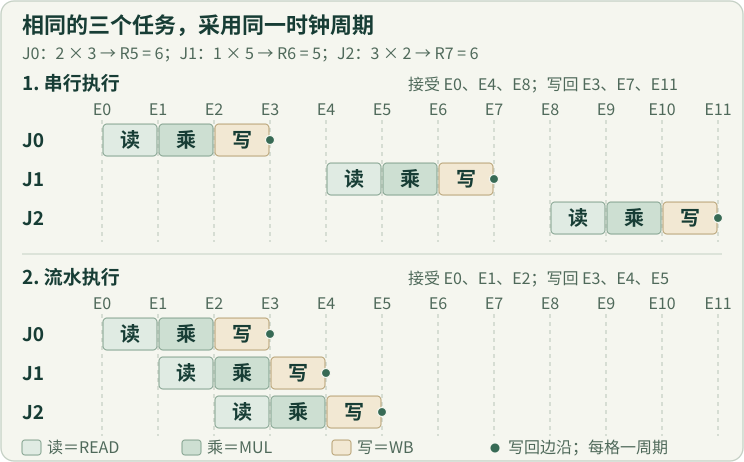
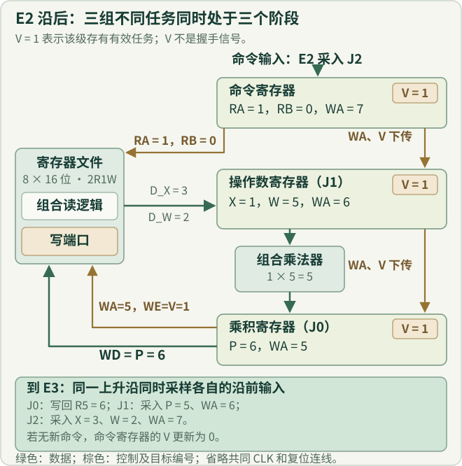
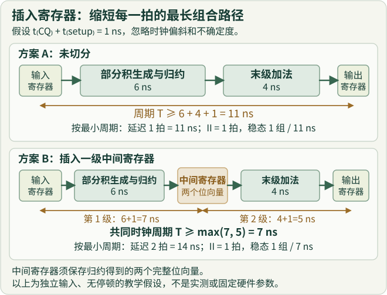
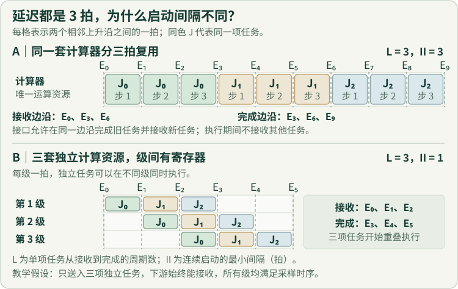
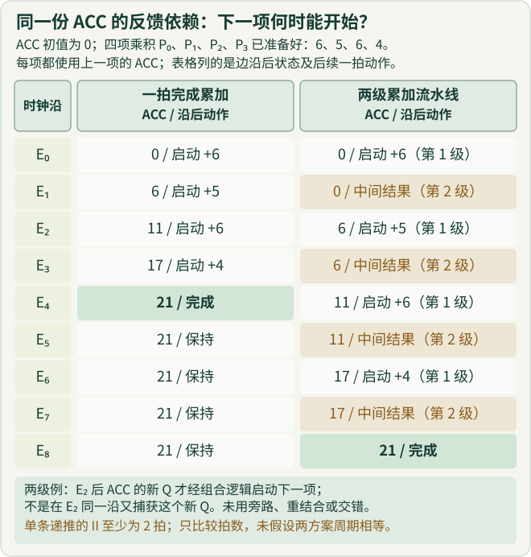

# 第一份结果还没出来，为什么下一份运算可以开始？

[A05](a05-datapath-and-control.md) 将寄存器文件、运算单元和控制通路组织到了一起。一项乘法命令要经过读操作数、乘法计算和结果写回三个阶段。控制器必须等这项命令结束，才能接收下一项。

但观察这个过程：乘法器处理第一组数时，读口已经没有任务；第一份乘积等待写回时，乘法器也没有任务。

能不能让第一组数进入乘法器后，读口立即准备第二组数？如果不同的阶段同时处理不同的工作，一批计算就可能更早结束。这种组织方式称为**流水线（Pipeline）**。

下面仍然沿着 A05 的数据通路追踪每一组数据。我们会先保持时钟周期不变，再研究流水线怎样改变时钟频率，以及哪些计算不能这样连续推进。

## 在 A05 中，为什么第一项没有写回就不能接收第二项？ {#serial-execution}

回忆 [A05 的多周期乘法](a05-datapath-and-control.md#multicycle)。RF 有两个组合逻辑读口和一个同步写口；X、W 保存待乘的数，P 保存低十六位整数乘积。一次 MUL 命令依次经过三个阶段：

| 阶段 | 所使用的电路 | 结束该阶段时的动作 |
| --- | --- | --- |
| READ | RF 的两个读口 | 采入 X、W |
| MUL | 整数乘法器 | 采入 P |
| WB | 写回通路和 RF 写口 | 把 P 写到目标寄存器 |

保留 A05 的初始值，取前面四组操作数中的前三组。这次让三个结果分别写入 R5、R6、R7。

| 任务 | 读地址 RA、RB | 操作数 X、W | 写地址 WA | 乘积 |
| --- | --- | --- | --- | ---: |
| J0 | 0、1 | 2、3 | 5 | 6 |
| J1 | 2、3 | 1、5 | 6 | 5 |
| J2 | 1、0 | 3、2 | 7 | 6 |

R0～R4 在这次实验中保持原值。三项计算都不需要其他任务产生的结果，且写入位置不同。因此，可以独立完成这三项计算。

仍以 E₀、E₁、E₂ 作为连续的时钟上升沿。第一项任务在 E₀ 被接收，E₁ 采入 X、W，E₂ 采入 P，E₃ 写回 RF。

按照 A05 的控制规则，E₃ 沿后才回到 IDLE，因此下一项命令要等 E₄ 才能被接收。三次写回分别发生在 E₃、E₇ 和 E₁₁。

然而，在 E₁ 到 E₂ 进行第一项乘法的过程中，X、W 已经保存了 2 和 3。即使读口此时改为选择 R2、R3，也不会立刻改变 X、W 的 Q。这意味着读口已经具备为第二项工作准备数据的条件。

同样，在第一项乘积被采入 P 后，只要保证 P 在写回沿之前不被覆盖，乘法器就可以使用新的 X、W 计算第二份乘积。

也就是说，限制下一项工作开始的不是这三个电路必须依次空闲，而是 A05 只有一份命令状态，而且控制器规定完成一项工作后才接收另一项。

## 怎样让三个阶段同时处理不同的任务？ {#overlap}

先看我们希望实现的执行过程。

- E₀ 接收 J0。读口选择 R0、R1。
- E₁ 把 J0 的 2、3 采入 X、W，同时接收 J1。
- E₂ 把 J0 的乘积 6 采入 P，同时把 J1 的 1、5 采入 X、W，并接收 J2。
- E₃ 将 J0 写回 R5，同时把 J1 的乘积 5 采入 P，把 J2 的 3、2 采入 X、W。

这样，在 E₂ 到 E₃ 之间，读口正在准备 J2 的数据，乘法器在处理 J1，写回通路正在准备 J0 的结果。三个阶段分别处理三项不同的工作。

<figure class="micro-diagram" style="max-width:780px; margin:1.2rem auto" tabindex="0" aria-label="三个独立乘法任务的串行执行与流水线执行对照，窄屏可横向滚动" markdown="1">

<figcaption>横轴是同一个长度不变的时钟周期。色块表示两个边沿之间的工作，写回发生在 WB 结束的边沿。流水线没有让任何一个阶段的计算更快。</figcaption>
</figure>

与串行执行相比，第一份结果仍然在 E₃ 写回，但第二份和第三份结果不需要再等到 E₇、E₁₁。

这种让数据依次经过多个阶段，并让不同阶段同时处理不同数据的结构就是流水线。其中，每两个保存数据的时序边界之间的电路组织成一个**流水级（Pipeline Stage）**。

这里的 READ、MUL、WB 各占一个周期。我们暂时没有修改乘法器的内部结构，也没有提升时钟频率。

## 为什么只增加接收命令的频率还不够？ {#pipeline-registers}

上面的执行顺序并不能直接在 A05 的控制电路上发生。想象一下：E₁ 接收 J1 之后，原先保存的 WA = 5 就可能被 J1 的 WA = 6 覆盖。等 J0 的乘积 6 到达写口时，电路就不知道应将它写入 R5 还是 R6。

解决办法是让目标编号与本项数据一同经过各阶段。既然 X、W 保存一份任务的操作数，就在这里也保存它的目标编号；P 保存该任务的乘积，就在 P 所在的级继续保存同一个目标编号。

这些级间用于保存和逐拍传递数据的寄存器称为**流水线寄存器（Pipeline Register）**。它们将上一阶段已经准备好的结果固定下来，供下一阶段在一个完整的时钟周期内使用。

<figure class="micro-diagram" style="max-width:760px; margin:1.2rem auto" tabindex="0" aria-label="乘法流水线的数据、目标寄存器编号和有效位逐级传递，窄屏可横向滚动" markdown="1">

<figcaption>为突出逐级传递，图中只保留 MUL 所需的路径。OP 固定为 MUL；若还支持不同运算，相关控制信息也要与该项数据对齐。</figcaption>
</figure>

每份任务在入口寄存器保存 RA、RB、WA；到了 X、W 所在的寄存器，就不再需要原先的两个源编号；到了 P 所在的寄存器，也不再需要保存这两个操作数。

沿着这三个寄存器位置列出每个边沿之后的稳定值：

| 上升沿 | READ 入口：任务与编号 | MUL 入口：X、W / WA | WB 入口：P / WA | 本沿写回 |
| --- | --- | --- | --- | --- |
| E₀ | J0：0、1 / 5 | — | — | — |
| E₁ | J1：2、3 / 6 | J0：2、3 / 5 | — | — |
| E₂ | J2：1、0 / 7 | J1：1、5 / 6 | J0：6 / 5 | — |
| E₃ | — | J2：3、2 / 7 | J1：5 / 6 | R5 ← 6 |
| E₄ | — | — | J2：6 / 7 | R6 ← 5 |
| E₅ | — | — | — | R7 ← 6 |

这里的任务名 J0、J1、J2 是帮助读者追踪数据的标记。对这个固定顺序的电路，并不需要额外保存这样的任务编号。

### 同一条时钟沿，为什么数据不会一次穿过所有级？

以 E₃ 为例，沿前 P 的 Q = 6，P 旁的目标编号为 5，RF 的写口已经准备好写 R5。同时，乘法器基于沿前 X = 1、W = 5 算出 5。

E₃ 到来时，RF 采入前者，P 采入后者。这两个动作发生在同一个沿。但 P 的新 Q 需要一段时间才会出现，送到写口后也要等下一沿才能被采样。

这与 [A01 的寄存器与边沿采样](a01-state-and-control.md#register) 一样：在满足建立与保持时间的条件下，同一时钟沿的接收寄存器采到的是沿前准备好的值，不是上一只寄存器在同一沿刚产生的新 Q。

因此，同一时钟沿可以同时把不同任务向前推进一级，而不会把数据一下子传到最后一级。A05 的两个读口与一个写口也允许这里不同地址的并行读写。

### 如果某一级暂时没有任务呢？

表中的“—”不是说寄存器里的比特不存在。它可能还保留着上一次操作的 6。若仅根据这些比特判断，空闲的 WB 级也可能把旧结果再次写回 RF。

所以每个级间寄存器还需要保存一位状态，说明当前内容是否代表一项有效的任务。称为**有效位（Valid Bit）**。复位时各级有效位为 0。

先只讨论一个无需等待的流水线：每拍各级都能接收前一级的数据，所有写回都能被 RF 接收；没有新命令时，入口有效位置 0。

在每个边沿，下一级的有效位与数据一起采入上一位置的沿前值。WB 入口的有效位控制 RF 的 WE。有有效结果才写回；没有任务经过时，即使数据线保留旧值，也不产生写回。

如果某一级暂时不能接收数据，简单的每拍移动规则就会覆盖仍需使用的信息。这需要新的控制机制，A07 将进一步讨论。

[MIT 6.004：Pipelining](https://ocw.mit.edu/courses/6-004-computation-structures-spring-2017/pages/c7/c7s1/)

## 一项任务仍要三拍，为什么整批工作更快？ {#latency-and-ii}

在刚才的流水线中，从 E₀ 接收 J0 到 E₃ 写回 J0，仍经过三个完整的时钟周期。第一项任务并没有因为第二项提前开始而提前结束。

从一项输入被接收到对应结果完成，所经过的时间称为**延迟（Latency）**。先用时钟周期计量，得到本例的延迟 L = 3 拍。乘以时钟周期 T，才能得到实际时间 3T。

再观察输入。流水线可以先在 E₀ 接收 J0，再在 E₁ 接收 J1。在固定间隔的连续执行中，相邻工作可以被接收的最小周期数称为**接纳间隔（Initiation Interval，II）**，也称启动间隔。

对于本例持续有独立输入的情况，串行控制每四拍接收一项，即 II = 4；流水线每拍接收一项，即 II = 1。两者执行单项乘法的延迟都是 3 拍。

### 延迟、接纳间隔和吞吐不是同一件事

假设每个任务产生一个结果，不发生停顿，且可以持续提供独立工作。在稳定执行的过程中，输入接收间隔与输出完成间隔相同。

单位时间内能够完成多少项工作，称为**吞吐率（Throughput）**。在上述条件下，稳定吞吐率为：

**吞吐率 = 1 / (II × T)**

如果 T = 10 ns，仅用于比较两种执行组织，不代表真实乘法器的工作频率：

| 指标 | A05 串行控制 | 三阶段流水线 |
| --- | ---: | ---: |
| 单项延迟 L | 3 拍 | 3 拍 |
| 接纳间隔 II | 4 拍 | 1 拍 |
| 单项延迟（时间） | 30 ns | 30 ns |
| 稳定吞吐率 | 每 40 ns 一项 | 每 10 ns 一项 |
| 三项任务从首项接收到末项写回 | 110 ns | 50 ns |

本例串行控制的 II = 4 来自 A05 规定的接收边沿，其中包含回到 IDLE 后等待下一沿的空档。若修改控制使它能在同一沿完成旧任务并接收新任务，II 可以变成 3，而不必采用流水线。

### 为什么三项任务不是三拍就全部完成？

沿着时序图数一数。在 E₀ 刚接收第一项时，只有 READ 入口是有效的。E₁ 时有两项任务，E₂ 时三项任务才分别处于三个阶段。流水线逐级被工作填满，这个过程称为**填充（Fill）**。

取完所有输入后，也不能立即停止时钟。E₂ 已经接收最后一项输入，但它仍需要走过三个阶段，直到 E₅ 才写回。这段过程称为**排空（Drain）**。

对于固定延迟 L、无停顿、按固定 II 接收 N 项任务的情况，从接收第一项到完成最后一项所需的时钟周期数为：

**C = L + (N − 1) × II**

当 N = 3 时，串行控制需 3 + 2 × 4 = 11 拍；流水线需 3 + 2 × 1 = 5 拍。公式只计算从首项输入到末项完成的间隔，不把 E₀ 也当作一个已过的周期。

[Intel HLS Best Practices Guide，2018.12.24：循环 II 与总延迟的相同计算关系](https://cdrdv2-public.intel.com/705062/ug-hls-best-practices-18-1-683152-705062.pdf#page=21)

如果只有一项计算，重叠没有收益；如果有一百项独立工作，流水线需 3 + 99 = 102 拍，串行控制需 399 拍。

任务数越多，固定的填充和排空开销占总时间的比例通常越小。但若输入不足、输出停顿或存在数据依赖，就不能直接用峰值吞吐率预测全部工作所需时间。

## 为什么在组合逻辑中间增加寄存器，可能提高时钟频率？ {#critical-path}

前面的优化没有改变每个阶段的逻辑，而是让它们同时工作。现在回到整数乘法器内部，看另一种使用流水线的原因。

[A03](a03-multiplication-and-accumulation.md#compression) 先生成部分积，将它们用压缩器归约到两行，最后利用进位传播加法器得到乘积。A05 将整个过程放在 X、W 与 P 之间。

回忆[半导体与电路基础的建立时间](../../semiconductor-foundations/pvt-and-path-delay/README.md#setup)。时钟沿到来后，X、W 的 Q 需要时间出现新值；新值穿过乘法器的门和连线；P 的 D 还需要在下一沿前提前稳定。

假设某条普通单周期的寄存器到寄存器路径，两端的时钟沿同时到达，不考虑时钟不确定性，并已满足保持时间等其他约束。它要求的最小时钟周期为：

**T ≥ tCQ,max + tlogic,max + tsetup**

其中，第一项是发送寄存器的最大时钟到 Q 延迟，第二项是门和连线的最大传播延迟，第三项是接收寄存器的建立时间。

同一个时钟域有许多需要在一拍内完成的路径。对这些路径分别计算，要求周期最长的路径决定它们对时钟周期的下限，称为**关键路径（Critical Path）**。

### 将乘法拆成两个流水级

做一个新的独立教学实验，只观察从 X、W 采入操作数到 P 保存乘积的边界。假设生成部分积并归约需要 6 ns，随后末级加法需要 4 ns，每一段寄存器间路径的时钟到 Q 与建立时间之和取 1 ns。

不划分时，最长逻辑路径需要 6 + 4 = 10 ns，加上两端的时间要求，T 至少为 11 ns。

如果在部分积归约与末级加法之间插入一组寄存器，把归约得到的两行完整保存下来，第一拍只需要生成和归约部分积，第二拍再执行末级加法。

<figure class="micro-diagram" style="max-width:760px; margin:1.2rem auto" tabindex="0" aria-label="乘法器未分级与内部划分流水级的寄存器间关键路径对比，窄屏可横向滚动" markdown="1">

<figcaption>假设 6 ns 与 4 ns 是相应路径的教学延迟，且无其他更长路径、时钟偏差和保持问题。它们不是从真实工艺库获得的参数。</figcaption>
</figure>

两个流水级的周期要求分别为 7 ns 和 5 ns。因为它们共用时钟，所以要采用能满足两者的公共周期，至少 7 ns，而不是给第一段 7 ns、第二段 5 ns。

此时，单项乘法要多经过一个边沿才能完成。但是新的一项输入可以在前一项已经进入末级加法时，送入前一段归约电路。

假设两个版本都能每个时钟周期接纳一项独立乘法，按照各自的理想最小时钟周期比较：

| 只观察乘法器 | 未切分 | 切分为两级 |
| --- | ---: | ---: |
| 最小时钟周期 T | 11 ns | 7 ns |
| 延迟 L | 1 拍 | 2 拍 |
| 延迟时间 L × T | 11 ns | 14 ns |
| 接纳间隔 II | 1 拍 | 1 拍 |
| 稳定吞吐率 | 约 9091 万项/s | 约 14286 万项/s |

注意：这里单项延迟反而增加了，但单位时间完成的乘法更多。在前面的三阶段算例中是减小 II；在本节算例中是缩短 T。它们是两种不同的吞吐提升方式。

### 为什么不无限增加流水级？

每次划分都要多保存一级中间数据和必要的控制信息，并增加时钟负载。即使组合逻辑很短，寄存器本身的时钟到 Q 和建立时间仍然存在。

而且，6 ns 与 4 ns 的两段逻辑并不平衡。如果能够产生两个各需要 5 ns 的合法阶段，理论周期下限可以降到 6 ns。但必须能在切分处保存足够的信息，也要重新检查所有其他数据与控制路径。

真实设计需要在时钟频率、延迟、寄存器数量、布线、功耗和反馈依赖之间做取舍。物理约束见[建立与保持：数据为何太晚或太早](../../semiconductor-foundations/pvt-and-path-delay/README.md)。

[MIT 6.004：同步电路的建立和保持条件](https://ocw.mit.edu/courses/6-004-computation-structures-spring-2017/pages/c5/c5s1/)

## 同样要执行三拍，为什么一项多周期运算不一定是流水线？ {#iterative-units}

考虑 [A05](a05-datapath-and-control.md#multicycle) 中另一种分步运算：先用一个加法器求 A + B，再用同一个加法器把结果与 C 相加。把它扩展为四个数的求和：

**((A + B) + C) + D**

可以让一个加法器和一个中间结果寄存器重复工作三拍。每拍都把新和保存下来，再选取下一个操作数。

这与前面三个阶段使用不同电路的情况不同。如果在第二拍就启动另一项运算，同一个加法器还在为第一组计算，第二组就没有可用的加法资源。即使入口可以暂存新任务，也不等于运算已经开始。

这次把 J0、J1、J2 作为三份独立的四数求和任务。假设计算第一项任务的三拍是 E₀ 到 E₃，结果在 E₃ 保存；并且这一沿已有独立的入口和输出存储，可以接受下一项任务。那么第二项最早在 E₃ 开始，第三项在 E₆ 开始。

<figure class="micro-diagram" style="max-width:760px; margin:1.2rem auto" tabindex="0" aria-label="同为三拍延迟的复用计算单元和三级流水线对照，窄屏可横向滚动" markdown="1">

<figcaption>假设复用单元在完成旧项的边沿可接收新项，不需额外空档。两种结构的单项延迟相同，资源占用方式不同。</figcaption>
</figure>

如果为三个加法步骤分别提供加法器和级间寄存器，并将尚未使用的 C、D 随任务向后传递，则有可能让三个步骤同时处理三份不同的求和任务。

前者用时间复用资源，后者用空间上的独立计算路径换取任务的重叠执行。它们的延迟都可以是三拍，但是接纳间隔可能不同。

所以，描述一个运算单元时，仅知道它是三周期或四周期单元还不能判断它每拍能否接收新输入。应分别确认延迟、接纳条件与所需资源。

## 乘积之间可以重叠计算，累加之间也可以吗？ {#feedback-dependence}

回到 [A03 的点积](a03-multiplication-and-accumulation.md#mac) 和 A05 的 MAC。四项乘积分别为 6、5、6、4。它们都只依赖各自的两个乘数，可以独立计算。

但每次累加都需要前一次产生的部分和：

**ACCi = ACCi−1 + Pi，ACC−1 = 0（i = 0、1、2、3）**

即先计算 0 + 6，得到 6；再计算 6 + 5，得到 11；之后继续得到 17 和 21。

为了单独观察累加路径，假设四项乘积已准备好，并可在需要时送给加法器。这里不计算从读取乘数到乘积形成的时间，也不再采用 A05 一项完整 MAC 命令的时序。

如果旧 ACC 和本项乘积经过一拍就能产生新 ACC，那么在 E₀ 后计算 0 + 6，E₁ 保存 ACC = 6。E₁ 后的下一周期便可以使用新的 6 计算 6 + 5。四次累加分别在 E₁ 到 E₄ 完成。

### 如果累加路径也划分为两个流水级呢？

现在假设累加加法器需要两拍。例如，第一拍完成低位相加，保存低位结果、进位和未处理的高位操作数；第二拍完成高位相加并组成完整结果。

仍使用一个 ACC。规定每项累加必须使用前一项已经更新的完整 ACC，不允许直接使用内部尚未写回的中间值。此时：

- E₀ 后开始计算 0 + 6。
- E₁ 只保存第一阶段的中间结果，ACC 仍为 0。
- E₂ 才把完整的 6 采入 ACC。其新 Q 出现之后，才具备开始计算 6 + 5 的条件。
- E₄、E₆、E₈ 分别更新 ACC 为 11、17、21。

<figure class="micro-diagram" style="max-width:780px; margin:1.2rem auto" tabindex="0" aria-label="单拍与两拍累加反馈路径的部分和值和启动间隔对照，窄屏可横向滚动" markdown="1">

<figcaption>两个算例的拍数对照不包含乘法延迟，起始 ACC 都为 0。下一次加法从写入 ACC 的沿后开始使用新 Q，不是在该沿采到尚未出现的新值。</figcaption>
</figure>

如果强行在 E₁ 后启动第二项累加，它读到的旧 ACC 仍为 0，计算的就是 0 + 5，而非 6 + 5。这不是多增加几个寄存器就自然能消除的问题。

这种新的操作必须使用此前计算结果的关系称为**数据依赖（Data Dependency）**。这里结果又送回同一个计算路径，因此称为反馈依赖。

对于本例的单个累加状态，在不提前获得反馈结果的条件下，每两拍才能开始下一项更新。同一条 ACC 更新链的运算启动间隔至少为 2 拍，而非说输入不能先被暂存。即使内部各级有处理其他独立加法的能力，也不能每拍开始同一份部分和的更新。

注意，限制接纳间隔的是从旧 ACC 到新 ACC 的反馈路径。如果只是将乘法器划分为多个流水级，乘积可以提前计算；只要累加路径仍能单拍完成，就不一定需要每两拍才更新 ACC。

### 怎样利用那些因为等待反馈而空闲的周期？

如果同时计算两组不同的点积，可以让它们各有一个累加状态。第一拍推进点积 A 的一次累加，第二拍推进点积 B 的一次累加。到第三拍，A 的反馈值已经返回，就可以继续计算 A。

这样，每份点积的反馈间隔仍是两拍，但整个加法流水线有可能每拍接收一项来自不同点积的工作。代价是增加累加状态、选择电路和控制信息。

对当前四项整数乘积，还可以改变计算组织：分别求 6 + 6 与 5 + 4，再相加得到 21。这相当于先保存两个独立的部分和，再进行归约，而不是连续更新同一个 ACC。

不过，改变累加次序并不总能保证相同数值。例如 [A04 的浮点舍入](a04-floating-point-and-low-precision.md#rounding) 可能使不同求和次序的结果不同。能否采用这种方式取决于运算规定。

[Microchip SmartHLS 2021.1.2 优化指南：反馈依赖怎样约束循环 II](https://microchiptech.github.io/fpga-hls-docs/2021.1.2/optimizationguide.html)

## 接下来需要解决什么问题？ {#next}

现在我们可以从同一个计算任务中区分几件事：一项工作经过多少个周期才完成，连续两项工作间隔多少拍能够开始，以及每拍有多长。

流水线通过级间保存状态，使不同阶段能够同时操作不同的任务；切分过长的组合路径可能提升频率。但执行单项任务更快和整批任务完成得更多并不等价。

本篇假设每一级都能按预定节奏接收数据。但如果乘积每拍产生一份，而累加器两拍才能接收一份，或者 WB 暂时不允许写回，上游就不能不加判断地接受并覆盖尚未使用的数据。

怎样让下游告诉上游自己无法接收，并让尚未完成的工作在等待期间保持正确的状态？A07 将从这里开始研究停顿、握手和反压。

[返回共同计算基础导读](README.md)。
