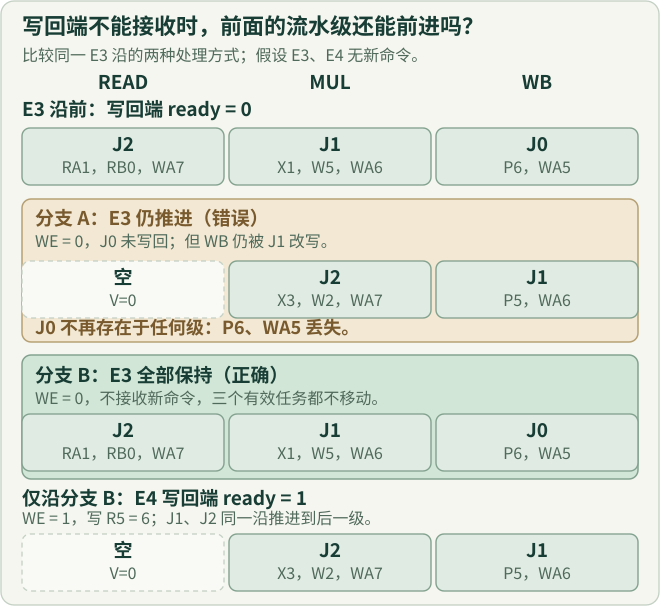
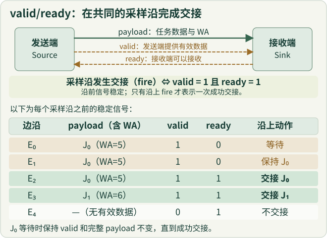
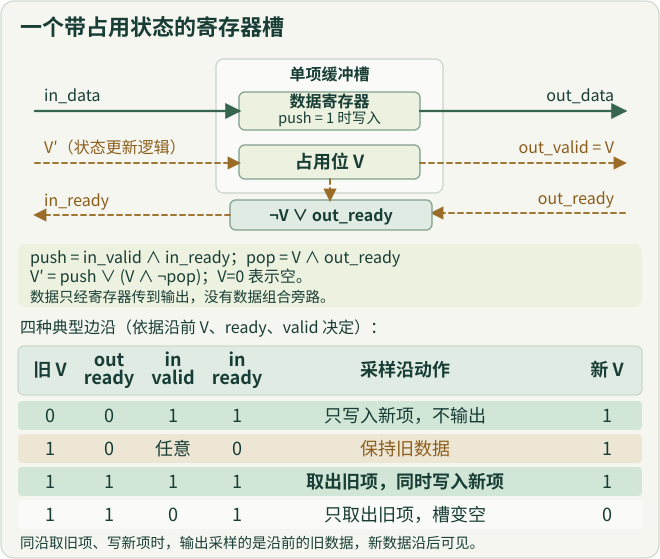
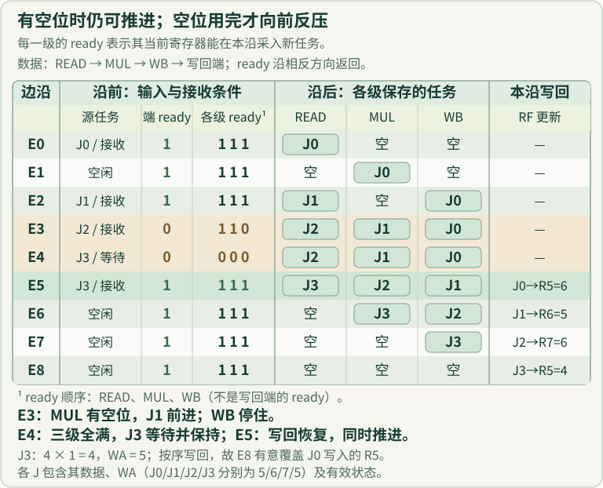
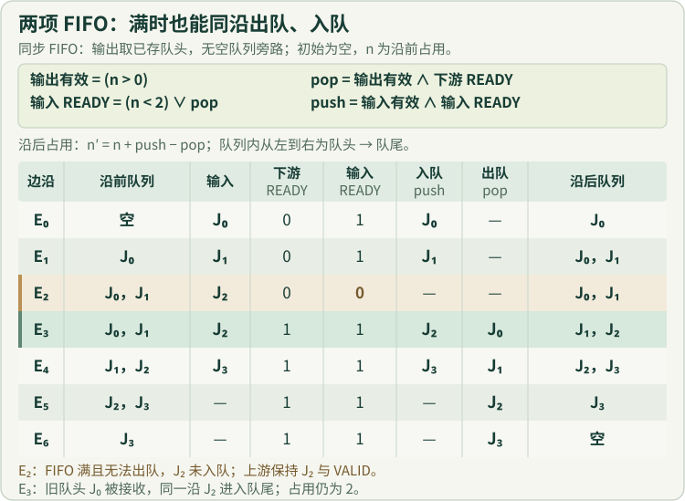
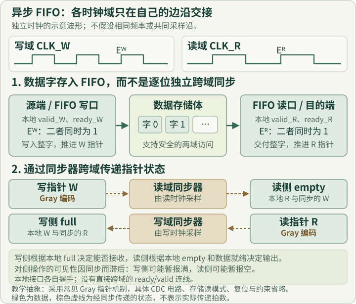

# 下游来不及接收数据，上游怎样知道何时停止？

[A06](a06-pipeline-and-throughput.md) 将读操作数、乘法和写回组织成三级流水线。只要每一级都能接收前一级的结果，就可以每拍推进一项任务。

但是，如果写回端这一拍不能接收乘积，另一份乘积又即将进入保存结果的寄存器 P，应该怎样处理？

最直接的办法是让有关寄存器暂时保持旧值，等下游能够接收后再继续推进。更进一步，上游还需要知道下游有没有空位，以及哪一拍真正完成了数据交接。

本文从 A06 的电路出发，逐步建立缓冲容量、握手与反压的概念。我们不再假设所有工作都能按原定的节奏向前移动。

## 如果写回通路暂时被占用，会发生什么？ {#stall}

回到 [A06 的三级流水线](a06-pipeline-and-throughput.md#pipeline-registers)。READ 级保存源编号与目标编号，MUL 级保存 X、W，WB 级保存乘积 P。每一级都保存该项工作的目标编号 WA 与有效位。

在 E₂ 沿后，三项工作的状态如下。

| 流水级 | 当前任务 | 保存的主要信息 |
| --- | --- | --- |
| READ | J2 | RA = 1，RB = 0，WA = 7 |
| MUL | J1 | X = 1，W = 5，WA = 6 |
| WB | J0 | P = 6，WA = 5 |

按 A06 的执行规则，E₃ 应当将 J0 的结果 6 写回 R5；与此同时，J1 的乘积 5 被采入 P，J2 的操作数被采入 X、W。

现在修改一个条件：假设 RF 的唯一写端口在 E₃ 被另一条通路使用，所以这里不允许写回 J0。用一个来自写回端的允许信号表示这种条件，先不讨论多个运算单元如何竞争写端口。

本篇始终假设 RF 中本组任务的源寄存器 R0～R4 不被其他工作修改，其他读写资源也不冲突。暂不讨论多个执行单元之间的依赖。

如果其他动作照常进行，J1 的 5 就会覆盖 P 中的 6，目标编号也会从 5 改成 6。J0 的结果既没有写入 RF，也没有保存在流水线中。

<figure class="micro-diagram" style="max-width:760px; margin:1.2rem auto" tabindex="0" aria-label="写回受阻时无条件推进丢失结果，与全流水线保持对照，窄屏可横向滚动" markdown="1">

<figcaption>两个分支是从 E₂ 沿后同一状态出发的独立对照。RF 不会因乘积已经算出，就自动完成写入。</figcaption>
</figure>

要避免丢失 J0，就不能让 P 在这个边沿采入新的乘积。不仅如此，P 旁的 WA 和有效位也要保持不变，否则恢复写回时可能向错误的地址写入数据。

再向前看：既然 WB 不能接收 J1，就必须保住 J1 的 X、W、WA 和有效位。X、W 所在级无法接收 J2，READ 级也不能被新的命令覆盖。

这种当前工作不能继续推进、需要保持有关状态的现象称为**停顿（Stall）**。

一种简单的实现是：从末级的接收条件产生全局允许信号，所有级只有在允许时才推进。停顿期间各流水线寄存器使用 [A01 的写使能机制](a01-state-and-control.md#enable) 保持状态；本通路的 RF 写使能也为 0。

假设 E₄ 恢复写回许可，这三个已经保存好的工作便可以继续推进。时钟本身一直运行，停止更新的是相应的状态，不是所有组合电路或整颗芯片。

但是，这种统一停止的方式可能使本来还有空位的级也停下来。要解决这个问题，我们先单独观察两个相邻电路怎样交接一项数据。

## 怎样知道一份数据真正被接收了？ {#valid-ready}

假设 P 已经保存 J0 的乘积和目标编号。发送方希望把它交给写回端。

[A06](a06-pipeline-and-throughput.md#pipeline-registers) 已经让每一级保存有效位。用 VALID 向接收方表示当前输出是不是一项真实的工作。

仅有 VALID 仍不够。它说明发送方有数据，却没有说明接收方能否接收。因此让接收方向发送方提供另一个信号 READY，表示它允许在本次采样沿接收一项数据。

| 信号 | 谁提供 | 表示什么 |
| --- | --- | --- |
| DATA | 发送方 | 要交接的内容，例如乘积 P 和目标编号 WA |
| VALID | 发送方 | 当前 DATA 是一项有效的工作 |
| READY | 接收方 | 本次能够接收一项工作 |

DATA 在这里不只包含数值。只要接收端执行该项工作需要的信息，都应作为同一份数据一起传递。

本篇先使用同一时钟域的教学接口。信号应在采样沿附近满足时序要求。在一个上升沿，只有 VALID 和 READY 同时为 1，才认为这一项数据真正完成了交接。

这称为 **valid/ready 握手（Handshake）**。为便于记录交接，将这个条件记为 FIRE：

**FIRE = VALID ∧ READY**

| VALID | READY | 在采样沿发生什么 |
| ---: | ---: | --- |
| 0 | 0 | 没有有效数据，接收端也未接纳 |
| 0 | 1 | 接收端可以接纳，但没有数据传递 |
| 1 | 0 | 有一项有效数据，当前未传递 |
| 1 | 1 | 传递一项数据 |

发送方提出一项有效工作之后，如果 READY = 0，就必须保持 VALID 及该项 DATA，直到握手发生。发送方不能看到 READY 为低就撤回或改成下一项工作。

否则，接收方还没有取得 J0，发送方就切换到了 J1，仍会造成与上一节相同的数据丢失。

### READY 一直为 0，什么时候才算交接？

做一个只观察单个接口的独立实验。发送方已经准备好 J0；接收方暂时不允许接收，直到 E₂ 才允许。

<figure class="micro-diagram" style="max-width:760px; margin:1.2rem auto" tabindex="0" aria-label="同一时钟域的有效就绪握手和连续交接时序，窄屏可横向滚动" markdown="1">

<figcaption>表中信号值表示采样沿之前已准备好的值。J0 在 E₀ 和 E₁ 没有被接收，不应计为两次传递。</figcaption>
</figure>

这个过程中，VALID 连续为 1 并不意味着每拍都发生交接。直到 E₂，接收方才第一次收下 J0。

E₂ 沿后，发送方才可以将 DATA 换为下一项 J1。如果下一项已经准备好，VALID 不必先变成 0。因此 E₃ 可以直接完成第二次传递。

READY 为 1 也只代表本次允许接收，不保证下一拍仍有空间。发送方只依据实际握手前进，不根据其他时刻的 READY 推测交接已经完成。

为了避免双方都等待对方，本文采用以下约定：发送方有可供传递的工作时，应当声明 VALID，不把 READY 已为 1 作为首次声明的前提。接收方则可以依据容量等条件控制 READY，也可以等看到 VALID 再决定是否接收。

实际总线也使用类似的机制，例如 [Arm AXI 规范 Issue L，A2.3 节的通道握手](https://documentation-service.arm.com/static/68b03beb01ae952d9559f9eb)。本文只讨论自身的单接口契约，不定义完整 AXI 通道；AXI 还要求接口输入、输出之间不存在组合路径（见该规范 A2.1.1 节）。

## 一个寄存器有数据时，就一定不能再接收了吗？ {#elastic-slot}

现在把刚才的握手机制放到 WB 入口寄存器上。向前连接 MUL 级，向后连接写回端。为了让符号更容易理解，分别给两个接口加上 in 和 out 前缀。

记保存内容的有效位为 V。V = 0 表示这个位置没有有效工作；V = 1 表示里面已有一项尚未交付的工作。本例复位后 V = 0。

输出 DATA 取自寄存器的 Q，输出 VALID 直接来自 V。我们暂时不允许输入数据绕过寄存器直接送到输出端。

**out_valid = V**

首先，如果 V = 0，这个槽位是空的，即使下游不允许接收，它也可以先保存上游的一项数据。

如果 V = 1 呢？当 out_ready = 0 时，旧数据无法交给下游，确实不能接收新的数据。

但当 out_ready = 1 时，下游可以在同一个边沿采走旧数据，寄存器也可以在这个边沿采入新数据。由于各寄存器采的是沿前已经稳定的输入，不会把刚写入的新值当作这一沿的旧输出。

因此，在本例的单槽寄存器中，只有下面两种情况允许接收新输入：当前没有有效工作，或者当前的工作能够在本沿离开。

**in_ready = ¬V ∨ out_ready**

<figure class="micro-diagram" style="max-width:740px; margin:1.2rem auto" tabindex="0" aria-label="单槽弹性寄存器接收和交付条件，窄屏可横向滚动" markdown="1">

<figcaption>out_valid 来自当前 V；in_ready 由空位或同沿交付条件得到。图中 push、pop 分别表示 in_fire、out_fire；没有从输入直接到输出的数据旁路。</figcaption>
</figure>

如果新数据在这一沿被接收，保存它的内容并把 V 置为 1。否则，如果旧数据已被下游收走，则将 V 置为 0；如果两种动作都未发生，则保持原来的状态。

用两个接口的握手条件就能描述这些动作。

- in_fire = in_valid ∧ in_ready：接收上游的新项。
- out_fire = V ∧ out_ready：交付槽位中的旧项。

| in_fire | out_fire | 在边沿更新什么 |
| ---: | ---: | --- |
| 0 | 0 | 数据和 V 保持 |
| 1 | 0 | 保存新数据，V = 1 |
| 0 | 1 | V = 0，旧数据位可不清除 |
| 1 | 1 | 交付沿前的旧数据，保存新数据，V = 1 |

回忆 A01 的保存数据与控制写使能：这个电路不需要新的存储原理。只在 in_fire 为 1 时写入 DATA。由上表得到有效位的下一值：

**V 的下一值 = in_fire ∨ (V ∧ ¬out_fire)**

尤其要注意，满槽可以在同一个沿交付并接收，因此只要上下游都能跟上节奏，就可以每拍交接一项数据，而不必等到下一拍确认槽位已经空了。

[Chisel Queue 文档：pipe 与 flow 选项分别控制满槽接续和空槽旁路](https://www.chisel-lang.org/api/latest/chisel3/util/Queue.html)

## 如果某一级还空着，其他级也需要一起停吗？ {#elastic-pipeline}

将以上单槽结构应用到 A06 的三个流水级入口。它们保存的内容不同，遵循的接纳条件却相同：只有能够保住原来的工作，才允许接收另一项工作。

设 r_READ、r_MUL、r_WB 分别为三个级入口对上游的 READY。相应的有效位是 V_READ、V_MUL 和 V_WB，外部写回许可为 r_out。

从末级向前看：

- r_WB = ¬V_WB ∨ r_out。
- r_MUL = ¬V_MUL ∨ r_WB。
- r_READ = ¬V_READ ∨ r_MUL。

这里的 r 是一个位置能否接纳输入的信号。MUL 的输出有效位来自它保存的任务，但输出数据为该任务的乘积；READ 的输出则是该命令读出的操作数。由于本例的源寄存器保持不变，等待期间这些读出值也保持稳定。

各级保存的内容在输入握手时更新。如果没有有效输入但旧项离开，就把对应的有效位置 0。如果有效工作尚未离开，便保持数据和控制信息。RF 的本通路写使能 WE 等于 WB 的输出握手条件。

因此，写回端是否能够接收会影响 WB，WB 能否腾出位置又影响 MUL，最后可能影响新命令的入口。接纳能力的变化沿着数据流动的反方向传到上游，这就是**反压（Backpressure）**。

### 先让中间一级留出一个空位

另做一次实验。继续使用前面三项任务，并加入 A01 的第四组操作数：

| 新任务 | RA、RB | X、W | WA | 乘积 |
| --- | --- | --- | ---: | ---: |
| J3 | 4、2 | 4、1 | 5 | 4 |

J3 不读取前三项产生的结果。它也写 R5，但本例按顺序写回，所以 J3 将在 J0 写入 6 之后，把 R5 更新为 4；这是有意设置的两次写入。

假设 E₀ 接收 J0，E₁ 没有新输入，E₂ 接收 J1。经过两拍，WB 中已有 J0，MUL 的槽位为空，READ 中已有 J1。

现在令写回端在 E₃ 和 E₄ 都不允许接收，观察这条流水线是否必须全部停住。

- E₃ 沿前，J0 无法离开 WB，因此 r_WB = 0。
- MUL 中没有有效工作，它可以先接收 J1，所以 r_MUL = 1。
- J1 可以离开 READ，所以 r_READ = 1，入口还能接收新命令 J2。

等 E₃ 过去，三个槽位都已占满。在 E₄ 写回仍被阻止，这次才需要让三个槽位都保持。J3 即使已经准备好，也必须等待入口的 READY 恢复。

<figure class="micro-diagram" style="max-width:780px; margin:1.2rem auto" tabindex="0" aria-label="下游阻塞时空流水级继续接纳工作，随后反压传播与恢复，窄屏可横向滚动" markdown="1">

<figcaption>READY 是沿前针对三个入口计算的接纳许可；表中槽位显示边沿之后的状态。空位能够先吸收上游的一项工作。</figcaption>
</figure>

E₅ 恢复写回。J0 被写入 R5，J1 在这个沿进入 WB，J2 进入 MUL，J3 进入 READ。四个动作同时发生，但每个接收方都采入沿前准备好的内容。

将这次实验继续走完：

| 边沿 | 写回端 READY | 接收的新任务 | 沿后 READ / MUL / WB | 本沿写回 |
| --- | ---: | --- | --- | --- |
| E₀ | 1 | J0 | J0 / — / — | — |
| E₁ | 1 | — | — / J0 / — | — |
| E₂ | 1 | J1 | J1 / — / J0 | — |
| E₃ | 0 | J2 | J2 / J1 / J0 | — |
| E₄ | 0 | —（J3 等待） | J2 / J1 / J0 | — |
| E₅ | 1 | J3 | J3 / J2 / J1 | R5 ← 6 |
| E₆ | 1 | — | — / J3 / J2 | R6 ← 5 |
| E₇ | 1 | — | — / — / J3 | R7 ← 6 |
| E₈ | 1 | — | — / — / — | R5 ← 4 |

恢复运行后，所有任务都恰好写回一次，且执行顺序没有改变。

### 气泡和停顿有什么不同？

E₂ 沿后，MUL 为空。这种不包含有效工作的流水槽位称为**气泡（Bubble）**，即有效位为 0。不管里面保留着什么比特，都不代表需要执行的任务。

E₄ 则不同。三个槽位都有有效工作，只是末级无法向后交付，导致它们都必须保持。这是停顿，而不是把三个有效位置 0。如果这样清除有效位，就会丢失任务。

气泡可以出现在填充、排空或输入不连续时。在本例中，需要同时追踪槽位是否有效，以及它是否允许接纳，才能判断下一沿该怎样更新。

这种允许各级依据自身占用和下一级接纳条件独立推进或保持的流水线，通常称为**弹性流水线（Elastic Pipeline）**。

它不保证每项工作总是以固定的延迟到达输出，但可以在下游短暂繁忙时利用尚未占用的槽位。反压不是简单地停止整条流水线，而是防止超过现有接收空间。

## 如果下游经常停两三拍，能否先保存更多结果？ {#fifo}

刚才的 WB 只有一个保存结果的位置，其他级保存的又是还没写回的任务。如果下游短暂阻塞，我们可以给已算出的乘积增加一些专用缓冲空间。

把一组有顺序的待交付结果放在两个槽位中。新的结果依次放入队尾，下游总是先取走队首，最早进入的结果先离开。

这种先进先出（First In, First Out）的队列称为 **FIFO**。

FIFO 可以用寄存器或合适的存储阵列实现。以一个两槽的同步 FIFO 为例，除两份存储空间外，还要记录队首、下一次写入的位置以及有效项的数量。容量为 2，当前占用数记为 n，复位后 n = 0。

本例使用和前面相同的 valid/ready 接口。FIFO 不允许在为空时让新输入直接绕过存储到输出；但已满时，允许在取走旧队首的同一个边沿向队尾写入新项。

因此：

- out_valid = (n > 0)，只有非空时才提供有效队首。
- pop = out_valid ∧ out_ready，出队。
- in_ready = (n < 2) ∨ pop，有空位或本沿能腾出空位。
- push = in_valid ∧ in_ready，入队。

如果入队发生，写指针移到下一个槽位；如果出队发生，读指针移到下一个槽位。使用循环组织时，指针到末尾可以回到开头。满和空时两个指针的位置可能相同，需要占用数或其他状态加以区分。

无论如何组织物理存储，占用数都要符合以下关系：

**n 的下一值 = n + push − pop**

这里 push、pop 取 0 或 1。两者都为 1 时，占用数不变，但逻辑队首与队尾所对应的工作已经变化。

### 两个槽位怎样吸收暂时的停顿？

这次只观察 FIFO 与上下游的交接。四份乘积 J0、J1、J2、J3 已准备好，将要按顺序送进 FIFO。它们也包含各自的目标编号。

假设写回端从 E₀ 到 E₂ 都不允许接收，而上游可以持续提供工作。从空 FIFO 开始，观察两个槽位被用完的过程。

<figure class="micro-diagram" style="max-width:780px; margin:1.2rem auto" tabindex="0" aria-label="两槽同步FIFO的入队、出队、填满、反压和恢复，窄屏可横向滚动" markdown="1">

<figcaption>这是独立的 FIFO 接口实验，边沿编号重新从 E₀ 开始。图中的队列按逻辑顺序排列，不是固定物理地址；入队和出队列的任务名表示动作发生，“—”表示没有发生。没有空队列数据旁路。</figcaption>
</figure>

E₀ 和 E₁，先后保存 J0 和 J1。虽然下游没有接收任何工作，上游仍然可以交付两份已经产生的结果。

到 E₂，FIFO 已满，且这一沿没有出队，所以 in_ready 为 0。此时上游必须保住 J2，不能把它直接覆盖到某个槽位。

到 E₃，写回端恢复接收。队首 J0 可以在这一沿离开，新的 J2 也可以占据刚腾出的容量。因此同一沿既出队又入队，队列中的逻辑顺序变为 J1、J2。

满队列中的读、写指针可能指向同一个物理位置。必须保证下游在该沿取得的是旧队首，而不是同一沿新写入的值。本文的小型寄存器组织可满足这一要求。其他 FIFO 是否允许满时同时出入队，需要按具体实现确认。

继续传递，E₄ 交付 J1 并接收 J3，E₅ 交付 J2，E₆ 交付 J3。FIFO 最终回到空状态。

### FIFO 能让系统一直处理得更快吗？

FIFO 与刚才的单槽缓冲解决的是容量问题，而不是运算速度问题。它可以让上游在下游暂时繁忙时继续交付，减小短时速率不匹配带来的停顿。

但如果上游长期以每拍一项的速度产生结果，下游只能每两拍接收一项，那么每两拍会多出一项尚未交付的结果。只要持续足够长时间，任何有限容量的 FIFO 都会填满。

此时上游仍须降低实际交付速率。增加 FIFO 深度能吸收更长的突发，却不能消除持续存在的速率差，也可能增加数据在队列中的等待时间。

## READY 信号不断向前传播，会不会也限制时钟频率？ {#ready-path}

刚才的三级弹性流水线用组合逻辑逐级计算 READY。假设所有槽位都满，末级的接收条件发生变化，入口 READY 也要相应变化。

逻辑链延伸到更多的流水级时，接纳信号经过的门和连线可能很多。它同样要赶在采样沿之前稳定，可能成为 [A06 所讨论的关键路径](a06-pipeline-and-throughput.md#critical-path)。

是否可以像切分数据通路一样，把反压信号也用寄存器隔开？

如果只是让“当前是否可接收”的信号晚一拍传到上游，却不提前安排容量，就会出现新问题。假设接收位置原来只有一个空槽，上游已经看到 READY 为 1。数据 A 被采入后位置变满，旧的 READY 却还有效。

如果上游继续给出有效的 B，并在下一沿仍看到 READY = 1，那么按接口契约 B 已经交付。接收方不能事后忽略这次交接；如果没有地方保存 B，就会出现覆盖或溢出。

因此，给 READY 增加一级寄存器不能只考虑时序，还要考虑在停止许可到达前允许多少新数据进入。若反压晚一拍且至多每拍传递一项，则需要保证能接住这一项额外的传递。

一种选择是在接收侧增加备用槽位，用来暂存反馈还未到达期间的工作。也可以按已经授权的槽位数量限制发送，这样不用实时把每次空位变化传播很远。

例如 [AMD AXI Register Slice PG373 的 Fully Registered 模式](https://docs.amd.com/r/en-US/pg373-axi-register-slice/Fully-Registered) 使用深度为 2 的缓冲，使握手信号经过寄存器后仍可连续交付。

另一种方式见[Credit 如何控制逐跳发送与反压？](../../interconnect/NOC/02-router-microarchitecture/credit-based-flow-control.md)。本篇不展开互连协议，只需理解反压反馈也有延迟和容量成本。

## 如果两个电路不使用同一个时钟，还能在同一沿握手吗？ {#clock-domain-crossing}

前面所有实验都使用同一个时钟。发送方和接收方能够在同一个有效边沿判断 VALID 和 READY，因而共同确定一项工作是否已经交付。

假设乘法通路与结果接收端使用两个没有固定相位关系的时钟。写入方的上升沿和读取方的上升沿不再是同一组时刻，不能直接用同一个沿来判断跨域交接。

而且，发送方改变信号的时刻可能恰好落在接收触发器的采样窗口内，造成采样不确定甚至亚稳态。物理原因见[半导体与电路基础：触发器的采样窗口](../../semiconductor-foundations/latch-and-divider/README.md#timing)。

对于在足够长时间内保持稳定的单比特信号，可以在接收域使用多级同步寄存器，给可能进入亚稳态的第一级触发器更多恢复时间。这能降低亚稳态向后传播的概率，但不能保证风险为零。

如果是短脉冲，它还可能完全落在接收域的两个采样沿之间而漏采。

如果传递的不只是一个比特，而是一个数呢？例如输出从 011 变化到 100。不同的比特可能在不同的边沿被识别，如果逐位独立同步后再拼接，接收方可能得到既不是旧值也不是新值的组合。

跨时钟域交接（Clock Domain Crossing，CDC）不仅要提高采样可靠性，还要让一整项工作被正确接收一次。对于不频繁的多位数据交接，可以使用经验证的请求与确认机制，让数据在交接期间保持稳定，并满足相应的跨域约束。

如果需要持续传递多位数据，可以在两端之间使用一个**异步 FIFO（Asynchronous FIFO）**。

<figure class="micro-diagram" style="max-width:780px; margin:1.2rem auto" tabindex="0" aria-label="不同写读时钟域之间的异步FIFO和本地接纳条件，窄屏可横向滚动" markdown="1">

<figcaption>两个接口分别在自己的时钟域完成交接，并非让一个域直接采样另一个域的整个 valid/ready 接口。</figcaption>
</figure>

与同步 FIFO 不同，写入方在写时钟的边沿推进写位置，读取方在读时钟的边沿推进读位置。存储空间必须支持按这种组织方式安全地存取数据。

常见异步 FIFO 让读写位置采用**格雷码（Gray Code）**编码，再通过跨域同步器传向对方。格雷码的相邻计数值只变化一个比特，在符合指针更新和跨域路径约束的条件下，有助于避免多位指针采样时得到不一致的状态。

读写两侧根据本域状态和同步后可见的远端位置，分别判断是否还有可读数据或可写空位。传的是表示存储位置的状态，不是把多位运算结果各自同步后拼起来。

这也说明了为何一个位置已经腾出，写入端却不一定立即看到可接收的 READY：释放空间的信息还需要经过跨域同步。

同样，一项数据已经写入物理存储后，读取端也要等到本域确认有有效数据，才能开始相应的读取动作。

异步 FIFO 并没有消除时钟域之间的延迟。格雷码、同步器和两侧复位还需要满足实现的具体要求。本文只建立交接和容量的观察模型，不设计完整的 CDC 电路。

[AMD PG327：独立时钟 FIFO](https://docs.amd.com/r/en-US/pg327-emb-fifo-gen/Independent-Clocks-Block-RAM-and-Distributed-RAM) · [Cummings，SNUG 2002：使用格雷码指针的异步 FIFO 设计](https://www-inst.eecs.berkeley.edu/~cs150/fa10/Collections/Papers/CummingsSNUG2002SJ_FIFO1.pdf)

[互连系列中的跨时钟域采样、同步与流控](../../interconnect/BUS/04-microarchitecture-integration/bridge-cdc-width-adaptation.md#cdc跨域采样同步和流控)

## 接下来需要解决什么问题？ {#next}

回到三级流水线。当入口接收一项工作时，流水线中就多一项尚未完成的任务。一次写回成功，这项工作才真正离开本文观察的边界。

在没有取消、丢弃或重复工作的条件下：

**已接收的任务数 − 已写回的任务数 = 当前流水线中的有效任务数**

例如在 E₄ 沿后，接收了 J0、J1、J2，尚未完成写回，三个槽位全部有效。E₅ 接收新任务 J3，同时写回 J0，仍有三项工作留在流水线中。

这样的记录有助于检查某项工作是否丢失、重复，或者在未释放容量时被覆盖。若加入 FIFO，则还应把尚未交付的 FIFO 项计入同一个观察边界，并核对输出顺序。

不过，入口 READY 为 1 只说明这里有能力接收一项工作，并不意味着任意工作都可以立即计算。例如 A06 的累加反馈依赖就要求先等到上一份部分和可用。

如果有几项工作已经具备所需的数据，又都希望使用同一个计算单元，控制电路应该选择哪一项？A08 将继续研究依赖、在途状态、资源占用和调度。

[返回共同计算基础导读](README.md)。
