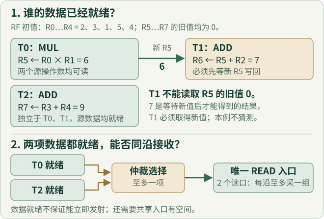
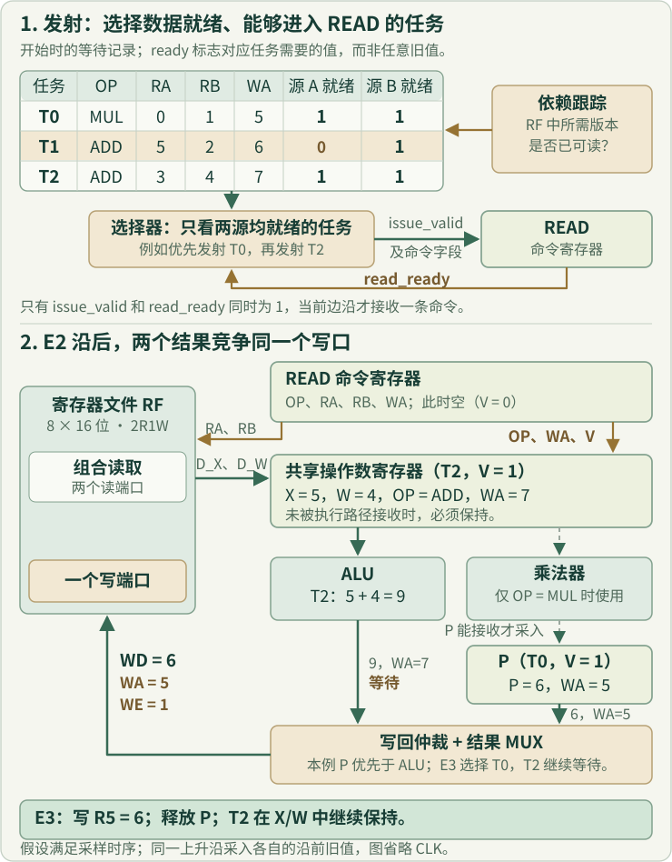
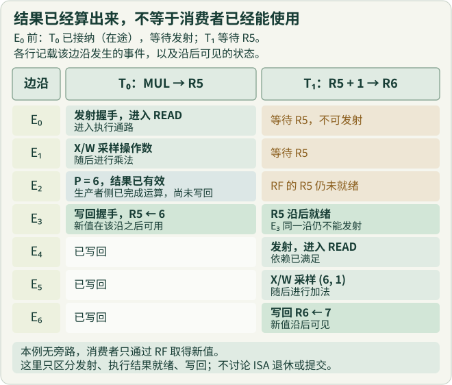
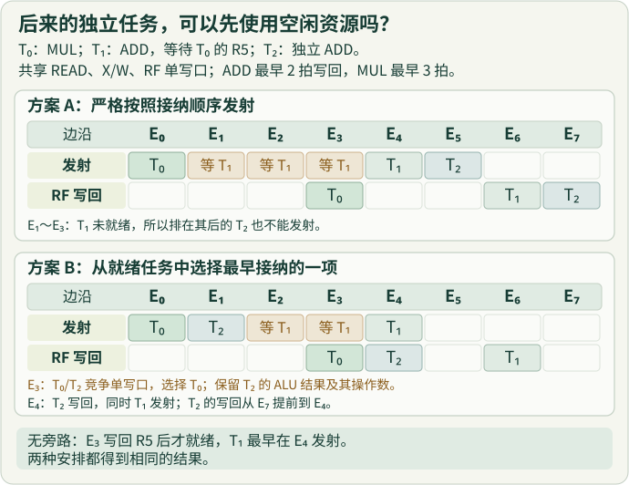
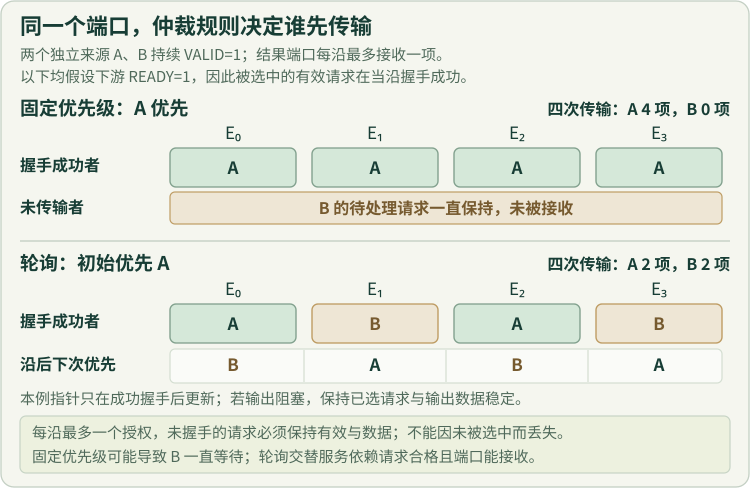

# 多项工作同时就绪，谁先使用计算资源？

[A07](a07-handshake-and-backpressure.md) 让流水线能够根据下游的接纳能力决定何时推进。一项工作不能交付时，要保存它的数据和控制信息；有空位时，则可以接收新的工作。

现在有三项运算等待执行。其中两项所需的数据已经准备好，另一项还需要等待第一项的结果。即使运算电路可以接收新数据，也不是任意一项工作都能立即开始。

控制电路需要回答两个不同的问题：哪些工作已经具备执行所需的条件？在这些工作中，哪一项可以先使用当前的硬件资源？

本文将前几篇的数据通路、流水线和握手组织起来，逐步观察依赖、就绪、资源占用、仲裁和执行过程。执行顺序不再只由一个计数器或固定流程决定。

## 明明寄存器中有数，为什么还不能使用它？ {#dependency}

回到 [A05 的寄存器文件与运算单元](a05-datapath-and-control.md#functional-units)。RF 有八个十六位寄存器，两个读口和一个写口。仍准备 R0～R4 中的 2、3、1、5、4，R5～R7 初值为 0。

这次不再处理 A06 的三项独立乘法，而是提出下面三项任务。任务的编号 T0、T1、T2 表示其原有顺序。

| 任务 | 运算 | 期望结果 |
| --- | --- | --- |
| T0 | R5 ← R0 × R1 | R5 ← 6 |
| T1 | R6 ← R5 + R2 | R6 ← 7 |
| T2 | R7 ← R3 + R4 | R7 ← 9 |

第一项应该得到 6。第二项所需的其中一个输入不是原来保存在 R5 中的 0，而是第一项产生的 6。若直接读取旧值 0，第二项得到的结果就会变成 1。

这就是**数据依赖（Data Dependency）**：一个工作需要使用另一项工作产生的数据。T0 是新值的生产者，T1 是这个新值的消费者。本文先追踪这种真正的值依赖；多个任务对同一位置读写时还会有其他顺序约束。

相反，T2 的两个输入都已准备好。它不读取前两项产生的结果，也不改变前两项需要读取或写入的位置。因此，只要具备所需资源，T2 就可以在 T1 之前执行。

<figure class="micro-diagram" style="max-width:740px; margin:1.2rem auto" tabindex="0" aria-label="三项任务之间的数据依赖与同时申请共享资源的区别，窄屏可横向滚动" markdown="1">

<figcaption>数据依赖是结果之间的必要关系；两项独立工作可能因为使用同一硬件而暂时不能同时执行。</figcaption>
</figure>

如果增加第二套读取和运算资源，T0 与 T2 就可能并行开始。可是再增加一套 ALU，也不会使 T1 在 T0 提供新值之前得到正确输入。

因此，必须把等待数据和等待硬件资源分开。这两类等待的原因不同，解决方法也不同。

## 控制电路怎样知道哪些数据已经可以使用？ {#data-ready}

硬件需要有一种方法记录某项任务正在等待什么。仅观察 RF 的数据输出无法判断：旧值 0 也是一个合法的十六位数。

假设这三项命令已经通过入口接口被接收，并且在 E₀ 之前全部保存在一个等待执行的命令表中。每项记录包括在 A05 中使用过的 OP、RA、RB、WA。

为简化本例，约定在这批工作中，每个目标寄存器只有一个写入者；T1 需要的是 T0 写入 R5 的新值。各任务所需的数据版本产生后，在采入操作数前不会被无关工作覆盖。本例允许按依赖关系改变独立任务的执行顺序。

我们可以为 RF 添加一组记录数据状态的位。某个位置的就绪位为 1，表示它保存的是本次计算可以使用的值；为 0，表示该位置还在等待某项工作产生的新值。

在本例中，登记这些任务时将 R5、R6、R7 的就绪位清零，R0～R4 保持为 1。

| 位置 | RF 现在保存的值 | 就绪位 | 原因 |
| --- | ---: | ---: | --- |
| R0～R4 | 2、3、1、5、4 | 1 | 输入已经准备好 |
| R5 | 0 | 0 | 等待 T0 写回 |
| R6 | 0 | 0 | 等待 T1 写回 |
| R7 | 0 | 0 | 等待 T2 写回 |

对于每项任务，只需要按 RA、RB 选出相应的两个就绪位，再对它们做与运算，就能判断两个操作数是否都可用。这里只读取单独的就绪状态位，不占用 RF 的两个十六位数据读口。

| 任务 | 源地址 | 两个源的就绪位 | 操作数是否就绪 |
| --- | --- | --- | --- |
| T0 | R0、R1 | 1、1 | 是 |
| T1 | R5、R2 | 0、1 | 否 |
| T2 | R3、R4 | 1、1 | 是 |

稍后，当 T0 的结果真正写入 R5 时，将 R5 的就绪位置为 1。这样 T1 就不再需要等待这个数。

这是一种教学用的数据就绪记录。它成立的关键是：就绪位能够明确表示正在等待的那一份值。

如果有多项任务会先后写入同一个编号，或者较早的任务仍然需要其中的旧值，就不能直接套用本例的就绪位规则。需要保留正确的数据版本和执行次序，这些问题将在 CPU 专题进一步讨论。

## 两项工作都已准备好，为什么仍然只能选一项？ {#issue}

现在 T0 和 T2 的操作数已经就绪。可以同时让乘法器计算 T0、让加法器计算 T2 吗？

回看 A05 的两个 RF 读口与共享的 X、W。即使 ALU 和乘法器是两套运算电路，在同一个读取阶段，两个读口也只能提供一组独立选择的双源操作数，而不是两组。

为了具体观察执行顺序，从 A05、A06 的结构构造下面这个教学电路。

- READ 入口保存一项命令，负责从 RF 读取两个操作数。
- 执行入口共享 X、W、OP、WA 和有效位，一次保存一项工作。ADD 使用 ALU，MUL 使用乘法器。
- 整数乘法结果先进入寄存器 P，随同目标编号和有效位一起保存；ALU 的结果可以由 X、W 的组合逻辑直接提供给写回 MUX。
- RF 只有一个写口。ALU 结果与 P 中的乘积都可能请求这个写口。

和 A07 一样，各级只有在成功交接时才能更新。本例假设所有逻辑路径满足时序，不提供从运算单元直接到其他任务的结果旁路，也没有其他通路使用 RF 写口。

<figure class="micro-diagram" style="max-width:780px; margin:1.2rem auto" tabindex="0" aria-label="等待命令、发射选择、共享读操作数入口和写回仲裁的数据控制通路，窄屏可横向滚动" markdown="1">

<figcaption>只画本例需要的 ALU、整数乘法与控制，不包含 A05 的 FPU 和 ACC。各项任务的目标编号及有效位随数据保存。</figcaption>
</figure>

我们将从等待表中选出一项工作，把它交给 READ 命令入口的动作称为**发射（Issue）**。

在本例中，以命令和 READ 入口之间实际发生 valid/ready 握手的边沿作为发射时刻。真正读取操作数和开始组合运算发生在随后的阶段。其他设计可能采用不同的发射边界。

### 操作数就绪不是唯一条件

要发射一项任务，本例至少需要满足以下条件：

- 两个操作数均已就绪；
- OP 是本通路支持的运算类型；
- READ 入口可以接纳一项工作；
- 如果有多个候选，当前任务获得选择许可。

这里的操作数就绪表示数据可用；[A07 的 READY](a07-handshake-and-backpressure.md#valid-ready) 则表示接收位置能接纳下一项工作。虽然都与“可以继续”有关，但它们描述的条件不同。

例如，当 READ 只剩一个位置时，即使两项任务的数据均已准备好，也只能在一个边沿向该入口交付一项命令。

如果 READ 入口已经保存旧命令，只要旧命令能在这一沿移入下一阶段，它就可以同时接收新命令。这个接纳条件与 A07 中的单槽弹性寄存器相同。

因此，控制电路不必等所有运算完全结束才允许发射。对于可以重叠执行的流水线，应观察相应的入口空间和资源条件，而不只判断某个运算单元内部是否还有工作。

本例在发射时不预留未来的写口。READ 有空位即可接纳数据已就绪的命令。如果随后执行或写回资源不可用，就用 A07 的规则暂存并等待。另一种设计也可以在发射前预留后续资源。

### 怎样在多个候选中选择一项？

现在 T0、T2 都可以提出对 READ 的使用请求。T1 因为缺少操作数，暂时不参与此次选择。

从多项请求中选出可以使用某个共享资源的一项或若干项工作的机制，称为**仲裁（Arbitration）**。

本例每次只能选择一项，先采用最简单的规则：在数据已就绪的候选中，优先选择原有顺序较早的任务。因此 E₀ 选择 T0。

如果接收端未提供 READY，即使候选已经被选中，它也还没有发射。只有完成握手，才能将这项工作从等待表中移走，由 READ 入口保存。

如果控制器已经向入口声明了一个有效命令，但还未被接收，就应按 A07 的握手约定保持该命令，而不能每拍把选中的任务任意换掉。

[BOOM 发射单元文档](https://docs.boom-core.org/en/latest/sections/issue-units.html) 展示了一种具体处理器如何根据操作数就绪状态与执行端口能力选择指令。这里不借用其完整乱序处理器结构。

## 若加法和乘法都已经算出结果，谁先写回？ {#writeback-arbitration}

沿着本例逐拍观察。

E₀，T0 发射，进入 READ。接下来 RF 产生 2、3 两个操作数。

E₁，T0 的 X、W 被采入执行入口，READ 同时接收已经就绪的 T2。T1 仍等待 R5。

E₂，乘法器产生的 6 被采入 P。与此同时，T2 的 5、4 被采入 X、W，OP 为 ADD，WA 为 7。

此时乘法器已经完成 T0 的计算。而 T2 的加法器可以在 E₂ 到 E₃ 之间产生 9。

因此在 E₃ 到来之前，有两份可以写回的结果：

| 结果来源 | 数据 | 目标 |
| --- | ---: | --- |
| P（T0） | 6 | R5 |
| ALU（T2） | 9 | R7 |

A05 的写口只有一组 WA、WD 和 WE。同一边沿不能向两个不同地址写入两个不同的数。

这次需要在已经准备好的写回结果之间再次仲裁。为简化电路，本例规定 P 的有效写回请求优先于 ALU 的请求。因此 E₃ 选择 T0，由写回 MUX 选出 P 的数据及对应 WA，并使能 RF 写入。发射仲裁与写回仲裁不必使用同一种规则。

T2 虽然已经计算出 9，却没有获得此次写回许可。要保住 9，可以保持产生它的 X、W、OP、WA 与有效位，使 ALU 的输出继续稳定。在这个例子中不用额外的 ALU 输出寄存器。

最终，E₃ 写入 R5 = 6，P 中的 T0 可以离开；E₄ 写入 R7 = 9，执行入口中的 T2 才能离开。

与 A07 一样，各保存位置只有在原项离开或为空时才允许接收新项。在本例中，执行入口有两种交付方式：ADD 等待自身写回获准；MUL 等待 P 可接纳乘积。

例如 E₂ 的 T0 成功将乘积交给 P，执行入口就能在同一沿接收 T2。E₃ 的 T2 没有成功写回，不能接收新操作数。离开的项若没有被新项替换，就清除所在位置的有效位。

这说明一个任务可能在已经得到正确的计算结果之后，仍占用某些硬件。算术完成并不代表这项工作的所有资源都已经释放。

对于共享写口，仲裁选择必须与 DATA、目标编号、WE 以及发送方的交接条件保持一致。没有成功写回的输出不能被随意清除。

实际设计中也会共享不同运算单元的写回端口，例如 [CORE-V CV32E40P v1.8.0 的执行路径](https://docs.openhwfoundation.org/projects/cv32e40p-user-manual/en/cv32e40p_v1.8.0/pipeline.html)。其具体冲突处理取决于该处理器的实现。

## 结果已经算出，依赖它的任务什么时候才能开始？ {#result-availability}

E₂ 沿后，T0 的乘积 6 已经保存在 P。为什么此时仍不能发射 T1？

因为本例规定操作数只能从 RF 读出。即使 P 已经保存新的计算结果，如果 R5 还没有被更新，读口就无法取得 T1 所需的 6。

直到 E₃ 发生成功写回，R5 的数据及就绪状态才会在沿后更新。在 E₃ 那个边沿，发射选择依据的仍是沿前的就绪状态。本例不使用即将写回的预测或提前通知，即使某种设计有办法让消费者在 E₄ 读到新值，也不会让 T1 在 E₃ 发射。

E₄ 时，T1 才能根据已经更新的就绪位参加选择并发射。E₅ 采入实际的操作数 6、1，随后执行加法，在 E₆ 把 7 写入 R6。

<figure class="micro-diagram" style="max-width:780px; margin:1.2rem auto" tabindex="0" aria-label="T0从接纳到写回及新值对T1可用的逐拍生命周期，窄屏可横向滚动" markdown="1">

<figcaption>从等待表接纳到计算结果产生，再到成功写回和消费者可以使用，新数据跨过了几个不同的观察边界。图中没有结果旁路。</figcaption>
</figure>

回忆 [A06 的累加反馈依赖](a06-pipeline-and-throughput.md#feedback-dependence)。下一次累加要等到旧 ACC 更新后才能使用新值。这里原理相同，只是消费者在另一项任务中。

那能否直接把 P 中的 6 送给需要它的执行入口，而不等它先经过 RF？

如果增加一条这样的数据路径，并能判断哪些消费者等待这份结果，确实可能让值提前可用。这种直接从生产者所在通路取得结果的做法称为**旁路（Bypass / Forwarding）**。

但是，告诉控制器“结果可以使用”并不等于数据已经在所需的时刻到达。旁路既要传递正确的数据与身份信息，也必须满足接收时间。CPU 专题将结合指令依赖深入讨论；本篇继续采用无旁路的模型。

### 同一个任务有几个不同的状态？

从 T0 的执行过程可以区分以下事件。本例明确了每个事件发生在哪个边沿，以及它对后续工作的含义。

| 事件 | T0 的例子 | 含义 |
| --- | --- | --- |
| 接纳命令 | E₀ 之前 | 进入等待表，系统保存该项工作 |
| 发射 | E₀ | 获选并进入 READ |
| 采入操作数 | E₁ | 执行入口开始拥有所需数值 |
| 计算结果产生 | E₂ 沿后 P = 6 | 生产者拥有结果，准备写回 |
| 写回完成 | E₃ | RF 保存新值，本任务完成 |
| 对指定消费者可用 | E₃ 沿后 | 后续任务可以从 RF 取得新值 |

本例把成功写回作为任务的完成边界，因为这项任务的契约就是更新指定的 RF 位置。

在其他设计中，计算产生结果、结果交付到约定位置以及对其他实体可见可能是不同的事件。不能只看到一个名为 DONE 的标志就假设这些动作都已发生。

例如具有推测执行的 CPU 还需要区分内部结果可用与程序架构状态正式更新；这里不展开提交、异常恢复及内存可见性机制。[BOOM 的提交阶段](https://docs.boom-core.org/en/latest/sections/reorder-buffer.html#the-commit-stage)

## 改变发射顺序，能不能让整批工作更早完成？ {#scheduling}

回顾三项任务：

T0 需要进行 READ、MUL、WB，若没有额外等待，发射到写回需三拍。T1、T2 执行 READ、ALU 并直接写回，若没有额外等待，则需两拍。

现在用同一套数据通路对比两种控制策略。它们都不改变 T1 必须等待 T0 的数据依赖，也不增加 RF 的读写口。

第一种严格按照 T0、T1、T2 的先后次序发射。只有当前等待表中最早的未发射任务能够参加选择。

E₀ 发射 T0。到 E₃ 之前 T1 仍不能执行，所以即使 T2 已经就绪，控制器也不会选择它。

E₄ 发射 T1，E₅ 发射 T2。两次加法可以重叠执行，分别在 E₆、E₇ 写回。

第二种是前面实际跟踪的规则：从所有数据已就绪且允许发射的任务中选择最早的一项。因此可以在 E₁ 先发射 T2，让它使用原本没有工作的执行机会。

<figure class="micro-diagram" style="max-width:780px; margin:1.2rem auto" tabindex="0" aria-label="严格按序发射与从就绪任务中选择的执行日程对照，窄屏可横向滚动" markdown="1">

<figcaption>两种策略使用同一时钟、相同数量的运算资源、相同的读写接口和数据依赖。只改变哪些尚未发射的任务可以参加选择。</figcaption>
</figure>

| 指标 | 严格按序发射 | 从就绪任务中选择 |
| --- | --- | --- |
| T0 写回 | E₃ | E₃ |
| T1 写回 | E₆ | E₆ |
| T2 写回 | E₇ | E₄ |
| 从首项发射到全部写回 | 7 拍 | 6 拍 |

在第二种策略中，T2 提前三拍完成，整批任务提前一拍结束。T1 仍然要等到 R5 可用，所以没有因此提前发射。

要注意，这只是当前条件下的执行结果。调整选择顺序也可能导致新的资源争用。例如 E₃ 的写回冲突，使 T2 即使提前计算出结果，也无法立即完成。

控制器需要依据实际数据状态、接纳条件和资源使用情况组织工作的先后次序。这就是**调度（Scheduling）**。

若依赖、运算延迟和资源能力已知，可以事先安排执行次序，称为静态调度。如果运行时根据任务就绪、资源状态等条件决定谁先走，则是动态调度。

不同系统可以结合这两种方式，事先安排的执行次序也可以通过握手处理等待。软件怎样生成和优化执行安排属于编译器及系统软件的知识范围。

[AMD Vitis HLS 2021.2：根据依赖与资源预先安排运算周期的例子](https://docs.amd.com/r/2021.2-English/ug1399-vitis-hls/Basics-of-High-Level-Synthesis)

## 如果同一个资源一直有人申请，怎样决定谁先用？ {#arbitration-policy}

前面的仲裁采用较早任务优先。现在单独观察一个共享接口：两个发送端 A、B 都不断提出请求，每次只允许一个发送端在这个边沿交付一项数据。

假设下游一直可以接收，且为简化例子，忽略前面三项运算的依赖与目标编号。

一种规则是固定优先级。只要 A、B 同时申请，永远选 A。如果 A 在每一拍都有新请求，那么连续四拍都可能属于 A。

B 明明已经准备好数据，却可能长期得不到服务。如果这样的条件一直持续，它就可能始终无法使用这个资源，这称为**饥饿（Starvation）**。

另一种办法是轮询（Round Robin）。保存一个优先选择的位置，每次成功交接后移动到下一个候选。初值选择 A 时，连续有效的两个请求者可以按 A、B、A、B 的顺序获得服务。

<figure class="micro-diagram" style="max-width:760px; margin:1.2rem auto" tabindex="0" aria-label="两个持续请求者共享一个端口时固定优先级与轮询仲裁对照，窄屏可横向滚动" markdown="1">

<figcaption>这是假设两方持续具有资格且下游永远接收的独立例子。真实仲裁需要考虑接口阻塞、候选资格和资源服务条件。</figcaption>
</figure>

轮询需要保存少量状态。在本例中，只有选中的工作真正完成握手，才更新优先位置。否则就要按接口约定保留尚未交付的工作。

固定优先级易于为关键工作提供优先服务，但可能让低优先级工作一直等待。轮询在持续合格且获得服务机会的请求者之间轮换，却不能为下游一直阻塞的接口保证固定完成时间。

[Chisel 的固定优先级仲裁器](https://www.chisel-lang.org/api/latest/chisel3/util/Arbiter.html)和[轮询仲裁器](https://www.chisel-lang.org/api/latest/chisel3/util/RRArbiter.html)是两种具体硬件接口实现。

因此，仲裁策略影响等待时间和资源分配公平性；它不改变一个共享端口每拍最多能交付一项工作的能力。

## 还在等待的工作算不算在途？ {#in-flight}

为了判断新的工作何时可以被接收，需要进一步明确观察边界。

假设把本例的等待表、READ、共享执行入口和 P 全部看作同一个系统。输入边界是命令接纳，输出边界是成功写回 RF。

从命令进入到它完成写回之间，系统都有责任保存相应工作，或者在正确的时机把它传递到下一个位置。我们称这些已经接收、但尚未完成的任务为**在途任务（In-flight / Outstanding Work）**。

在其他设计中，“在途”或 outstanding 的统计可能只包含已发射未完成、或未提交的工作。因此讨论在途数量时，要先明确采用哪两个事件作为边界。

回到本例的第二种发射日程。观察各个边沿之后的状态：

| 时刻 | 等待表 | READ | 执行入口 X/W | P | 已完成 |
| --- | --- | --- | --- | --- | --- |
| E₀ 之前 | T0、T1、T2 | — | — | — | — |
| E₀ | T1、T2 | T0 | — | — | — |
| E₁ | T1 | T2 | T0 | — | — |
| E₂ | T1 | — | T2 | T0 | — |
| E₃ | T1 | — | T2 | — | T0 |
| E₄ | — | T1 | — | — | T0、T2 |
| E₅ | — | — | T1 | — | T0、T2 |
| E₆ | — | — | — | — | T0、T1、T2 |

例如在 E₂ 沿后，有三项在途工作：T1 在等待数据，T2 正在准备 ALU 的结果，T0 正在等待写回。它们分别占用不同位置，没有必要让每项工作都占用整条数据通路。

如果没有取消、丢弃或重复任务，沿用 A07 的守恒关系：

**累计接纳数 − 累计完成数 = 当前在途任务数**

本例在 E₃ 沿后共有两项在途任务，一项等待发射，另一项等待写回。到了 E₆，三项工作都已完成，在途数为 0。

在途数量决定系统需要保存多少份尚未完成的任务状态。即使增加执行资源，如果等待表或结果缓冲已经没有空间，系统仍然不能无限接纳新任务。

## 从这里怎样理解不同的计算架构？ {#next}

到这里，前七篇建立的电路与执行机制可以放到同一个认识框架中。每项任务有需要的数据、要执行的操作和结果去向；硬件需要保留任务与中间数据，保证它在适当的时刻使用正确的资源。

判断一项任务能否继续推进时，可以先问：

- 需要的值是否已经在约定的使用位置就绪？
- 所需的运算路径、读写端口和缓冲是否有可用容量？
- 在存在多个候选时，是否获得了对应资源的使用许可？
- 数据是否成功交接？结果何时产生、何时完成、何时可供下一项工作使用？

不同架构取得并选择工作的方法并不一样，但都绕不开数据、资源和时序之间的这些关系。

共同计算基础的八篇文章在这里形成一条完整的阅读路线，从比特的保存到多项任务的执行与资源协作。它们并不规定所有计算芯片都要采用本文的命令表、寄存器文件或动态发射机制。

接下来可按目标选择不同方向：

- [指令执行与 CPU](../02-cpu/README.md)：指令怎样控制数据通路，以及如何在程序正确的约束下提高并行执行能力。
- [并行执行与 GPU](../03-parallel-execution/README.md)：许多独立工作怎样使用多个通道和执行上下文。
- [计算阵列与数据流](../04-compute-arrays/README.md)：乘加单元怎样组织数据传递、部分和及复用。
- [数据搬运与处理引擎](../05-data-movement/README.md)：搬运请求与数据返回怎样推进独立任务。
- [多执行实体与资源协作](../06-resource-cooperation/README.md)：计算与搬运的结果、容量和同步条件怎样连接起来。

[返回共同计算基础导读](README.md)。
