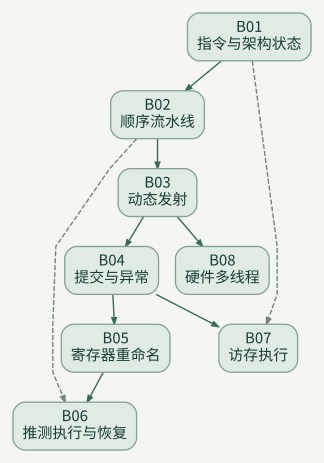

# 指令执行与 CPU

在共同计算基础中，控制电路已经能够选择操作数、发起运算和更新寄存器。CPU 还需要做一件事：根据程序中的指令决定这些动作，并使程序看到的结果符合指令集规定。这个路线解释硬件如何在正确执行程序的前提下，让更多指令同时工作。

## 从一条指令走向现代处理器核心

假设一个短程序先从内存取数，再做加法和比较，随后根据结果跳转。先观察一条指令怎样经过数据通路，再让相邻指令共享这条通路的不同阶段。

如果取数还没回来，一条无关的加法能否先执行？如果后面的指令先算完，何时才可以让它改变程序所见的状态？写同一寄存器的两条指令是否一定要互相等待？沿着这些问题，逐步引入动态发射、提交和寄存器重命名。

最后还需处理两类不确定性：分支的下一条指令尚未确定，或者访存地址与数据尚未准备好。再看看多个硬件线程如何共享执行资源，就能理解现代 CPU 核心的主要执行机制。

## 知识关系

<figure class="micro-v2-map" markdown="1">

<figcaption>知识衔接示意。虚线表示关联或辅助阅读。点击可查看大图。</figcaption>
</figure>

实线是本路线所选教学模型的主要前置关系；虚线指出控制流和访存从较早的文章就已经出现。分支预测与访存可以分别深入，硬件多线程也不以完整的乱序执行机制为必要条件。

## 计划阅读顺序

正文按下表逐篇发布。B01 使用 RV32I 的四种基础指令构造单条指令在途的教学 CPU，并建立后续共同使用的短程序。后续各篇逐步改变执行结构，而不是把某一代 CPU 的具体实现当成唯一方案。

| 编号 | 文章 | 读完应理解什么 | 状态 |
| --- | --- | --- | --- |
| B01 | [一条指令怎样让数据通路执行指定的运算？](b01-instructions-and-architectural-state.md) | 认识 ISA、程序计数器（PC）、指令编码和架构状态；跟随取指、译码、执行、访存和写回，理解一条指令如何改变程序所见的状态。 | 已发布 |
| B02 | [第一条指令尚未完成，第二条怎样安全地开始？](b02-in-order-pipeline-and-hazards.md) | 逐拍追踪顺序指令流水线，区分数据、资源与控制冒险，理解旁路、互锁、停顿和清空错误路径（flush）。 | 已发布 |
| B03 | [前面的指令还在等待，后面的指令能否先执行？](b03-dynamic-issue-and-out-of-order-execution.md) | 观察多发射、超标量、指令窗口、发射队列、scoreboard、保留站和乱序动态发射，并与 VLIW 静态安排对照。 | 已发布 |
| B04 | 后发指令先算完，为什么不能直接提交结果？ | 区分完成与提交，理解顺序退休、作为一种实现的重排序缓冲区（ROB），以及精确异常、中断与恢复。 | 未发布 |
| B05 | 两条指令写入同一个寄存器，为什么不一定存在真正的依赖？ | 区分 RAW 真依赖与 WAR/WAW 名字依赖，跟踪物理寄存器、寄存器重命名、映射、资源回收和提交。 | 未发布 |
| B06 | 分支结果还没有算出来，处理器下一拍该执行什么？ | 区分分支方向与目标预测，认识 BTB 和 RAS 如何帮助选择下一条指令，再看推测执行及错误路径恢复。 | 未发布 |
| B07 | 前面的 Store 地址还没有确定，后面的 Load 能否提前执行？ | 跟踪地址生成单元（AGU）、访存单元（LSU）、访存队列（LSQ）与 store buffer，理解地址消歧、存储转发、内存次序与屏障，并区分提交和可见性。 | 未发布 |
| B08 | 一个线程正在等待，另一个线程怎样利用空闲的计算资源？ | 比较多硬件上下文、交错多线程和同时多线程（SMT），分析资源共享、公平性与执行吞吐之间的权衡。 | 未发布 |

## 前置知识与相关路线

建议先读[共同计算基础](../01-foundations/README.md)，理解状态与数据通路、流水线、握手和资源调度。不要求先掌握全部乘加与浮点电路的实现细节。

这条路线关注 CPU 核心如何执行指令，不展开完整 ISA、编译器指令选择与操作系统进程管理。Cache、TLB 与主存如何提供数据见[存储系统](../../storage/README.md)；缓存一致性等通信机制见[芯片与系统互连](../../interconnect/README.md)。

如果关心数据级并行以及其他计算架构，可以继续阅读：

- [并行执行与 GPU](../03-parallel-execution/README.md)：比较物理执行通道、向量与 SIMT 机制，不要求学完 CPU 的乱序执行。
- [多执行实体与资源协作](../06-resource-cooperation/README.md)：把单个核心的执行过程扩展到多个计算单元和异构引擎。
- [性能分析与设计权衡](../08-performance/README.md)：结合执行资源与数据供给，分析有效吞吐、等待以及设计代价。

返回[计算微架构系列首页](../README.md)可选择其他阅读路线。
