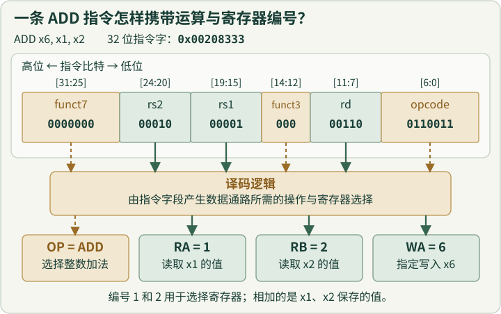
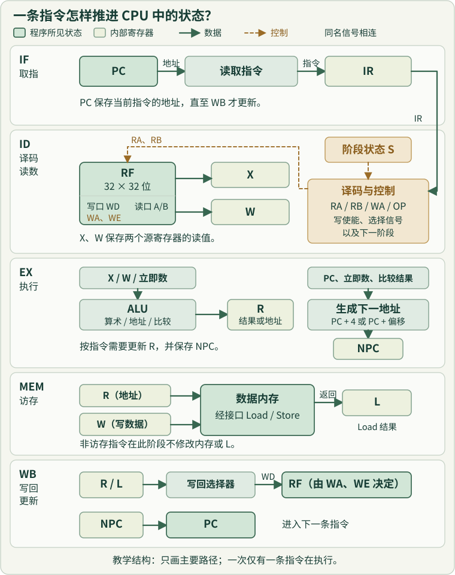

# 一条指令怎样让数据通路执行指定的运算？

在 [A05](../01-foundations/a05-datapath-and-control.md) 中，我们已经构造了一个可以执行不同运算的数据通路。给它四个控制字段 OP、RA、RB、WA，它就能从指定的寄存器取数，执行加法，再把结果保存到指定位置。

但每次计算之前，都需要外部提供这些字段。假设希望硬件自己完成一段程序：先计算一个加法，再从内存读取数据，随后根据计算结果决定还要执行哪些操作。谁来产生每一次运算所需的控制字段？

CPU 的一种基本工作方式，是从存储器取得描述这些操作的**指令（Instruction）**，按照指令的含义控制数据通路，并改变程序能够观察到的状态。

下面沿用 A05 的硬件组织，让它每次执行一条指令。先看指令怎样提供控制信息，再逐拍追踪数据和状态的变化。此后几篇将逐步改变这个处理器的执行组织，而不改变同一段程序应得到的结果。

## 怎样把一项运算变成可以保存的指令？ {#instruction}

先规定三个寄存器的值：x1 保存 2，x2 保存 3，x6 保存 0。我们希望把 x1 与 x2 相加，所得的 5 写入 x6。

可以用下面这一行文字描述操作：

```asm
ADD x6, x1, x2
```

ADD 表示整数加法，x6 是结果的去向，x1、x2 是操作数的来源。这种便于人阅读的表示称为**汇编指令**。但硬件不需要认识字母 ADD，也不需要逐个读取这行文字。

回忆 [A05 的计算命令](../01-foundations/a05-datapath-and-control.md#control-path)。只需给操作类型和寄存器编号规定二进制编码，就可以用一组比特记录一次完整的操作。

问题是，不同软件生成的比特怎样才能被同一个处理器正确理解？如果软件认为某种编码表示加法，硬件却认为它表示减法，即使硬件计算没有出错，程序的结果也会错。

因此需要一个共同的约定。**指令集架构（Instruction Set Architecture，ISA）**规定软件可使用的指令及其编码、这些指令对程序状态的作用等。微架构则决定硬件用哪些电路、保存哪些内部信息、经过几个周期来实现这些行为。

本专题选用 RISC-V 的 RV32I 基础整数指令集中很小的一部分。下面的编码和指令含义遵循其规范，但数据通路和执行周期是我们自己定义的教学模型，不是一个完整的 RV32I 处理器。

与 A05 相比，将 RF 从八个十六位寄存器扩展为 32 个三十二位整数寄存器 x0～x31，并仍然提供两个读口和一个写口。其中 x0 按 RV32I 的约定始终读出 0，对它的写入不改变该值。

RV32I 的 ADD 将加法结果的低 32 位写到目标寄存器，符合 [A02 的定宽加法](../01-foundations/a02-number-representation-and-arithmetic.md#overflow)所解释的低位结果；本例的 5 不会超出这个范围。

[RV32I 官方规范：整数寄存器与指令格式](https://docs.riscv.org/reference/isa/v20260120/unpriv/rv32.html)

### 指令中的比特怎样成为数据通路的控制信号？

在 RV32I 中，ADD x6, x1, x2 可以编码为 `0x00208333`，即下面这组 32 位二进制数。为了便于观察，将其按所包含的信息分成六个字段。

<figure class="micro-diagram" style="max-width:780px; margin:1.2rem auto" tabindex="0" aria-label="ADD指令的二进制字段及译码信号，窄屏可横向滚动" markdown="1">

[](assets/b01-instruction-fields.svg)

<figcaption>从高位 31 到低位 0 排列指令字段。寄存器编号是选择 RF 条目的信息，不是存放在这个条目中的操作数。</figcaption>
</figure>

| 指令字段 | 本例编码 | 控制用途 |
| --- | --- | --- |
| rs1（位 19～15） | `00001` | RA = 1，选择 x1 |
| rs2（位 24～20） | `00010` | RB = 2，选择 x2 |
| rd（位 11～7） | `00110` | WA = 6，指定 x6 |
| opcode、funct3、funct7 | 图中色块所示 | 共同识别 ADD，选择整数加法 |

例如，rs1 的值是编号 1。如果 x1 中保存的是 20，读口就会实际提供 20，而不是 1。

在这个模型中，可以直接连接相应的编号字段与 RF 的地址输入。识别 ADD 所需的其他比特则送入组合逻辑：当它们满足 ADD 的编码条件时，产生相应的 OP 和写回控制信息。这个把指令编码转换为控制信息的过程称为**译码（Decode）**。

注意，识别出 ADD 并不等于现在就可以写 x6。译码决定需要执行哪些动作；[A01 的状态机](../01-foundations/a01-state-and-control.md#fsm)仍然要根据执行阶段决定何时使能操作数寄存器和 RF 写口。

[官方指令编码表](https://docs.riscv.org/reference/isa/v20260120/unpriv/rv-32-64g.html)给出了各字段的位置和固定编码。本文只详细拆解 ADD，其余指令使用汇编表示和对应语义，不要求记忆完整编码表。

## 指令保存在内存中，怎样知道应该读取哪一条？ {#pc}

一条指令的编码仍然只是一组比特。和输入数据一样，可以将它保存在有地址的存储器中。

假设指令已经放在下面这些地址。本例内存按字节寻址，每个地址对应 8 个比特；本例只使用固定长度的 32 位指令，因此顺序摆放的指令起始地址相差 4。

| 指令地址 | 内容（用汇编表示） |
| --- | --- |
| `0x100` | `ADD x6, x1, x2` |
| `0x104` | `LW x5, 0(x4)` |
| `0x108` | `ADD x7, x5, x3` |
| … | … |

地址和内容是不同的信息。`0x100` 是第一个指令字的起始地址，不是这条 ADD 指令的编码。

我们需要一个能保存指令地址的寄存器。处理器的**程序计数器（Program Counter，PC）**记录当前指令的地址。在这个简单设计中，让 PC 的输出连接到指令存储的地址输入，准备好指令编码后，再用一个独立的指令寄存器 IR（Instruction Register）保存它。

这个过程称为**取指（Instruction Fetch）**。此后即使存储接口的数据改变，译码逻辑仍可以通过 IR 得到本次指令的编码。

第一条指令执行结束时，将 PC 从 `0x100` 更新为 `0x104`。于是下一次取指得到的是另一条指令。只要再重复取指、译码和执行这一过程，之前需要外部逐条给出的计算命令就可以由硬件自己产生。

这里 PC 的初值由教学环境给定，不讨论启动过程。先让它始终记录当前执行的指令；未来允许多条指令在途时，前端下一次取指使用的地址可能与正在执行的某条指令地址不同。顺序执行时 PC 加 4，但后面还会看到指令可以改变这个增量，选取其他位置的指令。

## 只有计算结果还不够，CPU 怎样从内存取数？ {#load-store}

A05 的操作数已经预先放在 RF 中。但实际程序通常拥有比 RF 容量大得多的数据。我们还需要让程序指定存储器中的数据位置，并在存储器和寄存器之间传递数据。

先考虑第二条指令：

```asm
LW x5, 0(x4)
```

LW（Load Word）要求从内存读取一个 32 位的字，再把所读比特写入 x5。这里 x4 并不保存要读取的那个字，而是保存一个基地址。括号前的 0 是相对于基地址的字节偏移，它直接编码在指令里，称为**立即数（Immediate）**。

RV32I 的 LW 和 SW 使用 12 位带符号的字节偏移，译码后将它按 [A02 的补码符号扩展规则](../01-foundations/a02-number-representation-and-arithmetic.md#overflow)扩展为 32 位再参与地址计算。

假设 x4 = `0x200`，地址 `0x200` 开始的四个字节表示整数 6。先计算地址 x4 + 0 = `0x200`，然后访问这个地址，返回的数据才是 6。

这与 ADD 的区别在于：加法器的输出不是最终要写入 RF 的数，而是一次数据访问的地址。可以继续使用 A05 的加法路径，只需允许其第二个输入选择立即数，并让结果通路接到存储接口。

相反，下面这条指令将数据从寄存器送到内存：

```asm
SW x7, 4(x4)
```

SW（Store Word）要求把 x7 的 32 位值写到地址 x4 + 4，即 `0x204` 开始的四个字节。本次计算地址之外，还需要保留 x7 中准备写入的数据；它不会把 `0x204` 或 x7 的值再写到某个目的寄存器。

因此，数据通路需要同时支持两个方向：读取的字通过写回 MUX 送往 RF，待写入内存的字则由另一个 RF 读口提供。

本例只讨论正常完成的、按四字节对齐的字访问。假设读取一个字、写入一个字都能在各自的数据访存周期内完成。真实存储系统的访问时间可以不同，地址翻译以及 Cache 的内部机制见[存储系统](../../storage/README.md)。

## 下一条指令不一定在 PC + 4 {#branch}

如果 CPU 只能让 PC 不断加 4，那么程序只能沿存储地址依次执行。同一段程序无论输入是什么，都会经过相同的指令。

假设希望当 x7 和 x5 相等时跳过一条加法。可以在地址 `0x114` 放置下面的条件分支指令：

```asm
BEQ x7, x5, +8
```

这里用 +8 直接标出分支的字节偏移；实际汇编代码常使用目标位置的标签，由汇编器等工具确定偏移。BEQ（Branch if Equal）的含义是比较两个寄存器。如果相等，则下一条指令地址为本条分支的地址加上立即数偏移 8；否则仍为本条地址加 4。

| 比较结果 | 下一条指令地址 |
| --- | --- |
| x7 = x5 | `0x114 + 8 = 0x11C` |
| x7 ≠ x5 | `0x114 + 4 = 0x118` |

这个分支不需要给普通整数寄存器写入一个比较结果。比较产生的条件信号用于选择下一 PC。

我们已经拥有 [A02 的比较逻辑](../01-foundations/a02-number-representation-and-arithmetic.md#compare) 和 A01 的 MUX，接下来让比较结果和指令类型控制一个 MUX，选择增量 4 或分支偏移。

再用独立的 PC 加法路径将增量加到当前 PC 上。这样，普通加法或访存地址计算与下一 PC 的计算可以在同一执行周期完成，不需要争用同一个加法器。

指令怎样改变下一条指令的位置，称为改变程序的**控制流（Control Flow）**。对于 BEQ，下一地址由执行时的操作数决定，而不是只由指令在内存中的位置决定。

本例中的四种指令已经能表达几类基本动作。RV32I 对它们的具体运算和偏移规则见[官方规范的整数运算、控制转移和访存指令](https://docs.riscv.org/reference/isa/v20260120/unpriv/rv32.html)。

## 哪些状态是程序需要看到的？ {#architectural-state}

回看刚才的指令。ADD 需要写 x6，LW 需要写 x5，SW 需要改变内存，BEQ 可能改变下一条指令的位置。

这些都不是随意选择的控制信号，而是指令本身规定的行为。我们可以在尚未构造硬件之前，就依据指令含义算出每一步之后程序应该看到什么。

定义本例关注的**架构状态（Architectural State）**：指令集所规定的、对程序语义有意义的状态。在当前子集中，先观察 PC 和整数寄存器，并同时观察程序可访问的内存内容。后者位于处理器核心之外也可以被指令改变，并不是 CPU 的某组内部寄存器。

| 观察对象 | 本例在第一条 ADD 前 | ADD 正常结束后 |
| --- | --- | --- |
| PC | `0x100` | `0x104` |
| x1、x2 | 2、3 | 2、3 |
| x6 | 0 | 5 |
| 内存内容 | 已准备好 | 不变 |

程序不关心这一设计是否有名为 X、W 或 IR 的临时寄存器，也不会因为某种实现为计算 2 + 3 多保存一次中间结果，就要求程序改变指令编码。

因此要区分两个层次：

- **架构层次**：规定每条指令正常结束之后，程序所见的寄存器值、控制流以及访问内存的行为。
- **微架构层次**：为实现这些行为，实际增加的操作数寄存器、控制阶段、地址及结果暂存位置，以及它们在各个周期内的变化。

本文仅讨论一个执行线程、无异常和中断、没有其他观察者或设备访问的普通内存。这个条件下，可以把一次指令的结束作为观察程序状态的边界。真实 CPU 还有更多 ISA 规定的状态，以及多线程环境下的内存次序约束；我们暂且不展开。

## 怎样把这些动作组织成一条指令的执行过程？ {#datapath}

现在扩展 A05 中的数据与控制通路。仍然让一个控制状态寄存器 S 决定当前工作阶段，并且只允许一条指令在途。

<figure class="micro-diagram" style="max-width:820px; margin:1.2rem auto" tabindex="0" aria-label="简化CPU的五阶段数据通路，窄屏可横向滚动" markdown="1">

[](assets/b01-single-instruction-datapath.svg)

<figcaption>教学数据通路，只画必要的存储位置和传递关系，省略时钟、部分选择器与端口细节。图中各模块并不是同时执行多条指令的流水级。</figcaption>
</figure>

在 A05 中，控制器已经能够从读操作数走到执行和写回。现在把完整的过程组织为五个阶段，每个阶段结束时在一个时钟上升沿更新相应寄存器。

| 阶段 | 本阶段的动作 | 阶段结束时保留什么 |
| --- | --- | --- |
| IF · 取指 | 用 PC 读取指令 | IR |
| ID · 译码及读取操作数 | 根据 IR 产生编号、读取 RF、解释立即数 | X、W（按需要）、立即数及控制信息 |
| EX · 执行 | 算术、地址计算或条件比较，同时选择下一 PC | ALU 结果或访存地址 R（按需要）、下一 PC 候选 NPC |
| MEM · 数据访存 | 若为 LW/SW，则发起相应的内存访问 | LW 保留返回数据 L；SW 更新内存 |
| WB · 写回及结束 | 按指令决定是否更新 RF；更新 PC | 程序正常执行到下一条指令 |

在 ID 之后仍然保存 IR；可以从中继续取得 rd 等字段，不必为所有字段再造独立寄存器。本例在 ID 结束时锁存需要的立即数和控制信息。EX 中还需要原 PC 来计算顺序地址或分支目标，为便于观察，设 PC 一直保持当前指令地址，直到 WB 阶段结束。

接下来假设取指、读操作数、各组合运算、数据存储访问及写回均能在各自的一拍内满足时序。为了让后续对照更简单，即使某个阶段没有实际操作，本篇也仍经过该阶段。每条指令占用五拍。

这是一种**多周期执行**组织，不是 ISA 规定的五个周期。真实设计可以合并阶段、让某些指令跳过阶段，或者为较慢的操作增加周期。取指也不必使用独立的物理存储器；图中将指令访问与数据访问分开表示，便于观察各自的作用。

[MIT 6.004：指令与数据通路](https://ocw.mit.edu/courses/6-004-computation-structures-spring-2017/pages/c9/c9s1/) · [MIT 6.375：多周期与流水线处理器](https://csg.csail.mit.edu/6.375/6_375_2019_www/handouts/lectures/L11-MulticycleProcessorsAndPipelinedProcessors.pdf)

## 逐拍完成第一条 ADD {#add-timeline}

E₀ 沿后，控制器处于 IF，PC = `0x100`，x6 = 0。下表的 E₁～E₅ 表示五个连续的上升沿；各行的寄存器值表示该边沿之后的稳定状态。

| 上升沿 | 沿前处于的阶段 | 本沿发生的变化 | 沿后 PC、x6 | 沿后阶段 |
| --- | --- | --- | --- | --- |
| E₁ | IF | IR ← `0x00208333` | `0x100`、0 | ID |
| E₂ | ID | X ← 2，W ← 3，保留加法控制信息 | `0x100`、0 | EX |
| E₃ | EX | R ← 5，NPC ← `0x104` | `0x100`、0 | MEM |
| E₄ | MEM | 无数据访问，R 和 NPC 保持 | `0x100`、0 | WB |
| E₅ | WB | x6 ← R；PC ← NPC | `0x104`、5 | IF |

E₂ 沿后 X 和 W 才真正保存 2、3。加法器在 E₂ 到 E₃ 之间产生结果，在 E₃ 被 R 采入。此时已经算出了 5，但是 x6 仍然为 0。

到了 E₅，写回 MUX 选择 R。控制逻辑根据这条 ADD 的目标字段令 WA = 6、WE 有效，并使能 PC 采入 NPC。只在此时 x6 才更新为 5。

然后控制器返回 IF。PC 已经指向 `0x104`，下一次取指将取得第二条指令。

这里能够看清计算结果与架构状态之间的区别：R 在 E₃ 已经保存新值，RF 在 E₅ 才保存新值。两者之间经过的时间是这个设计的选择。

## 同样的五个阶段，怎样完成不同的指令？ {#other-instructions}

继续执行 `LW x5, 0(x4)`。此时 PC 已经是 `0x104`，x4 = `0x200`，内存中保存了 6；设 x5 的初值为 0，上一条 ADD 没有改变它。

| 上升沿 | 沿前阶段 | 本沿发生的变化 | 沿后 x5 |
| --- | --- | --- | ---: |
| E₆ | IF | IR ← LW 的指令编码 | 0 |
| E₇ | ID | X ← `0x200`；立即数 ← 0 | 0 |
| E₈ | EX | R ← `0x200`；NPC ← `0x108` | 0 |
| E₉ | MEM | L ← 内存读取结果 6 | 0 |
| E₁₀ | WB | x5 ← L；PC ← NPC | 6 |

在 E₈，R 中保存的是地址 `0x200`。若直接把它写入 x5，就会违反 LW 的指令含义。因此要让 MEM 阶段使用这个地址，并在 WB 阶段选择 L 而不是 R 作为写回数据。

SW 和 BEQ 则不需要更新 RF。在这两种指令的 WB 阶段，应令 RF 的 WE = 0。

| 指令 | EX 阶段 | MEM 阶段 | WB 阶段 |
| --- | --- | --- | --- |
| ADD | R 保存加法结果 | 无操作 | 写 rd，更新 PC |
| LW | R 保存读取地址 | L 保存读取结果 | 写 rd，更新 PC |
| SW | R 保存写入地址 | 将 W 中的数据写入内存 | 只更新 PC |
| BEQ | 比较 X、W，选择 NPC | 无操作 | 只更新 PC |

对 SW，实际的数据写入在 MEM 结束时发生，PC 则在之后的 WB 结束时更新。我们在一条指令完整结束之后检查程序可见状态；本篇的模型没有其他观察者，也不处理访问失败的情形。未来增加并发访存和异常处理时，不能简单沿用这个写入规则。

这张表并不是四套互相独立的电路。指令类型和控制状态共同决定当前启用哪条路径，以及允许哪些位置更新。

## 让处理器执行一小段程序 {#program}

现在可以用以上四种指令组装一段程序。此后 CPU 专题将以这段程序为基线，在需要额外现象时只修改或扩展很少的指令。

在 E₀ 之前，已经准备好指令存储和数据存储，并将 PC 设为 `0x100`。本次观察使用下面的初值，不代表 RV32I 要求寄存器复位为这些值。

| 寄存器 | 初值 |
| --- | --- |
| x1、x2、x3 | 2、3、1 |
| x4 | `0x200` |
| x9、x10 | 5、4 |
| x5、x6、x7、x8、x11 | 0 |

数据地址 `0x200` 开始的字为 6，`0x204` 开始的字为 0。下面用 M[地址] 表示从该字节地址开始的一个 32 位字，并在每条指令正常结束时记录变化。

| 编号 | 地址 | 指令 | 本次执行产生的变化 |
| --- | --- | --- | --- |
| I0 | `0x100` | `ADD x6, x1, x2` | x6 ← 5 |
| I1 | `0x104` | `LW x5, 0(x4)` | x5 ← 6 |
| I2 | `0x108` | `ADD x7, x5, x3` | x7 ← 7 |
| I3 | `0x10C` | `ADD x8, x9, x10` | x8 ← 9 |
| I4 | `0x110` | `ADD x5, x6, x1` | x5 ← 7 |
| I5 | `0x114` | `BEQ x7, x5, +8` | PC ← `0x11C` |
| I6 | `0x118` | `ADD x8, x8, x3` | 被跳过，不执行 |
| I7 | `0x11C` | `SW x7, 4(x4)` | M[`0x204`] ← 7 |
| I8 | `0x120` | `LW x11, 4(x4)` | x11 ← 7 |

除了 I5 分支跳转，其余实际执行的指令结束后 PC 都加 4。到 I8 正常结束为止，PC 是 `0x124`；这里停止观察，不表示该程序里存在一条隐含的停机指令。

最后，x5 = 7、x6 = 5、x7 = 7、x8 = 9、x11 = 7，M[`0x200`] = 6，M[`0x204`] = 7。

仔细看 x5 的变化。I1 将它改为 6，I2 读取这个 6，之后 I4 才将它改为 7。虽然最后 x5 = 7，但若让 I2 错误地读到了这个较晚的值，就会得到 x7 = 8，随后影响 I5 的分支结果。只核对程序结束时某一个寄存器的值是不够的。

## 为什么不在第一条指令结束之前取下一条？ {#next}

在这个处理器中，I0 占用 E₀ 到 E₅ 之间的五个周期，I1 从 E₅ 到 E₁₀，再接着执行 I2。从 I0 开始取指到 I8 完整结束，共执行八条指令，用时 40 拍；I6 被跳过，不计入执行数量。这是教学假设下的周期数，不是实际 CPU 的性能数据。

这么组织的好处是，每次只需保留一份指令信息。上一条指令已完整改变程序状态，下一条指令才开始取指。因此不必额外判断操作数来自哪条尚未完成的指令，也不会提前执行分支之后的错误路径。

但在 I0 执行加法的那一拍，指令存储其实已经不再为 I0 提供新数据。如果允许 I1 提前取指，I0 和 I1 就有机会使用不同的硬件资源。

这正是 [A06 的流水线](../01-foundations/a06-pipeline-and-throughput.md) 提供的机会。问题是，I2 依赖 I1 刚读取的数据，I5 还会决定 I6 是否应该执行。如果让几条指令重叠推进，我们需要保证这段程序看到的仍然是上面推导出的状态变化。

下一篇 B02 将保留同一组指令和数据，改变它们在硬件中推进的方式，逐拍观察顺序指令流水线怎样处理这些约束。

[返回指令执行与 CPU 导读](README.md)。
