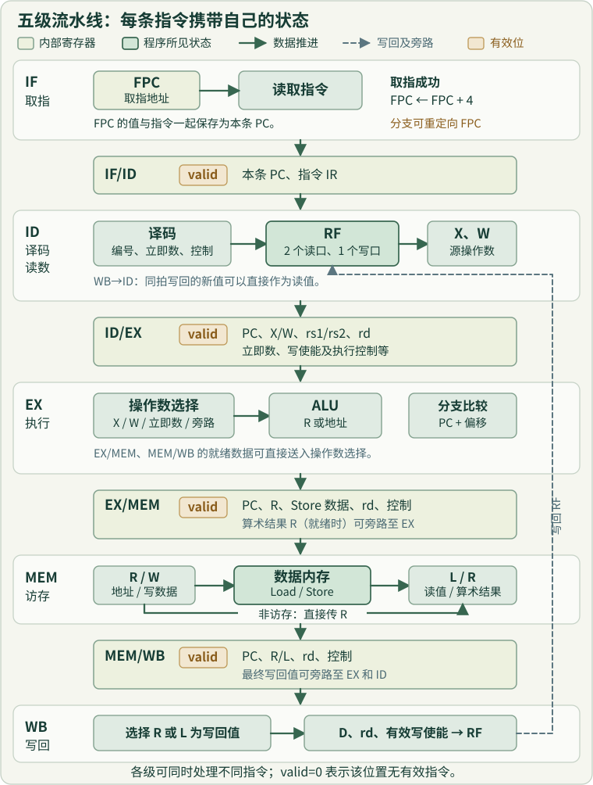
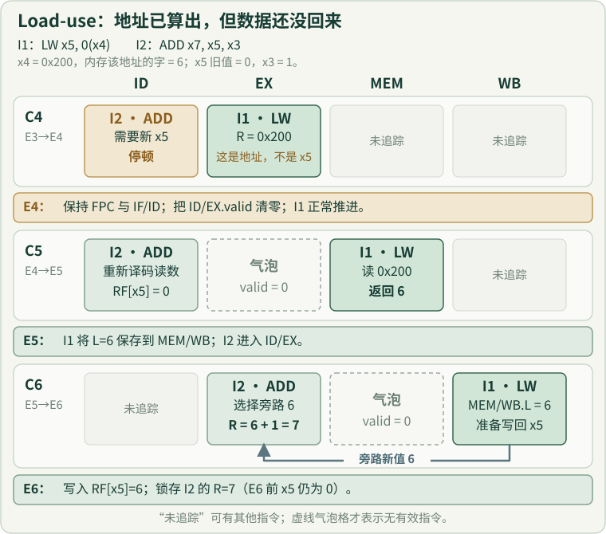
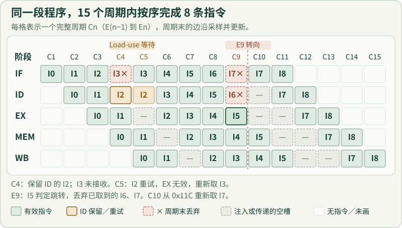

# 第一条指令尚未完成，第二条怎样安全地开始？

在 [B01](b01-instructions-and-architectural-state.md) 中，CPU 每次只执行一条指令。第一条 ADD 正在使用加法器时，负责取指的电路已经空闲，第二条指令却仍要等第一条指令写回之后才能取指。

[A06](../01-foundations/a06-pipeline-and-throughput.md) 已经解释过：让不同阶段同时处理不同的工作，可以减少这些空闲时间。现在将这个方法用到 B01 的 CPU 上，构造一条**顺序指令流水线（In-order Instruction Pipeline）**。

但是，程序中的指令不一定相互独立。如果一条指令需要前一条指令产生的数据，或者前面的分支决定了后面的指令不应该执行，让它们直接重叠就可能得到错误的结果。

本篇继续使用 B01 的指令和初始数据。我们先让处理器尝试每拍接收一条指令，再观察哪些指令必须等待、哪些结果可以提前使用，以及哪些指令必须从流水线中移除。

## 多条指令同时工作，各自的状态应该保存在哪里？ {#pipeline-state}

回顾 B01 的五个阶段：取指 IF、译码及读数 ID、执行 EX、数据访存 MEM、写回 WB。原来的控制状态 S 只记录一条指令当前处于哪个阶段。IR、X、W、R 和 L 也只为这一条指令服务。

现在尝试让 I0 执行加法的同时，I1 读取操作数。如果仍然只保存一份指令内容，I1 的译码信息就可能覆盖 I0 还需要的目标编号。仅仅让 PC 每拍加 4，不足以让指令安全地重叠执行。

沿用 [A06 的流水级寄存器](../01-foundations/a06-pipeline-and-throughput.md#pipeline-registers)，在相邻阶段之间分别设置保存位置。每条指令的数据和后续控制信息一起向后传递，不再通过一个全局的 IR 表示所有阶段中的指令。

这里用 IF/ID、ID/EX、EX/MEM、MEM/WB 表示四组流水线寄存器。例如 ID/EX 保存刚经过 ID、下一拍供 EX 使用的信息。

| 保存位置 | 本例需要保留的主要信息 |
| --- | --- |
| IF/ID | 指令编码、该指令的地址 PC |
| ID/EX | 指令地址、X/W、源与目标编号、实际使用哪些源、立即数、操作及后续读写控制 |
| EX/MEM | 运算结果或访存地址 R、Store 数据、目标编号、后续访存和写回控制 |
| MEM/WB | 供写回选择的 R 或 L、目标编号、写回控制 |

因此，在 B01 中使用的 X/W、R/L 并没有失去作用。它们现在分别保存在对应的流水线寄存器中，并与所属指令的信息一起推进。

每个位置还要有自己的有效位 valid。只有有效指令才能发起访存、写回等实际操作。后面会用它表示空槽位以及被取消的指令。[A07 的气泡与停顿](../01-foundations/a07-handshake-and-backpressure.md#elastic-pipeline) 已经建立过这种观察方式。

<figure class="micro-diagram" style="max-width:800px; margin:1.2rem auto" tabindex="0" aria-label="顺序五级流水线与各阶段保存的指令状态，窄屏可横向滚动" markdown="1">

<figcaption>这是由 B01 的五个阶段改造出的教学数据通路。略去部分控制线和寄存器字段，后面逐步解释旁路和暂停控制。</figcaption>
</figure>

PC 的使用也要改变。原来 PC 一直保存正在执行的唯一一条指令的地址；现在 IF 与 EX 可能处理不同地址的指令。

本篇将指令前端下一次取指使用的地址寄存器称为 FPC（Fetch PC）。正常接受一条指令时，FPC 加 4，同时将刚取到的指令及其原地址一起存入 IF/ID。若取指未被接受，则不按顺序增加 FPC。

到了 EX，处理分支需要的是这条分支自身的地址，而不是已经推进到更后面的 FPC。这正是流水线寄存器还需要传递指令地址的原因。FPC 是取指进度的一部分，不等同于 B01 用于描述程序语义的 PC；本例不另外实现一个物理退休 PC。

为便于观察，保留 B01 的正常访问、单线程、无异常等假设，并做以下具体设计：

- 五个阶段各占一拍；指令与数据访问可以同拍完成，RF 保持双读单写。
- 所有状态寄存器仍然在上升沿采样，数据和控制路径满足所选周期的时序要求。
- 每拍最多接受一条新指令，也最多将 ID 中的一条指令交给 EX；后面的有效指令不允许越过前面的有效指令进入 EX。每条有效指令都经过 WB，即使它不需要写 RF。

这里选择的是经典的五阶段单发射顺序模型，不表示 CPU 必须这样划分流水线。

## 如果每拍取一条指令，会发生什么？ {#first-three}

先取出 B01 程序的前三条：

| 编号 | 指令 | 正常执行的结果 |
| --- | --- | --- |
| I0 | `ADD x6, x1, x2` | x6 ← 5 |
| I1 | `LW x5, 0(x4)` | x5 ← 6 |
| I2 | `ADD x7, x5, x3` | x7 ← 7 |

沿用 B01 的时钟上升沿 E₀、E₁……。这里引入记号 C1 表示 E₀ 到 E₁ 之间的一个周期，C2 表示 E₁ 到 E₂，以此类推。表格中的阶段表示这个周期内正在进行的动作，结果在周期结束的边沿采入下一组寄存器。

| 周期 | IF | ID | EX | MEM | WB |
| --- | --- | --- | --- | --- | --- |
| C1 | I0 | — | — | — | — |
| C2 | I1 | I0 | — | — | — |
| C3 | I2 | I1 | I0 | — | — |

E₃ 沿后，I0 的加法结果 5 已保存在 EX/MEM。I1 的基地址已经读取，保存在 ID/EX；I2 的指令编码和地址则保存在 IF/ID。

这些动作虽然发生在同一时钟周期，却更新不同的保存位置。I0 的结果不会被 I1 的操作数覆盖。

但是如果接下来不加任何限制，让 I2 在 C4 读取 x5，然后在 C5 执行，结果会怎样？

I1 在 C4 才计算出读取地址 `0x200`，要到 E₅ 才能把内存中的 6 保存到 MEM/WB。而 C4 中 RF 的 x5 仍为旧值 0。若直接让 I2 的 X 捕获 0，随后用 0 + 1 进行计算，就会得到错误的 x7 = 1。

回忆 [A08 的数据依赖](../01-foundations/a08-dependencies-and-scheduling.md#dependency)。I2 需要的是 I1 产生的新值，不是 RF 中恰好占据 x5 位置的旧值。

这种重叠执行时，消费者可能在所需数据可用之前读取或使用它的情况，属于**数据冒险（Data Hazard）**。这里是较早的指令写 x5，较晚的指令读 x5，即写后读依赖（Read After Write，RAW）。

数据依赖是程序中已经存在的关系；冒险则取决于硬件何时提供、何时需要这个值。没有流水线时，B01 通过等待整条指令结束就避免了这里的冒险。

## 结果已经算出来，为什么一定要先写回 RF？ {#forwarding}

最简单的解决办法是：让 I2 留在 ID，直到 I1 的结果可以在读取阶段取得。那么不论其他指令是否已经准备好，都先不让它们越过 I2。

可是，一条 ADD 在 EX 结束之后就已经有了计算结果。还要经过 MEM 和 WB 才写入 RF，难道后面的指令必须浪费这两拍？

先看同一段程序中 I4 和 I5 的关系：

| 编号 | 指令 | 相关数据 |
| --- | --- | --- |
| I4 | `ADD x5, x6, x1` | 产生 x5 = 7 |
| I5 | `BEQ x7, x5, +8` | 应比较 x7 = 7 与 x5 = 7 |

假设 I4 正在 MEM，I5 正在 EX。I4 的 7 已保存在 EX/MEM，但 RF 中的 x5 还可能是 I1 写入的 6。即使 I5 已经在 ID 把这个 6 保存到 X/W，EX 仍然可以改选 I4 的 7。

[A08](../01-foundations/a08-dependencies-and-scheduling.md#result-availability) 已引出这种**旁路（Bypass / Forwarding）**的基本思想：数据不必先写回 RF 再从那里读出，可以从已经产生正确结果的位置直接送到需要它的执行路径。

给 EX 的每个实际使用的寄存器源增加一个 MUX，使它可以从三处取得值。

| 数据来源 | 何时使用 |
| --- | --- |
| ID/EX 保存的 X 或 W | 没有需要替换该值的在途写入者 |
| EX/MEM 中的 ALU 结果 | 较早的一条指令刚得到可用结果 |
| MEM/WB 中的最终写回值 | 较早的指令已经经过 MEM，尚在 WB |

如何确定应该选哪条路径？不能仅观察数据值，因为硬件不知道某个数值是不是程序期望的值。它需要比较寄存器编号。

取出当前指令实际使用的源编号，与 EX/MEM、MEM/WB 中有效指令的目标编号比较。只有对方确实要写该寄存器，且目标不是恒为零的 x0，才是候选写入者。

如果两个位置都要写同一个源寄存器，应该优先使用 EX/MEM 中较年轻的写入者，因为它在程序中更接近当前指令。若这个较年轻的写入者还没有产生所需结果，不能改选更早的旧值。

同样的选择规则用于加法的两个寄存器输入、Load/Store 的基地址、Store 将要写入的数据和 BEQ 的比较输入。立即数不需要做寄存器编号匹配。Store 的数据要随指令传到 MEM，而不是误送入用于地址计算的加法器第二输入。

### 如果一条指令正在写回，另一条恰好正在 ID 读取呢？

还有一条容易被忽略的路径。假设 I2 正在 WB，I5 正在 ID，I5 需要 I2 即将写入的 x7。

[A05](../01-foundations/a05-datapath-and-control.md#write-port) 已经说明过，同一个上升沿，不能假设 RF 刚采入的值可以立刻成为其他寄存器在这一沿采样的输入。

本篇在 ID 的两个读口之后也增加一个 MUX。若 WB 中的有效指令即将写入某个实际使用的源寄存器，就直接选择这一周期已经稳定的写回数据，而不是沿前 RF 的旧值。

这样，在 E₈，RF 将 x7 更新为 7 的同时，ID/EX 也能采入来自写回路径的 7。两者采样的是边沿之前已经准备好的信号，而不是沿后才更新的 RF 输出。

这条 WB→ID 旁路与 EX 的两条结果旁路共同保证操作数正确。其他实现也可在不同的时钟相位安排寄存器文件读写，具体取决于端口和时序设计。

[MIT 6.004：指令流水线中的数据相关与旁路](https://ocw.mit.edu/courses/6-004-computation-structures-spring-2017/pages/c15/c15s1/) · [Cornell CS3410：转发条件和较新结果的选择](https://www.cs.cornell.edu/courses/cs3410/2016fa/projects/p3/)

## 为什么有了旁路，紧跟 Load 的指令仍然要等待？ {#load-use}

回到刚才 I1 和 I2 的问题：

C4，I1 在 EX，I2 在 ID。到 E₄ 时，I1 只能将计算出的地址 `0x200` 保存在 EX/MEM。I1 真正要写入 x5 的数据 6 尚未取得。

如果让 I2 在 C5 进入 EX，EX/MEM 中虽然有一个目标编号为 x5 的有效写入者，但它保存的是地址。把该地址旁路给 I2，仍然会计算错误。

本例没有从 MEM 中正在读取的内存组合输出直接通向同周期 EX 的路径。数据在 E₅ 保存到 MEM/WB 后才可以经旁路使用，从 C6 开始提供给 I2。

因此，需要让 I2 的 EX 延后一拍。这里不必让整个处理器暂停：I0 可以照常进入 WB，I1 也必须继续进入 MEM，才能产生 I2 所等待的数据。

<figure class="micro-diagram" style="max-width:800px; margin:1.2rem auto" tabindex="0" aria-label="Load-use 停顿、气泡与结果旁路的逐拍变化，窄屏可横向滚动" markdown="1">

<figcaption>本图沿用完整程序中的 C4～C6。“未追踪”表示本图省略的其他阶段；只有标为气泡的虚线格没有有效指令。停在 ID 的 I2 仍有效，不会被丢失。</figcaption>
</figure>

控制电路怎样知道应该暂停 I2？本例在 ID/EX 保存指令类型、写入目标等信息，在 IF/ID 中的指令译码时知道它真正需要哪些寄存器。

如果 EX 中的有效指令是 Load、目标不为 x0，而且 ID 中的有效指令需要这个目标作为源，就产生一次停顿请求。这个根据指令依赖自动限制流水线推进的硬件逻辑称为**互锁（Interlock）**。

在 E₄，控制逻辑执行三个动作：

- 禁止更新 FPC 和 IF/ID，I2 保留在 ID；I3 即使已经被 IF 读取，也没有被接纳。
- 使 ID/EX 的 valid 变为 0，因此 C5 的 EX 中没有有效指令。这是在流水线中插入一个气泡。
- 允许 I1 的 EX 结果进入 EX/MEM，老指令照常向后推进。

C5 时，EX 中不再有有效的 Load，互锁解除。在 E₅，I2 可以进入 ID/EX 并允许 I3 进入 IF/ID。I2 这时即使从 RF 读到的还是 0，也不影响 C6 的计算：MEM/WB 已经保存了 I1 的 6。

| 周期 | I1 的状态 | I2 的状态 | 结束边沿的关键变化 |
| --- | --- | --- | --- |
| C4 | EX：计算地址 | ID：互锁等待 | E₄：R = `0x200`；保持 I2，插入气泡 |
| C5 | MEM：读出 6 | ID：重新读取 | E₅：MEM/WB 保存 6；I2 进入 ID/EX |
| C6 | WB：准备写 x5 | EX：旁路使用 6 | E₆：RF x5 = 6；I2 的 R = 7 |

如果没有 EX 旁路而仍有 WB→ID 旁路，I2 还要等到 C6 的 ID 才能取得 6，从 C7 开始计算。相比之下，现在只需要插入一拍气泡。

这就是本例相邻 Load 和使用者之间的 Load-use 冒险。停顿拍数不是由 LW 这条指令的语义决定的；如果访存需要更多拍，或者另有满足时序的数据路径，结论也会改变。

例如真实的 [CORE-V CV32E40P v1.8.0](https://docs.openhwgroup.org/projects/cv32e40p-user-manual/en/cv32e40p_v1.8.0/pipeline.html) 是四阶段顺序核，也有转发和相邻 Load-use 的停顿，但实际阶段和分支处理不完全相同。

## 指令和数据都已准备好，为什么仍然不能推进？ {#structural-hazard}

暂时只改变一个硬件条件：假设原来分别进行取指和数据访问的两个接口，现在共享一个每拍只接受一次访问的存储端口。

在前面的 C5 中，I1 需要在 MEM 读取地址 `0x200`，而 IF 希望取得地址 `0x10C` 的 I3。两次访问即使互不依赖，仍然不能在这个周期同时使用唯一的端口。

这种由于硬件路径或端口不能满足同时发生的请求而产生的冲突，称为**结构冒险（Structural Hazard）**。其原因是资源不足，不是某个操作数还没有计算出来。

让数据访问优先，那么 I1 在 C5 照常得到 6，I2 也可以从 ID 进入 EX。只是 I3 没有被取入 IF/ID，因此这个位置在 E₅ 变为空，FPC 保持 `0x10C`；下一拍再尝试取 I3。

这与刚才 Load-use 停顿不同。E₄ 要保持 IF/ID 中仍有用的 I2；现在 E₅ 中 I2 已经成功离开 IF/ID，若仍然让这个位置保存有效的 I2，就会造成重复执行。

可以通过仲裁控制共享端口，也可以增加独立访问路径以避免此类冲突。前者会损失某些周期的接纳机会，后者增加硬件资源。真实 CPU 的具体条件还受指令与数据存储层级的组织影响，访存延迟也可能随[Cache 命中与缺失](../../storage/01-memory-hierarchy/02-access-paths/cache-hit-lookup.md)改变。本篇不展开这些机制。

[Cornell CS3410：分离指令与数据存储的教学处理器](https://www.cs.cornell.edu/courses/cs3410/2019sp/projects/full-risc/)

接下来仍按本篇开始时的独立访问接口模型推导，不把这一额外冲突计入时序。

## 如果取到的下一条指令不应该执行呢？ {#control-hazard}

在 B01，分支执行完才会取得下一条指令。现在 IF 可能提前取得分支之后的指令，但分支实际需要进入 EX 才能比较两个操作数。

继续观察 B01 程序中的 I5：

| 编号 | 地址 | 指令 |
| --- | --- | --- |
| I5 | `0x114` | `BEQ x7, x5, +8` |
| I6 | `0x118` | `ADD x8, x8, x3` |
| I7 | `0x11C` | `SW x7, 4(x4)` |

如果每遇到分支就让 IF 等到结果确定，可以避免走错，但分支执行期间会失去取指的机会。本例采用另一种简单办法：先沿顺序地址取指；如果分支确定要跳转，就修正取指地址。

在这段程序中，I5 当时需要比较的两个值都是 7。I2 产生的 x7 经过 WB→ID 旁路取得；I4 产生的新 x5 则经过 EX/MEM→EX 旁路取得。

C9 中出现如下状态：

| IF | ID | EX | MEM | WB |
| --- | --- | --- | --- | --- |
| I7（第一次取指） | I6 | I5 | I4 | I3 |

EX 比较相等，因此 I5 的下一条指令应位于 `0x114 + 8 = 0x11C`。如果不改变流水线中的状态，I6 就会进入 EX，随后将 x8 从 9 错误地改为 10。

这种因为下一条应当执行的指令地址尚未确定而产生的问题，称为**控制冒险（Control Hazard）**。

为阻止 I6 继续推进，在 E₉ 做三件事：

- 清除 IF/ID 和 ID/EX 的有效位，不将 I7 的第一次取指结果和 I6 的译码结果作为有效指令传下去。
- 将 FPC 改为分支目标 `0x11C`，从 C10 开始按这个地址重新取指。
- I5 及比它早的 I3、I4 正常推进，不取消它们的工作。

注意，此时 IF 恰好已取得目标地址上的 I7，但本例采用统一清除全部年轻指令的简单策略，不检查并保留其中碰巧正确的指令。因此 I7 需要在 C10 重新取一次。

这种主动使尚未执行完的指令失效的处理称为**清空（Flush）**。它与停顿不同：停顿保留需要继续处理的指令；清空使不再需要的在途指令失效。

在这个模型中，分支确定时，年轻指令尚未进入 EX，更没有到达 MEM 或 WB。通过有效位禁止它们继续执行，就能阻止错误的寄存器写回和 Store。本模型中 EX 不会同时处理分支和 Load。若以后加入其他暂停条件，应注意：不能让年轻指令的停顿请求阻止已确定的分支重定向。

这里仅采用默认顺序取指与必要的纠正，没有引入根据历史行为选择分支方向或目标的预测机制。B06 会进一步考虑怎样减少走错路径所浪费的周期。

## 逐拍走完 B01 的整个程序 {#walkthrough}

现在将以上机制放入同一条流水线。继续采用 [B01 的初始寄存器值和 I0～I8 程序](b01-instructions-and-architectural-state.md#program)。

| 周期 | IF | ID | EX | MEM | WB | 周期结束时的关键动作 |
| --- | --- | --- | --- | --- | --- | --- |
| C1 | I0 | — | — | — | — | 保存 I0 编码 |
| C2 | I1 | I0 | — | — | — | 保存 I0 的操作数 |
| C3 | I2 | I1 | I0 | — | — | I0 得到 5 |
| C4 | I3* | I2（等） | I1 | I0 | — | I1 得到地址；保持 I2，插入气泡 |
| C5 | I3 | I2 | — | I1 | I0 | x6 ← 5；保存 Load 数据 6 |
| C6 | I4 | I3 | I2 | — | I1 | x5 ← 6；I2 旁路取得 6，得到 7 |
| C7 | I5 | I4 | I3 | I2 | — | I3 得到 9 |
| C8 | I6 | I5 | I4 | I3 | I2 | x7 ← 7；I5 取得 x7；I4 得到 7 |
| C9 | I7* | I6* | I5 | I4 | I3 | x8 ← 9；分支跳转，清空年轻指令 |
| C10 | I7 | — | — | I5 | I4 | x5 ← 7；接受重新取得的 I7 |
| C11 | I8 | I7 | — | — | I5 | 分支经过 WB（不写 RF） |
| C12 | — | I8 | I7 | — | — | I7 得到地址和写数据 |
| C13 | — | — | I8 | I7 | — | 内存 M[`0x204`] ← 7 |
| C14 | — | — | — | I8 | I7 | I8 从内存读出 7 |
| C15 | — | — | — | — | I8 | x11 ← 7 |

表中的 `*` 表示本周期没有保留这一份年轻指令：C4 的 I3 是取指因互锁没有被接受；C9 的 I6、I7 是分支重定向时取消的在途指令。两者的原因不同。— 表示阶段没有有效指令。

为与 B01 比较同一段程序，表中不再请求 `0x124` 及之后的指令，只让已经进入的指令结束。这是算例的观察边界，不是实际 ISA 提供的停机机制。

<figure class="micro-diagram" style="max-width:820px; margin:1.2rem auto" tabindex="0" aria-label="I0至I8完整指令流水线时序，窄屏可横向滚动" markdown="1">

<figcaption>将上面的逐拍状态变成时间轴。有效指令在各阶段重叠工作；被取消的指令不会进入有效的访存或写回阶段。</figcaption>
</figure>

按照表格检查结果：

I2 使用的是 I1 产生的 6，而不是初始的 0，也不是 I4 后来写入的 7。I2 在 E₈ 写入 x7 = 7，并在同一拍把这个结果提供给 I5。I4 在 E₈ 已经得到新 x5 = 7，I5 在 C9 用该结果比较，所以跳过 I6。

I7 在 E₁₃ 将 7 写入内存，I8 在接下来的 C14 才读取同一地址。最后 x5 = 7、x6 = 5、x7 = 7、x8 = 9、x11 = 7，M[`0x200`] = 6、M[`0x204`] = 7。按程序语义，下一条地址仍为 `0x124`。

这些结果与 B01 相同，虽然各条指令在硬件中的执行时间已经改变。

## 让指令重叠之后，得到什么，又付出了什么？ {#implications}

本例执行的程序仍然是八条有效指令，而不是九条静态列出的指令。顺序执行正确的指令、没有任何额外停顿和错误取指时，五级流水线需要 8 + 4 = 12 拍。实际还增加一次 Load-use 停顿和两拍分支重定向的损失，得到 15 拍。

| 指标 | B01 单条在途 | B02 顺序流水线 |
| --- | ---: | ---: |
| 有效指令数 | 8 | 8 |
| 总周期数 | 40 | 15 |
| 无冒险时最小取指接纳间隔 | 5 拍 | 1 拍 |
| 平均每周期完成的指令数（IPC） | 8/40 = 0.2 | 8/15 ≈ 0.53 |

这里按每条有效指令离开 WB 的时刻统计完成数量，Store 和分支也计入。只有在时钟周期相同的假设下，这两个周期数才对应约 2.67 倍的执行时间改善。

这种设计不仅增加了保存多条在途指令所需的状态，还增加了寄存器编号比较、旁路 MUX、互锁条件及控制流修正逻辑。它们本身也占用面积，并可能影响时钟路径。因此不能仅凭流水级数估算真实处理器的性能。

尤其要注意，本例能够简单地让有效指令按程序顺序进入 EX，并保证后发指令不会先于较早的指令写回 RF。MEM 中的 Store 也按顺序访问普通内存。

在这些约束下，后发指令不会提前覆盖较早指令尚未读取的寄存器值，也不会把两次对同一寄存器的写入顺序颠倒。进一步改变执行顺序后，这两类约束需要重新检查。B05 会详细区分这些关系。

## 如果 I2 在等待，有没有必要连 I3 也一起等待？ {#next}

回到 C4。在 I1 尚未返回数据时，I2 缺少 x5，因此不能进入 EX。但是后面的 I3 只需要 x9 和 x10，它的两个操作数已经准备好。

当前模型要求指令按顺序经过 ID 和 EX。I2 留在 IF/ID 时，I3 无法取得这个位置；到 C5，EX 甚至出现了气泡。即使 I3 与 I1、I2 没有数据依赖，也不能提前进入执行级。

能不能让 I3 先用这个本来空闲的执行机会，而 I2 留在某个位置继续等待？如果随后还有更多已经准备好的指令，又该怎样选择？

这正是下一篇 B03 要解决的问题：从顺序指令流水线出发，逐步建立动态选择可执行指令的机制。我们还会继续沿用 B01 程序，并检查改变执行顺序后程序状态是否仍然正确。

[返回指令执行与 CPU 导读](README.md)。
