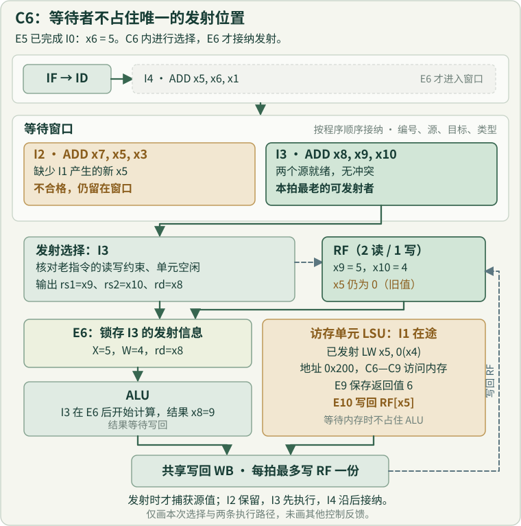
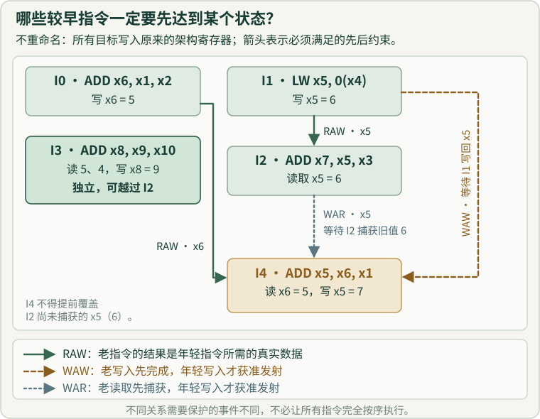
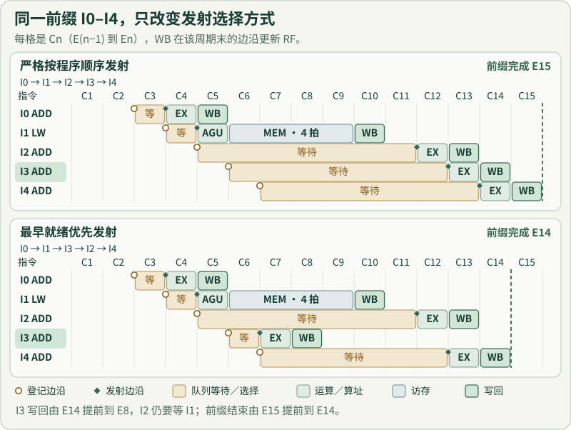

# 前面的指令还在等待，后面的指令能否先执行？

在 [B02](b02-in-order-pipeline-and-hazards.md) 中，我们已经让多条指令在流水线中重叠。虽然第二条指令不必等第一条写回才开始取指，遇到缺少数据的指令时，后面仍然可能有许多工作无法继续推进。

例如，B01 程序中的 I1 还在等待内存返回的数据，I2 需要这个数据才能执行加法。但是 I3 所需要的两个数早已准备好。只要运算资源允许，I3 的计算并不需要等待 I2 的结果。

那么，能不能让 I2 留在某个位置等待，先把运算单元交给 I3？

这就是本篇研究的**动态发射（Dynamic Issue）**：硬件在运行时根据指令所需数据、执行资源及程序顺序约束，选择可以开始执行的指令。允许较晚的指令先于某些较早的指令进入执行过程，是实现**乱序执行（Out-of-Order Execution，OoO）**的一种方式。

下面先改变 B02 的指令存放与选择方式，再检查为什么某些指令仍然不能乱序。最后对照实际的发射结构与多发射方式。

仍沿用 B01 的单线程、无异常和中断、无其他观察者的普通内存假设。本篇暂不允许指令跨越未决分支执行。

## 如果一条 Load 不只等待一拍，会发生什么？ {#waiting}

继续使用 [B01 的短程序和初始状态](b01-instructions-and-architectural-state.md#program)。先观察分支 I5 之前的五条指令。

| 编号 | 指令 | 正确结果 |
| --- | --- | --- |
| I0 | `ADD x6, x1, x2` | x6 ← 5 |
| I1 | `LW x5, 0(x4)` | x5 ← 6 |
| I2 | `ADD x7, x5, x3` | x7 ← 7 |
| I3 | `ADD x8, x9, x10` | x8 ← 9 |
| I4 | `ADD x5, x6, x1` | x5 ← 7 |

B02 假设 Load 的数据访问占用一拍，现在只为突出等待现象，将 I1 的数据访问时间设为四拍。实际存储访问可能随[命中和缺失](../../storage/01-memory-hierarchy/02-access-paths/cache-hit-lookup.md)等条件而变化；这里的四拍不是某种 Cache 的实测延迟。

为了单独观察发射选择，下面还暂时关闭 B02 的旁路，只允许从已经写好的 RF 取操作数。两种发射策略都采用这一条件。

在 B02 中，I2 还在 ID 等待 x5 的新值。控制器不能将 I2 直接交给执行级，因此也不能让 I3 通过同一个 ID 位置。即使加法器暂时空闲，I3 也进不去。

[A08](../01-foundations/a08-dependencies-and-scheduling.md#dependency) 已经解释过：等待需要的数，与等待计算资源，是两个不同的问题。现在 I3 还有第三个约束：较早的 I2 挡住了它通往执行级的路径。

我们希望解除这个位置上的限制，却不解除 I2 对 I1 结果的真正依赖。

## 怎样让多条指令在不同位置等待？ {#window}

回看 B02 的 IF/ID 和 ID/EX。由于每一级只保存一条指令，当 I2 不能离开 ID 时，后面就缺少可以保存 I3 的位置。

可以在译码和执行之间增加一组记录位置。译码后先保存指令的操作类型、源与目标编号、PC、立即数和执行所需控制信息，不要求它立即交出所有操作数。

本篇将这些已经进入后端、但尚未完成的指令记录构成的集合称为**指令窗口（Instruction Window）**。窗口中尚未发射、等待执行选择的部分具有**发射队列（Issue Queue）**的作用。它不必像 FIFO 那样只能取走最早的一项。

为使教学模型简单，先采用六个记录位置，并按原程序顺序从 ID 登记指令。每条指令拥有一个顺序编号，可以据此判断谁更早进入程序。

每个周期检查已登记的指令，从中选择一条满足条件的指令，读取 RF 中的操作数，并把这些值和控制信息交给执行入口。本篇将这次成功交付的边沿称为**发射（Issue）**时刻。不同处理器对发射阶段的具体划分可能不同。

为了让 I1 等待时不占用 I3 需要的硬件，本例把地址计算及数据访问组织在独立的访存路径中。I1 可保留请求状态，同时 ALU 继续执行其他加法。

这条访存路径称为 Load/Store Unit（LSU，访存单元）。本例一次只处理一条访存指令；更复杂的请求组织、地址和数据依赖留到 B07 再讨论。

对于 I2 和 I3，选择器现在能够分别判断它们是否有资格发射。

| 指令 | 操作数状态 | 可用的执行资源 | 初步判断 |
| --- | --- | --- | --- |
| I2 | 等待 I1 写入 x5 | 加法器可接纳 | 不能发射 |
| I3 | x9 = 5，x10 = 4 | 加法器可接纳 | 可以发射 |

若没有其他顺序限制，选择器就可以跳过 I2，先让 I3 使用加法器。I2 仍然有效，保留在窗口中，直到以后满足条件。

<figure class="micro-diagram" style="max-width:820px; margin:1.2rem auto" tabindex="0" aria-label="指令窗口中 I2 等待而 I3 获选发射，窄屏可横向滚动" markdown="1">

<figcaption>本图对应后文的 C6。I0 已写回，I1 的内存访问正在进行；I4 此时还在译码，未成为这一周期的发射候选。</figcaption>
</figure>

## 只要操作数已经就绪，就可以让指令先执行吗？ {#register-order}

如果所有指令写入的寄存器编号都不相同，而且不会影响更早指令需要读取的数，那么沿用 A08 的数据就绪判断就能够选择很多独立指令。

但是 B01 的 I1 和 I4 都要修改 x5，I2 又需要读取 I1 写入的那份数据。不能直接把 A08 中一个寄存器对应一个就绪位的简化规则套过来。

依次观察三个问题。

**第一，I2 必须使用 I1 产生的 6。** 如果 I1 还没有完成写回，I2 读取 x5 时就可能得到旧值 0。这正是 B02 介绍的写后读（RAW）约束。

**第二，I4 不能比 I1 更早改写 x5。** 如果 I4 先写入 7，I1 随后又写入 6，则最后 x5 会错误地等于 6，而不是 7。

**第三，I4 也不能抢在 I2 读取 x5 之前改写它。** 即使 I1 已经写回 6，只要 I2 还没有读走这个 6，就不能让 I4 将其覆盖为 7。

这里的第二种和第三种顺序关系分别称为写后写（Write After Write，WAW）与读后写（Write After Read，WAR）。B05 会进一步研究怎样解除这些由寄存器编号带来的约束。

<figure class="micro-diagram" style="max-width:780px; margin:1.2rem auto" tabindex="0" aria-label="I0至I4 的寄存器数据依赖与读写顺序约束，窄屏可横向滚动" markdown="1">

<figcaption>实线指向需要某个结果的消费者；另一类连线表示为了保护同一寄存器编号的读写顺序而必须满足的条件。本篇先保守地遵守这些顺序，不改变寄存器的组织方式。</figcaption>
</figure>

注意，I4 不需要读取 I1 得到的 6，计算 7 也不需要 I2 的结果。后两个约束并不是计算上的数据传递关系，而是因为几条指令使用了同一个寄存器编号。

在本篇不改变 RF 寄存器组织的前提下，先规定一组保守的发射条件：

| 对当前候选指令的检查 | 如果条件不满足 |
| --- | --- |
| 每个源都没有更早、尚未写回的写入者 | 等待该写入完成 |
| 目标没有更早、尚未写回的写入者 | 等待该写入完成 |
| 目标没有更早、尚未采入该旧值的读取者 | 等待该读取完成 |

这三个条件检查的都是**程序顺序更早的指令**，不只检查已经进入运算单元的指令。例如 I2 在上述几拍仍在发射队列中等待；它还没有进入 ALU，却仍然是 I4 必须保护的旧值读取者。

只把这些条件作为发射许可的一部分，就能在本篇模型中避免晚发的指令读到旧值，或提前覆盖前面的指令尚需使用的数据。某些实现可以更早判断或放宽这些限制；这里不提前引入那些机制。

## 硬件怎样记录一条等待指令受到哪些限制？ {#scoreboard}

先只看上面的发射条件。控制器至少需要知道每条尚未完成的指令在程序中的位置，还需要知道哪些寄存器尚未被读取、哪些结果尚未写回。

可以让窗口中每个记录位置保存下面这些信息：

| 字段 | 作用 |
| --- | --- |
| valid、原顺序编号 | 识别有效指令及其相对先后 |
| OP、源编号和目标编号 | 识别运算、真实源及目标 |
| 是否已发射并采入操作数 | 确定是否还有未完成的寄存器读取 |
| 是否还需要写回 RF | 确定其目标值何时可以使用或覆盖 |
| 其他执行控制信息 | 交给实际执行路径的地址、立即数及控制字段 |

本例将发射和读取寄存器安排在同一个边沿：发射成功时，X/W 等执行入口寄存器采入操作数，同时记录已发射。随后 RF 即使发生变化，也不会改变已经锁存的输入。

对于已经发射的 ADD 或 LW，在成功写回 RF 之前，其有效记录继续保留，供年轻指令检查是否有尚未完成的写入。成功写回后，清除该记录的有效位，空出的记录位置才可以重新使用。

窗口中的有效记录表示尚未完成的指令，不表示所有记录都需要参与发射选择。已发射指令由各自执行路径保存，不能再次进入发射候选。

例如 C7 开始时，I4 已经登记在窗口中。此时 I1 仍在访存，I2 还没有得到新 x5；I3 已经发射。

| 指令 | 读取状态 | 尚待写回的目标 | 对当前发射的影响 |
| --- | --- | --- | --- |
| I1 | 已读 x4 | x5 | 阻止 I2 使用 x5，也阻止 I4 同名写入 |
| I2 | 尚未读取 x5、x3 | x7 | 阻止 I4 覆盖 x5 |
| I3 | 已读 x9、x10 | x8 | 不阻止 I2、I4 的这些寄存器访问 |
| I4 | 尚未读取 x6、x1 | x5 | 等待更早的写入和读取条件 |

这里 I0 已经写回，它的 x6 可以直接从 RF 读取，因此不再需要保留 I0 的记录。

发射选择逻辑可以根据这些字段比较源、目标是否相同，再结合先后关系和状态位生成每条指令的许可。比较时只检查指令实际使用的源及实际写入的目标；RV32I 的 x0 恒为零，不产生需要等待的寄存器写入。

这种用硬件记录在途指令、数据访问状态和资源占用，以检测冒险和控制执行的思路通常称为**计分板（Scoreboard）**。计分板不一定是一张与本例完全相同的表，也不意味着处理器一定允许乱序发射。

例如早期 CDC 6600 的计分板分阶段管理发出指令、读取操作数、执行和写入结果。本篇选择的是按年龄检查窗口中早期记录、在选中时才读取操作数的简化设计，不是在复现 CDC 6600 的实现。

[MIT 6.823：顺序发出指令时的计分板与冒险检测](https://ocw.mit.edu/courses/6-823-computer-system-architecture-fall-2005/e2f9477e0a0cc8effcc472354d962264_handout9.pdf) · [Berkeley CS252：经典计分板的动态调度](https://people.eecs.berkeley.edu/~kubitron/courses/cs252-S11/lectures/lec07-dynasched2.pdf)

## 让 I3 先执行，逐拍会有什么不同？ {#walkthrough}

为了只比较发射选择方式，下面构造两种控制策略。它们使用完全相同的数据通路、记录容量和访存时间：

- IF、ID 按顺序每拍最多取得并登记一条指令；登记在边沿发生，新登记项从下一拍才参加选择。
- 一个双读单写的 RF，一个可每拍接收新加法的 ALU，以及一个独立的 LSU。每拍最多发射一条指令。
- 指令在发射边沿采入操作数。ADD 在下一拍算出结果并保存，随后一拍写回 RF；已计算结果可等候写口仲裁。
- LW 在发射后的一拍计算地址，再用四拍取回数据，随后一拍写回 RF。
- 为单独观察发射选择，将 B02 的结果旁路暂时关闭。发射所需的值都从沿前 RF 读取；不提前使用同沿即将写回的值。

仍采用 B02 的 Cn、En 记法，Cn 是上一上升沿到 En 之间的周期。这里说 E6 发射，表示 C6 选择、读取数据，到 E6 将它们采入执行入口。

执行入口可以按照 [A07 的单槽接续](../01-foundations/a07-handshake-and-backpressure.md#elastic-slot) 在旧工作成功交出结果的同一个边沿接收下一项。共享写口仍然每拍最多接受一次写入；若有多个结果就绪，采用程序顺序较早的指令优先，未获许可的结果保留。在本算例中没有发生写口争用。

### 先观察两种策略的共同过程

| 边沿 | 指令登记或发射 | 执行及状态变化 |
| --- | --- | --- |
| E₂ | 登记 I0 | — |
| E₃ | 登记 I1，发射 I0 | I0 采入 2、3 |
| E₄ | 登记 I2，发射 I1 | I0 算出 5；I1 采入基地址 |
| E₅ | 登记 I3 | I0 写入 x6 = 5；I1 算出地址 `0x200` |

E₅ 沿后，LSU 已经算出 I1 的地址，接下来等待内存不占用 ALU。I1 将在 C6～C9 中进行访存，E₉ 保存返回的数据 6，再在 E₁₀ 写入 x5。

I2 已经登记，但需要 I1 的结果才能发射。I3 也已登记，所需操作数可直接从 RF 取得。从这一刻开始，两种策略的行为不同。

### 如果只允许最早的未发射指令参加选择

最早等待发射的是 I2。即使 I3 已经满足条件，只要 I2 还没有发射，I3 就不能使用 ALU。

E₁₀ 时，I1 写回 x5 = 6。按本例沿前状态判断的约定，要到 E₁₁ 才能发射 I2。随后 E₁₂ 发射 I3，E₁₃ 发射 I4。

因此 I3 要到 E₁₄ 才能写入 x8 = 9。

### 如果允许从所有就绪的指令中选择

采用 A08 中较早的合格任务优先的选择规则，但不要求等待队列中最早的那个记录一定获得许可。

C6 中，I2 因为等待 x5 没有资格发射；I3 的操作数和资源都满足条件，于 E₆ 发射。I4 也在 E₆ 登记，但不会参与 C6 的选择。

| 边沿 | 本次发射 | 其他关键变化 |
| --- | --- | --- |
| E₆ | I3 | I4 登记；I2 继续等待 |
| E₇ | — | I3 得到 9；I1 仍在访存 |
| E₈ | — | I3 写回 x8 = 9 |
| E₉ | — | I1 取得内存中的 6 |
| E₁₀ | — | I1 写回 x5 = 6 |
| E₁₁ | I2 | 从 RF 采入 6、1 |
| E₁₂ | I4 | I2 算出 7；I4 采入 5、2 |
| E₁₃ | — | I2 写回 x7 = 7；I4 算出 7 |
| E₁₄ | — | I4 写回 x5 = 7 |

尤其注意 E₁₁ 和 E₁₂：E₁₁ 时 I2 才真正采入 x5 的旧版本 6，所以不能在它读取前发射 I4。到了 E₁₂，这份值已经保存在 I2 的执行入口；I4 不必等 I2 写回 x7 才发射。

此时 I2 后续使用的 6 已经与 RF 分离，未来 I4 改写 x5 不会影响它。我们改变的是执行顺序，而不是程序规定的数据来源。

<figure class="micro-diagram" style="max-width:820px; margin:1.2rem auto" tabindex="0" aria-label="严格顺序与动态发射的逐拍日程对照，窄屏可横向滚动" markdown="1">

<figcaption>两种策略均只允许每拍发射一条指令。图中发射标记是成功采入操作数的边沿，不是运算结果已经产生的时刻；只比较程序前缀 I0～I4。</figcaption>
</figure>

| 指标 | 严格顺序发射 | 从就绪指令中动态选择 |
| --- | ---: | ---: |
| I3 发射边沿 | E₁₂ | E₆ |
| I3 写回边沿 | E₁₄ | E₈ |
| I0～I4 全部写回 | E₁₅ | E₁₄ |

I3 提前六拍写回，但五条指令全部完成的时间只提前一拍。原因是 I2 仍要等待 I1，并且 I4 有保护旧值的顺序限制。动态选择不能消除真正的数据依赖。

这也是为什么不能只观察某条独立指令是否更早完成，就判断整个程序一定同样快。本例调整了访存延迟、前端和旁路条件，因此这里的拍数不直接与 B02 的十五拍比较。

### 后面的分支和访存怎么办？

本篇尚未引入异常恢复或分支预测，因此限定指令不能跨越尚未确定的分支执行。前端在 I5 译码登记时停止接纳后续指令，并暂停取指。若同时取得了顺序地址上的 I6，也不保留它。等到所有更早指令完成，才允许 I5 执行；确定下一地址后再恢复正确路径的取指。

在两种发射策略中，I5 比较时 x7 = x5 = 7，所以跳过 I6。访存指令按程序顺序发出，前一个访存指令完成后才允许下一个访存指令发射。

因此 I7 将 7 写到 `0x204`，随后 I8 从同一地址读出 7；与 B01、B02 的最终寄存器状态及内存内容相同。这里不再逐拍展开这部分，以免将分支和访存的后续机制混入发射选择的讨论。

本模型只适用于无异常和中断、无其他观察者的单线程普通内存，并通过上述顺序限制保证本段程序的结果。后面会逐步放宽这些限制，而不是把它们当成所有 CPU 必须遵守的硬件组织。

## 等待位置可以放在执行单元旁边吗？ {#reservation-stations}

前面的指令窗口只保存编号和控制信息，等所有操作数可从 RF 读取时再选择发射。这样实现容易观察，但多个候选指令就绪后仍要共同竞争 RF 读端口。

也可以改变等待位置保存的内容。假设 I2 已经取得 x3 = 1，但 x5 的新值仍未返回。如果直接把已取得的 1 保存在等待位置中，就不必等到最后再读两次 RF。

剩下的 x5 不能随便读取当前 RF。等待位置必须知道它缺少哪一份结果，或者由哪条更早的指令提供。当收到所需结果后，再保存 6，同时把该操作数标为就绪。

这种靠近执行路径、为尚未能够执行的操作保留记录和部分操作数的结构，通常称为**保留站（Reservation Station，RS）**。

经典的 Tomasulo 算法让保留站保存已得到的操作数，或者保存等待的生产者标记。执行结果经公共数据总线传播，等待该标记的记录可以接收结果。标记机制还能够区分不同写入者产生的值，这与寄存器重命名有关，将在 B05 深入讨论。

[Tomasulo，1967：An Efficient Algorithm for Exploiting Multiple Arithmetic Units](https://courses.grainger.illinois.edu/ece511/Fa2003/papers/Tomasulo.1967.IBMJRD.pdf)

并非所有发射队列都保存完整操作数。有些实现主要保存指令信息和源就绪状态，选中后再从寄存器文件取数；有些则让等待位置保存操作数并接收结果。

例如 [RISC-V BOOM 的发射单元](https://docs.boom-core.org/en/latest/sections/issue-units.html) 按指令类型设置发射队列，由就绪请求及执行端口能力选择可发射的操作。这不是本篇简化计分板的直接实现，而是可以观察相同选择问题的具体实例。

## 增加可以同时发射的指令数，又会改变什么？ {#superscalar}

到目前为止，即使窗口中有两条互不依赖的指令，每拍也只能选择其中一条。这是本篇的单发射限制，不是乱序执行的必然要求。

例如假设 I0 和 I1 都已经缓存在窗口中，它们的源寄存器已经就绪，也没有互相冲突的目标。只要 ALU 和 LSU 的接纳条件满足，就可以考虑在同一拍把 I0 送给 ALU，把 I1 送给 LSU。

可是，原来的 RF 只有两个读口。I0 需要 x1、x2，I1 需要 x4，这次共需要读取三个不同的寄存器。因此除了两条执行入口，还要让读取通路能够提供三个操作数，或者从其他已经保存数据的地方取数。

如果两条指令将来同时产生结果，也要考虑写回端口、结果暂存以及仲裁。若每拍希望持续提供更多指令，前端的取指、译码、登记带宽也必须配合。

每拍允许向多个执行入口交付多条指令的机制称为**多发射（Multiple Issue）**。**超标量（Superscalar）**处理器通过多个执行路径等硬件组织，试图在一个周期内发射或执行多条独立指令。

是否多发射，与是否允许较晚指令越过较早的等待者，是两个不同的设计选择。

| | 每拍最多发射一条 | 每拍可发射多条 |
| --- | --- | --- |
| 按程序顺序选择 | B02 的顺序流水线 | 顺序多发射 |
| 可越过等待者 | 本篇教学模型的动态发射 | 多发射乱序执行 |

增加发射宽度不等于每拍一定有足够多的指令可执行，还要处理同一批候选之间的数据和资源冲突。增加窗口容量也只提供更多可选的工作，不保证都能同时发射。

这里通过 I0、I1 的组合说明硬件所需条件，不改变前面单发射算例的日程。

## 能不能由软件提前安排哪些指令并行？ {#vliw}

刚才 I0 和 I1 可以并行，是硬件在窗口中检查数据及资源条件后决定的。如果在执行之前就知道它们之间没有依赖，也了解目标硬件能同时提供加法和地址计算路径，还可以提前安排这两个操作。

一种设计是让指令编码包含多个操作槽位。例如假设一条指令字可以同时描述一个加法操作和一个访存操作，软件可以将 I0 的加法安排在加法槽、I1 的读取安排在访存槽。

这类组织称为**超长指令字（Very Long Instruction Word，VLIW）**。在典型的 VLIW 设计中，软件按照目标硬件允许的并行组合安排操作，而不是主要依靠运行时窗口寻找可并行的指令。

| 观察对象 | 动态发射的处理器 | 典型 VLIW |
| --- | --- | --- |
| 哪些操作组合并行执行 | 硬件依据运行时状态选择 | 软件预先安排指令中的操作槽 |
| 数据及资源等待 | 运行时检查后选择就绪项 | 静态安排考虑依赖和资源，运行时仍需按具体架构处理等待 |
| 主要取舍 | 额外选择、记录及比较电路 | 软件安排复杂，效果依赖目标硬件与可预知性 |

这里是假想的指令字格式，不是把两条原本的 RV32I 指令简单拼起来就能得到 VLIW。具体设计仍需定义可用槽位、时序约定和变化访存延迟时如何保证正确。

两种方式都需要正确处理依赖与资源限制，但决定并行组合的时间与责任不同。编译器怎样分析程序依赖、生成静态执行安排，属于编译器与系统软件系列。

[MIT 6.823：VLIW 与静态指令级并行](https://ocw.mit.edu/courses/6-823-computer-system-architecture-fall-2005/resources/l21_vliw/)

## 计算结果提早出现，就可以立即改变架构状态吗？ {#next}

回到本篇的动态发射日程。I3 在 E₈ 已经把 9 写入 x8，而更早的 I1 到 E₁₀ 才完成写回。在无异常、无中断并保护所需读写顺序的条件下，这能够得到与顺序执行相同的最终结果。

但是，如果在 E₈ 之后发现较早的 I1 访存失败，处理器需要报告异常呢？如果要求异常发生时的架构状态对应程序中出错指令之前的状态，I3 就不应该已经改变 x8。刚才的直接写回却已经修改了它。

这说明，选择哪条指令先计算、什么时候得到结果，以及什么时候允许这个结果正式改变程序看到的状态，是不同的决策。

[B04 · 后发指令先算完，为什么不能直接提交结果？](b04-in-order-commit-and-precise-exceptions.md) 将从这里继续，推导怎样区分内部计算完成和架构状态更新。

[返回指令执行与 CPU 导读](README.md)。
