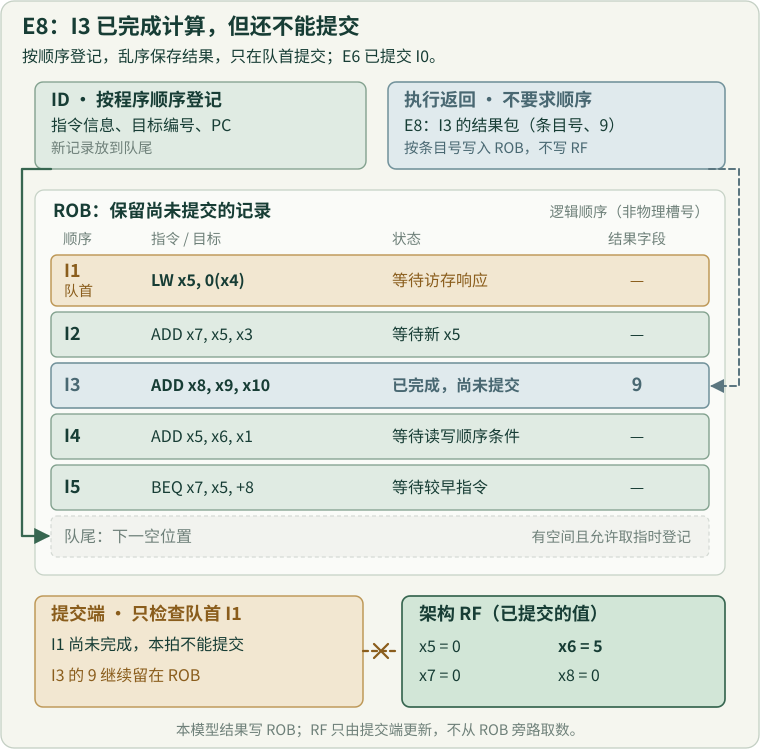
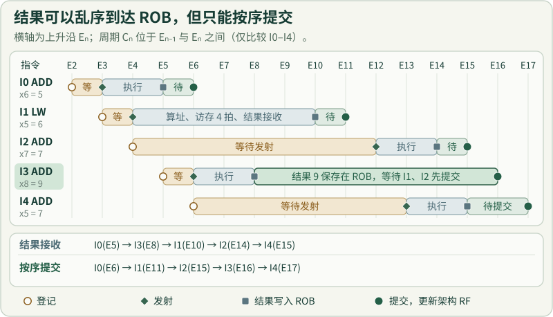
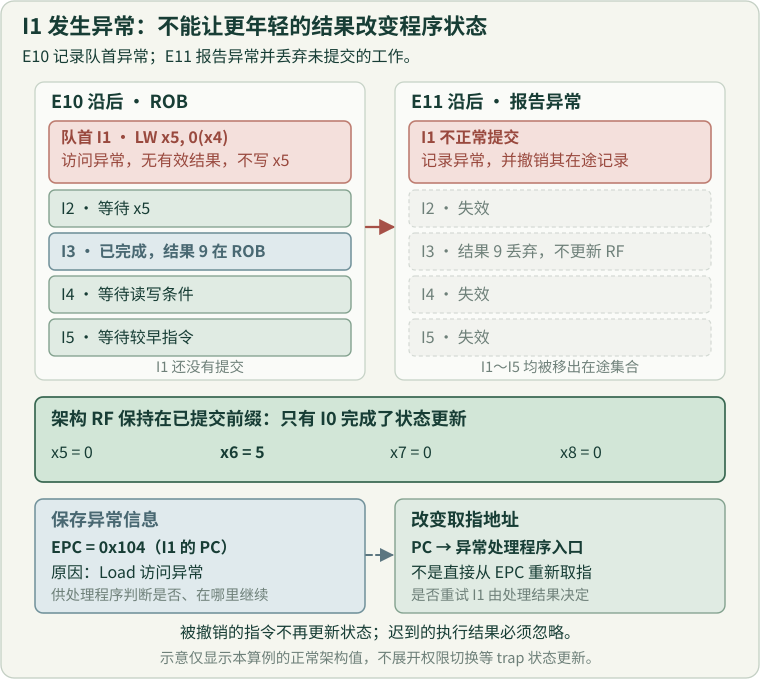

# 后发指令先算完，为什么不能直接提交结果？

在 [B03](b03-dynamic-issue-and-out-of-order-execution.md) 中，处理器可以从等待窗口中选择已经具备执行条件的指令。I1 正在等待访存，I3 却可以先完成加法，并把 9 写入 x8。

在没有异常和中断的条件下，我们通过保护寄存器读写顺序，使改变发射顺序后的程序仍然得到正确结果。

但如果 I1 最后没有成功读取数据呢？此时 I3 已经改变了架构状态，处理器还能够说自己正确执行到了 I1 吗？

这就是本篇要解决的问题。我们希望硬件可以乱序计算，但对程序表现为按序推进。为此，必须先区分计算结果的产生和它正式改变程序状态的时刻，再推导一种实现这种约束的硬件结构。

## 如果 I1 访存失败，程序应该看到什么？ {#precise-state}

还是使用 [B01 的指令序列和初始值](b01-instructions-and-architectural-state.md#program)。先观察前五条指令：

| 编号 | 指令地址 | 指令 | 正常执行的结果 |
| --- | --- | --- | --- |
| I0 | `0x100` | `ADD x6, x1, x2` | x6 ← 5 |
| I1 | `0x104` | `LW x5, 0(x4)` | x5 ← 6 |
| I2 | `0x108` | `ADD x7, x5, x3` | x7 ← 7 |
| I3 | `0x10C` | `ADD x8, x9, x10` | x8 ← 9 |
| I4 | `0x110` | `ADD x5, x6, x1` | x5 ← 7 |

在 B03 的动态发射日程中，I0 在 E₅ 写入 x6 = 5。I1 在 C6～C9 中访问内存；与此同时，I3 在 E₈ 已经写入 x8 = 9。

现在只改变一个条件：假设 I1 到 E₉ 没有得到数据，而是得到了一个表示访问失败的反馈。它不能将原来预期的 6 写入 x5。

对于这条普通整数 Load，访存失败与 I1 本身有关，需要处理器转向专门的处理程序。这种与正在执行的指令有关的特殊情况称为**异常（Exception）**。本例的异常按照选定的执行环境约定引起控制转移。

如果将 B01 的顺序执行作为参考，在 I1 发生异常之前，只有 I0 正常完成。观察这一时刻的通用寄存器：

| 寄存器 | 程序顺序要求的状态 | B03 提前写回后的状态 |
| --- | ---: | ---: |
| x5 | 0 | 0 |
| x6 | 5 | 5 |
| x7 | 0 | 0 |
| x8 | 0 | 9 |

问题在 x8。虽然 I3 计算的 9 本身没有错，但它是 I1 之后的指令。在程序应当停在 I1 的时候，这个值不能已经出现在被保存的程序架构状态中。

如果处理器能够在一条指令的边界报告异常，使出错指令之前的指令都已产生应有的架构效果，而出错指令及之后的指令没有留下不应有的架构副作用，就能建立一种与顺序执行一致的**精确异常（Precise Exception）**语义。

对于本例，异常处理程序应能得到 I0 已完成、I1 尚未完成的状态，以及出错指令的地址 `0x104`，后面将这个保存的恢复地址记作 EPC。这里说的是原程序的状态边界，不是要求异常处理程序本身也在 `0x104` 执行。

并非所有指令、异常或体系结构都规定完全相同的恢复语义。本文只讨论需要提供这种精确状态的普通整数指令，并沿用单线程、无其他观察者的普通内存条件。

[Smith 与 Pleszkun，1988：Implementing Precise Interrupts in Pipelined Processors](https://american.cs.ucdavis.edu/academic/readings/papers/smithpleszkun.pdf) 讨论了流水线中如何使保存的程序状态对应顺序执行的指令边界，以及多种实现方法。

## 既然不能立即写入 RF，那就先把结果存在哪里？ {#completion-and-commit}

一种办法是不允许 I3 在 I1 完成前执行。这当然可以避免 x8 提前改变，却失去了 B03 通过动态发射获得的执行机会。

另一种办法是允许 I3 计算，但让计算结果先留在处理器内部。等它前面的指令都已成功结束，才能用 9 更新 x8。

回忆 B03 中 I3 的过程：

- E₆：I3 发射，将 5、4 采入执行入口。
- E₇：加法器产生 9，保存到结果寄存器。
- E₈：结果通过原来的写回路径进入 RF。

现在保留前两个动作，却改变第三个：E₈ 将 9 写到一处内部暂存位置，同时记录 I3 已经正常完成计算。不要立即改写 RF。

本文把执行路径将结果或异常信息成功交付给相应的内部记录，称为**完成（Completion）**事件。它与算术结果在 E₇ 已经产生的时刻仍有区别。

某条指令满足程序顺序及异常检查等条件，正式将该指令的效果纳入架构状态，这一动作称为**提交（Commit）**。本篇的指令在成功提交时离开未提交记录表，这一退出动作也称为**退休（Retirement）**。

在一些处理器文档中，commit 和 retirement 可以近义使用；在另一些设计中，写入物理寄存器、更新映射、释放相关资源可能是不同事件。本篇采用同一提交边沿退休的简单模型。

因此，正确的数值算出来了，只能说明这项运算取得了结果。它还不一定有资格改变程序所见的状态。

## 怎样知道哪些结果可以按程序顺序提交？ {#rob}

如果每条指令的结果都保存在不同位置，还需要判断哪条指令是当前最应该提交的指令。回忆 B03 的指令窗口，本来就按照程序顺序登记指令。

可以利用这个顺序：让每条已登记而未提交的指令一直保留一个记录位置，并允许不同执行路径把完成信息写回原来登记的位置。提交逻辑则始终从最早的一项开始。

这种按程序顺序登记、允许结果乱序到达、能够按程序顺序处理完成记录的结构，称为**重排序缓冲区（Reorder Buffer，ROB）**。

在本教学模型中，将 B03 窗口中的在途记录扩展为六个 ROB 条目。尚未发射的部分仍可由发射选择逻辑检查；已发射的操作数由执行路径保存。区别在于，指令执行完成后不再立即释放记录，而是留到提交或取消。

<figure class="micro-diagram" style="max-width:820px; margin:1.2rem auto" tabindex="0" aria-label="乱序结果写入ROB而队首决定是否提交，窄屏可横向滚动" markdown="1">

[](assets/b04-rob-and-commit.svg)

<figcaption>教学结果缓冲型 ROB 的一个状态。条目按程序顺序排列；完成端可以按编号更新任意对应条目，但提交端只检查队首。</figcaption>
</figure>

为了实现上述行为，每个记录位置除 B03 已有的指令编号、操作及读写状态之外，还需要保存：

| 新增或改变的字段 | 用途 |
| --- | --- |
| 指令 PC | 记录该条指令地址；异常时可取得恢复地址 |
| 目的寄存器及内部结果 | 正常提交时决定写哪个寄存器、写入什么 |
| 完成状态 | 等待、正常完成或异常已确定 |
| 异常原因 | 需要报告异常时使用 |

例如 I3 在登记时获得自己的 ROB 条目编号。发射时将该编号与操作数和控制信息一起传给 ALU；E₈ 返回结果时，写回路径根据编号把 9 写入 I3 原来的位置，并标记正常完成。

这与[互连中的在途事务及响应匹配](../../interconnect/BUS/03-on-chip-protocol-families/axi-channel-id-outstanding.md)有一个相同的基本问题：返回的结果要找到原来的记录。但 CPU 的 ROB 还承担程序顺序和架构状态更新的职责。

### 为什么通常有一个队首和一个队尾？

以六个条目为例，可以用一个循环使用的数组保存记录。

- 队尾（Tail）：标识下一个分配位置，译码登记成功时推进。
- 队首（Head）：标识最早尚未提交的指令，正常提交时推进。

数组末端用完后可以回到起点，但只有被释放的空条目才能重新分配。通过有效位、占用数量等状态判断队列为空还是已满。

在这个简单模型中，指令提交时还更新已提交程序前缀对应的下一条指令地址。它不同于 [B02 的取指地址 FPC](b02-in-order-pipeline-and-hazards.md#pipeline-state)，不要求真实处理器为它实现一个独立的物理寄存器。

提交逻辑只需要查看队首是否有效及处于什么状态：

| 队首状态 | 本拍允许的动作 |
| --- | --- |
| 还没有正常完成或确定异常 | 等待，保留所有记录 |
| 已正常完成，且架构更新能够成功 | 提交并释放队首 |
| 异常已确定 | 不提交该指令，进入异常处理 |

较晚的条目即使已经完成，也不会使队首直接跳过尚未完成的指令。这里的“重排序”不是把条目重新排序，而是让乱序到达的结果按照原程序顺序成为正式结果。

若 ROB 已满，就不能继续分配位置，即使某些执行单元仍然空闲。前端按 [A07 的接纳与反压](../01-foundations/a07-handshake-and-backpressure.md#elastic-slot)规则保持不能登记的指令和取指进度。

本例选择每拍至多登记一条、完成通路最多更新一条、提交最多一条。它们是不同的操作，可以在同一个边沿更新不同条目。实际硬件需要提供相应的访问路径或端口。

这种直接保存结果的 ROB 是一种实现方式。Smith 与 Pleszkun 的论文第四节讨论过类似结构；例如现代 [RISC-V BOOM 的 ROB](https://docs.boom-core.org/en/latest/sections/reorder-buffer.html) 主要跟踪指令状态，而计算结果保存在另一类寄存器结构中。本篇不提前引入这种组织。

## 如果 I1 正常返回数据，逐拍会发生什么？ {#success-timeline}

先不发生异常，继续对比 B03 的动态发射算例。保留同样的前端、ALU、LSU 和 I1 四拍数据访问。仍采用 B03 的 Cn、En 记法，Cn 为上一上升沿到 En 之间的周期。

只改变两项执行规则：

- 原来写入 RF 的结果先写到 ROB，从下一拍开始才可参加队首提交判断。不使用同沿完成并提交的旁路。
- 发射时仍然只从已经提交的 RF 读取操作数，不使用 ROB 数据旁路。B03 保守的 RAW、WAW、WAR 检查继续生效：写出者要等其提交，旧值读取者要等其采入操作数。

这不是 ROB 必须采用的读数策略，只是为了不用先学习寄存器重命名，并把提交行为与结果产生的时间区分清楚。

例如 I1 在 E₁₀ 把 6 交给 ROB。E₁₁ 才提交并更新 x5，所以 I2 虽然已经等待很久，也要到 E₁₂ 才能从 RF 取得正确操作数。

具体看各条指令的边沿：

| 指令 | 登记 | 发射 | 正常完成（写入 ROB） | 提交（更新 RF） |
| --- | --- | --- | --- | --- |
| I0 · ADD | E₂ | E₃ | E₅ | E₆ |
| I1 · LW | E₃ | E₄ | E₁₀ | E₁₁ |
| I2 · ADD | E₄ | E₁₂ | E₁₄ | E₁₅ |
| I3 · ADD | E₅ | E₆ | E₈ | E₁₆ |
| I4 · ADD | E₆ | E₁₃ | E₁₅ | E₁₇ |

I5 在 E₇ 登记，但仍然按照 B03 的保守规则等待所有更早的指令成功提交。前端到此暂不接纳更年轻的指令。这里先只计算 I0～I4 的日程。

<figure class="micro-diagram" style="max-width:820px; margin:1.2rem auto" tabindex="0" aria-label="结果乱序到达而架构状态顺序提交的边沿时序图，窄屏可横向滚动" markdown="1">

[](assets/b04-complete-and-commit-timeline.svg)

<figcaption>结果进入 ROB 的顺序与提交顺序不同。图中的执行区间包含运算和随后结果交付到 ROB 的时间；只展示 I0～I4 前缀。</figcaption>
</figure>

来看几个关键状态，以下值均指上升沿后的稳定状态：

| 边沿 | 队首或提交动作 | RF 中的新值 | 已提交前缀的下一条 PC |
| --- | --- | --- | --- |
| E₅ | I0 的结果进入 ROB | 尚未写 x6 | `0x100` |
| E₆ | 提交 I0，队首变为 I1 | x6 = 5 | `0x104` |
| E₈ | I3 的 9 进入 ROB，I1 仍在等待 | x8 仍为 0 | `0x104` |
| E₁₀ | I1 的 6 进入 ROB | x5 仍为 0 | `0x104` |
| E₁₁ | 提交 I1，队首变为 I2 | x5 = 6 | `0x108` |
| E₁₅ | 提交 I2，队首变为 I3；I4 结果进入 ROB | x7 = 7 | `0x10C` |
| E₁₆ | 提交已经等待很久的 I3 | x8 = 9 | `0x110` |
| E₁₇ | 提交 I4 | x5 = 7 | `0x114` |

注意 E₁₃，I2 在上一沿已经采入 6、1。I4 可以发射，而不必等 I2 正式提交。I4 的结果随后可以保存在 ROB 中，只是在 E₁₇ 才更新 x5。

这样就实现了两个不同的顺序：

- 完成顺序：I0、I3、I1、I2、I4。
- 提交顺序：I0、I1、I2、I3、I4。

I3 可以提前完成。但从 E₈ 到 E₁₆ 的八拍间隔里，9 始终只保存在内部，x8 的架构值不变。

回看 B03 的日程，采用直接写回的前缀在 E₁₄ 完成；本篇更加保守，在 E₁₇ 才全部提交。这里增加的等待既与分离提交阶段有关，也与本例只从已提交 RF 读取操作数有关，并非每一种 ROB 组织都具有这三拍的额外开销。

例如可以让消费者直接从相应的内部结果位置取得已经完成的值，而不必等提交。但硬件必须能识别它需要哪一份结果。我们在 B05 中会改变这部分组织。

## 如果 I1 返回的是异常而不是数据呢？ {#exception-recovery}

现在回到第一节的问题。这一次 I1 在 E₉ 得到访问失败的反馈。其他指令的变化与正常路径相同，直到这一时刻为止。

在 E₁₀，完成通路找到 I1 的 ROB 条目，但是不为它保存一个可正常提交的 32 位结果，而是记录异常已确定及其原因。I3 的条目仍然保存此前得到的 9。

现在 I1 正好是最早尚未提交的指令。下一拍检查队首时，控制器不能把它当作正常完成的指令提交。

<figure class="micro-diagram" style="max-width:820px; margin:1.2rem auto" tabindex="0" aria-label="队首访存异常时取消未提交指令并保留精确架构状态，窄屏可横向滚动" markdown="1">

[](assets/b04-fault-recovery.svg)

<figcaption>这是 I1 异常时的独立执行路径，不是在上一节正常提交日程之后发生。仅正常提交的 I0 的结果保留在架构 RF 中。</figcaption>
</figure>

在本模型的 E₁₁，控制器完成以下动作：

- 禁止 I1 正常提交，保留之前成功提交的 I0 所产生的状态。
- 记录 I1 的指令地址 `0x104` 和异常原因。
- 取消 I1 以及所有更年轻的指令记录、等待中的操作和取指状态；不允许它们再写 RF 或产生内存更新。
- 将取指地址重定向到异常处理程序的入口。该重定向优先于被取消指令在同沿可能发生的发射或登记。

检查 E₁₁ 沿后，x6 = 5、x5 = 0、x7 = 0、x8 = 0。I3 的 9 随内部记录被丢弃，而不是先写入 RF 再想办法把之前的 0 写回来。

这样，相对于原程序，状态正好对应 I0 已结束、I1 尚未完成的指令边界。

如果异常先发生在某条不处于队首的指令上呢？可以先在其 ROB 条目中记录异常，但不能立即让它改变更早指令的顺序。若更早的指令随后也失败，首先处理程序顺序更早的异常；如果该条目后来被取消，则不再报告它的异常。

### 保存恢复地址与重定向是两个不同的动作

在 RISC-V 的术语中，这类转向处理程序的控制转移称为 trap（陷入）。

以机器级异常处理为具体例子，处理器因异常进入机器模式时，mepc（Machine Exception Program Counter）记录发生异常或被中断的指令地址，mcause 记录原因，而 PC 转向相应的异常处理入口。

如果处理程序解决了问题，并选择重试之前的 Load，返回时才可能从保存的 `0x104` 重新执行 I1。处理程序也可以基于异常类型采取其他动作。因此保存出错地址不意味着处理器马上再次取出该指令。

[RISC-V 官方非特权规范：异常、中断与 Trap](https://docs.riscv.org/reference/isa/v20250508/unpriv/intro.html#trap-defn) · [机器级 ISA：mepc、mcause 与 mtvec](https://docs.riscv.org/reference/isa/v20250508/priv/machine.html)

本文不展开不同权限级别、地址翻译错误的处理或操作系统怎样编写异常处理程序，只观察 CPU 如何形成正确的状态边界及改变取指路径。

### 清除记录就一定能取消所有在途工作吗？

还要考虑执行路径中尚未返回的操作。例如某条被取消的 Load 可能已经向外发出了读请求，接口未必允许立刻撤销它。

硬件必须保证返回的旧响应不会重新成为有效的完成信息。可以等待相关请求排空再复用记录位置，或者在请求与条目匹配时使用能区分不同使用次数的标记。本篇不指定具体回收协议。

精确异常要求的是架构效果符合该指令边界，而不是要求处理器内部所有寄存器、Cache 及其他微架构状态都回到以前的比特值。

## 如果中断到来时，很多指令已经开始执行呢？ {#interrupt}

异常与执行的指令有关。另一类情况是程序本来正在正常执行，但定时器或外部设备提出了一个需要 CPU 处理的事件，例如[设备完成通知触发中断](../../interconnect/BUS/04-microarchitecture-integration/doorbell-completion-interrupt-flow.md)。

这类与当前指令不同步的事件称为**中断（Interrupt）**。与异常一样，中断引起的控制转移也属于 trap。

可以沿用相同的提交边界来理解精确中断。区别在于，不必找到一条本身执行失败的指令，而是要在允许接纳中断的时刻保存一个已经完成的程序前缀。

假设回到正常访存路径，外部中断请求在 E₈ 被记录为待处理，且这个中断已经允许接纳。采用一种简化策略，让队首正常的 I1 先在 E₁₁ 提交，在 E₁₂ 接受中断，而不是发射下一条指令。

| 对照 | I1 精确异常 | 此例 E₁₂ 接受中断 |
| --- | --- | --- |
| 已成功提交的程序前缀 | I0 | I0、I1 |
| 保存的指令地址 | `0x104`（I1） | `0x108`（I2） |
| x6 | 5 | 5 |
| x5 | 0 | 6 |
| x7、x8 | 0、0 | 0、0 |

这里 I1 正常完成；I2 本身没有发生异常，只是它还未成为已提交程序的一部分。处理器取消尚未提交的记录，保存下一条应继续执行的 I2 地址，并转向中断处理入口。

不要求每条已经发射的指令都先执行完并提交，才能接受中断。只要能保护不可取消的副作用、恢复正确程序边界，并符合体系结构规定的中断接纳条件，就可以处理相应事件。

E₁₂ 是本例选择的边界，不是实际处理器固定的中断延迟。中断使能、优先级、具体的异常与中断选择规则等属于体系结构与系统控制的详细内容。这里也没有同时发生异常与中断。

## 如果先执行的是一条 Store，保存它的结果够吗？ {#store-commit}

前面的 ADD 和 LW 可以先把结果保存在内部，只要尚未提交，就不改写架构 RF。

可是 B01 中的 I7 是一条 Store：

```asm
SW x7, 4(x4)
```

它的作用不是改变一个整数寄存器，而是把 x7 的值写入 `0x204` 开始的四个字节。如果直接让执行单元完成实际写入，之后又发现前面有异常，那么仅仅丢弃 ROB 条目，不能让已经写入的内存自动恢复。

因此，Store 的执行和内存更新也需要区分。沿用本篇的简单 ROB，Store 可以先计算地址并保存将要写入的值，以及相应检查结果；这些准备动作还不允许改变内存。

只有 Store 成为队首，已具备所需数据和地址且检查通过，才允许它向内存发出实际写入。本例假设普通内存的写入可以报告成功或在不产生写入副作用的情况下失败。若还没有得到成功反馈，就保留相应记录，不重复发出同一个请求。

成功写入时完成提交；若发现该 Store 的异常，则按队首异常处理。这个规则是刻意保守的教学选择。

如果队首 Store 已发出不可取消的写请求，仍在等成功或失败的反馈，本模型也暂不接纳中断。不能一边放弃该 Store 的提交，一边让它的写入继续改变内存。

真正的 CPU 也可以在提交时只授予 Store 不再被取消的资格，随后由内部存储缓冲继续将写入请求送往存储系统。例如 [BOOM 的 ROB 与提交阶段](https://docs.boom-core.org/en/latest/sections/reorder-buffer.html) 在 Store 提交后允许 LSU 继续处理实际写入。

因此，“Store 已提交”不等于“数据已经在所有观察者面前可见”。更复杂的存储转发、访存并行和内存次序留到 B07 讨论。这里仍限定普通内存，不把可能具有不可逆读写副作用的 [MMIO](../../interconnect/BUS/04-microarchitecture-integration/mmio-cache-interrupt-view.md) 操作当成可以随意提前执行的访问。

若沿用 B01 的剩余指令，I5 在更早的指令都提交后执行，确定 x7 = x5 = 7，跳过 I6。我们规定它在提交时才恢复目标路径取指，暂不跨未决分支执行。

I7 计算并保存地址和值，在队首成功写入内存后提交；I8 按 B03 的有序访存约定等待 I7 成功写入，然后读得 7 并提交给 x11。程序的最后状态仍与 B01、B02、B03 相同。这里不重复计算其后缀拍数。

## 已经解决了提交顺序，为什么仍然不能让 I4 更早执行？ {#next}

通过本篇的设计，处理器可以让不同的运算路径乱序完成结果，却只按程序顺序改变架构状态。代价是需要额外保存尚未提交的记录、结果和故障信息，并且空闲 ROB 容量及提交宽度可能成为新的吞吐限制。

但回看一处仍然保留的等待：本篇的 I4 所需操作数 x6、x1，在 I1 结束之前就已经准备好。为什么没有让 I4 更早计算自己的 7？

因为 I1 和 I4 要写入同一个 x5，I2 又需要 I1 的 6。我们沿用了 B03 的保守读写顺序限制，还要求消费者等结果提交进 RF 才能读取。

是否可以为 I1 和 I4 的结果使用不同的内部保存位置，让硬件直接针对 I2 所需的那份值记录依赖，而不让两次写入因同一个寄存器编号互相等待？

下一篇 [B05 · 两条指令写入同一个寄存器，为什么不一定存在真正的依赖？](b05-register-renaming.md) 会从这里继续，研究寄存器重命名如何区别真正需要的数据与寄存器编号带来的顺序约束，以及它和发射、完成、提交之间的关系。

[返回指令执行与 CPU 导读](README.md)。
