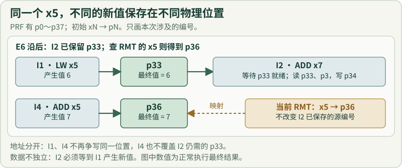
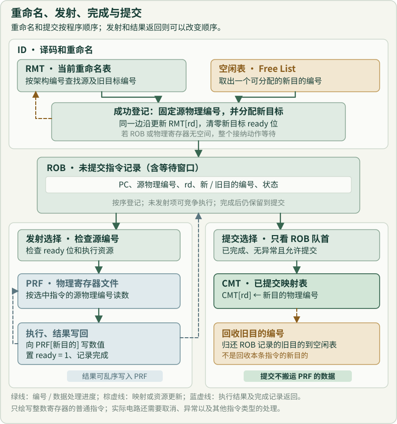
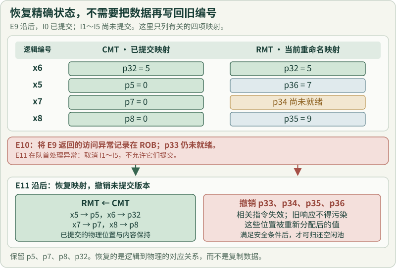

# 两条指令写入同一个寄存器，为什么不一定存在真正的依赖？

在 [B04](b04-in-order-commit-and-precise-exceptions.md) 中，我们已经允许较晚的指令先算出结果，再让这些结果按照程序顺序提交。但 I4 仍然要等很久才能发射。它与前面的 I1 都写入 x5，而 I2 还需要读取 I1 写入的那份数据。

如果为两次写入分别安排一个内部寄存器，再让每条指令准确地找到自己需要的那份值，I4 就不必为了保护 x5 的旧值而等待。

这就是**寄存器重命名（Register Renaming）**要解决的问题：将指令使用的架构寄存器编号转换为硬件内部的寄存器编号，使同一架构寄存器在不同时刻产生的值能够同时保存在不同位置。

下面在 B04 的顺序提交模型上只改变寄存器的组织和操作数来源，观察什么时候分配位置、什么时候能发射，以及什么时候才能释放旧值。

## I4 究竟在等待什么？ {#name-dependency}

继续沿用 [B01 的程序和初值](b01-instructions-and-architectural-state.md#program)，只看分支 I5 之前的五条指令。I1 的数据访问仍然需要四拍。

| 编号 | 指令 | 程序语义所需的值 |
| --- | --- | --- |
| I0 | `ADD x6, x1, x2` | 2 + 3 = 5，写 x6 |
| I1 | `LW x5, 0(x4)` | 从地址 `0x200` 读得 6，写 x5 |
| I2 | `ADD x7, x5, x3` | 6 + 1 = 7，写 x7 |
| I3 | `ADD x8, x9, x10` | 5 + 4 = 9，写 x8 |
| I4 | `ADD x5, x6, x1` | 5 + 2 = 7，写 x5 |

I2 必须使用 I1 产生的 6。如果 I1 尚未取得数据，I2 就没有办法完成正确的加法。I4 也确实要使用 I0 产生的 5。

但 I4 并不使用 I1 的结果，也不需要 I2 产生的 7。即使从内存取得的是 60，I4 的结果仍然是 5 + 2 = 7。真正影响 I4 计算的是 I0 和 x1，而不是对 x5 的其他访问。

回顾 [B03 的寄存器顺序约束](b03-dynamic-issue-and-out-of-order-execution.md#register-order)，区分三种关系：

| 关系 | 本例 | 为什么需要约束 |
| --- | --- | --- |
| RAW（写后读） | I1 → I2；I0 → I4 | 后面的计算需要前面的结果，数值必须先产生 |
| WAR（读后写） | I2 → I4 | 后面的写入不能覆盖前面尚未读走的值 |
| WAW（写后写） | I1 → I4 | 两次同名写入不能颠倒最终的结果 |

RAW 对应真实的数据传递关系，称为**真依赖**。后两种寄存器关系不是因计算需要前一条指令的结果而形成，而是由于复用了相同的寄存器名称，称为**名字依赖**或假依赖。

这里的“假”并不是说它们可以直接忽略。如果硬件把 x5 看成唯一的存储位置，提前覆盖此处的值仍然会出错。必须改变数据的存放方式，才能解除相应的执行限制。

## 能不能让同一个 x5 的两份值同时存在？ {#physical-registers}

其实 B04 已经做了一半。I1 与 I4 各有一个 ROB 条目，两个条目可以分别保存 6 和 7。即使先收到 I4 的结果，也不会妨碍 ROB 按程序顺序提交。

可是 B04 仍然只有一组已经提交的 RF，I2 在发射时按 x5 这个编号取数。我们还没有让它直接指出自己需要的是哪一份值。

现在把 B01 中的 32 个三十二位寄存器的位置扩展为 38 个，每个位置仍然存放一个 32 位数。将它们编号为 p0～p37，构成**物理寄存器文件（Physical Register File，PRF）**。

指令中的 x0～x31 仍然是 ISA 规定的**架构寄存器**（也称逻辑寄存器）。它们是程序使用的名称。p0～p37 则是本设计中实际存放数据的位置，程序的指令编码不用因此改变。

开始时，令 x0 对应 p0，x1 对应 p1，依此类推。p1～p31 保存原来的架构寄存器值，p0 固定返回 0。其余六个位置没有被分配，可以用来保存新的值。

例如给 I1 分配 p33，给 I4 分配 p36。两者分别向不同位置写 6 和 7。I2 如果明确从 p33 取数，就不再关心 p36 是否已经写入结果。

这样，原来共用 x5 存储位置的 WAR 和 WAW 约束，可以不再限制这几条指令的发射。但 I2 仍然要等待 p33 中的 6。寄存器重命名改变的是数据的存放位置，而不是计算关系。

还有一个问题：指令里只有 x5，硬件怎样知道何时应使用 p33，何时应使用 p36？

## 怎样在指令登记时确定源和目标的位置？ {#rename-map}

需要一张表，记录每个架构编号目前对应哪个物理编号。这张**重命名映射表（Rename Map Table，RMT）**表示截至已经登记的程序为止，各架构寄存器最近一次写入对应的位置。该位置的值可能还没有算出来。

对于一条指令，沿用 B04 按程序顺序登记的规则，在译码后增加以下动作，并与 ROB 登记放在同一个边沿完成：

1. 查询 RMT，取得本条指令实际使用的所有源物理编号。如果指令有目的寄存器，也读出其当前的物理编号。
2. 为需要写入的架构寄存器分配一个空闲物理编号。将新位置的就绪位置为 0，并将 RMT 中该架构编号改为新编号。
3. 在等待指令的记录中保存已经取得的源物理编号及新目标编号，在 ROB 内另外保存架构目标及旧物理编号，供之后提交使用。

空闲物理编号可以由一组记录未分配位置的状态提供，称为**空闲列表（Free List）**。本例为了便于计算，按顺序取出初始空闲编号 p32～p37，释放的编号追加到末尾。

源与旧目标编号在改变映射之前取得。例如 B01 中的 `ADD x8, x8, x3`（I6，本次实际不执行）如果被登记，必须先记录原来的 x8 对应位置，再为本次写 x8 分配新位置。否则它会错误地等待自己的计算结果。

Store、BEQ 等没有整数寄存器写入的指令不分配新的物理寄存器。对于 RV32I 的 x0，读取始终使用 p0，写 x0 不分配目的位置；这不代表该指令的其他作用可以省略。

只有 ROB 及所需物理位置都能分配时，才允许本条指令成功登记。否则前端等待，不应先修改 RMT 再把同一条指令留在译码级重试。

下面实际重命名 I0～I5。E₂～E₇ 分别登记一条指令，初始 RMT 中 xN 对应 pN。

| 登记边沿 | 指令 | 此时取得的源编号 | 旧目标 → 新目标 | 沿后变化的 RMT 项 |
| --- | --- | --- | --- | --- |
| E₂ | I0 | p1、p2 | p6 → p32 | x6 → p32 |
| E₃ | I1 | p4（地址基址） | p5 → p33 | x5 → p33 |
| E₄ | I2 | p33、p3 | p7 → p34 | x7 → p34 |
| E₅ | I3 | p9、p10 | p8 → p35 | x8 → p35 |
| E₆ | I4 | p32、p1 | p33 → p36 | x5 → p36 |
| E₇ | I5 | p34、p36 | 无 | 无 |

E₄ 时虽然 p33 还没有取得数据，I2 已经知道需要等待的位置。E₆ 时 RMT[x5] 改成 p36，I2 的源记录仍然是 p33，不会随映射表改变。

而 E₇ 才登记的 I5 要比较程序顺序上较新的 x5 和 x7，因此查到的是 p36 和 p34。不同指令使用同一个架构名称，却得到了符合各自程序位置的物理编号。

<figure class="micro-diagram" style="max-width:820px; margin:1.2rem auto" tabindex="0" aria-label="同一架构寄存器的两份值存放在不同物理寄存器中，窄屏可横向滚动" markdown="1">

<figcaption>图示两次写入的去向与 I2 的数据来源。6 和 7 是各自最终产生的值，不表示两者必须同时就绪。</figcaption>
</figure>

这里重命名的是硬件内部记录的寄存器编号，不是软件中变量的名字，也不是将原来寄存器的数值复制了一遍。

## 发射与写回怎样使用这些编号？ {#physical-ready}

在 [A08 的数据就绪判断](../01-foundations/a08-dependencies-and-scheduling.md#data-ready) 中，我们已经给每个数据位置设置过就绪位。本篇也采用相同的思路，只是将状态对应到物理编号，而不再直接对应架构编号。

初始映射的 p0～p31 都就绪。每当分配一个新位置，就将它置为未就绪。即使其中还保存上次使用时留下的比特，也不能把这些比特当作本次需要的输入。

发射时，检查候选指令所保存的源物理编号的就绪位。当所需数据和执行资源都满足条件时，使用这些编号选择 PRF 的读口，在发射边沿将实际数值采入执行入口。

执行路径同时保存本条指令的 ROB 编号和新目标物理编号。结果返回时，将结果写到新目标位置，把其就绪位置为 1，并更新对应 ROB 的完成状态。异常返回则记录异常，不将错误结果标成就绪。

这样，只要 I0 的 p32 已经写回，I4 就可以发射。它不会覆盖 I1 的 p33，提前执行也不会破坏 I2 的输入。原来按架构编号查找更早的 WAW 写入者和 WAR 读取者的保守条件，可以从本例的发射逻辑中删除。

RAW 仍由源物理位置的就绪状态约束，所需的 ALU、LSU 和 PRF 端口也仍然需要可用。因此重命名不等于所有指令都可以随意执行。

## 结果已经写入 PRF，如何知道哪些值属于架构状态？ {#committed-map}

现在结果直接写入 PRF，不再像 B04 那样先把所有整数结果存入 ROB。可是 PRF 中既有已经提交的值，也有尚未提交的值。

如果直接把 RMT 当作正式架构状态，登记 I4 时 x5 就会指向 p36，此时 p36 甚至还没有有效数据。即使 p36 以后写入 7，程序也不应在 I1 和 I2 尚未提交时看到它。

在本模型中，再保存一张**已提交映射表（Committed Map Table，CMT）**。它记录已提交程序前缀对应的架构寄存器与物理位置，初始与 RMT 相同。读取程序在提交边界的整数寄存器状态时，使用 CMT 指定的位置中的值。

| 状态或位置 | 现在保存什么 | 何时更新 |
| --- | --- | --- |
| RMT | 已登记的最新架构名 → 物理编号 | 按程序顺序重命名 |
| PRF 及就绪位 | 实际数值及是否有效 | 分配清就绪；完成写入并置就绪 |
| ROB | 指令顺序、完成/异常状态及新旧物理编号等 | 登记、发射、完成、提交或取消 |
| CMT | 已提交的架构名 → 物理编号 | 队首指令成功提交时更新 |
| Free List | 可以用于新值的物理编号 | 分配取出；安全释放后归还 |

ROB 继续承担 B04 的队首顺序及异常判断职责。对于正常写入整数寄存器的指令，提交时只用它记录的新物理编号更新 CMT 并释放旧位置，不需要再通过 RF 数据写口将 32 位结果复制到另一个寄存器文件。为什么此时可以释放旧位置，稍后用 x5 的两次提交说明。

<figure class="micro-diagram" style="max-width:820px; margin:1.2rem auto" tabindex="0" aria-label="重命名、发射、写回和提交的数据与状态关系，窄屏可横向滚动" markdown="1">

<figcaption>本篇选用显式物理寄存器重命名的教学组织。图中省略端口仲裁、PC 及访存细节；发射选择所需记录与 ROB 合在一起，并非必须使用相同的物理结构。</figcaption>
</figure>

与 B04 的结果缓冲型 ROB 相比，本篇把整数数据统一存入 PRF，并用映射区分多个版本。也可采用保留独立架构 RF、在 ROB 等位置暂存未提交结果并用内部标记识别所需值的组织，而不需要这套完整的独立 PRF 和 CMT。

这种差异可见 [BOOM 的重命名阶段文档](https://docs.boom-core.org/en/latest/sections/rename-stage.html)对显式重命名与结果保存在 ROB 中的实现的对照。本文选前一种组织来解释值的位置与生命周期，并不把它当作实现乱序执行的唯一方法。

## 让 I4 提前执行，逐拍会发生什么？ {#timeline}

现在保持 B04 的时序约定：Cn 是上一上升沿到 En 之间的一拍，Eₙ 表示该拍结束的上升沿。六个 ROB 条目，每拍最多登记、发射、完成、提交各一条；PRF 为双读单写，ALU 和 LSU 分别工作，仍采用最早的合格指令优先。

ADD 发射后下一拍产生结果，再一拍写入 PRF。I1 在 E₄ 发射，E₅ 计算地址，C6～C9 访存，E₉ 收到数据，E₁₀ 写入 PRF。发射使用沿前已就绪的操作数，不使用同沿写回旁路；分配也只使用沿前的空闲位置。

与 B04 不同，此时消费者可读取已经完成而尚未提交的物理值。新位置在登记时已经取得，不需要等原架构编号的写入者提交或读取者采入操作数。

| 指令 | 登记 | 发射 | 写 PRF 并完成 | 提交 |
| --- | --- | --- | --- | --- |
| I0 | E₂ | E₃ | E₅：p32 = 5 | E₆ |
| I1 | E₃ | E₄ | E₁₀：p33 = 6 | E₁₁ |
| I2 | E₄ | E₁₁ | E₁₃：p34 = 7 | E₁₄ |
| I3 | E₅ | E₆ | E₈：p35 = 9 | E₁₅ |
| I4 | E₆ | E₇ | E₉：p36 = 7 | E₁₆ |

具体跟踪 I2、I4 及 x5 的变化。下表中的值或记录均指边沿之后的稳定状态；“未就绪”不是数值 0。

| 边沿 | 发生的动作 | RMT[x5] | CMT[x5] 所指的值 |
| --- | --- | --- | --- |
| E₃ | I1 分配 p33，尚未取得数据 | p33 | p5 = 0 |
| E₄ | I2 保存源 p33，等待其就绪 | p33 | p5 = 0 |
| E₆ | I4 分配 p36；I3 发射、I0 提交 | p36 | p5 = 0 |
| E₇ | I4 从 p32、p1 采入 5、2 | p36 | p5 = 0 |
| E₈ | I3 的 p35 写入 9；I4 算出 7 | p36 | p5 = 0 |
| E₉ | I4 的 p36 写入 7；I1 收到 6，但 p33 未就绪 | p36 | p5 = 0 |
| E₁₀ | I1 写入 p33 = 6，置就绪 | p36 | p5 = 0 |
| E₁₁ | I2 从 p33、p3 读取 6、1；I1 提交 | p36 | p33 = 6 |
| E₁₃ | I2 写入 p34 = 7，置就绪并完成 | p36 | p33 = 6 |
| E₁₆ | I4 提交 | p36 | p36 = 7 |

E₉ 时 I4 已经完成，I1 的物理结果却还未写回。没有发生原来担心的“6 覆盖 7”。因为两个结果从来就没有使用同一个存储位置。

到了 E₁₁，I2 读取 p33，并不重新查询 RMT[x5]。它取到的是 6，不是更早已经准备好的 p36 中的 7。此时 I2 能发射是因为 p33 已在 E₁₀ 就绪，而不是因为 I1 在 E₁₁ 恰好提交。

提交顺序仍然是 I0、I1、I2、I3、I4。架构 x6、x5、x7、x8 的最终值分别为 5、7、7、9，与 B01 相同。

| 指标 | B04 的保守读写规则 | B05 的物理寄存器重命名 |
| --- | ---: | ---: |
| I4 发射 | E₁₃ | E₇ |
| I4 完成 | E₁₅ | E₉ |
| I0～I4 全部提交 | E₁₇ | E₁₆ |

I4 提前六拍完成，整个前缀却只提前一拍提交。I2 仍需要等待访存，而且提交需要按顺序进行。这个对比同时改变了值的识别办法和消费者的读数条件，不能把全部收益归因于消除 WAR/WAW 中某一类冒险，也不能据此估算真实 CPU 的加速比。

## 每次写入都分配新位置，会不会最终用完？ {#reclaim}

物理寄存器数量是有限的。本例只有六个初始空闲位置。如果只分配不释放，继续执行几个写寄存器的指令就无法登记了。

先看 I1 写 x5。E₃ 已经让 RMT[x5] 指向 p33，但 p5 仍保存提交边界的 x5 = 0。如果 I1 发生异常，p5 中的 0 仍然需要。因此不能在改变 RMT 时就释放 p5。

当 I1 在 E₁₁ 正常提交，CMT[x5] 改为 p33。此时为什么可以释放 p5？

- 早于 I1 的所有指令都已提交，因此不会再有它们的寄存器读取需要保留 p5。
- I1 自己已完成。在程序顺序上晚于 I1 的指令登记时，看到的是 p33 或更晚的映射，不再获得原来的 p5 作为 x5 的源。
- 已提交的 x5 现在由 p33 表示，本例也不让多个架构寄存器共用同一个物理位置。

所以 E₁₁ 可将 p5 归还空闲列表。但 **p33 是 I1 新分配的目标，不能在 I1 自己提交时释放**。

跟踪下一次对 x5 的写入：虽然在 E₆ 重命名 I4 后 RMT 已经不再指向 p33，I2 仍然需要从 p33 读取。即使 I2 已经读完，I4 尚未提交时，p33 仍可能表示已提交的 x5。

直到 I4 成功提交，才不必保留这份旧值。于是使用 I4 在 ROB 中记录的旧目标 p33，将它归还空闲列表。

| 提交边沿 | 指令 | CMT 更新 | 可以释放的位置 |
| --- | --- | --- | --- |
| E₆ | I0 | x6 → p32 | p6 |
| E₁₁ | I1 | x5 → p33 | p5 |
| E₁₄ | I2 | x7 → p34 | p7 |
| E₁₅ | I3 | x8 → p35 | p8 |
| E₁₆ | I4 | x5 → p36 | p33 |

这就是重命名时必须保存旧物理编号的原因。到 E₁₆，空闲位置的数量又恢复为六个，只是其中的物理编号已经发生变化。释放不需要先清空位置里的全部比特，下一次分配会清除其就绪状态，等待新的结果写入。

在本例中，顺序提交和每次独占分配一个新位置，使旧目标的回收具有明确的时机。真实处理器如果采用其他共享或提前回收机制，需要有相应规则证明值已经不再被使用，也不再被恢复机制需要。

[Yeager，1996：The MIPS R10000 Superscalar Microprocessor](https://courses.grainger.illinois.edu/ece511/Fa2004/papers/Yeager.1996.Micro.pdf) 的 Register mapping 部分给出了使用物理寄存器、映射表和活动指令列表，并在提交时归还旧物理编号的具体实现。

## 如果 I1 发生异常，已经改变的映射怎么办？ {#recovery}

沿用 [B04 的 I1 精确异常](b04-in-order-commit-and-precise-exceptions.md#exception-recovery)。这次 E₉ 访存返回失败，E₁₀ 将 I1 的 ROB 条目标为异常，不让 p33 就绪。I3 的 p35 = 9 和 I4 的 p36 = 7 已经写好，但都还没有提交。

虽然 RMT[x5] 已经是 p36，CMT[x5] 仍然是 p5。I0 则已经在 E₆ 提交，因此 x6 的正式映射是 p32，而不是原来的 p6。

<figure class="micro-diagram" style="max-width:820px; margin:1.2rem auto" tabindex="0" aria-label="I1 发生异常时恢复已提交映射并回收被取消的物理位置，窄屏可横向滚动" markdown="1">

<figcaption>沿用 B04 的精确异常边界；两张映射表在故障前后所指向的位置不同。回收表示相关在途工作已不会再次写入这些位置之后才允许复用。</figcaption>
</figure>

E₁₁ 队首处理异常时，不提交 I1。按本例的规则进行下列动作：

- 将 RMT 恢复为 CMT，令 x5 → p5、x7 → p7、x8 → p8、x6 → p32。
- 取消 I1 及其后面的在途指令和前端记录。将这些指令各自新分配的 p33、p34、p35、p36 安全归还空闲列表；I5 没有新的目的位置。
- 延续 B04 的行为，保存故障指令地址 `0x104` 和异常原因，将取指重定向到处理程序入口。

恢复时回收的是被取消指令的新位置，而不是它们的旧目标。例如 I1 的旧目标 p5 仍然表示已经提交的 x5；释放 p5 反而会破坏要恢复的状态。

本次故障沿后只保留 I0 的架构效果，x6 = 5、x5 = x7 = x8 = 0。即使 p35 和 p36 还留有 9 和 7 的比特，恢复后的架构映射也不会指向它们。

类似 B04 的迟到访存响应，如果有已取消的操作仍能返回结果，必须先确认其无法写入已经释放的位置，例如排空相应在途操作或验证每次分配的标记，再允许复用。本例的相关结果已返回或尚未发射，可以在取消时保护并归还这些编号。

精确中断也可选择一个已提交的边界并按相同办法恢复。例如仍按 B04 的策略在 I1 正常提交后接受中断，则保留 x5 → p33，保存 I2 的地址 `0x108`。I2 已在 E₁₁ 发射，但尚未提交；E₁₂ 的中断取消它的在途工作，并在确保旧写回无效后回收 p34。

保留 CMT 是一种恢复方法，另一些实现不一定保存整张表。例如 R10000 的论文描述从未提交的记录逆程序顺序恢复旧映射；BOOM 文档描述可选的 CMT 与逐步撤销 ROB 记录两种方案。它们都需要正确处理物理位置的回收。

## 寄存器重命名带来的收益与代价是什么？ {#implications}

本篇可以让相同的架构寄存器对应多份同时存在的值，使原先因读写同名位置而等待的指令重新获得执行机会。读数时也可以使用尚未提交但已经就绪的值，而不必等 CMT 更新。

但它需要更多内部数据位置以及维护映射、就绪位和空闲列表的逻辑。即使 ROB 仍有空位，如果新写入没有可分配的物理寄存器，前端也需要停止登记。增加物理位置能够容纳更多未提交的写入，却不保证这些指令都能获得执行资源。

我们的设计仍然每拍最多发射一条。若按 B03 的超标量思路同时重命名多条指令，就需要让后一条获得同拍较早指令刚分配的源映射，还要为多个目的选择不同的空闲位置。

扩大 PRF 会增加存储容量和选择路径的负担；增加发射宽度还可能需要更多读写端口和连线，相关存储实现与端口权衡可继续阅读[存储系统的寄存器堆](../../storage/02-sram/applications/register-file-as-sram.md)。这些代价与实际硬件组织有关，不能从本篇的 38 个位置直接推广到真实 CPU。

现代处理器的重命名有多种组织方式。例如 [Tomasulo，1967 年的原始论文](https://courses.grainger.illinois.edu/ece511/Fa2003/papers/Tomasulo.1967.IBMJRD.pdf) 展示了用生产者标记和保留站区分所需结果的早期办法，与 B03 介绍的保留站机制相连。这里并不要求所有重命名设计都采用本篇 PRF、ROB 与双映射表的组合。

## 下一条指令的位置还不确定，能不能先重命名它？ {#next}

本例仍然不允许指令跨越未决分支。I5 等 I0～I4 提交后才执行，并在提交时恢复正确路径的取指；它使用 p34 和 p36 的 7 进行比较，跳过 I6。

I7 与 I8 继续遵守 B04 的有序访存条件。I7 使用重命名时取得的 x7、x4 对应位置准备写入数据和地址，成为队首后成功写入 `0x204` 并提交；随后 I8 读取 7 写入新分配的物理位置并提交 x11。因此整段程序的架构结果不变。

但当 I5 尚未比较出结果时，前端其实不知道应该继续取 I6 还是跳到 I7。如果先选择一个方向，它就有机会提前登记、重命名并执行后续指令。

如果选择错了，而这些指令已经改变了 RMT，该保留哪些映射，又该撤销哪些映射？下一篇 [B06 · 分支结果还没有算出来，处理器下一拍该执行什么？](b06-branch-prediction-and-speculation.md) 将继续研究分支预测、推测执行及错误路径恢复。

[返回指令执行与 CPU 导读](README.md)。
