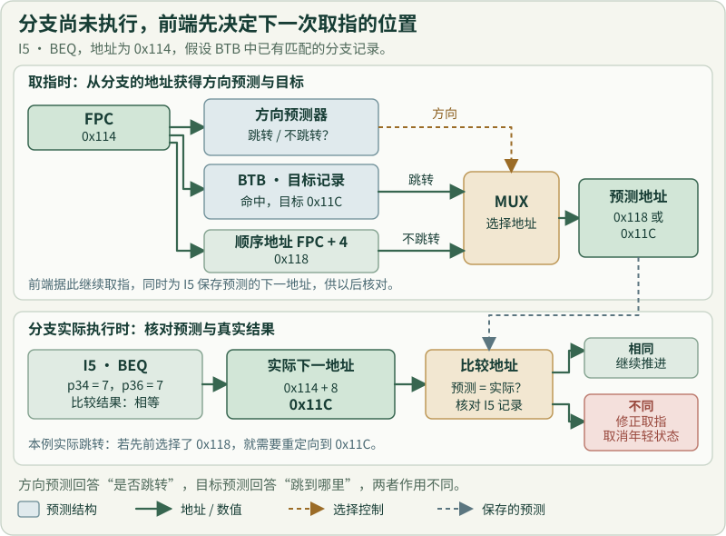
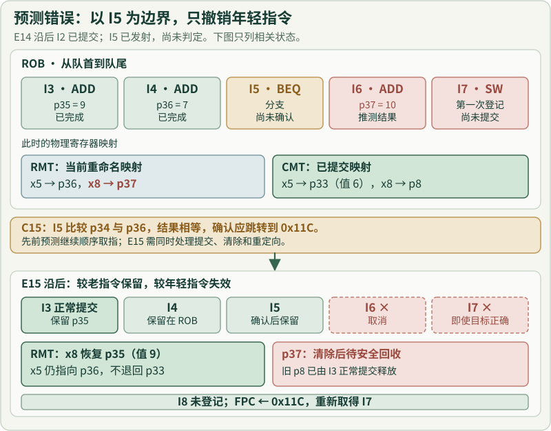
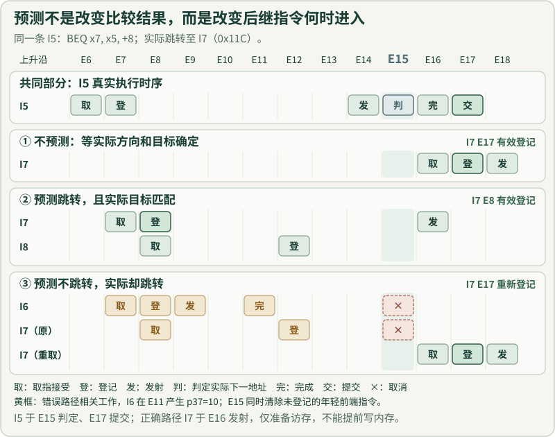

# 分支结果还没有算出来，处理器下一拍该执行什么？

在 [B05](b05-register-renaming.md) 中，处理器已经能够让多条指令乱序执行，同时按程序顺序提交。但每次遇到分支，前端仍要停止取得后续指令，直到知道下一条指令在哪里。

可是在这段等待时间里，前面的指令可能仍在执行，后面一些指令的操作数也可能已经准备好。是不是可以先选择一个方向，让硬件继续工作，等分支真正执行时再检查选择是否正确？

**分支预测（Branch Prediction）**让处理器在真实控制流尚未确定时估计下一条指令的地址。根据预测取得的指令还可以进行译码、重命名和执行，这种尚未确认是否属于正确路径就开始的执行称为**推测执行（Speculative Execution）**。

本篇先看为什么需要预测、预测什么，再改变 B05 的教学 CPU，观察预测正确和错误时指令、物理寄存器及提交状态分别发生什么变化。

## 为什么分支会让后面的指令等待？ {#control-dependency}

继续沿用 [B01 的程序和初值](b01-instructions-and-architectural-state.md#program)。其中 I5 是一条条件分支。下面只列接近分支的几条指令：

| 编号 | 指令地址 | 指令 |
| --- | --- | --- |
| I4 | `0x110` | `ADD x5, x6, x1` |
| I5 | `0x114` | `BEQ x7, x5, +8` |
| I6 | `0x118` | `ADD x8, x8, x3` |
| I7 | `0x11C` | `SW x7, 4(x4)` |
| I8 | `0x120` | `LW x11, 4(x4)` |

根据 [B01 的 BEQ 语义](b01-instructions-and-architectural-state.md#branch)，当 x7 = x5 时，I5 跳到 `0x11C`，否则下一条指令的地址是 `0x118`。只有不跳转的情况下，I6 才属于实际执行的程序。

回顾 B05，I5 在 E₇ 登记时已保存两个源编号 p34、p36。p36 是 I4 产生的值，在 E₉ 就绪；p34 是 I2 产生的值，需要到 E₁₃ 才就绪。

也就是说，I5 的两个物理编号虽然已知，比较使用的两个数却还没有都到达。即使 I6 所需的数据已经准备好，处理器也不知道它是不是应该执行。这是一个与数据依赖不同的问题：结果决定哪些指令属于正确的**控制流**。

如果一定要等比较完成才取下一条指令，就必须让前端停止推进。但下一条指令的地址并非完全无法估计。例如，可以预先假设 I5 不跳转，先取 `0x118` 处的 I6。

在 [B02](b02-in-order-pipeline-and-hazards.md) 中，顺序流水线已经使用过这个办法。只是当时分支执行得早，尚未进入执行级的年轻指令可以通过清除几个流水线有效位来取消。

本篇要面对两个新问题：怎样更准确、更早地选择下一取指地址？如果选错时，一条年轻指令已经把 10 写入 PRF，该怎样取消它的效果？

## 在真实结果到达之前，怎样选择下一取指地址？ {#direction-and-target}

回忆 [B02 的取指地址 FPC](b02-in-order-pipeline-and-hazards.md#pipeline-state)。FPC 保存的是前端下一次将使用的地址，不是某条已经提交指令的 PC。当前端成功取得一条普通的 32 位指令时，通常选择 FPC + 4。

对于 I5，需要区分两件事：

- **方向（Direction）**：比较相等还是不相等，也就是跳转（Taken，T）还是不跳转（Not Taken，N）。
- **目标（Target）**：如果跳转，下一条指令应该从什么地址取得。

对本例的直接条件分支，译码时只要获得指令自己的 PC 和立即数就能计算跳转目标：`0x114 + 8 = 0x11C`。不需要等 x7 或 x5 的值，才能算出这个地址。

但在 IF 取得 I5 时，译码可能还没有完成。希望此时就给下一拍的取指电路提供一个地址，就可以使用之前记录的信息。

例如，增加一个用取指地址查询的表。表里记录哪些地址曾对应控制转移指令，以及它们的跳转目标。当 FPC = `0x114` 且找到有效匹配项时，就能先取出曾记录的 `0x11C`。

这种用于帮助前端取得跳转目标的结构称为**分支目标缓冲区（Branch Target Buffer，BTB）**。一个简单条目包含有效位、地址标识和目标地址；实际设计还可能记录控制转移的类型及其他信息。

现在如果方向预测为 T，就选择预测目标 `0x11C`；方向预测为 N，就选择顺序地址 `0x118`。只有在目标信息可用时，预测跳转才有一个地址可供前端使用。如果 BTB 没有命中，可按具体设计等待译码、使用已经可以计算的目标，或者暂时顺序取指并随后纠正。

<figure class="micro-diagram" style="max-width:820px; margin:1.2rem auto" tabindex="0" aria-label="分支方向、目标与实际下一地址的选择和检查，窄屏可横向滚动" markdown="1">

<figcaption>单指令取指的教学示意。假设 BTB 中已有 I5 的目标；预测阶段只选择下一 FPC，不改变架构状态。执行阶段才核对真实结果。</figcaption>
</figure>

实际处理器并不一定将方向预测与目标查询做成完全独立的表。例如 [BOOM 的 Next-Line Predictor](https://docs.boom-core.org/en/latest/sections/branch-prediction/nl-predictor.html) 将方向信息、目标信息和下面要介绍的返回地址预测结合使用，并针对取指组进行选择。

## 怎样决定预测跳转还是不跳转？ {#direction-predictor}

最简单的办法是不保存历史，而根据一种固定规则决定下一地址。例如 B02 每次先取顺序地址，就是一种总预测不跳转的**静态预测**。也可以根据跳转方向等指令信息采用不同规则。

例如循环末尾经常有一条跳回较早地址的分支。若假设向后跳转的分支更可能跳转、向前跳转的分支更可能不跳转，对某些程序可能有帮助。但它不是 ISA 规定的结果；本例 I5 是向前跳转且实际跳转，正好可以预测失败。

希望硬件能根据程序实际行为改变判断，就需要保存过去执行这条分支时得到的结果。

### 如果用一位保存上一次结果呢？

当同一个静态指令地址在循环或多次执行中被再次访问，可以用一位状态表示它上一次实际是 T 还是 N。下一次遇到该地址，先按这位状态预测，再根据真实结果更新它。

这个办法对经常保持同一方向的分支很直观。不过，如果某条分支连续多次跳转，偶尔一次不跳转，随后立即又开始跳转，那么这一位会被连续改变两次。

例如下面是同一静态分支在五次执行中的实际方向。这里单独构造一组重复观测来解释预测器；B01 的一次短程序执行中，I5 只出现一次，不包含这五次循环。

设一位预测器的初值为 N，实际序列为 T、T、N、T、T。第一次预测 N 后更新为 T；第三次实际为 N，就改变为 N；第四次又实际为 T，于是再次预测错误。

### 怎样让偶尔发生的一次变化不立即改变判断？

可以增加一个状态位，将预测状态从两种扩展为四种。不再直接记录上一次结果，而记录一个有限范围的计数值：

| 状态 | 含义 | 本次预测 | 若实际为 T，下一状态 | 若实际为 N，下一状态 |
| --- | --- | --- | --- | --- |
| 00（0） | 强不跳转 | N | 01 | 00 |
| 01（1） | 弱不跳转 | N | 10 | 00 |
| 10（2） | 弱跳转 | T | 11 | 01 |
| 11（3） | 强跳转 | T | 11 | 10 |

实际为 T 时加 1，实际为 N 时减 1，到达最大值 3 或最小值 0 后不继续越界。这种只需两位保存当前状态的结构称为**两位饱和计数器（2-bit Saturating Counter）**。

初值设为 01。仍然使用刚才的五次实际方向，观察一位和两位预测器的变化。每一行先按沿用的旧状态预测，再根据这次真实结果更新状态。

| 次数 | 实际方向 | 一位预测 → 新状态 | 两位旧状态 → 预测 → 新状态 |
| --- | --- | --- | --- |
| 1 | T | N（错）→ T | 01 → N（错）→ 10 |
| 2 | T | T（对）→ T | 10 → T（对）→ 11 |
| 3 | N | T（错）→ N | 11 → T（错）→ 10 |
| 4 | T | N（错）→ T | 10 → T（对）→ 11 |
| 5 | T | T（对）→ T | 11 → T（对）→ 11 |

第三次实际为 N 时，两位计数器从 11 变成 10，下一次仍预测 T。于是第四次没有像一位预测器那样再错一次。代价是当真实行为已经长期改变，原先的强状态可能需要多次更新才能切换预测。

让表中的多个计数器分别对应不同地址，就可以针对不同分支的行为作判断。注意计数器只估计方向，并不保存目标地址。表容量有限，不同分支可能共用表项；实际预测器也可以利用更丰富的历史信息。

[Smith，1981：A Study of Branch Prediction Strategies](https://american.cs.ucdavis.edu/academic/readings/papers/smith-branch.pdf) 比较了多种静态与历史预测策略，包括这种使用有限状态计数的方向预测。本例的命中次数只对应上述人为给定的序列，不代表真实程序的预测准确率。

## 如果跳转的目标也会变化，BTB 保存一个地址够吗？ {#return-address-stack}

对于本篇的 BEQ，只要该地址的指令内容不变，直接跳转目标由 PC 和立即数决定。但有些跳转使用寄存器中的值决定目标，目标可能随程序状态而变化。

例如函数 A 与函数 B 都调用函数 F。执行到 F 的同一条返回指令时，有时需要返回 A 的调用点之后，有时需要返回 B 的调用点之后。

只在 BTB 记录这个返回指令上一次的目标，并不总能预测下一次的目标。不过返回地址有一个有用的规律：一般的嵌套调用中，最后被调用的函数最先返回。

因此可以在调用时把调用后的继续执行地址压入一组预测记录，在返回时从最近一项取出预测地址。例如，A 调用 B 时保存 A 的继续地址，B 调用 C 时再保存 B 的继续地址；C 返回采用 B 的地址，B 再返回时采用 A 的地址。

这种后进先出的预测结构称为**返回地址栈（Return Address Stack，RAS）**。它只是前端预测用的内部状态，不是软件保存真实返回地址的调用栈；实际跳转仍由指令语义和真实操作数决定。

例如 RV32I 的 JAL 可以把 PC + 4 写入指定整数寄存器，JALR 的实际跳转地址由寄存器和立即数计算。RISC-V 根据特定寄存器编号组合提供调用与返回的 RAS 提示，不能把所有 JAL 或 JALR 都理解为调用或返回。

[RISC-V 官方规范：控制转移指令与返回地址栈提示](https://docs.riscv.org/reference/isa/v20260120/unpriv/rv32.html)

这里不进一步展开调用约定或间接跳转预测算法。本篇的 BEQ 不使用 RAS，理解这类结构是为了区分方向预测、普通目标预测和返回地址预测的职责。

## 预测以后，年轻指令能不能先进入执行单元？ {#speculate}

现在把预测得到的地址接入 B05 的前端。仍采用六个 ROB 条目、38 个物理寄存器、双读单写 PRF、每拍最多登记、发射、完成与提交各一条的模型。

为了单独观察分支，将 B05 的规则作两项改变：

- IF 成功取得 I5 时，按预测选择下一 FPC，并保存预测的下一地址，随后与 I5 一起在 ROB 登记。允许该路径的年轻指令继续登记、重命名与发射。
- I5 不再等待所有更早指令提交才发射，而是在真实源数据及执行资源就绪时发射。提交仍严格按程序顺序进行。

此前的执行和资源约定保持不变：登记、发射和提交使用沿前状态判断；同沿释放的 ROB 条目及 PRF 位置下一拍才能分配。不跨越第二条未决分支，本例也不允许尚未确定分支的年轻访存指令发射。

对于 I5，在发射边沿采入 p34、p36。下一拍进行真实比较，可以在该拍结束时反馈正确的下一地址并决定是否重定向；再经过一拍将正常完成信息交给 ROB。这是本例选定的反馈路径，不是处理器通用的固定延迟。

为了对照，设 FPC = `0x114` 时 BTB 已有正确的目标 `0x11C`，分别给方向预测器两种初始判断。暂不考虑多条分支相互影响。本例只对最终成功提交的分支更新方向和目标记录；实际预测器的更新时机可以不同。

## 如果预测不跳转，而真实结果是跳转，会发生什么？ {#wrong-path}

沿用 B05 的 I0～I4 时序，不改变任何初始数值。这一次 I5 在 IF 被预测为不跳转，所以选择顺序地址 `0x118`。

| 边沿 | 前端及后端的主要变化 |
| --- | --- |
| E₆ | IF 取得 I5，预测下一地址 `0x118`；I0 提交、I4 登记 |
| E₇ | I5 登记，源 p34、p36；取得 I6；I4 发射 |
| E₈ | I6 登记，读取源编号 p35、p3，分配 p37；取得 I7；I3 写 p35 = 9 |
| E₉ | I6 发射并采入 9、1；I4 写 p36 = 7 |
| E₁₀ | I6 算出 10；I1 写 p33 = 6 |
| E₁₁ | I6 写 p37 = 10 并完成；I1 提交，I2 发射 |
| E₁₂ | 登记第一份 I7，取得 I8 |
| E₁₃ | I2 写 p34 = 7 |
| E₁₄ | I5 采入 p34、p36 的 7、7；I2 提交 |
| E₁₅ | I5 比较确定跳转；I3 提交；取消年轻指令并重定向 |

为什么直到 E₁₂ 才登记 I7？E₈ 沿后 ROB 中恰好有 I1～I6 六条指令，虽然还存在空闲物理位置，却没有可以登记 I7 的条目。I7 留在 IF/ID，直到 E₁₁ I1 提交，E₁₂ 才能登记。

现在重点观察 E₁₁。I6 计算的 10 已经写入它独占的物理位置 p37，RMT[x8] 也在 E₈ 登记 I6 时就改为 p37。但 I5 仍在等待 p34，还不能知道 I6 是否应该执行。

为什么没有破坏架构 x8？B05 中的 CMT 只随 ROB 队首正常提交而更新，I6 比 I5 更年轻。只要 I5 尚未确定且未提交，I6 就无法越过它更新已提交映射。

到了 E₁₄，I5 真正读入 7 和 7。C15 内比较结果为相等，因此实际下一地址是 `0x11C`。这与原先保存的预测地址 `0x118` 不同。预测失败（Misprediction）被发现，并在 E₁₅ 改变前端取指地址。

对于其他控制转移，即使认为会跳转，也可能猜错目标。重要的是检查取得的下一地址是否符合真实控制流，而不只比较一个方向位。

## 只丢弃错误结果就够了吗？ {#recovery}

回忆 [B05 的精确异常恢复](b05-register-renaming.md#recovery)。异常发生时，处理器从已提交映射 CMT 恢复全部未提交状态。

这里不能照搬这个办法。因为预测错误并不表示 I5 发生异常，也不表示所有尚未提交的指令都不该执行。I5 本身是正确的指令，它前面的 I4 也已经产生正确结果，只是此时还没有提交。

例如 E₁₄ 沿后，CMT[x5] = p33，其中保存 I1 提交的 6；而 RMT[x5] = p36，其中保存 I4 产生的 7。若把整个 RMT 恢复成 CMT，就会错误地撤销 I4 的映射。

需要恢复的是**紧接 I5 之后、尚未登记任何年轻指令时的重命名状态**，而不只是已提交状态。

### 怎样利用已有 ROB 恢复这个边界？

在 B05 中，每条写入整数寄存器的指令都记录旧目标物理编号与新目标物理编号。现在可以用这些信息来撤销较年轻的重命名操作。

假设错路中 I6 的记录为：架构目标 x8，旧物理编号 p35，新物理编号 p37。如果撤销 I6，就让 RMT[x8] 重新指向 p35，并回收不再属于任何有效指令的 p37。

如果有多条需要撤销的指令修改同一个架构编号，应从队尾向分支逆序处理这些记录。逐次恢复对应的旧编号，最后就能还原到该分支的边界，而不是任意选择某个旧值。

E₁₅ 的具体变化如下：

- 保留 I5 和更早的指令。I3 在这个沿正常提交，CMT[x8] 更新为 p35，并释放原 p8。I4 的 p36 及其未提交记录仍然保留。
- 取消已经登记的 I6 和第一份 I7。I6 的新目标 p37 在确保不会再收到被取消写回后归还空闲列表；I7 没有整数目的位置。
- 恢复 RMT[x8] = p35，保留 RMT[x5] = p36。I8 此时仍在 IF/ID，不接受这次错误路径登记，也不为它分配物理位置。
- 清除错误路径的前端记录，将 FPC 重定向到 `0x11C`。重定向优先于同沿错误路径的登记或发射。

<figure class="micro-diagram" style="max-width:820px; margin:1.2rem auto" tabindex="0" aria-label="分支预测错误时保留较老指令并逆序撤销年轻映射，窄屏可横向滚动" markdown="1">

<figcaption>分支预测失败只撤销受该分支错误选择影响的年轻指令。本图不是精确异常处理，不回到旧的 CMT，也不转向异常处理程序。</figcaption>
</figure>

即使第一份 I7 原本的地址与真正的目标地址相同，本例仍然统一取消 I5 之后的所有在途指令及前端记录，从正确目标重新开始。某些设计可以尝试保留路径重新汇合后的工作，但需要额外确认其依赖和状态有效。

本例只有需撤销的 I6 改写了一个映射，允许在 E₁₅ 完成更新。更大的窗口中，逆序撤销多个映射可能需要更多周期。取消后尚未返回的结果也必须通过 B04、B05 所述的机制防止更新已复用的位置。

### 能不能更快地恢复映射？

另一种实现是在 I5 重命名完成时记录一份 RMT 的快照。若预测失败，直接使用这份快照恢复映射，而不必每次从队尾逐项查找旧编号。这种额外保存用于恢复的状态称为**检查点（Checkpoint）**。

但只恢复旧映射还不够，还需要处理资源。例如 I5 登记之后，I1、I2、I3 陆续提交了旧的物理位置 p5、p7、p8。若将空闲列表简单重置为 I5 当时的列表，就可能丢掉这些正常释放的资源。

因此需要在保留较老指令提交产生的回收结果的同时，归还错路分配的新位置。我们的教学模型通过实际撤销的 ROB 记录回收 p37。真实处理器也可以另行记录每个未决分支之后的物理编号分配。

例如 [BOOM 的重命名阶段](https://docs.boom-core.org/en/latest/sections/rename-stage.html) 描述了分支映射快照与分配记录；[BOOM 的执行阶段](https://docs.boom-core.org/en/latest/sections/execution-stages.html#branch-unit-branch-speculation) 描述了如何让受同一未决分支影响的在途操作在预测错误时被取消。

现代核心可能同时处理多个未决分支，因此需要识别一条年轻指令依赖哪些预测。本文只保留一个未决分支，并通过 ROB 年龄识别应当取消的记录，不展开多级预测器与检查点的具体实现。

## 如果预测正确，提前做的工作可以保留多少？ {#correct-path}

回到同一个 I5，但这次预测为 T，并得到正确目标 `0x11C`。I5 的源就绪时间没有改变，仍在 E₁₄ 发射，并在 E₁₅ 校验出正确方向。

区别在于前端已经从正确地址取得指令：

| 边沿 | 正确预测时的后续指令变化 |
| --- | --- |
| E₆ | 取得 I5，预测下一地址 `0x11C` |
| E₇ | 取得 I7，登记 I5 |
| E₈ | 登记 I7，取得 I8 |
| E₁₂ | ROB 有空位，登记 I8，为 x11 分配 p37 |
| E₁₄ | I5 发射，I2 提交 |
| E₁₅ | I5 确认预测正确，保留已经登记的 I7、I8；I3 提交 |

本模型只允许年轻访存指令在分支确定后发射。为了维持沿前判断的约定，I7 最早在 E₁₆ 发射，准备写入地址和数据；I8 仍等待较早的 Store 成功写入后才允许访问内存。

I5 正常完成信息在 E₁₆ 进入 ROB，E₁₇ 才提交。即使准备动作已完成，I7 也不能在 I5 提交、自己成为队首之前向内存实际发出写入。这与 [B04 的 Store 提交规则](b04-in-order-commit-and-precise-exceptions.md#store-commit) 一致。

如果年轻指令在取指、译码等阶段已记录异常，后来却因预测错误被取消，也不能把它的异常当成正确路径上的异常报告。本篇仍遵循 B04 的精确异常规则。

<figure class="micro-diagram" style="max-width:820px; margin:1.2rem auto" tabindex="0" aria-label="等待分支、正确预测和错误预测的指令日程对照，窄屏可横向滚动" markdown="1">

<figcaption>只比较分支附近的前端与内部执行进度。三种策略的比较及提交约定相同；不将提前登记的拍数当作整段程序的性能提升。</figcaption>
</figure>

作为对照，若完全不预测、只等待分支比较完成（不是等待分支提交），则与错误预测一样，要到 E₁₆ 才能取得 I7，E₁₇ 登记，E₁₈ 发射。正确预测使 I7 提前九拍登记，但由于它也需要等待数据和访问许可，真正发射只提前两拍。

| 指标 | 等待分支 | 正确预测跳转 | 错误预测不跳转 |
| --- | ---: | ---: | ---: |
| I5 真实方向确定 | E₁₅ | E₁₅ | E₁₅ |
| 最终有效的 I7 登记 | E₁₇ | E₈ | E₁₇ |
| I7 发射 | E₁₈ | E₁₆ | E₁₈ |
| I6 产生错误路径上的 10 | 否 | 否 | 是，E₁₁（E₁₅ 取消） |

三条路径的架构状态最后都相同：x5 = 7、x6 = 5、x7 = 7、x8 = 9、x11 = 7；M[`0x200`] = 6、M[`0x204`] = 7，下一条指令地址为 `0x124`。我们改变的是处理器内部的进度和数据位置，而不是程序语义。

## 预测准确率提高，性能就一定按相同比例提高吗？ {#implications}

正确预测可以让前端尽早提供正确路径的指令，减少执行资源因缺少工作而空闲的机会。预测错误却需要取消已经进行的工作，恢复状态，重新取得正确的指令。

从发现预测错误到正确路径重新具备执行条件，需要多少时间，取决于实际反馈路径、恢复方式和取指延迟等条件。这个时间或相对于正确预测所增加的执行时间常与**预测失败代价**相关；比较时需要说明采用的是哪一个时间边界。

在本例中，正确路径的 I7 在预测正确时提前九拍登记，但它真正能够发射的时间并没有提前九拍。它还受到 I2 的结果、访存顺序和提交边界的约束。

增加预测器容量和利用更长历史可能提高某些程序的准确率，但也会增加存储、状态更新、读取路径与恢复成本。还有一些程序的分支行为很难通过简单的历史规律预测。

错误预测与精确异常的恢复都要求保证程序可见状态正确，而不是把处理器内部所有微架构状态的比特恢复到原样。推测执行的具体实现、适用边界和资源管理都需要各自考虑。

## 如果后面的 Load 已经知道地址，它可以越过 Store 吗？ {#next}

B06 解决的是下一条指令在哪里的不确定性。现在即使前端已经取得并登记了正确路径中的 I7 Store 和 I8 Load，本例仍要求 I8 等 I7 实际写入成功，才能访问内存。

如果两个访问的地址不同，后面的 Load 是否有必要一直等待？如果地址相同，但前面的 Store 值已经算出，Load 能否直接从处理器内部取得正确数据？

下一篇 B07 将把观察重点移到访存路径，分析如何记录地址与数据、判断访存依赖，并区分指令提交和内存效果可见的时刻。

[返回指令执行与 CPU 导读](README.md)。
