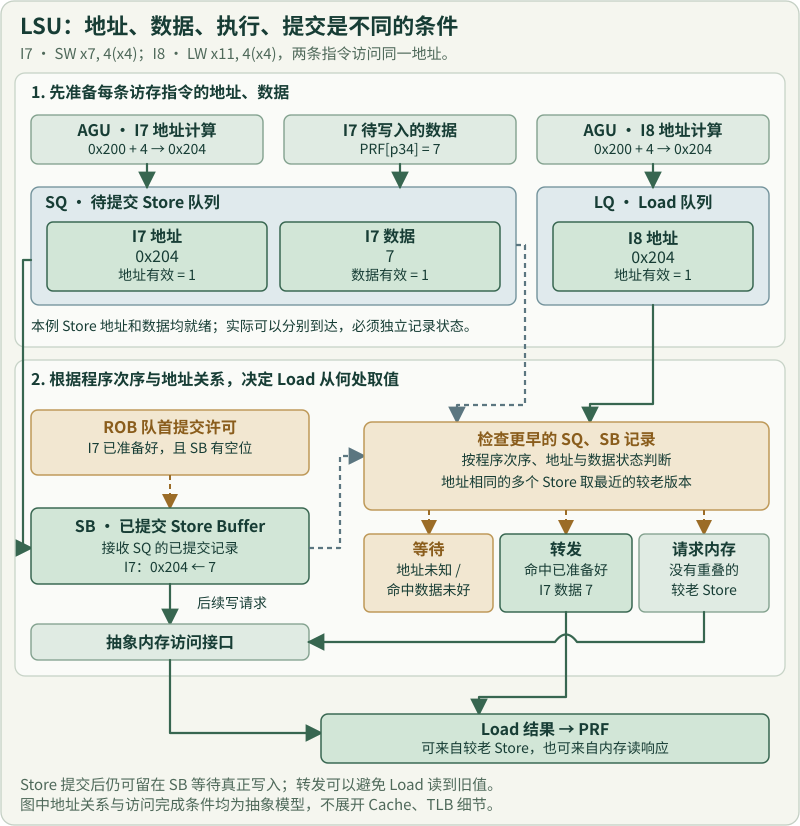
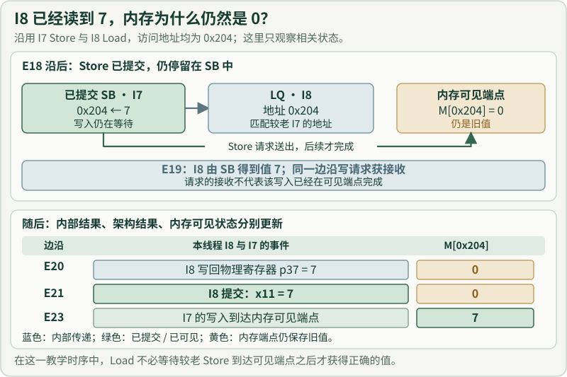
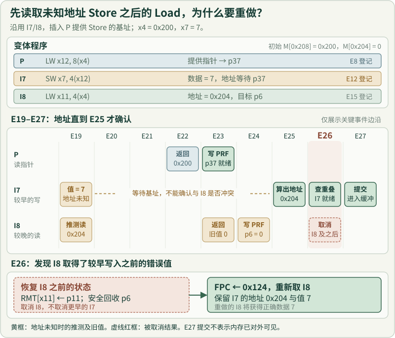

# 前面的 Store 地址还没有确定，后面的 Load 能否提前执行？

在 [B06](b06-branch-prediction-and-speculation.md) 中，处理器已经能够提前取得分支之后的指令。只要数据和执行资源满足条件，它甚至可以让较年轻的指令先完成计算。

但程序中的访存指令仍采用较保守的规则：前面的 Store 没有成功写入，后面的 Load 就不能发起访存。即使两条指令使用的寄存器完全不同，也可能需要互相等待。

这里的问题是，寄存器的名字已经可以在译码时取得，但访存指令真正读写的是计算出来的内存地址。**访存执行不仅需要取得地址和数据，还需要判断不同内存访问之间是否有依赖。**

下面沿用之前的教学 CPU，逐步改变访存指令的组织方式。先解决同一个硬件线程中怎样正确取数，再看内部执行顺序与其他硬件线程观察到的内存次序有什么关系。

## 如果 I8 不等 I7 写入就直接读内存，会发生什么？ {#store-load-dependency}

回顾 [B01 的程序及初值](b01-instructions-and-architectural-state.md#program)。I5 比较相等，跳过 I6。接下来实际执行两条访存指令。

| 编号 | 指令 | 访问的位置 | 程序语义 |
| --- | --- | --- | --- |
| I7 | `SW x7, 4(x4)` | `0x204` 开始的四字节 | 保存 7 |
| I8 | `LW x11, 4(x4)` | `0x204` 开始的四字节 | 读取 7 |

其中 x4 = `0x200`，x7 = 7；访问前 M[`0x204`] = 0。如果 I8 在 I7 实际写入之前直接读取原来的内存内容，就会取得错误的 0。

换一下条件。假设只是为了比较，把 I8 改成 `LW x11, 0(x4)`。这次它要读取的是 `0x200` 开始的四个字节，所需的 6 原本就在内存中。I7 对 `0x204` 的写入不会改变这个值。

这说明，同一个线程中的两条访存指令是否存在数据依赖，不能只根据它们在程序中的先后关系决定。还要看它们访问的内存位置是否重叠。

可是两条指令的寄存器编号即使不同，也可能计算出同一个地址。如果指令刚登记时还缺少基地址的值，硬件甚至无法确定第一次 Store 要写到哪里。

因此我们首先需要让较早的地址计算结果被记录起来，供后续的访存指令查询。

## 怎样把地址计算与真正的内存访问分开？ {#address-generation}

在 [B01](b01-instructions-and-architectural-state.md#load-store) 中，已经让加法器通过基地址加立即数计算访存地址。这里将负责这种运算的硬件路径称为**地址生成单元（Address Generation Unit，AGU）**。它可以是专用单元，也可以利用共享的执行电路。

对于 I7，AGU 需要读取 x4 对应的物理寄存器 p4 中的 `0x200`，加上立即数 4。计算结果 `0x204` 是要写入的地址，不是待写入内存的数据 7。

Store 因此有两类准备工作：

- 取得基地址并计算访问位置，同时完成必要的地址及访问检查。
- 取得准备写入的值，本例是 p34 中的 7。

这两份信息不必在同一时刻就绪。例如 Store 已取得基地址，但仍要等另一条指令计算写入数据。也可能先取得待写数据，却无法计算地址。

如果一定要等待两个操作数都就绪才开始计算地址，那么后续 Load 也要等得更久，才能判断是否与这个 Store 访问同一个位置。可以让 Store 的地址计算和数据采集分别进行，分别记录有效状态；当两份输入都已就绪时也允许一次交付。

而 B03 介绍的**访存单元（Load/Store Unit，LSU）**不只是一个地址加法器。它还要根据这些地址、在途访存的状态、资源接纳能力和顺序约束，决定何时向存储接口发送请求，何时等待，以及何时直接返回内部数据。

主算例只观察一个硬件线程，没有其他读写者。本篇只处理对齐的 RV32I 四字节访问，使用无别名的普通内存地址。将地址转换、访问属性、权限等检查抽象为获得可用于匹配和访问的地址这一过程，不展开 [Cache 与 TLB 的内部实现](../../storage/README.md)。

## 访存指令需要保存哪些状态，才能不必全部等待？ {#lsq}

在 B05，已经登记的指令会记录源物理编号、目标编号、程序顺序和完成状态。但普通 ADD 结果写回后，消费者只需要查相应物理位置是否就绪。

Store 的结果不是写给某个物理寄存器的数。即使已经算出 `0x204`，也不能立即释放这份地址，因为年轻的 Load 还需要根据它判断自己应该从哪里读取。

所以再增加一些在途记录位置。分别保存读请求和写请求的状态，称为 **Load Queue（LQ，Load 队列）**与 **Store Queue（SQ，Store 队列）**。两者合称 **Load/Store Queue（LSQ，访存队列）**，也有设计使用其他名称或组织成统一结构。

登记访存指令时，同时为它分配 ROB 条目和相应 LSQ 条目。这里按程序顺序分配，并保留足以判断年龄先后的编号。执行不需要严格按照这些条目的分配顺序进行。

| 记录位置 | 本模型主要保存的信息 |
| --- | --- |
| LQ | 指令年龄及 ROB 关联、地址和地址有效位、访问范围、目标物理编号、请求与数据来源状态 |
| SQ | 指令年龄及 ROB 关联、地址及有效位、待写数据及有效位、写入范围、检查和准备状态 |

例如 I7 已经算出 7，但地址还没有算出，可以在 SQ 中将数据就绪位置为 1、地址就绪位保持为 0。这样硬件能够明确知道缺少哪一份信息，而不是把一个无效地址当作 0。

B04～B06 的 ROB 记录一直保留到指令提交或取消。本篇还让 LQ 保留到 Load 提交或被取消；即使数据已经写入物理寄存器，记录仍可能用于检验访存次序。

对于 Store，后文还会在 SQ 之外增加保存已提交写入的缓冲。只要它的写入仍没有传播到本模型的内存观察点，就必须保留能够处理这次写入和后续读取的信息。

例如 [BOOM 的访存单元](https://docs.boom-core.org/en/latest/sections/load-store-unit.html) 使用读写队列，并允许 Store 的地址与写数据分开进入记录。它不要求所有处理器都采用本篇的队列容量、分配方式或执行阶段。

## 地址已经确定，Load 怎样决定读谁的数据？ {#address-disambiguation}

假设 I8 的地址已算出是 `0x204`。硬件要在尚待处理的写入中找到与它有关的那些 Store，必须按照程序顺序筛选：只检查比 I8 更早的 Store，而不能因为一个较年轻的 Store 已经算出结果，就把这个未来的值交给 I8。

这种通过地址等信息消除对未知访存依赖的疑问的过程，通常称为**内存地址消歧（Memory Disambiguation）**。先看所有较早 Store 的地址都已知的情形。

| Load 与较早待处理的 Store 的关系 | 本篇采用的处理规则 |
| --- | --- |
| 访问范围不重叠 | 可以按资源和次序条件，直接发出读请求 |
| 访问同一个完整字，且匹配 Store 的数据就绪 | 直接使用该 Store 的写入数据 |
| 访问同一个完整字，但所需 Store 数据还未就绪 | 等待数据，不能读内存中的旧值 |

如果 I7 已经将地址和数据 7 保存在队列中，I8 在检查后直接从记录取得 7，无须等待它先写入内存再读取一遍。

这种从较早的待完成写入中直接取得读取所需数据的方式称为**Store-to-Load Forwarding（存储转发）**。它与 [B02 的寄存器结果旁路](b02-in-order-pipeline-and-hazards.md) 相似，区别是需要通过内存地址判断应选择哪份值。

如果两个较早 Store 先后写同一个位置，例如一个写 6、另一个写 7，随后 Load 应得到最近一次写入的 7。这里的“最近”指的是程序顺序上最接近 Load 的较早写入者，而不是最早完成或最后进入缓冲的那一条。

如果最近一次写入的数据尚未就绪，不能改用更老的 6。硬件可以根据年龄和地址比较选择正确的生产者，等所需的数据真正到达。

实际 CPU 还需比较访问的字节范围。例如一个四字节读取与一个单字节写入可能部分重叠，不能只比较起始地址。若多个 Store 覆盖不同字节，应根据每个字节的顺序找到正确数据；有些实现会合并这些数据，也可保守等待相关写入完成再读。

本文只转发完全匹配的对齐整字。对于部分重叠则采用保守等待规则；不将本例的整字比较当作一般地址判断方法。

## Store 提交以后，为什么还要保留写入记录？ {#store-buffer}

回忆 [B04 的 Store 提交](b04-in-order-commit-and-precise-exceptions.md#store-commit)。由于不能轻易撤销已经改变内存的写入，原来的教学模型要求 Store 到达 ROB 队首后才真正发起写入，并等待成功反馈后提交。

但是从程序顺序来看，一旦 Store 位于队首，且地址、数据及同步异常检查均已确定，就已经知道这条指令应该执行。它真正写入存储系统时还可能因为端口忙、缓存访问或下游等待而迟迟未完成。

能否让它先退出 ROB，同时用一个新的位置继续保存这份已确认的写入？

可以增加一个**Store Buffer（SB，存储缓冲）**，保存已经提交、但尚未完成对内存写入的记录。当队首 Store 已准备好且缓冲可以接纳时，将地址、数据、访问范围和顺序信息一起转入缓冲。在本模型中，这次成功交付就是 Store 提交。

这样 ROB 可以释放相应条目，后端还能继续处理更多正确指令。存储缓冲以后再按本模型的程序顺序向存储接口发出写入，并保留有关记录直到写入效果已安全交付。

注意，交付给缓冲的必须是实际地址和数据等完整信息，而不是仅仅保存一个源物理寄存器编号。后续指令继续提交时，该物理位置可能已被回收并重新分配。

到这里，前面的 Store 可能还在未提交的 SQ 中，也可能已经转到 Store Buffer 中。进行存储转发时，要检查这两个集合中的较早待处理写入。否则刚刚提交但还没写入的 Store 会从查询范围中消失，导致年轻 Load 读到旧值。

本篇为了观察数据去向，将未提交 SQ 和已提交 Store Buffer 画成两种存储位置。实际 CPU 也可以用同一个队列同时保存未提交、已提交但尚未排空的 Store，并通过状态位区分，参见 [BOOM 的提交阶段](https://docs.boom-core.org/en/latest/sections/reorder-buffer.html#the-commit-stage) 与访存单元文档。

增加这个缓冲后，还需改变 B04 的故障假设：所有需要以精确同步异常报告的 Store 检查，都应在提交前完成；本模型假设已授权的普通内存写请求最终成功，不考虑提交之后的额外存储系统故障。真实平台对此类故障另有处理约定。

<figure class="micro-diagram" style="max-width:820px; margin:1.2rem auto" tabindex="0" aria-label="独立地址生成、访存队列、写入缓冲及读取选择的数据通路，窄屏可横向滚动" markdown="1">

<figcaption>本篇最终教学结构。地址、写数据和访存状态分别保存，Load 选择等待、转发或访问存储，而 Store 提交和实际写入分开。图中的两个地址计算动作由同一 AGU 在不同拍完成，省略 Cache、地址转换及其他内存系统细节。</figcaption>
</figure>

未提交的 Store 可因异常或错误分支被取消。已进入此缓冲的 Store 已被确认应当发生，即使后面遇到异常、中断或错误预测也不能将它一起丢弃。若缓冲已满，队首 Store 必须等待，ROB 仍然可能产生反压。

这里是 CPU 核心的存储缓冲，不是 [DRAM 控制器的写缓冲](../../storage/04-dram-controller/write-buffer-write-drain.md)，也不代表每次写入都要直接到达 DRAM。

## 让 I8 提前取得数据，逐拍会发生什么？ {#forwarding-timeline}

从 B06 正确预测的日程继续观察。E₁₅ 之后分支已经确定，I7、I8 已登记，I5 仍将在 E₁₇ 提交。I7 读取 p34、p4，I8 的目标位置为 p37。

保留 B06 的六条目 ROB、38 个物理位置及单发射、单完成、单提交约定。为这部分访存执行增加三项规则：

- LQ、SQ 分别有三个和两个记录位置，已提交存储缓冲可保存两个写入。登记时原子分配 ROB 和所需队列位置。
- 一个 AGU 每拍最多接纳一项地址计算。发射边沿采入操作数，下一沿记录计算好的地址；独立的数据采集也使用同一发射机会。Store 若两者都就绪，可以一起采入。若竞争这一机会，本例先选已就绪的地址生成动作，再选纯写数据采集；同类动作按年龄优先。
- 存储接口每拍最多接纳一个新请求，可有多笔在途，依响应标记匹配记录。为便于对照，假设接纳后四个完整周期产生反馈，写入在反馈沿更新抽象内存 M。内部转发不占用该接口。

这些是新的后缀观察条件，不是实际 Cache/DRAM 延迟，也不重新计算之前 I1 的访存日程。这里用 M 表示抽象存储观察点中的值，尚待转发或写入的内部数据不直接计入 M；不设其他读写者。

观察原程序的同址路径：

| 边沿 | I7 Store | I8 Load | M[`0x204`] |
| --- | --- | --- | ---: |
| E₁₆ | 发射，采入 `0x200`、7 | 已登记 | 0 |
| E₁₇ | SQ 保存地址 `0x204`、数据 7，准备及检查完成 | 发射，采入 `0x200` | 0 |
| E₁₈ | I7 已在队首，提交并移入 Store Buffer | LQ 保存地址 `0x204` | 0 |
| E₁₉ | 写请求被存储接口接纳，记录继续保留 | 命中较老 I7 的缓冲记录，取得 7 | 0 |
| E₂₀ | 等待写入反馈 | 将 7 写入 p37，完成 | 0 |
| E₂₁ | 等待写入反馈 | 提交，CMT[x11] → p37 | 0 |
| E₂₃ | 写入成功，安全释放缓冲记录 | 已提交 | 7 |

E₁₇ 时 I7 已具备所需地址及数据，I5 也在 E₁₇ 提交。沿前判断的约定下，I7 要到 E₁₈ 才能使用队首提交逻辑。I8 的地址也在这个沿得到，C19 中查询 Store Buffer 时 I7 仍然存在。

<figure class="micro-diagram" style="max-width:820px; margin:1.2rem auto" tabindex="0" aria-label="已提交但尚未写入的Store将7转发给年轻Load，窄屏可横向滚动" markdown="1">

<figcaption>仅表示本模型的内部转发与存储反馈时序。I8 的数据来源是还未排空的 I7 写入记录，而不是读取到旧的 M[`0x204`]。</figcaption>
</figure>

在本例的 E₂₁，I8 甚至已经提交了 x11 = 7，M[`0x204`] 却仍是 0。这不矛盾：同一个线程的 Load 已经通过转发得到了它按照程序语义需要观察的值，Store 的实际写入还在推进。

如果采用原来的有序访问策略，年轻 Load 必须等较早的写入完成，然后再发出读请求。这里不再重复 B06 没有逐拍展开的后缀日程；只对照新组织中转发为什么可以缩短等待。

### 如果 I8 改读另一个位置呢？

只把 I8 改成 `LW x11, 0(x4)`，其他条件不变。它在 E₁₈ 得到 `0x200`，I7 的写入范围是 `0x204`～`0x207`，两者不重叠。

C19 中 Load 通过地址检查后提出读取请求，Store Buffer 也提出写入请求。假设本次仲裁让 Load 先用端口，等待中的 Store 下拍获得服务。

| 边沿 | I8 Load | I7 Store |
| --- | --- | --- |
| E₁₉ | 存储接口接纳读 `0x200` 的请求 | 等待端口 |
| E₂₀ | 等待读反馈 | 存储接口接纳写 `0x204` 的请求 |
| E₂₃ | 读取返回 6 | 等待写反馈 |
| E₂₄ | 写入 p37 = 6 | 更新 M[`0x204`] = 7 |
| E₂₅ | 提交 x11 = 6 | 已排空 |

因此虽然 Store 先登记、先提交，但 Load 的存储请求可以先被接纳。这个结果依赖接口允许多笔工作在途；如果存储资源一次只能处理一笔，Load 仍然可能要等待资源。这与数据真的依赖较早的写入是不同的问题。

本变体不再是 B01 的原程序，所以最后 x11 是 6 而不是 7。我们只改变 Load 的地址，用它说明不相关地址的访问可以重叠。

## 如果较早 Store 的地址还没有算出，Load 怎样继续？ {#unknown-address}

上述判断依赖一个前提：需要比较的较早地址已经确定。但访存地址本身也可能依赖某一条比较慢的指令。

为了观察这个现象，将原程序正确分支目标之后增加一条 Load，记为 P；它从内存中读取 I7 要使用的基地址。I7 改用 x12，I8 保持原来的 Load。其余指令和初值保持不变，另设 M[`0x208`] = `0x200`。

| 代号 | 新指令地址 | 指令 | 所需关系 |
| --- | --- | --- | --- |
| P | `0x11C` | `LW x12, 8(x4)` | 从 `0x208` 读得 `0x200` |
| I7 | `0x120` | `SW x7, 4(x12)` | 地址依赖 P，最终写 `0x204` |
| I8 | `0x124` | `LW x11, 4(x4)` | `0x204` 已可计算 |

I5 仍以 `0x11C` 为分支目标，跳过 I6。这个变体只增加一条指令并改一个 Store 的基地址，新的程序结束观察地址为 `0x128`。

I7 所需的写入数据 7 已准备好，但 x12 的新值还要等 P 的返回。I8 不需要 x12，能够先得到自己的地址 `0x204`。

现在暂时不知道 I7 将会写入哪儿。有两种基本策略。

- **保守执行**：只要有可能影响本次读取的较早未知 Store 地址，就先等待，直到能够正确选择转发或读内存。
- **推测执行**：若预计前面的 Store 与本次 Load 不重叠，可以先发出读请求。但是要保留相关记录，待较早地址确定时重新核对。

第二种方法与 B06 的分支推测有相似之处：先完成可能有用的工作，而不把未经确认的效果作为正式架构结果。区别在于，这次不确定的不是下一条指令地址，而是 Load 需要的数据来自哪里。

### 如果错误地读到了旧值，怎么恢复？

仍按预测正确的分支进入这段程序，保持前缀时序。此时 P 在 E₈ 登记（分配 p37），I7 在 E₁₂ 登记，I8 在 E₁₅ 登记（分配 p6）。P 与 I8 都使用已就绪的 p4 计算地址。

假设 LSU 使用允许跳过未知 Store 的推测策略。仍保留未决分支约束，并明确所有响应时间都按上节接纳请求后的四拍计算。

| 边沿 | 较早的 P 和 I7 | 较晚的 I8 |
| --- | --- | --- |
| E₁₆ | P 发射 | 等待发射端口 |
| E₁₇ | P 的地址 `0x208` 就绪 | I8 发射 |
| E₁₈ | P 读请求被接纳；I7 采入写数据 7 | 地址 `0x204` 就绪 |
| E₁₉ | I7 地址仍未知 | 推测读请求被接纳 |
| E₂₂ | P 返回 `0x200` | 等待读反馈 |
| E₂₃ | P 写 p37 = `0x200` | 返回原内存值 0 |
| E₂₄ | P 提交；I7 发射地址计算 | 写 p6 = 0，暂时完成 |
| E₂₅ | I7 地址 `0x204` 就绪 | LQ 仍有已执行记录 |
| E₂₆ | 核对重叠关系，I7 的准备及检查完成 | 发现错误取值，撤销这次执行 |

E₁₉ 时，I7 的数据已经准备好，却不知道地址，因此硬件不能确认 I8 是否可以从内存取得正确的结果。I8 如果先请求内存，就会返回原来的 0。

E₂₅ 后，I7 的地址终于确定为 `0x204`。C26 核对较年轻的 Load 记录时发现：I8 曾经从内存得到 0，实际上它应该得到 I7 的 7。这里发生了访存次序错误，需要让 I8 重新执行。

为什么到了 E₂₆ 仍然可以纠正？因为 I7 更早，它还未提交，年轻的 I8 不可能越过它提交。在本例中，I7 必须通过已执行 Load 的顺序检查才可标记准备完成。若有冲突，先修复错误，再允许正常提交。

<figure class="micro-diagram" style="max-width:820px; margin:1.2rem auto" tabindex="0" aria-label="较老Store地址未知时提前Load及重叠检查恢复，窄屏可横向滚动" markdown="1">

<figcaption>独立变体中的内存依赖推测。I8 的 0 从未提交为架构结果；E₂₆ 确认错误后，保留正确的较早 Store，并撤销错误的年轻指令及相关记录。</figcaption>
</figure>

这种重新执行的动作常称为 **Replay（重放）**。在本模型中，沿用 B06 简单的逆序恢复：从出错的 Load 开始取消它以及所有更年轻的指令，删除相应 LQ、SQ 和 ROB 记录，恢复旧的重命名映射并安全释放新位置。

E₂₆ 将 RMT[x11] 恢复为 p11，p6 在确认旧响应不再修改它后回收。I7 仍然保留已算出的地址与数据，在 E₂₇ 可以正常提交到 Store Buffer；取指也从 I8 的新地址 `0x124` 重新开始。

重新取得的 I8 将重新分配一个物理位置。它再次查找访存依赖，若 I7 仍在写缓冲中就可以取得 7；若已经排空则可以从内存读取 7。原先写入 p6 的错误结果不会正式成为 x11 的架构值。

如果 I7 最后算出的是另一个不重叠的地址，且没有其他顺序冲突，这次提前读取就可以保留。实际处理器可以用访存依赖预测减少不必要的等待，又在出现错误时验证并恢复。

[Chrysos 与 Emer，1998：Memory Dependence Prediction using Store Sets](https://people.csail.mit.edu/emer/media/papers/1990s/1998/1998.06.isca.storesets.pdf) 研究了如何根据已观察到的访存依赖帮助调度器选择较早的可执行时机。这里不深入该预测算法，也不要求所有 CPU 采用本篇整段撤销的恢复方法。

## 自己能读到刚写的值，是否意味着其他核心也能读到？ {#memory-ordering}

回到原来的 I7、I8。我们已经看到 Store 可以先提交，年轻 Load 可以通过转发取得它的值，而实际内存写入还没有完成。

这在单线程、没有其他读写者的程序里很容易理解。可是，若另一个硬件线程同时发出读取，是否也能从这个处理器内部的写入缓冲取得相同的 7？并不一定。

需要区分三个时刻：

| 事件 | 本模型的 I7 | 表示什么 |
| --- | --- | --- |
| 准备完成 | E₁₇ | 地址和写数据已知，检查通过 |
| 提交 | E₁₈ | 这次写入不能再因年轻指令被取消，转入缓冲 |
| 在抽象内存观察点生效 | E₂₃ | 写入的值已进入本模型的共享存储观察点 |

真实系统的最后一个事件需要按照相应 ISA 和一致性系统的契约理解，不一定等于数据到达 DRAM。本级 Cache 接纳、其他核心可观察、下级存储写回及掉电持久化，也不能仅凭一个反馈信号认定是同一件事。相关内容参见[存储系统的 Cache 写策略](../../storage/01-memory-hierarchy/02-access-paths/cache-vs-scratchpad.md)与[缓存一致性专题](../../interconnect/COHERENCE/01-foundations/coherence-consistency-atomicity.md)。

### 两个硬件线程分别执行 Store 和 Load，会看到什么？

为简要说明内存次序，采用上述一致性专题已有的两地址算例。设普通内存的 a、b 是不同位置的两个对齐字（初值 0），两个线程都只进行下表两次访问。将其视为 ISA 层的内存事件，不是高级语言中的普通共享变量程序。

| 线程 A 的程序顺序 | 线程 B 的程序顺序 |
| --- | --- |
| 写 a = 1 | 写 b = 1 |
| 读 b → rA | 读 a → rB |

假设两个线程的 Store 都先保存在各自内部的缓冲中，尚未传入共享存储观察点。两个 Load 访问的又都是另一个位置，不会从本线程的 Store 取得新值，于是可能分别读出 0。

随后两次写入完成，a、b 都变成 1。两线程各自的提交顺序并没有被颠倒，但是从跨线程的内存观察结果看，并非所有访问都必须按每个线程的程序顺序发生。

若要求存在同时保持两个线程程序顺序的共同内存访问次序，这种结果不可能出现。因为 A 要读出 b = 0，就要求它的读发生在 B 的写之前；B 同理。与两边的程序顺序放在一起，便形成互相矛盾的先后关系。

这种要求保持每个线程程序顺序的模型称为**顺序一致性（Sequential Consistency，SC）**。而**内存一致性模型（Memory Consistency Model）**更一般地规定多个线程可以观察到哪些内存访问结果。一个设计可以采用内部乱序，只要最终可观察行为满足所选模型即可。

未增加更强的顺序扩展时，RISC-V 的普通主存采用 **RVWMO（RISC-V Weak Memory Ordering）**。在上述例子中，它允许两次读取都得到 0。但这并不允许任意重排：规范规定需要保持的程序顺序关系、每个被读取字节的取值规则等条件。

[RISC-V RVWMO 规范](https://docs.riscv.org/reference/isa/unpriv/rvwmo.html) · [官方解释材料：已提交写入缓冲与读取取值规则](https://docs.riscv.org/reference/isa/v20260120/unpriv/mm-eplan.html)

本篇的转发规则是在没有其他写入者的教学模型中解释同线程的正确取数。真实多线程系统还要满足规范关于外部写入、顺序、原子性等方面的规则；不能仅用 LSQ 中最近的同址 Store 来概括完整内存模型。

## 如果程序需要约束这些访问的顺序，怎么办？ {#fence}

比如刚才的双线程程序如果要求各线程先使自己的写入按约定被观察，再读取另一个位置，就需要向硬件表达这种额外的顺序要求。

在 RV32I 中，可以使用 **FENCE（内存屏障）**等指令规定一组前面的内存操作与一组后面的内存操作之间必须遵循的次序。其中 R 表示普通内存读，W 表示普通内存写。

| 线程 A 的程序顺序 | 线程 B 的程序顺序 |
| --- | --- |
| 写 a = 1 | 写 b = 1 |
| `FENCE RW,RW` | `FENCE RW,RW` |
| 读 b → rA | 读 a → rB |

普通 `FENCE RW,RW` 约束其前后匹配的读写访问。在这个例子中，两边都增加了从 Store 到后续 Load 的顺序要求。因此 RVWMO 下不能再出现 rA = rB = 0 的结果。具体语义见 [RV32I 官方规范的 Memory Ordering Instructions](https://docs.riscv.org/reference/isa/v20260120/unpriv/rv32.html)。

对于本篇简单硬件，可以让屏障等待前面的相关读写达到所需的有序边界，才允许后面的相关内存访问前进。例如等待屏障之前的待写数据安全传播，再允许后面的读取。

但屏障规定的是需要得到的内存次序，不强制所有实现暂停整个流水线，或把所有 Cache 脏数据写入 DRAM。实际设计可以用更精细的调度与系统协议满足它的要求，甚至在某些更强顺序的实现中不需要额外动作。

MMIO 访问、共享设备及 DMA 的顺序与可见性还有特定约束。例如有副作用的设备寄存器读取不能被简单当作可撤销的普通内存推测读取。相关知识见[互连系列的 MMIO 与访存属性](../../interconnect/BUS/04-microarchitecture-integration/mmio-cache-interrupt-view.md)。

原子操作、内存一致性模型的全部规则、编译器与操作系统如何使用屏障，不在本篇展开。这里只理解硬件能够如何利用乱序访存，而 ISA 如何限制其对程序可见的结果。

## 算术资源还空闲，却因为访存等待无法继续怎么办？ {#next}

本篇将访存依赖从寄存器依赖中单独分离出来：通过地址、数据及顺序记录，判断何时可以发出读取、等待或转发；通过缓冲让 Store 的提交不再直接绑定实际写入时间。

这些机制需要额外的队列项、地址比较电路、数据通路和恢复控制。地址未知、队列满、写缓冲无法排空或存储接口接纳能力不足，都仍然可能使一条指令或整个前端停止推进。

如果当前线程因为这些原因长时间缺少可执行的工作，即使 ALU 还有空闲周期，也不一定能够继续提高该线程的执行进度。

下一篇 [B08 · 一个线程正在等待，另一个线程怎样利用空闲的计算资源？](b08-hardware-multithreading-and-resource-sharing.md) 将从这个现象出发：能否让另一条硬件线程使用暂时空闲的运算和访存资源？多条线程又需要哪些独立状态，以及怎样共享有限的物理资源？

[返回指令执行与 CPU 导读](README.md)。
